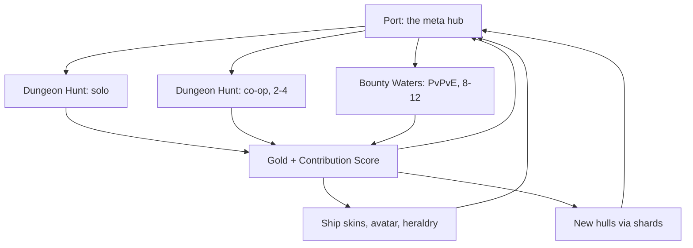

# 01 — Game Overview

## Core fantasy

You are a pirate captain alone against the sea. Not a hero — a scavenger with a ship that is barely holding together, sailing into water that is actively trying to kill you because the alternative is being poor.

The fantasy is **escalating, barely-controlled power**. You start with two rusty cannons that fire slowly. Fifteen minutes later you are a floating fortress laying down a wall of iron in every direction, and the screen is a solid mass of dying sea monsters. The pleasure of a survivor-like is the curve from fragility to absurdity, and the pleasure of a *pirate* survivor-like is that the absurdity is broadsides.

## Design pillars

Four pillars. Every feature in these documents should be traceable to at least one, and anything that violates one needs an argument.

### 1. Movement is aiming

The genre's defining weakness is that the player only positions; the game shoots. We fix that without adding an aim stick. Cannons fire perpendicular to your hull, so steering to present your broadside *is* targeting. A skilled player carves circles around a mob pack, keeping it in the firing arc. An unskilled one drives straight at it and wonders why nothing is dying.

This single decision earns the pirate theme instead of decorating with it, and it is the reason this is not a Vampire Survivors reskin. Full spec in [03 — Core Combat](03-core-combat-and-progression.md).

### 2. Every run pays

You never leave with nothing. Death still banks your gold and your Contribution Score. The run's *bonus* is what you gamble by pushing deeper, not the run itself. This matters more than usual here because the economy pays for participation, and a mode that can zero you out is a mode people stop playing.

### 3. Risk is chosen, visible, and reversible

Wherever the player takes on risk — a deeper Tide Level, hunting a captain instead of farming mobs, taking the face-down card — the choice is explicit, the consequence is legible to other players, and there is a way back. No hidden difficulty modifiers, no invisible aggro rules, no punishment the player could not have seen coming.

### 4. Grind is never gated

No stamina. No energy. No daily cap. No "come back in four hours." If someone wants to play for ten hours they should be able to, and they should earn the whole time.

This is unusual for the genre's business model and it is affordable specifically because of how the token works: emission is fixed per unit of time regardless of how many people play or how hard. Playtime costs the treasury nothing. See [06 — Economy](06-economy-and-tokenomics.md).

## The three modes

### Dungeon Hunt — solo

The default mode and the one everything else is built on top of. A fifteen-to-twenty minute run into a **Tide Level** — a depth tier that sets enemy density, elite frequency, and reward multiplier. Kill monsters, level up, draft power-ups, survive escalating waves, fight a boss, extract with gold.

Target session: **15 minutes**, with Tide Levels 1–3 running shorter (8–12 min) as an on-ramp.

### Dungeon Hunt — co-op

Two to four captains, same structure, shared arena. Enemy density and boss health scale with party size, but not linearly — a four-stack should feel meaningfully stronger than a solo player, because otherwise there is no reason to bring friends.

The co-op-specific mechanic is the **Convoy bonus**: staying in loose formation with an ally grants both of you a stacking buff that decays with distance. It rewards fighting together without forcing you to hug, and it gives co-op a texture solo does not have.

Downed players become drifting wrecks rather than dying outright; an ally sailing over the wreck revives them. Loot is instanced, so there is nothing to steal and no reason to resent your teammates.

Target session: **15–20 minutes**.

### Bounty Waters — PvPvE

Eight to twelve captains on one small map with a monster population. Kill monsters for safe, modest XP. Kill captains for dangerous, large XP. Level up, draft, and try to be the biggest thing on the water when the storm closes.

The design problem this mode exists to solve is making both paths viable *simultaneously* rather than one dominating. The answer is that XP is a droppable resource — die and you scatter a share of what you banked — so farming quietly is not actually safe, and hunting is how you convert someone else's patience into your own power.

Target session: **8–10 minutes**.

Full spec in [05 — Bounty Waters](05-mode-pvpve.md).

## Session length rationale

| Mode | Target | Why |
| --- | --- | --- |
| Dungeon Hunt, Tide 1–3 | 8–12 min | Onboarding. Must fit a commute or a lunch break. |
| Dungeon Hunt, Tide 4+ | 15–20 min | Long enough for a full build to come online and peak. |
| Co-op | 15–20 min | Matches solo so parties can form from the same queue expectations. |
| Bounty Waters | 8–10 min | Short enough that a bad match does not sting. Competitive modes need fast re-queue. |

The hard constraint across all of them: a player should be able to finish one session in under twenty minutes. Anything longer and the "one more run" loop breaks.

## What the player keeps

Three currencies, deliberately separated so that none of them can buy power.

- **Gold** — earned every run, off-chain, non-tradeable. Buys cosmetics only. This is the bottomless sink that absorbs playtime.
- **Ship Shards** — themed drops that unlock new hull builds. Progression breadth, not vertical power.
- **`$PLUNDER`** — the fixed-emission reward token, distributed proportionally to Contribution Score. Never buys power. Deferred to a later season; the game ships without it.

Vertical power lives entirely inside a run and resets when the run ends. There is no permanent stat ladder, because a permanent stat ladder in a game with a token is a pay-to-win accusation waiting to happen.

## Audience and positioning

Primary audience is the survivor-like player: mobile and PC, short sessions, high tolerance for grind, motivated by build variety and numbers going up.

Secondary audience is the Pirate Nation community and the broader "play and earn without a job simulator" crowd, who are notably tired of energy systems.

Positioning against the field:

- **Versus Survivor.io and Vampire Survivors** — real aiming through hull orientation, plus a competitive mode. Those games have no PvP.
- **Versus web3 survivor-likes** — no stamina gate, no NFT purchase requirement to play, and an emission model where whales cannot mint more supply by spending more.
- **Versus extraction shooters** — far lower time commitment and far lower loss on death, but the same "someone else's greed is my payday" tension in Bounty Waters.

## Non-goals

Stating these now to prevent scope drift later.

- **Not an MMO.** No persistent shared world. Port is a menu, not a hub you sail around.
- **Not a ship builder.** You pick a hull and cosmetics. You do not place individual cannons.
- **Not a crafting game.** The art library has a full gather-craft-equip pipeline and we are deliberately not using most of it. See [02](02-asset-audit-and-gaps.md).
- **Not PvP-first.** Bounty Waters is the third mode built, not the first. It depends on combat that has already been tuned in PvE.
- **Not launching with a token.** See [06](06-economy-and-tokenomics.md) for why shipping the token late is the correct sequencing rather than a compromise.

## Open questions

These need answers before the vertical slice, and are flagged wherever they recur.

1. **Engine.** Unresolved, and it has economic consequences — a deterministic simulation enables replay-verified Contribution Scores, and not every candidate can provide one. See [08](08-engine-and-tech.md).
2. **3D or pre-rendered 2D.** The library supports both. 2D is dramatically cheaper to run and reaches more devices; 3D is more flexible and needs no sprite-baking pipeline. See [02](02-asset-audit-and-gaps.md) and [08](08-engine-and-tech.md).
3. **Mobile at launch or after.** Affects enemy count budget, which affects the feel of the entire genre.
4. **Art licensing.** The Pirate Nation library's terms for a derivative commercial game are not established in these documents and need a real answer before production spend.
