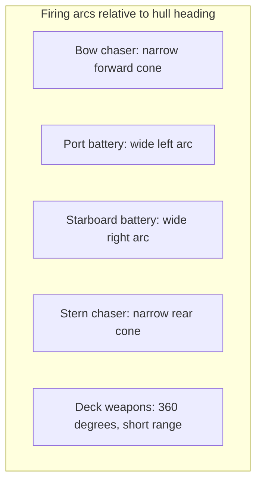
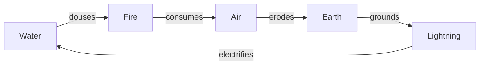

# 03 — Core Combat and Progression

This document specifies the moment-to-moment game. It applies identically to all three modes; [04](04-modes-solo-and-coop.md) and [05](05-mode-pvpve.md) only change what wraps around it.

All numbers marked `[TUNE]` are starting points for playtesting, not decisions.

## Broadside Doctrine

**The rule: your cannons fire perpendicular to your hull, and you cannot aim them.**

In Vampire Survivors and Survivor.io the player positions and the game shoots, usually at the nearest target. Movement matters for survival but not for damage. That is the genre's largest weakness and the reason its skill ceiling is low.

Here, the main batteries are mounted on the port and starboard sides. They fire automatically, but only into their arcs. So the way you deal damage is by **steering to keep enemies in the arc** — which means the movement input and the aiming input are the same thing.

### Why this works

A skilled player fights in **arcs**. They approach a mob cluster at an angle, turn hard to sweep the broadside across it, then peel away and come back around. The motion is a series of overlapping circles, and it looks like naval combat because it is naval combat.

An unskilled player drives straight at the cluster and does almost nothing, because the bow chaser is their weakest mount.

Crucially, this is legible within thirty seconds of play without a tutorial. Enemies die on your sides and survive in front of you. Players work it out.

### The tradeoff

This makes the game harder than its competitors, and harder is not automatically better in a genre defined by accessibility. Three mitigations, all in the design already:

1. **Deck weapons are the accessibility valve.** They fire in all directions and require no positioning. A player who never learns arc management can still build a viable, if lower-ceiling, deck-heavy build.
2. **Both broadsides fire simultaneously.** You are never covering only one side, so the punishing case is enemies directly fore or aft — which is a much smaller failure window than a single-side arc would be.
3. **Turn rate is a stat that can be bought.** Struggling players will naturally take turn-rate passives, which is exactly the correct self-correction.

### Controls

One analogue input. Left stick, WASD, or touch-drag sets a heading; the ship accelerates toward it and rotates at its hull turn rate. **There is no aim input, no fire button, and no dash button on the base kit.** Dashes and repositioning abilities are earned as power-ups.

Ships have momentum. They do not stop instantly and they do not turn instantly. This is the source of both the naval feel and the skill expression, and it should be tuned toward responsive rather than realistic — closer to a car than a boat.

## The hull roster

Five hulls, drawn from the five classes that recur across `Voxel Game Assets/ships/`. These are the "characters" of the game.

| Hull | Hull HP | Speed | Turn rate | Broadside arc | Starting kit | Feel |
| --- | --- | --- | --- | --- | --- | --- |
| **Skiff** | 60 | 130% | 160% | 70° | Light Cannons | Fast, fragile, forgiving to steer, punishing to be hit |
| **Sloop** | 100 | 100% | 100% | 90° | Iron Cannons | The default. Every system tuned against this. |
| **Frigate** | 130 | 85% | 75% | 110° | Long Nines | Heavy broadside, wide arc, commits to turns |
| **Galleon** | 180 | 70% | 55% | 120° | Carronades | A fortress. Hard to steer, hard to kill. |
| **Marauder** | 75 | 115% | 120% | 60° | Twin Barrels | Glass cannon. Narrow arc, highest damage, dies to mistakes. |

The design intent is that **arc width and turn rate trade against each other**. The Galleon has a huge arc precisely because it cannot turn; the Marauder must be flown precisely because its arc is narrow. Both are viable, and they play completely differently.

Hulls unlock via **Ship Shards** (`Voxel Game Assets/ship_shards/`). The Sloop is free at account creation.

Theme skins (Undead, Mecha, Viking, Disco, and the other 65) are **purely cosmetic** and change nothing. This is non-negotiable: the moment a purchasable skin has a stat, the game has a pay-to-win problem it cannot argue its way out of, and the economy in [06](06-economy-and-tokenomics.md) depends on that separation holding.

## Weapons

Six weapon slots. Every weapon belongs to an **arc family**, which determines where it fires. Arc family is the strategic layer — a build of six broadside weapons is devastating and completely blind fore and aft.

### Arc families

| Family | Fires | Character | Example cards |
| --- | --- | --- | --- |
| **Broadside** | Port and starboard arcs | Highest DPS, demands arc management | `Cannon_Blast`, `Long_9s`, `Carronade`, `Scatter_Shot` |
| **Chaser** | Narrow fore and aft cones | Covers the blind spots, low DPS, long range | `Musket_Shot`, `Harpoon_The_Hull`, `Clean_Shot` |
| **Deck** | 360°, short range | No positioning required, panic clear | `Bombardment`, `Rain_of_Iron`, `Tail_Sweep` |
| **Trailing** | Drops behind the hull | Rewards being chased, area denial | `Hit_the_Dry_Powder`, `Slow_Drip` |
| **Orbital** | Circles the hull | Passive contact damage, always-on | `Iron_Fangs`, `Barbed_Shield`, `Coiled_Strike` |

Card art for all of these exists in `Combat Cards/` — see [02](02-asset-audit-and-gaps.md#power-up-cards).

### Weapon stats

Each weapon carries: base damage, fire interval, projectile count, pierce, projectile speed, range, knockback, and an element. Levels 1–5 improve these; level 5 makes the weapon eligible for evolution.

### Starting weapon

Every hull starts with one broadside weapon at level 1 and five empty slots. The first draft is guaranteed to offer at least one weapon so the player is never stat-padding an empty build.

## Passives

Six passive slots, filled from the same draft. Passives modify stats globally.

| Passive | Effect | Card art |
| --- | --- | --- |
| Powder Charge | +damage | `Card_Art_Extra_Power.png` |
| Ramrod | +fire rate | `Card_Art_Reload.png` |
| Rigging | +turn rate | `Card_Art_Swift_Course.png` |
| Sailcloth | +movement speed | `Card_Art_Fleetfoot.png` |
| Hull Plating | +max HP | `Card_Art_Hardened_Shield.png` |
| Ballast | +knockback resistance, −turn rate | `Card_Art_Fortitude.png` |
| Spyglass | +range and arc width | `Card_Art_Steady_Aim.png` |
| Lodestone | +pickup radius | `Card_Art_Sticky_Fingers.png` |
| Ship's Cook | +HP regeneration | `Card_Art_Continuous_Repairs.png` |
| Luck of the Draw | +rarity weight in future drafts | `Card_Art_Stack_The_Deck.png` |
| Cooper | +projectile count on Broadside weapons | `Card_Art_Double_Barrel.png` |
| Powder Monkey | −fire interval on Deck weapons | `Card_Art_Fast_Hands.png` |

Passives also gate evolutions, which is the reason to take them rather than stacking weapons.

## Evolutions

The genre's signature moment. A weapon at level 5 paired with a specific passive at max level upgrades into an evolved form that is qualitatively different, not just numerically bigger.

The card library makes this almost free — the dramatic names are obviously evolved versions of the plain ones.

| Weapon (Lv5) | + Passive (max) | Evolves into | Behaviour change |
| --- | --- | --- | --- |
| `Cannon_Blast` | Ramrod | **`Storm_of_Iron`** | Continuous stream, no fire interval |
| `Scatter_Shot` | Cooper | **`Rain_of_Iron`** | Shotgun becomes a persistent falling barrage |
| `Long_9s` | Spyglass | **`Hull_Piercer`** | Infinite pierce, full screen length |
| `Carronade` | Powder Charge | **`Breach_the_Hull`** | Massive single shell, explodes on impact |
| `Iron_Fangs` | Hull Plating | **`Barnacle_Barrier`** | Orbitals become a damaging shield that blocks projectiles |
| `Harpoon_The_Hull` | Lodestone | **`Iron_Tides`** | Harpoons drag enemies to you and hold them |
| `Bombardment` | Powder Monkey | **`Thunder_Struck`** | Chains lightning between everything hit |
| `Musket_Shot` | Spyglass | **`DeadEye`** | Auto-targets the highest-HP enemy, always crits |
| Any lifesteal weapon | Ship's Cook | **`Vampiric_Rain`** | Lifesteal becomes area-of-effect |
| `Slow_Drip` | Powder Charge | **`Hit_the_Dry_Powder`** | Trail detonates in a chain |

Evolutions are announced with a full-screen flash and a distinct sound. They are the emotional peak of a run and should be over-produced.

## Elements

Five elements plus neutral, taken directly from the enemy variants that already exist in `Voxel Game Assets/Mob Enemies/`. Every mob ships in fire, water, air, earth, lightning, and neutral, so this system costs nothing in art and multiplies encounter variety by five.

### The affinity wheel

Each element deals `[TUNE: 150%]` damage to the element it beats and `[TUNE: 65%]` to the element that beats it. Neutral deals and takes 100% from everything.

A simple five-cycle is deliberate over a pentagram where each element beats two. Players need to hold this in their head mid-fight while dodging, and "one up, one down" is memorable in a way that "two up, two down" is not.

### How the player interacts with it

- **Weapons carry an element**, set by the cards drafted into them. Some cards are elementally flavoured (`Card_Art_Thunder_Struck.png`, `Card_Art_Phoenix_Armor.png`) and convert a weapon's damage type.
- **`Amplify_Affinity`** boosts your dominant element and is the payoff card for a mono-element build.
- **Waves are elementally themed** and telegraphed one wave ahead, so the player can draft toward the counter. This is the main reason the draft feels tactical rather than random — you are not picking the best card in the abstract, you are picking against what is coming.
- **Elite and boss enemies** carry an element shown on their health bar.

A mono-element build hits enormously hard into its counter and struggles badly into its predator. A mixed build is never bad and never great. That is a real decision and it repeats every run.

## The level-up draft

Collect XP from kills, level up, pause, choose one of three cards.

### Offer rules

The draft is where a survivor-like either feels smart or feels like a slot machine. These rules exist to keep it on the correct side.

1. **Three cards, always.** Never two, never four. Consistency makes the decision fast.
2. **The first draft always offers at least one weapon.** No opening on three passives.
3. **Maxed items are never offered.** Obvious, and frequently gotten wrong.
4. **If any owned weapon or passive is one level from enabling an evolution, its partner is weighted up heavily** `[TUNE: 3x]`. The game should help a player finish the build they are visibly reaching for. Nothing feels worse than being denied the last piece by RNG for six levels.
5. **At most one card of a family the player already has six of.** Prevents the draft from becoming useless when slots are full.
6. **When all twelve slots are full**, the pool becomes level-ups for owned items, plus consumables (heal, gold, temporary buff).

### Rarity

| Rarity | Base weight | Effect |
| --- | --- | --- |
| Common | 60% | Standard level-up |
| Uncommon | 25% | +1 extra level, or a minor secondary effect |
| Rare | 12% | +2 levels, or a build-defining modifier |
| Legendary | 3% | Unique effect; only source of certain behaviours |

`Luck of the Draw` shifts these weights. Card frames per rarity are the highest-priority UI chrome item in [02](02-asset-audit-and-gaps.md#p1--ui-chrome).

### Reroll and banish

Two draft-manipulation resources, both **earned in-run rather than purchased**:

- **Reroll** — discard the three offers and draw three more. Earned every `[TUNE: 30]` mob kills.
- **Banish** — permanently remove one card from this run's pool. Earned at every `[TUNE: 5th]` level.

These exist for two reasons. They convert bad luck into a resource problem, which is much less frustrating than pure RNG. And in Bounty Waters they become the mechanism by which farming monsters buys you draft control — see [05](05-mode-pvpve.md).

Card art exists: `Card_Art_Rummage.png` for reroll, `Card_Art_Do_It_Again.png` and `Card_Art_DejaVu.png` for related effects.

### XP curve

XP required for level *n*: `base * n^1.35` `[TUNE]`.

Target pacing in a 15-minute run: about **8 levels in the first five minutes**, 6 in the second five, and 4 in the last five. Front-loading is intentional — the early game must feel generous, and by the late game each choice matters more because there are fewer of them left.

XP orbs drop from every kill (`world items/UI/XP_Star/`) and are drawn in within the pickup radius.

## Stats reference

The full player stat block. Everything in the game modifies one of these.

| Stat | Base | Notes |
| --- | --- | --- |
| Hull HP | Per hull | No shields by default; shields are a drafted effect |
| Move speed | Per hull | |
| Turn rate | Per hull | The most valuable stat under Broadside Doctrine |
| Damage multiplier | 100% | Global |
| Fire rate multiplier | 100% | Global |
| Projectile count bonus | +0 | Additive per weapon |
| Pierce | Per weapon | |
| Range multiplier | 100% | |
| Arc width bonus | +0° | Widens broadside arcs |
| Knockback | Per weapon | |
| Pickup radius | Base | |
| HP regeneration | 0/s | |
| Rarity weight | 1.0 | Affects draft |
| Element affinity | Neutral | |

Deliberately absent: critical hit chance as a base stat. Crits are a drafted effect only (`Card_Art_Critical_Target.png`, `Card_Art_DeadEye.png`), so that they read as a build choice rather than as invisible background variance.

## Enemy behaviour archetypes

Twenty-five creatures, but only six behaviours. Reusing behaviours across models is how the enemy roster stays cheap while looking varied.

| Archetype | Behaviour | Creatures |
| --- | --- | --- |
| **Swarmer** | Direct pursuit, low HP, high count | Kelpling, Trilobite, Blowfish, Megasquito |
| **Charger** | Winds up, then dashes in a straight line | Hammerdead Shark, Mecha Hammerhead, Hexa Croc |
| **Ranged** | Maintains distance, fires projectiles | Anglerfish, Harpy, Shipwrecked Spirit |
| **Orbiter** | Circles at a fixed radius, strafes | Giant Squid, Mutant Jellyfish, Sea Lion |
| **Bruiser** | Slow, heavy, high HP, area attack | Charybdis, Demogorgon Whale, Deep One, Crasher |
| **Elite** | Any of the above with a modifier aura | Wyvern (the only explicitly Rare-tiered mob), Mist Monster |

Mist Monster deserves special mention: it has two model sets per element (`mistmonster_creature` and `mistmonster_mist`), so it can transition between a vulnerable body and an invulnerable cloud state. That is a free, genuinely interesting mechanic sitting in the asset library.

## Feel checklist

The genre lives or dies on feedback, not systems. This list is the acceptance criteria for the vertical slice, and it is not optional polish.

- Every hit produces a visible impact and a distinct sound
- Damage numbers pop and scatter
- Enemies flash white on hit and dissolve on death, never just disappear
- Screen shake scales with damage dealt, with an intensity slider for accessibility
- XP orbs magnetise with acceleration and a satisfying absorb blip
- Level-up freezes the frame briefly before the card screen animates in
- Evolutions get a full-screen effect and a unique sting
- Killing a hundred enemies at once should be visually overwhelming and audibly satisfying

If the game does not pass this list, no amount of systems design will save it.
