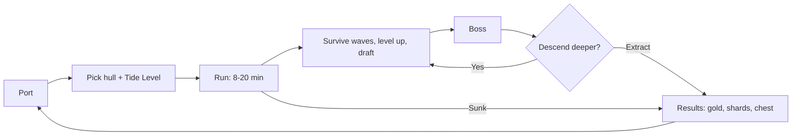

# 04 — Dungeon Hunt: Solo and Co-op

The PvE mode. This is the game's foundation: it ships first, it is where combat gets tuned, and both other modes reuse its systems. Co-op is the same mode with more captains, not a separate design.

Combat rules are in [03](03-core-combat-and-progression.md). This document covers what wraps around a run.

## The loop



Two ways a run ends: you extract, or you sink. Both pay out. What differs is the **Depth Bonus**, which is the thing you are actually gambling.

## Tide Levels

The difficulty and reward tier, chosen before the run. This is the primary risk dial and the reason a veteran and a newcomer can play the same mode.

| Tide | Unlock | Duration | Enemy HP | Enemy density | Elite rate | Reward mult. | Biome |
| --- | --- | --- | --- | --- | --- | --- | --- |
| 1 | Default | 8 min | 100% | 100% | 3% | 1.0x | Shallows (sand) |
| 2 | Clear T1 | 10 min | 140% | 120% | 5% | 1.4x | Shallows |
| 3 | Clear T2 | 12 min | 190% | 145% | 7% | 1.9x | Reef (stone) |
| 4 | Clear T3 | 15 min | 260% | 175% | 10% | 2.6x | Reef |
| 5 | Clear T4 | 15 min | 350% | 205% | 13% | 3.6x | Overgrown (grass) |
| 6 | Clear T5 | 18 min | 480% | 240% | 16% | 5.0x | Overgrown |
| 7 | Clear T6 | 18 min | 650% | 280% | 20% | 7.0x | Volcanic (lava) |
| 8 | Clear T7 | 20 min | 880% | 325% | 25% | 9.8x | Volcanic |
| 9+ | Endless | 20 min | ×1.35/tier | ×1.16/tier | +4%/tier | ×1.4/tier | Frozen, then cycles |

All values `[TUNE]`.

Three properties matter about this table:

**Reward scales faster than difficulty feels.** Enemy HP grows about 35% per tier while reward grows 40%. Pushing one tier deeper should always be tempting, and always slightly reckless.

**Enemy density matters more than HP.** In a survivor-like, density is what creates the fantasy and the danger simultaneously. Doubling HP makes the game tedious; doubling density makes it thrilling. Density is capped by the performance budget, which is the real ceiling on the top Tide — see [08](08-engine-and-tech.md).

**Biomes come free.** Every biome above maps to tiles already in `Voxel Game Assets/world items/Terrain Textures/` (`top_sand_light.png`, `top_stone.png`, `top_grass.png`, `top_lava.png`, `top_snow.png`) with transition pieces included. Obstacles come from `world items/Decorations/` — shipwrecks and coral in the reef, ruins and totems in the overgrown, lava pools in the volcanic.

Tides 6 and above require a **key** to enter, which is the economy's per-account cost gate. See [06](06-economy-and-tokenomics.md#per-account-cost).

## Run timeline

A Tide 4 run, as the reference case. Times scale proportionally at other Tides.

| Time | Event | Purpose |
| --- | --- | --- |
| 0:00 | Spawn, trickle of Swarmers | Let the player feel their hull |
| 0:30 | First level-up expected | Draft screen introduced early |
| 1:00 | Density ramps; first Chargers | Teach the arc |
| 2:30 | **Wave: elementally themed swarm** | First affinity decision |
| 3:00 | First Elite (Wyvern) | Introduce a health bar that matters |
| 4:00 | Chest drops (`chests/Tiered Chests/chest_common`) | Reward beat |
| 5:00 | **Mini-boss: Giant Crab** | First real check |
| 6:00 | Density spike; Ranged archetype enters | Force movement |
| 7:30 | **Wave: opposing element** | Punish mono-element overcommitment |
| 8:00 | Elite pair | |
| 9:00 | Treasure event: a dense gold cluster in a dangerous position | Greed decision |
| 10:00 | **Mini-boss: Giant Turtle** | |
| 11:00 | Sustained high density, all archetypes | Build should be peaking |
| 12:30 | Pre-boss lull | Deliberate quiet before the finale |
| 13:00 | **Boss: Sea Serpent** | |
| 14:00 | Boss defeated → extract or descend | The gamble |

The lull at 12:30 matters. Continuous escalation numbs the player; a fifteen-second quiet moment makes the boss entrance land.

### Boss assignment

Bosses come from `world items/World Bosses/` — see [02](02-asset-audit-and-gaps.md#bosses).

| Tide | Boss |
| --- | --- |
| 1–3 | Megalodon (Bruce) |
| 4–6 | Sea Serpent (Jorgamandr) |
| 7–8 | Kraken (Urza) |
| 9+ | C'thulhu |
| Mini-bosses, all tiers | Giant Crab, Giant Turtle |
| Events | Giant Goldfish, Kevin |

Bosses use telegraphed area attacks with visible ground indicators — a P0 VFX item in [02](02-asset-audit-and-gaps.md#p0--vfx). A boss that kills you without a readable telegraph is a bug, not difficulty.

## Descend or extract

After every boss, the run offers a choice: **extract now**, or **descend one Tide deeper and keep your build**.

Descending carries your entire build into a higher Tide with a fresh wave timeline. The Depth Bonus compounds `[TUNE: ×1.5 per descent]`. Sinking loses the accumulated Depth Bonus but keeps everything else.

This is the mode's central tension and it is a much better greed mechanic than a difficulty slider, because the decision is made repeatedly under information — you know exactly how strong your build is and exactly how close the last boss came to killing you.

## Death and payout

**Sinking is not a wipe.** Per pillar two in [01](01-game-overview.md#2-every-run-pays):

| On sinking you keep | On sinking you lose |
| --- | --- |
| All gold collected during the run | The Depth Bonus multiplier |
| All Ship Shards collected | The end-of-run chest tier bonus |
| Full Contribution Score earned | |
| Any achievement progress | |

There is no equipment loss, no durability, and no consumable burn. The run's *upside* is what you gamble, never the floor.

### Gold formula

```
gold = (mobs × mobValue + elites × eliteValue + bosses × bossValue)
       × tideMultiplier
       × depthBonus
       × (extracted ? 1.25 : 1.0)
```

The extraction bonus is deliberately modest. It should nudge toward extracting without making descending feel punished.

Gold is off-chain, non-tradeable, and buys cosmetics only.

### End-of-run chest

Chest tier is set by performance — waves survived, Tide reached, boss kills. Art from `chests/Tiered Chests/`: `chest_common` → `chest_uncommon` → `chest_rare` → `chest_epic`, each with open and closed states.

Chests contain gold, Ship Shards biased toward themes the player has partial sets of, and cosmetic drops. Never power.

## Co-op

Two to four captains, same arena, same timeline. Everything above applies unchanged except what follows.

### Party scaling

Scaling in co-op games is usually wrong in one of two directions: scale too hard and a group is weaker than a solo player, scale too little and grouping is strictly optimal. Deliberately, **grouping is slightly optimal** — the game wants people to bring friends.

| Party size | Enemy density | Enemy HP | Boss HP | Reward per player |
| --- | --- | --- | --- | --- |
| 1 | 100% | 100% | 100% | 100% |
| 2 | 175% | 110% | 190% | 95% |
| 3 | 245% | 120% | 275% | 92% |
| 4 | 310% | 130% | 355% | 90% |

All `[TUNE]`. Density scales sublinearly so that four players face more total enemies but fewer each, which is what makes a group feel powerful. Per-player reward dips slightly, but total party reward rises steeply, and the reduced risk of dying makes grouping clearly worthwhile in practice.

### Convoy bonus

The mechanic that gives co-op a texture solo does not have.

Captains within `[TUNE: 15 units]` of an ally gain a stacking **Convoy** buff: `[TUNE: +8% damage and +8% fire rate per nearby ally]`, decaying smoothly to zero at `[TUNE: 25 units]`.

The design intent is to reward fighting *near* each other without forcing players to overlap. Overlapping is bad in a survivor-like — everyone gets caught by the same area attack, and the screen becomes unreadable. Loose formation is the correct spacing and this buff pays for exactly that.

Visually it renders as light ropes or wake lines between allied ships, fading with distance. Cheap to build, extremely readable, and it makes a four-stack look like an actual fleet.

### Downed and revive

Captains do not die instantly. At zero hull they become a **drifting wreck**: immobile, invulnerable, out of the fight, on a `[TUNE: 45 second]` timer.

An ally sailing over the wreck revives them over `[TUNE: 3 seconds]` of continuous contact, at `[TUNE: 40%]` hull. If the timer expires, that captain is out until the next wave break, then respawns at `[TUNE: 30%]` hull with `[TUNE: 25%]` of their XP-to-next-level lost.

Reviving is deliberately risky. The wreck sits wherever the player died, which is by definition somewhere dangerous, and the rescuer has to hold position there. That is the moment co-op exists for.

**Nobody is ever permanently eliminated.** Watching your friends play for eight minutes is how you lose a player forever.

Wreck art can reuse `ships/shipwreck_Heitzmans_Royal_Navy_Frigate/`; the revive beam is a P0 VFX item.

### Loot

**All loot is instanced.** Every player sees and collects their own XP orbs, gold, and chests. Nothing can be stolen, there is nothing to negotiate, and there is no reason to resent a teammate with a large pickup radius.

Pickup radius passives affect only your own instance. This is worth stating explicitly because shared-loot co-op reliably generates player conflict for zero design benefit.

### Matchmaking

Three entry paths: invite friends directly, queue with a party, or public matchmaking by Tide Level. Public matchmaking should not gate on skill rating — this is PvE, and a strong player carrying a weak one is a positive experience for both.

Rejoin-on-disconnect within `[TUNE: 90 seconds]` restores the player's build and position.

## Difficulty scaling curves

Reference formulas so that Tide, party size, and time-in-run compose predictably rather than multiplying into nonsense.

```
enemyHP        = base × tideHP[tide] × partyHP[size] × (1 + 0.04 × minutesElapsed)
enemyDensity   = base × tideDensity[tide] × partyDensity[size] × densityCurve(minutesElapsed)
eliteChance    = tideEliteRate[tide] + 0.01 × floor(minutesElapsed / 2)
bossHP         = base × tideHP[tide] × partyBoss[size]
```

`densityCurve` is a stepped ramp with plateaus rather than a smooth line. Plateaus are what let a player feel their build come online; a smooth curve makes power gain invisible because the challenge rises exactly as fast.

**Hard cap on concurrent entities** is a platform decision, not a design one. It sets the real ceiling on the top playable Tide, and it needs to be established before content is tuned. See [08](08-engine-and-tech.md).

## Contribution Score from PvE

Both modes feed the token economy. The full formula is in [06](06-economy-and-tokenomics.md); what matters here is which run properties are measured:

- Tide Level reached, weighted **convexly** — deep runs pay superlinearly, which is what makes consolidating effort on one account beat spreading it across many
- Waves survived
- Boss and elite kills
- Damage dealt, capped per enemy so overkill does not inflate
- Descent chain length
- Co-op revives performed, so supporting a team is scored rather than punished

Deliberately **not** measured: raw session time, raw kill count. Both are trivially botted and neither correlates with contribution.

## Open questions

1. **Does descending need a new arena, or is a reskin sufficient?** A full arena transition costs load time in the middle of the mode's best moment.
2. **Should co-op allow duplicate hulls?** Four Galleons is thematically dull but restricting it hurts matchmaking.
3. **Is 45 seconds the right wreck timer?** Too short and revives fail constantly at high Tides; too long and death carries no weight.
4. **Public co-op griefing.** With instanced loot there is little to grief, but a player who deliberately pulls the boss early can ruin a run. Probably needs a vote-to-kick, probably not at launch.
