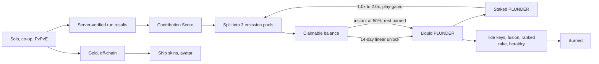

# 06 — Economy and Tokenomics

The token layer is **designed now and shipped later**. Nothing in this document touches a blockchain at launch. See [sequencing](#sequencing-ship-without-the-token) for why that is the correct order rather than a compromise.

All parameter values are proposals for the simulation in [07](07-economy-simulation-spec.md), not commitments.

## Design goals

1. **Reward participation proportionally.** Everyone who plays earns something; nobody is starved.
2. **Make inflation structurally impossible**, not merely discouraged.
3. **Encourage unlimited grinding.** No stamina, no energy, no daily cap. Long sessions are a product goal, and the economy must not fight it.
4. **Resist dumping** through mechanisms that make holding rational rather than through lockups that make holding forced.
5. **Never sell power.** Not for gold, not for tokens, not for fiat.

Goal 3 is unusual and it is the constraint that shapes everything else. Most token games gate play because their emission scales with activity, so more play means more supply. Ours does not, which is what makes uncapped grinding affordable.

## Three currencies, strictly separated

| Currency | Source | Sink | Tradeable | Buys power? |
| --- | --- | --- | --- | --- |
| **Gold** | Every run | Cosmetics | No | Never |
| **Ship Shards** | Run drops, chests | Hull unlocks | No | Breadth only, not vertical power |
| **`$PLUNDER`** | Fixed emission, proportional to Contribution Score | Tide keys, fusion, ranked rake, heraldry | Yes | Never |

The separation is load-bearing. Gold is a bottomless sink that absorbs playtime and converts it into cosmetic expression, with no economic consequence at all. `$PLUNDER` is the value layer. Neither can buy a stat.

This matters more here than in a normal free-to-play game. A tradeable token that buys power is a pay-to-win accusation that cannot be argued away, and it is the specific failure that has killed most games in this category.

## Why the ORE model

[ORE](https://ore.com/) is a proof-of-work token on Solana. Per its [program documentation](https://docs.rs/crate/ore-program/latest), the mechanism is:

- **Fixed linear emission.** Supply grows at a target of 1 ORE per minute, hard-bounded to the range 0–2 regardless of how many miners are active. The reward per valid solution is recalculated every 60 seconds to hold that average.
- **Non-exclusive rewards.** One miner finding a solution does not prevent another from finding one. Every miner who submits valid work is guaranteed a share; nobody can be starved out.
- **Fixed cap.** 21 million total, fully distributed over roughly 40 years.
- **Play-gated staking multiplier.** ORE v2 grants a rewards multiplier of up to 100% based on proportional stake, applied only to miners actually submitting hashes, and therefore not exploitable by flash loans.

The reason this fits a game better than a conventional emission schedule: **the amount of work performed has no effect on the amount of currency created.** Work only affects distribution. Ten players or ten million, one hour of play or sixteen — the supply curve is identical.

That is precisely the property needed to run a game with no energy system.

[ZINC](https://zinc.cash/) contributes a second idea: round-based settlement with rewards accruing per round rather than streaming continuously, which batches settlement cost and creates a natural claim step.

## Emission

| Parameter | Proposed value |
| --- | --- |
| Hard cap | 100,000,000 `$PLUNDER` |
| Emission rate | 500 per hour, fixed |
| Epoch length | 1 hour |
| Emission per epoch | 500, invariant |
| Time to full distribution | ~22.8 years |
| Emission when no one plays | **Zero. Nothing is minted.** |

Emission is flat and linear rather than halving. Halvings create anticipatory speculation cycles and a sawtooth in player yield, both of which are bad for a game where the token is supposed to be a participation reward rather than a trade. ORE made the same choice for the same reason: linear is scale-agnostic and simple to reason about.

**Unminted emission does not roll over.** If an epoch passes with zero contribution, those 500 tokens are never created. The cap is a ceiling, not a schedule, and the token can never be emitted to nobody.

## Contribution Score

`$PLUNDER` is distributed in proportion to **Contribution Score (CS)**, the game's analogue of hash difficulty. CS is computed server-side from verified gameplay, never reported by the client.

### Per-run score

```
rawScore = w_dmg  · damageDealt(capped per enemy)
         + w_wave · wavesSurvived
         + w_boss · bossAndEliteKills
         + w_obj  · objectiveSeconds        // Bounty Waters buoys
         + w_plc  · placementScore          // Bounty Waters finish
         + w_rev  · revivesPerformed        // co-op

depthMult = tideLevel ^ γ                   // PvE,    γ = 1.6
          = lobbyBracket ^ γ_pvp            // PvPvE,  γ_pvp = 1.4

runCS = rawScore × depthMult × modeNormalizer(mode)
```

### Epoch score

```
CS_player = Σ runCS  for all runs completed within the epoch
```

**Linear in volume. No cap, no diminishing returns, no daily limit.** Play for sixteen hours and every hour counts identically.

### What is deliberately not measured

- **Session time.** Trivially botted, uncorrelated with contribution, and rewards AFK.
- **Raw kill count.** Farms the easiest content.
- **Gold collected.** Would couple the two economies.

Damage is capped per enemy so that overkill from a maxed build does not inflate the score of trivial content.

### Why depth is convex

`γ = 1.6` means a Tide 8 run scores far more than four Tide 2 runs of the same duration. This does three things: it points effort at the content that is actually hard, it makes progression matter, and it is central to the sybil argument below.

## Segmented emission pools

Each epoch's 500 tokens are split into pools before distribution. Participants compete only within their pool.

| Pool | Share | Population |
| --- | --- | --- |
| Ranked Bounty Waters | 40% | Competitive players, all brackets |
| Deep Dungeon (Tide 6+) | 35% | Committed PvE grinders |
| Casual (Tide 1–5, all co-op) | 25% | Everyone else |

This is the replacement for a daily cap, and it is strictly better. **Nobody is limited in how much they can play.** A grinder can run Deep Dungeon for sixteen hours and take as large a share of that 35% as their contribution earns. But they cannot reach into the casual pool, so a casual player's yield is protected from dilution by people playing a fundamentally different game.

It also gives a lever for steering behaviour: raising the ranked pool share pulls players into the competitive mode without changing any gameplay.

Pool shares should be reviewable per season, published in advance, and never changed mid-season.

## The distribution formula

```
weight_i  = CS_i × stakeMultiplier_i

share_i   = weight_i / Σ_j weight_j        // over all players in the pool

reward_i  = poolEmission × share_i
```

Every player with `CS > 0` receives a strictly positive reward. This is ORE's no-starvation guarantee and it is not negotiable — a distribution where a small player can round to zero is a distribution people quit.



## Inflation is structurally impossible

Worth stating plainly because it is the whole point.

The supply curve is a function of **time only**. It does not reference the number of players, hours played, enemies killed, or accounts registered. A player who triples their playtime does not create a single additional token; they claim a larger fraction of a constant pool, and every other player's fraction shrinks correspondingly.

This has a direct product consequence: **playtime is free to the treasury**. There is no economic reason for a stamina bar, an energy meter, a daily quest cap, or a "come back in four hours" timer. Removing all of those is not generosity, it is the natural consequence of the emission model.

That is a genuine competitive differentiator. Nearly every game in this category gates play precisely because its emission scales with activity. Ours does not, so "no energy, no caps, grind as hard as you like" is both honest and structurally sound — and it maximises exactly the daily-active and session-length figures that matter to sponsors and partners.

## Sybil and bot resistance

Since there are no per-account caps, this needs care. The good news is that removing caps removes most of the incentive.

### Sybils gain nothing, and lose on two counts

**Caps are what create sybil incentive.** If each account can earn at most X per day, a farmer with 3X of effort must run three accounts. With uncapped, linear-in-volume scoring, one account absorbs unlimited effort, so splitting buys nothing — the same wall-clock hours produce the same total CS whether spread across one account or ten.

Splitting is then strictly *worse*, for two reasons.

**The staking multiplier punishes splitting, whatever its curve.** The multiplier is applied multiplicatively to CS and is increasing in **absolute** stake. Concentrated on one account, a holder earns `CS × (1 + f(S))`. Split evenly across two accounts, they earn `2 × (CS/2) × (1 + f(S/2))` = `CS × (1 + f(S/2))`. Since `f` is increasing, `f(S/2) < f(S)`, so the split earns strictly less. This holds for any increasing `f`, so the property is robust to retuning the curve.

**New accounts start where convexity hurts.** Depth is gated by progression: a fresh account begins at Tide 1, where `tideLevel^1.6` is near its minimum. Reaching the depths that actually score requires clearing the ladder on every account independently.

### Per-account cost

Earning `$PLUNDER` requires holding a **Voyage Key**, consumed on entry to a scoring run, or a minimum stake as an alternative. Art already exists: `Voxel Game Assets/collectibles/pirate_key_paid/`, `world items/UI/Roguelite_Key/`.

Keys are earned in-game at a modest rate and purchasable with `$PLUNDER` — which makes them a sink as well as a gate. N sybil accounts cost N key streams.

This mirrors the on-chain rent and transaction cost that makes ORE accounts non-free.

### Bots are a fairness problem, not a solvency problem

A bot playing continuously is economically identical to a very dedicated human: both dilute other players, neither creates supply. **The economy cannot be broken by botting**, only made to feel unfair. That distinction should govern how much is spent on the problem.

Three mitigations, in order of value:

1. **Replay verification.** If the match simulation is deterministic, a scoring run stores only its input stream, and the server can re-simulate it to confirm the reported Contribution Score. Clients cannot fabricate state. Verify 100% of high-value claims and a sampled fraction of the rest. This punishes fraud rather than punishing effort, which is exactly the right trade given goal 3. **It depends on the engine choice** — see [08](08-engine-and-tech.md).
2. **Ranked is the moat.** Bots lose to humans at high bracket, and ranked carries the largest pool share at 40%. The most valuable pool is the hardest to farm.
3. **Input-stream analysis.** Once inputs are logged for replay, entropy and consistency analysis is nearly free. Bots have characteristically inhuman input distributions.

### If the engine is not deterministic

Replay verification is unavailable and the remaining levers must carry more weight: raise the key cost, raise the ranked pool share, add server-side plausibility bounds on run results, and accept a higher residual bot rate. Flagged as a decision consequence in [08](08-engine-and-tech.md), not a detail.

## Staking multiplier

Directly adapted from ORE v2.

```
stakeMultiplier = 1 + min(1.0, sqrt(stake / stakeReference))
```

Range 1.0x to 2.0x. Concave, so early stake matters most and whales face diminishing returns.

Two rules make this work:

- **Play-gated.** The multiplier applies only in epochs where the account recorded `CS > 0`. Stake alone earns nothing. This is ORE's rule and it is what prevents the token from becoming a pure yield instrument detached from the game.
- **Not flash-loanable.** Stake must be held across the full epoch, with a `[TUNE: 7-day]` unstaking cooldown.

The effect is that the most profitable strategy is to play *and* hold. Selling forfeits your multiplier, which makes dumping directly self-punishing. That is the primary structural answer to the token-dump concern — better than a lockup, because it is a choice the holder makes for their own benefit rather than a restriction imposed on them.

## Sinks

This is where a game beats a pure mining token. **ORE has no sink** — supply only ever grows, and price is entirely a market question. A game can burn.

| Sink | Mechanism | Burn rate |
| --- | --- | --- |
| **Voyage Keys** | Required for scoring runs at Tide 6+ | 100% burned |
| **Deep Tide entry** | Tide 8+ charges an escalating fee | 100% burned |
| **Cosmetic fusion** | Combine two owned ship skins into a themed hybrid | 100% burned |
| **Shard crafting** | Convert shards between themes | 100% burned |
| **Ranked buy-in** | Bounty Waters ranked pot; winners split, house rakes | Rake 100% burned |
| **Heraldry** | Custom flag, sail dye, ship name, crew name | 100% burned |
| **Reroll and banish charges** | Purchasable in ranked, on top of the earned allowance | 100% burned |
| **Season pass** | Cosmetic track | 100% burned |

**Target: net burn between 100% and 140% of emission at expected DAU.**

At that ratio the token is deflationary while the game is growing, which is the opposite of the usual failure where a token only becomes deflationary once the playerbase collapses. Sinks must be priced dynamically against realised emission, not fixed at nominal values, or they decouple the moment token price moves. Modelling this is the core job of [07](07-economy-simulation-spec.md).

Note that every sink above is either a **cosmetic** or an **access gate**. None of them sell power. That constraint makes sink design harder and is worth the difficulty.

## Claim and vesting

Rewards accrue as a **claimable balance**, not as liquid tokens. ORE has the same explicit `Claim` step.

Two ways to realise a balance:

- **Vested claim** — 100% of the balance, unlocking linearly over `[TUNE: 14 days]`
- **Instant claim** — `[TUNE: 50%]` immediately; the remaining 50% is **burned**

The instant option is deliberately generous enough to be tempting. Every player who takes it burns supply, which means impatience is converted into deflation instead of into sell pressure. Players who want the full amount wait, which spreads sell pressure across two weeks.

No cliff and no lockup. Forced lockups create a synchronised unlock event, which is the single most reliable way to produce a price collapse.

## The gold economy

Entirely separate, off-chain, and much simpler.

**Faucet:** every run pays gold scaled by Tide, performance, and Depth Bonus. Uncapped.

**Sink:** ship cosmetics from roughly 286 builds across 69 themes (`Voxel Game Assets/ships/`), avatar cosmetics from ~291 modular slot pieces plus 34 full-body skins (`Voxel Game Assets/Avatar/`, `Pirate Skins/`), and heraldry.

Gold does not need careful balancing because it is non-tradeable and buys nothing that affects play. If a player accumulates far too much, the only consequence is that they own a lot of hats. Price the catalogue so that a committed player is still unlocking things at the twelve-month mark, and stop worrying about it.

The scale here is genuinely unusual: this is more cosmetic content than most live games ship in three years, and it already exists. See [02](02-asset-audit-and-gaps.md).

## The tension worth naming

**Uncapped grinding plus fixed emission means per-player yield falls as the game grows.**

If the playerbase multiplies by ten and every player's effort stays constant, each player's token yield divides by ten. A dedicated grinder will experience the game becoming more popular as their income dropping, even though their absolute effort rose. This is the honest cost of the model and it should not be buried in a footnote.

Four things offset it, none of which fully solve it:

1. **Segmented pools** keep casual growth from diluting the deep pool and vice versa.
2. **The staking multiplier** lets committed players compound their position rather than only their playtime.
3. **Burns** tighten supply as activity rises, since most sinks scale with engagement.
4. **Token price** typically rises with the playerbase, so unit yield falls while fiat yield may not.

The fourth is the real answer and it is the one outside our control. It gets an explicit stress test in [07](07-economy-simulation-spec.md), framed as *perceived yield floor for a top-decile grinder at 10x DAU*.

Communicate this honestly from day one. Players discover dilution regardless; the only variable is whether they feel misled when they do.

## Sequencing: ship without the token

**Recommendation: launch with gold only. Add `$PLUNDER` in a later season.**

Three reasons.

A token is a multiplier on retention, not a substitute for it. Proportional distribution requires meaningful contribution to be proportional *to*; if the game has no players, the mechanism has nothing to work with.

Sink calibration needs real data. The 100–140% burn target depends on actual player behaviour — how many keys get bought, how often people fuse cosmetics, what ranked participation looks like. Guessing those numbers pre-launch and hard-coding them into contracts is how token economies break.

And launching without a token lets the game be judged as a game. That is worth a great deal for a title in this category, and it is unrecoverable if skipped.

The design should nonetheless be built into the architecture from the start: log Contribution Score from the first day of soft launch, run the ledger, and show players what they *would* have earned. That produces months of real distribution data before a single token exists, and it is the highest-value thing the simulation in [07](07-economy-simulation-spec.md) can be validated against.

## Open questions

1. **Chain.** Deferred by decision. Solana matches ORE and ZINC and has the cheapest per-claim cost; Proof of Play Apex keeps the game native to Pirate Nation. Revisit when the token is real.
2. **Is 500/hour the right rate?** Depends entirely on target token price and expected DAU. Output of [07](07-economy-simulation-spec.md), not an input.
3. **Should Ship Shards be tradeable?** Tradeable shards create a real secondary market and a genuine pay-to-skip-progression accusation. Currently no.
4. **Season resets.** Does the ranked pool reset rank each season, and does that reset staking? Probably rank yes, stake no.
5. **Governance.** Deliberately absent. A governance token is a different product with different obligations and should not be bolted on by default.
6. **Regulatory.** Not addressed here and needs real counsel before any token exists. A reward token tied to gameplay participation, with staking yield, sits in a region where jurisdiction matters a great deal.
