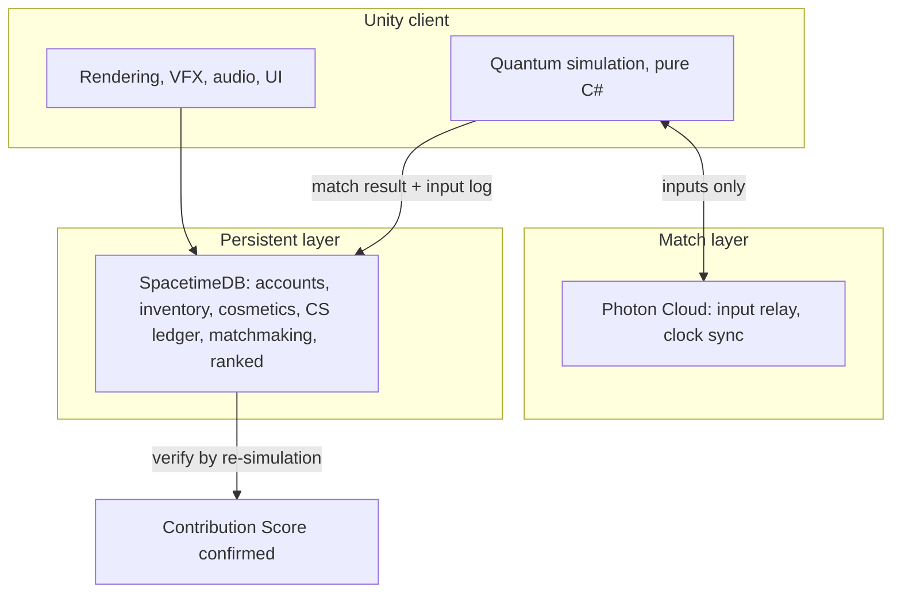

# 08 — Engine and Technology

> **Update (MagicBlock integration):** Co-op multiplayer now uses **MagicBlock Ephemeral Rollups** as the authoritative match server. Combat runs in the Rust `pirate-sim` crate (10Hz tick) inside the `pirate_coop` Anchor program on the ER. Unity handles rendering, local ship prediction, and VFX only. Default lobby capacity is **4 players** (configurable to 12). Development targets the **local ER stack** (`localhost:7799`); devnet is the release target. See [`onchain/README.md`](../onchain/README.md). This supersedes the Photon Quantum + SpacetimeDB recommendation below for co-op; PvPvE may still revisit deterministic client sim if needed at 8–12 players.

The engine is unresolved. This document lays out the requirements, the candidates, and the two decisions that have consequences beyond engineering.

Two things make this choice larger than it looks:

1. **Deterministic simulation is an economic feature.** Replay-verified Contribution Scores are the primary anti-bot lever in [06](06-economy-and-tokenomics.md#bots-are-a-fairness-problem-not-a-solvency-problem). Not every candidate can provide one, so the engine choice changes what the economy has to defend itself with.
2. **Photon Quantum is not retrofittable.** If PvPvE is going to use it, the project has to start on it. That makes it a day-one decision rather than a milestone-three decision.

## Requirements

Derived from the design documents rather than assumed.

| Requirement | Source | Severity |
| --- | --- | --- |
| 300–600 concurrent enemies at 60fps | Tide 8+ density in [04](04-modes-solo-and-coop.md#tide-levels) | Hard |
| Hundreds of simultaneous projectiles | Broadside Doctrine in [03](03-core-combat-and-progression.md) | Hard |
| 8–12 player authoritative matches | [05](05-mode-pvpve.md#match-format) | Hard |
| 2–4 player co-op | [04](04-modes-solo-and-coop.md#co-op) | Hard |
| Ingest ~800 self-contained GLTF with embedded textures | [02](02-asset-audit-and-gaps.md#format-and-pipeline-notes) | Hard |
| Heavy particle and VFX throughput | The genre; [02](02-asset-audit-and-gaps.md#p0--vfx) | Hard |
| Mobile viable | Audience in [01](01-game-overview.md#audience-and-positioning) | Strong |
| Deterministic simulation | Economy anti-fraud | Strong |
| Web build for instant play and wallet onboarding | Positioning | Nice |
| Persistent meta state with transactional integrity | Token ledger | Hard |

The first two are the ones that eliminate candidates. A survivor-like is an entity-count problem wearing a game costume.

## Candidates

### Unity

The default recommendation.

**For:** `glTFast` ingests the embedded-texture GLTFs with no preprocessing. DOTS, or a hand-rolled struct-of-arrays ECS, comfortably handles the entity counts. Mobile and WebGL export both exist. The largest talent pool and the deepest third-party ecosystem, which matters for the VFX and audio middleware that [02](02-asset-audit-and-gaps.md) says will be most of the remaining art budget. Both viable netcode paths — Photon and SpacetimeDB — have first-class Unity support.

**Against:** heaviest tooling, slowest iteration, largest builds, and licensing that has recently been a source of industry anxiety.

### Defold

Genuinely worth considering, and the most interesting of the alternatives, though it comes with two specific caveats.

**On the 3D path.** Defold supports glTF 2.0 models with skeletons and skeletal animation, and since 1.13.0 preserves imported transforms rather than re-centring models. It ships `model_instanced.material` and `model_skinned_instanced.material`, so GPU instancing for large enemy counts is available out of the box, which is directly relevant here.

The constraints are real:

- **Baked animations only.** Animations need a transform matrix per animated bone per keyframe, not separate translation, rotation, and scale tracks.
- **Linear interpolation only.** Any curve work must be pre-baked in the exporter.
- **One animation per file**, grouped through an `.animationset`. The library's per-mob `Idle`/`Attack`/`Hit` split actually suits this well.
- **Embedded textures** are listed as unsupported in Defold's older documentation. Every one of the ~800 GLTFs in this library embeds its textures as base64. Whether current Defold handles them is a one-hour spike; if it does not, extracting base64 textures to sidecar PNGs and rewriting the URIs is a trivial batch script. A cost to note, not a blocker.

**On the 2D path, which is the more interesting idea.** The library contains thousands of pre-rendered orthographic PNGs — `PNG/Front.png`, `Back`, `Left`, `Right`, plus `thumbnail_x512.png` on nearly every asset, and 159 `thumbnail_animated.mp4` files under `ships/` alone. Baking those into eight-direction sprite sheets produces a fully 2D survivor-like with the lowest possible performance floor, the smallest builds, and the best mobile and instant-web reach of any option here.

That is not a downgrade. It is arguably the correct genre choice — Vampire Survivors and Survivor.io are both 2D, and the performance headroom buys enemy density, which [04](04-modes-solo-and-coop.md#tide-levels) identifies as mattering more than any other difficulty variable.

The cost is a sprite-baking pipeline, loss of camera freedom, and considerably more work to make Broadside Doctrine's hull rotation read clearly with a finite number of sprite angles.

**Against, unambiguously:** Defold ships no multiplayer solution. Authoritative netcode for a 12-player PvPvE match with hundreds of entities would be built from scratch, with Nakama as the usual community answer. Given that [05](05-mode-pvpve.md) is a headline mode, this is the strongest argument against Defold and it is a serious one.

### Godot 4

**For:** native GLTF import with no plugin, genuinely free, capable 3D, fast iteration, good mobile export.

**Against:** the entity-count ceiling needs proving with a spike rather than assuming — `MultiMesh` helps but the ecosystem has less prior art at this scale. More importantly, authoritative netcode for 12 players plus hundreds of entities is the most do-it-yourself of the 3D options, with no equivalent to Quantum or Fusion.

### Web (three.js or Babylon)

**For:** instant play with no install, which is the single biggest onboarding advantage available and matters disproportionately for a game with a wallet in it. Zero asset conversion. Fastest iteration of anything here.

**Against:** the lowest performance ceiling by a wide margin, and entity count is exactly what this genre spends its budget on. Instanced rendering makes 300+ enemies reachable, but the headroom for VFX on top is thin, and mobile browsers are worse again.

### Summary

| | Unity | Defold (3D) | Defold (2D sprite) | Godot 4 | Web |
| --- | --- | --- | --- | --- | --- |
| Entity count ceiling | High | Medium-high | **Highest** | Medium | Low |
| GLTF ingest | Direct | Needs a spike | N/A, bakes to sprites | Direct | Direct |
| Mobile | Strong | **Strongest** | **Strongest** | Strong | Weak |
| Instant web play | Via WebGL | Good | **Best** | Via web export | **Best** |
| Netcode for PvPvE | **Quantum or Fusion** | DIY | DIY | DIY | DIY |
| Deterministic sim available | **Yes, via Quantum** | DIY | DIY | DIY | DIY |
| VFX and audio tooling | **Deepest** | Basic | Basic | Good | Basic |
| Talent availability | **Highest** | Low | Low | Medium | High |
| Iteration speed | Slowest | Fast | Fast | Fast | **Fastest** |

## The 3D versus 2D question

This is separate from the engine choice and should be decided first, because it changes the asset pipeline, the performance budget, and the art backlog.

**3D** uses the ~800 GLTFs directly, gives full camera freedom, makes hull rotation under Broadside Doctrine perfectly readable, and needs no baking pipeline. It costs performance, and performance buys enemy density.

**2D pre-rendered sprites** use art that already exists in the library, run anywhere, and let Tide 8 have twice the enemies. They cost a baking pipeline, camera flexibility, and — the real problem — rotation fidelity. A hull turning through eight sprite directions will look steppy, and hull orientation is the single most important piece of information on screen in this game. Sixteen or thirty-two directions fix it at the cost of atlas size.

**Recommendation: prototype Broadside Doctrine in 3D.** The mechanic depends on continuously readable hull orientation, and that is the one thing sprites make harder. If the 3D version cannot hit the density target on mobile, revisit — by then the sprite-baking pipeline can be scoped against a proven design rather than a hypothetical one.

## Asset pipeline

**GLTF is ready as-is.** All 456 ship and 336 mob GLTFs embed geometry as `data:application/octet-stream;base64,...` and textures as `data:image/png;base64,...`. There are zero external `.bin` files and zero external texture references anywhere in the library. Copy a single file and it renders.

The upside is that no conversion step exists for Unity, Godot, or web. The downsides are two:

- **File size.** Base64 inflates payloads by about a third. For a web or mobile build, a batch pass converting `.gltf` to `.glb` with Draco or Meshopt compression is worth building early. It is a solved problem with off-the-shelf tooling.
- **Defold.** As above, embedded textures may need extraction.

**Voxel sources are optional.** The `.vxm`, `.vxr`, and `.vxa` files matter only if new animations need authoring. Since [02](02-asset-audit-and-gaps.md#p1--ship-combat-animation) recommends faking ship combat animation procedurally rather than authoring it, they are unlikely to be needed at all.

**Build a manifest, not a convention.** The library's naming is inconsistent — flat bundles alongside nested `VE/` bundles, `mob_6x6_*` prefixes standing in for a `Neutral` folder, a `Lighting` typo in Shipwrecked Spirit, spaces mixed with underscores in the Combat Card filenames, and `_2` duplicate folders throughout. An import script should crawl once, emit a JSON manifest mapping game entity IDs to asset paths, and let the game read only the manifest. Do not let path conventions leak into runtime code.

## Netcode

Two different problems that want two different tools.

### Photon Quantum 3 — the match simulation

A deterministic ECS framework for Unity supporting up to 128 players, using predict/rollback networking. The simulation is written as pure C# entirely decoupled from Unity, with deterministic physics, pathfinding and bot systems built in. Unity is used only for rendering and input.

Two properties matter enormously here.

**It is input-synchronised.** Only player inputs cross the wire; every client simulates the same world from the same inputs. Six hundred enemies cost essentially zero bandwidth, because they are never transmitted. This is the single hardest technical problem in a networked survivor-like, and Quantum eliminates it rather than optimising it.

**Clients never transmit state.** State fabrication is structurally impossible, which is the class of cheating that matters when tokens are involved. Client-side cheats that read rather than write — wallhacks, and the equivalent of an aimbot — remain possible. And because the whole match is reconstructible from its input log, **any match can be re-simulated server-side to verify its Contribution Score.** That is exactly the anti-fraud mechanism [06](06-economy-and-tokenomics.md) needs, obtained as a side effect of the netcode rather than as separate work.

**The cost is rigidity.** Quantum requires its own project architecture, and existing Unity projects cannot practically be converted — the guidance from Photon is to start fresh. It is also a commercial product with licensing to budget for.

**Photon Fusion 2.1** is the fallback. State-synchronised, Stable as of 2.1, offering Shared Authority, Client Host, and Dedicated Server topologies, with object priority and bandwidth controls. Far easier to adopt and far more forgiving of an existing codebase. It gives up both the bandwidth win and replay verification, which means the economy loses its best anti-bot lever.

### SpacetimeDB — the persistent layer

A relational database that runs your server logic inside it. Modules compile to WebAssembly from Rust, C#, or TypeScript; clients subscribe to SQL queries and receive live deltas. It reached 1.0 and runs in production behind BitCraft.

**Why it fits the meta layer specifically:** all data is persisted by default under strongly serializable ACID transactions. A token ledger must not dupe, and the entire class of bugs where a game server's in-memory state diverges from its database — the classic source of gold duplication — simply does not arise when the game logic runs inside the transaction. For accounts, inventory, cosmetics, the Contribution Score ledger, matchmaking, and leaderboards, this is a very good fit.

**Two limits to design around.** Each database must fit in memory on a single machine; BitCraft handles this by sharding the world across many databases. For us that constraint is mild, since matches are short and independent. And the Unity SDK requires manually calling `conn.FrameTick()` in `Update()` to process messages at all, with reconnection logic left to the application.

**What it should not own:** the 60Hz match simulation. It is built for persistent state with client-side prediction layered on top, not for rollback combat with hundreds of entities.

### The recommended split

**Quantum owns the match. SpacetimeDB owns everything between matches.** The input log crosses from one to the other and becomes the verification artefact for the economy.

## Recommendation

**Unity, with Photon Quantum for matches and SpacetimeDB for persistence**, subject to the spikes below.

The reasoning: Quantum solves the entity-count networking problem outright rather than mitigating it, and it hands the economy a fraud-resistance mechanism that would otherwise cost real engineering. SpacetimeDB's transactional guarantees are the right foundation for a ledger. Unity is the only candidate where both are first-class.

**But it is a lot of technology for a small team**, and that should be said plainly. Quantum's determinism constraints affect how every gameplay system is written, and SpacetimeDB is young enough that its Unity SDK still asks the application to do work most SDKs handle. Neither is a place to learn on the job during a milestone crunch.

### Sequencing, given that Quantum cannot be retrofitted

The awkward part: if PvPvE is going to use Quantum, the project must start on Quantum, even though PvPvE is the third mode built. Quantum simulations run perfectly well single-player, so this is possible — it just front-loads the complexity.

The pragmatic route:

1. **A throwaway prototype in plain Unity, two weeks.** The only goal is to answer whether Broadside Doctrine is fun. Nothing in it is meant to survive. Do not let it become the codebase.
2. **If the mechanic holds, restart in Quantum** and build the real game there, solo first.
3. **Co-op and PvPvE then come nearly free**, because a Quantum simulation is networked by default.

Writing the prototype knowing it will be discarded is the part teams get wrong. Budget the rewrite explicitly.

### If Quantum is rejected

If the licensing cost or the architectural rigidity is unacceptable, the fallback is **Unity plus Fusion 2.1 plus SpacetimeDB**, and [06](06-economy-and-tokenomics.md#if-the-engine-is-not-deterministic) needs revisiting: without replay verification, the Voyage Key cost and the ranked pool share have to carry more of the anti-bot load, and a higher residual bot rate has to be accepted.

## Spikes to run before committing

Each is small, and each can invalidate a large decision.

| # | Spike | Answers | Effort |
| --- | --- | --- | --- |
| 1 | Render 600 instanced voxel enemies at 60fps on a mid-range phone, in each candidate | The hard requirement that eliminates candidates | 2 days each |
| 2 | Import a library GLTF with embedded textures into Defold | Whether the Defold 3D path needs a preprocessing step | 1 hour |
| 3 | Build Broadside Doctrine with a placeholder cube in the fastest available environment | Whether the core mechanic is fun. **Do this first.** | 3 days |
| 4 | Bake one ship into 8, 16 and 32-direction sprite sheets and evaluate rotation readability | Whether the 2D path is viable for this specific mechanic | 2 days |
| 5 | Quantum sample project with 300 entities and 8 simulated clients | Whether the input-sync claim holds at our entity count | 1 week |
| 6 | SpacetimeDB module for accounts, inventory and a CS ledger, with a Unity client | Whether the persistent layer is as clean as it promises | 1 week |
| 7 | Re-simulate a recorded Quantum match server-side and confirm a matching score | Whether replay verification actually works end to end | 3 days |

Spike 3 comes before all the others. If Broadside Doctrine is not fun, none of the rest of this matters.

## Open questions

1. **Does Quantum support the WebGL target well enough for instant-play?** Affects the onboarding advantage that partly motivates the web option.
2. **Quantum licensing cost** at expected concurrency, and whether it scales acceptably with a free-to-play population.
3. **SpacetimeDB hosting** — self-host or managed, and what the operational burden looks like at scale.
4. **Mobile at launch or after?** Sets the entity budget, which sets the top playable Tide, which is a content decision disguised as a platform one.
5. **How is the input log stored and for how long?** Replay verification requires retention, and at scale that is a real storage cost with a real retention policy attached.
