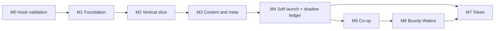

# 09 — Roadmap

Durations assume a small team: two to three engineers, one designer, one artist, plus contracted audio and VFX. They are relative sizing, not commitments.

## Shelved: on-chain co-op ship sync (2026-08)

Multiplayer ship position sync via MagicBlock ER is **paused** until single-player combat is fun.

### What works today

- Lobby flow: create / join / ready / start / delegate on local stack (`:8899` / `:7799`)
- `submit_input` transactions succeed; snapshot tick advances
- Local dual mode (K) can drive two wallets from one editor

### Known blockers (do not revisit until M5)

| Issue | Symptom | Likely cause |
| --- | --- | --- |
| Slot-1 spawn | `p1=(0,0)` instead of `(-2,0)` | `start_match` spawn not written for slot 1 on delegated snapshot; redeploy + spawn fallback |
| ER tick rate | `p1 z` jumps thousands per minute | Config PDA missing on ER → `tick_hz` defaults to 1 |
| Display sync | Stutter / snap-back | Prediction vs 10 Hz chain reconcile fighting; needs snapshot-only display or locked-step sim |
| Per-slot ticks | `p0` frozen when only slot 1 submits | By design: one input per `submit_input` tick |

### Resume checklist (M5)

1. Rebuild + redeploy `pirate_coop.so` with `spawn_player` fallback and ER config init
2. Anchor integration test: 2-player spawns + movement on ER after delegate
3. Unity: one ship per editor via `RemoteShipView`; no local dual reconcile
4. ParrelSync validation with Run In Background on both editors

Code remains in `Assets/Scripts/Net/` and `onchain/` — disabled at runtime by `SoloRunBootstrap`.

---

## Sequencing principles

**Validate the hook before building anything.** Broadside Doctrine is the one genuinely novel thing in this design ([03](03-core-combat-and-progression.md#broadside-doctrine)). If turning to aim is not fun, the entire project is a Vampire Survivors clone with pirate art and should be reconsidered rather than continued. Three days of prototyping answers this. Do it before the engine is chosen.

**PvE first, always.** Combat gets tuned in PvE. Balancing PvP against untuned combat is work that gets thrown away.

**The token is last.** Per [06](06-economy-and-tokenomics.md#sequencing-ship-without-the-token), the game launches without it. But the Contribution Score ledger runs from the first day of soft launch, so that when the token arrives it is calibrated against real behaviour rather than the guesses in [07](07-economy-simulation-spec.md).

**Feel before content.** The library gives us more content than we can use ([02](02-asset-audit-and-gaps.md)). What it does not give us is game feel, and game feel is what the genre is actually judged on. Budget accordingly: this project should spend most of its money on VFX and audio, not on models.

## Milestones

### M0 — Hook validation (2–3 weeks)

The only question: **is Broadside Doctrine fun?**

Build in whatever is fastest to iterate in — probably a web canvas or a plain Unity scene. Placeholder cubes. No art, no audio, no meta.

- Ship movement with momentum and a hull turn rate
- Port and starboard batteries firing into arcs
- One enemy type that chases
- Enough enemies to require arc management
- Three hull variants with different turn rates and arc widths to test the tradeoff in [03](03-core-combat-and-progression.md#the-hull-roster)

**Gate:** put it in front of ten people who play survivor-likes. Do they discover arc management without being told? Do they enjoy it, or does it feel like fighting the controls?

**If it fails,** the honest options are to fall back to conventional auto-targeting and accept being a competent genre entry, or to stop. Both are better than proceeding on a hook that does not work.

**This milestone is throwaway.** Say so up front, or it becomes the codebase.

### M1 — Technical foundation (4–6 weeks)

Runs the spikes in [08](08-engine-and-tech.md#spikes-to-run-before-committing) and commits to a stack.

- Spikes 1, 2, 4, 5, 6, 7
- Engine decision, with the 3D versus 2D question settled
- Asset manifest importer: crawl `references/piratenation-art-full`, emit JSON mapping entity IDs to paths, handle the naming inconsistencies documented in [02](02-asset-audit-and-gaps.md#duplicate-folders-and-gotchas)
- GLTF to GLB compression pass
- Project skeleton on the chosen stack, restarted from M0 rather than grown out of it
- Art style guide for the UI chrome and VFX that will be commissioned

Run the economy simulation from [07](07-economy-simulation-spec.md) in parallel. It has no dependency on the game and its findings shape decisions made later.

**Gate:** 600 enemies at 60fps on target hardware, real assets loading through the manifest, and a written stack decision with its reasoning.

### M2 — Vertical slice (8–10 weeks) — **current focus**

Single-player survivor loop first: one ship, wave director, broadside combat feel.

| Scope | Amount |
| --- | --- |
| Hulls | 1 (Sloop) |
| Biome | 1 (Shallows) |
| Enemies | 8, across all six behaviour archetypes |
| Waves | `WaveDirector` timeline (trickle → burst → ramp → calm → swarm) |
| Elements | All 5, plus the affinity wheel |
| Bosses | 1 (Megalodon) |
| Weapons | 8 |
| Passives | 6 |
| Evolutions | 3 |
| Cards drafted from | ~20 |
| Tide Levels | 1–3 |
| Meta | None. Results screen only. |
| Co-op / ER ship sync | **Shelved** — see above |

**Every item on the feel checklist** in [03](03-core-combat-and-progression.md#feel-checklist) must pass. This is the milestone's real purpose. A vertical slice with correct systems and bad feel has proven nothing.

**Gate:** playtesters voluntarily start a second run. Measure it rather than asking — the number of players who press "play again" without being prompted is the only honest signal at this stage.

### M3 — Content and meta (8–10 weeks)

Fill it out.

- All 5 hulls, tuned against each other
- Tide Levels 1–8 with 5 biomes
- All 25 enemy types across their elemental variants
- 4 bosses, 2 mini-bosses
- ~60 cards, ~12 evolutions
- Gold economy and the cosmetics shop
- Ship theme unlocks via shards
- Captain avatar customisation
- Port hub, results screen, progression UI
- Achievements
- Save, accounts, cloud sync

**Gate:** a player can spend twenty hours without exhausting the content or running out of things to unlock.

### M4 — Soft launch and shadow ledger (ongoing from here)

Limited region, real players, real telemetry.

- Contribution Score computed and stored for every run, per [06](06-economy-and-tokenomics.md#contribution-score)
- Full distribution simulated against a shadow emission schedule
- Players shown a "would have earned" figure on the results screen
- Every event a sink would have priced against, recorded
- Re-run the [07](07-economy-simulation-spec.md) suite against measured parameters instead of the guessed cohort table

**Gate:** D1, D7 and D30 retention meeting targets, and at least eight weeks of ledger data.

The shadow ledger is the highest-leverage item in the entire roadmap. It converts the economy from an argument into a measurement, months before a token exists.

### M5 — Co-op (6–8 weeks) — **blocked on shelved ER ship sync**

Resume when the checklist in [Shelved: on-chain co-op ship sync](#shelved-on-chain-co-op-ship-sync-2026-08) is complete.

- Networked 2–4 player Dungeon Hunt
- Party scaling curves from [04](04-modes-solo-and-coop.md#party-scaling)
- Convoy bonus
- Downed and revive
- Instanced loot
- Matchmaking, party invites, rejoin on disconnect

Substantially cheaper if the stack from [08](08-engine-and-tech.md) is deterministic, since the simulation is networked by default.

**Gate:** stable four-player matches at Tide 8 density, on the worst supported connection.

### M6 — Bounty Waters (10–12 weeks)

The most complex mode and the one most dependent on everything before it.

- 8–12 player authoritative matches
- Plunder: droppable banked XP
- Heat, with all five tiers
- Dual-track draft, Doctrine meter, Doctrine sails
- Earned rerolls and banishes, face-down slot
- Buoy objectives
- Kraken flashpoint
- Contracting storm
- Ghost mode and marking
- Ranked ladder across the eleven existing trophy tiers
- The full spectacle list in [05](05-mode-pvpve.md#spectacle)

Budget a long balance tail. PvP balance is not a milestone, it is a permanent activity.

**Gate:** a healthy queue with acceptable match times, and no dominant strategy at high bracket after four weeks of live data.

### M7 — Token

Gated on ledger data, not on a date.

- Final parameters set from real behaviour, not from [07](07-economy-simulation-spec.md)'s guesses
- Chain selected
- Contracts written and audited
- Staking, claiming, vesting
- Sinks activated with dynamic repricing
- Legal review completed — flagged as an open question in [06](06-economy-and-tokenomics.md#open-questions) and genuinely blocking

**Do not launch this before the game has proven retention.** A token attached to a game nobody plays has no participation to distribute proportionally.

## Asset production backlog

From the gaps in [02](02-asset-audit-and-gaps.md#the-production-backlog). Ordered by the milestone that needs them.

| Priority | Item | Needed by | Notes |
| --- | --- | --- | --- |
| P0 | Core VFX set: projectiles, impacts, deaths, XP trails, level-up burst | M2 | The genre's feel lives here. ~15 effects minimum for the slice. |
| P0 | Core audio: cannon fire, impacts, pickups, level-up, one music track | M2 | Pickup blip is heard ten thousand times a run and must not grate. |
| P0 | UI chrome: card frames per rarity, HP and XP bars, HUD, results screen | M2 | Card frames first. The draft screen is the emotional peak. |
| P1 | Procedural ship combat animation: recoil, roll, bob, damage, sinking | M2 | Engineering, not art. Days rather than weeks. See [02](02-asset-audit-and-gaps.md#p1--ship-combat-animation). |
| P1 | Full VFX set: telegraphs, auras, chains, orbitals, evolution flash | M3 | Roughly 25 more effects |
| P1 | Full audio: 25 creature voices, boss roars, complete music with intensity | M3 | Largest single content gap in the project |
| P1 | Meta UI: Port, shop grid, avatar customiser, achievements | M3 | |
| P2 | Convoy ropes, revive beam, downed wreck state | M5 | Wreck can reuse `ships/shipwreck_Heitzmans_Royal_Navy_Frigate/` |
| P2 | Storm VFX, Doctrine sail shader, Plunder scatter burst | M6 | Doctrine sails are the highest-value readability feature in [05](05-mode-pvpve.md) |
| P2 | PvPvE UI: scoreboard, kill feed, Heat indicator, ghost mode | M6 | |
| P2 | Kill-feed stingers, cannon salute, Legend of the Match | M6 | |
| P3 | Elemental cannon-fire skins | Post-launch | Materially improves build identity |
| P3 | Bosses beyond the existing 8 | Season 2 | |

Everything not listed here already exists in the library. That is the unusual part of this project and it should shape how the budget is allocated: almost none of it goes to models.

## Risk register

| Risk | Impact | Likelihood | Mitigation |
| --- | --- | --- | --- |
| Broadside Doctrine is not fun | Fatal | Medium | M0 answers it in three days, before any spend |
| Art licensing for a commercial derivative | Fatal | Unknown | **Resolve before M1.** Flagged in [01](01-game-overview.md#open-questions) and currently unanswered. |
| Entity count target missed on mobile | High | Medium | Spike 1 in M1; 2D sprite fallback exists |
| Quantum's rigidity slows development | High | Medium | Spike 5; Fusion fallback documented in [08](08-engine-and-tech.md#if-quantum-is-rejected) |
| Audio budget underestimated | High | High | Largest content gap. License a library early, commission only hero sounds. |
| PvPvE fails to hold a population | High | Medium | It is the third mode; the game must stand on PvE alone |
| Token regulatory problems | High | Medium | M7 is gated on legal review, and the game ships without it |
| Sink calibration wrong, burn target missed | Medium | High | Shadow ledger in M4 measures it before anything is committed |
| Feature creep from the crafting and building art | Medium | High | Explicitly out of scope in [01](01-game-overview.md#non-goals) and [02](02-asset-audit-and-gaps.md#what-exists-that-we-are-deliberately-not-using) |

Two of these are worth singling out. **Art licensing is unresolved and could end the project**, so it should be answered before any production money is spent — it is cheap to check and catastrophic to discover late. And the **audio budget** is consistently the thing teams underestimate on projects where the art is free, because the absence of a single sound file is less visible than the absence of a model.

## What to do first

If work started tomorrow, in order:

1. Resolve art licensing. One conversation, potentially fatal, blocks everything.
2. Start M0. Three days to a cube prototype of Broadside Doctrine.
3. Start the economy simulation from [07](07-economy-simulation-spec.md) in parallel. It shares no dependencies with the game and its findings take time to digest.
4. Run spike 3, then spikes 1 and 2, from [08](08-engine-and-tech.md#spikes-to-run-before-committing).
5. Commission the UI style guide. It has the longest lead time of any art item and gates the M2 chrome work.
