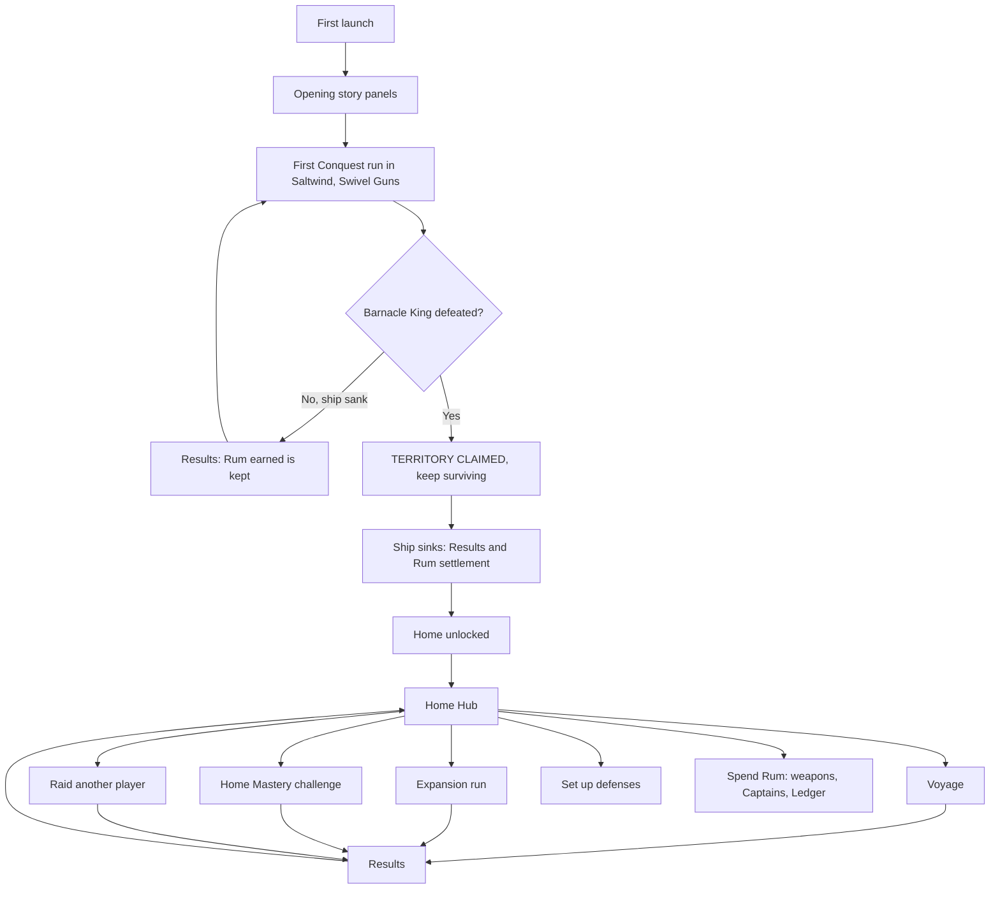
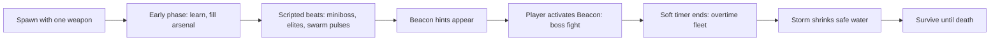
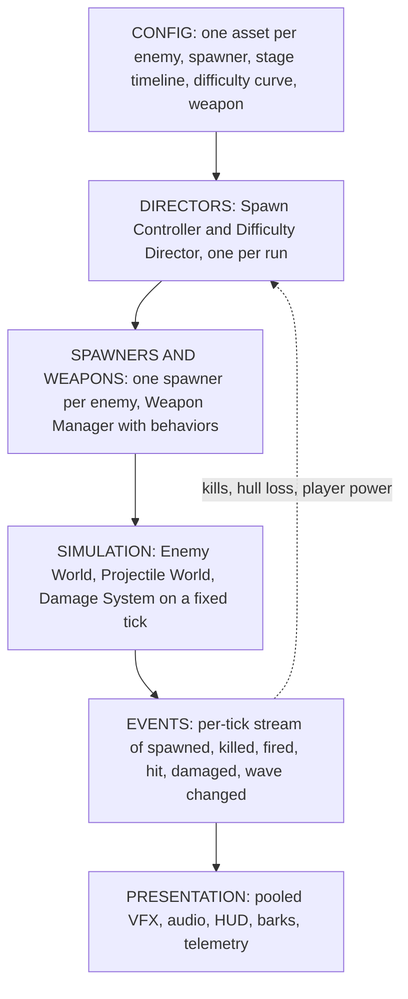

# Rogue Pirates — Gameplay Flow, Modules and Dynamic Architecture

A single readable reference for how the game plays and how each part of it is built to stay **data-driven and adjustable**, not locked to fixed numbers. It covers gameplay and narrative only. Monetization, ads, store and backend operations are left out.

Revised 25 September 2026. Every "Status" line and every file reference below was checked against the Unity project at `Pirate Game Unity/Assets/_Game/`. The target architecture follows the spawn, difficulty and pooling architecture canvas.

---

## 0. How to read this document

Each module has four parts:

- **How it plays:** the player-facing design.
- **What makes it dynamic:** which configuration or director decides its behavior, so designers change data instead of code.
- **Status today:** what exists in the code, with file and line proof.
- **Gaps to close:** what must change to reach the target architecture.

Status labels:

| Label | Meaning |
|---|---|
| **Built** | Exists in the running Saltwind solo game and is driven by configuration. |
| **Built, hardcoded** | Works in game, but its values or content lists live in C# instead of configuration. |
| **Stub** | A small placeholder class exists; no gameplay uses it. |
| **Not built** | No implementation found in the Unity project. |

Numbers shown in this document are **current tuning values read from configuration**, not rules. Changing them should never require code changes.

---

## 1. The game in one paragraph

Rogue Pirates is a top-down, 3D, ship-based bullet-heaven roguelite. You are always the ship. You steer; your weapons fire on their own. Every run starts weak. You collect XP, pick upgrades, buy chests, explore for landmarks, find a hidden Beacon, and fight a boss. Beating the boss **secures the objective but does not end the run**: the sea keeps coming until your ship sinks. Between runs you spend **Rum**, the one permanent currency, to unlock weapons and Captains, grow your home Territory, set up its defenses and raid other players.

**Player fantasy:** *"I start with a leaky ship and swivel guns. Ten minutes later I'm a ridiculous floating arsenal of cannons, lightning, kegs and blades, and I'm still greedily chasing one more chest while the ghost fleet closes in."*

---

## 2. Story and world

### 2.1 Premise: "The Sea Keeps Receipts"

An enormous treasure was stolen from the bottom of the sea. Unfortunately, it belonged to the sea. Now a cursed tide rearranges the archipelago, sinks greedy captains, and washes them back ashore to try again. Every captain believes they will get rich enough to retire. Nobody has ever retired.

### 2.2 The five world rules

1. **The captain survives sinking; the run does not.** Death ends the run and the temporary build is lost. Only earned Rum and unlocks remain.
2. **A claimed home is anchored.** Your Territory keeps its shape.
3. **The tide rearranges rival Territories.** A raided island looks familiar but is laid out differently each attack.
4. **A Treasury Beacon binds a guardian to the owner's loot.** Defeating it secures the loot once.
5. **Treasure is an in-game desire, not real money.**

### 2.3 Cast

| Character | Role |
|---|---|
| **The Captain** | The player: one of six playable Captains (section 8). |
| **Penny, the Quartermaster** | Dry, practical, keeps the Ledger and introduces contracts. |
| **Crumb, the gull** | Steals shiny things; silent reactions to disasters. |
| **Barnacle King** | First boss. Believes your home is his property. |
| **Drowned Admiral** | Second boss. A ghost obsessed with naval procedure. |
| **Infernal Kraken** | Third boss. Treats whole fleets as minor inconveniences. |

### 2.4 How the story is delivered

The story never interrupts combat and never gates play.

- **Opening:** three illustrated, skippable panels (about 20 seconds).
- **First claim:** a short Penny exchange on the results screen that introduces the Ledger.
- **Each Zone:** one introduction and one aftermath scene on first conquest.
- **Flavor lines and barks.** A *bark* is a one-line spoken or text reaction from a character, triggered by a game event and never blocking play. Examples:
  - Penny when you open your fifth chest: *"That's the grocery budget, Captain."*
  - Penny on a boss kill: *"Put it on the Ledger."*
  - Crumb squawks when you pick up a Legendary.
  - The Barnacle King taunts as his phase changes.

  Each bark has a cooldown so it never repeats too often. The plan is about 30 barks at launch, plus one flavor sentence on each Item, boss and contract description.

**What makes it dynamic:** barks should be data entries, each with a trigger event, a speaker, text lines, a cooldown and a priority. They should listen to the same combat event stream as the HUD (section 5.4), so adding a bark never touches combat code.

**Status today: Not built.** There is no narrative, bark or dialogue system in the scripts. The only story text is each Captain's menu description in `Scripts/V3/V3CaptainCatalog.cs` lines 46–60.

---

## 3. Rules that never change

1. The player is always the ship. No on-foot play, no realistic sailing physics.
2. Movement is the player's main skill; weapons fire automatically.
3. Each stage has a **soft timer**, then **overtime** with a distinct ghost fleet and rising danger.
4. **Killing the boss secures the objective but never ends the run.** No extraction.
5. **Death is the only way a run ends.** No paid revive.
6. Chests and landmarks are placed once at stage start and **never respawn**.
7. Some builds fail early; others become absurdly strong. No guaranteed perfect build.
8. **Gold exists only inside a run.** It buys chests and expires at death. **Rum is the only permanent currency.**
9. Cosmetics never affect combat.
10. **Every tunable value lives in configuration.** Code decides *how* a rule works; data decides *how much*.

---

## 4. The full gameplay flow

### 4.1 The big picture

### 4.2 The home loop

1. **Choose** an activity, Captain, biome and tier.
2. **Play:** build up, explore, beat the boss, survive, sink.
3. **Collect:** the results screen settles Rum once per run and shows progress.
4. **Invest:** spend Rum on unlocks, Ledger upgrades and defenses.
5. **Repeat** with a new build idea, a harder tier, a raid or an event.

### 4.3 One stage, as the player experiences it

The boss can be fought at any point once the Beacon is found. Section 5.2 explains how this timeline becomes one configurable asset instead of hardcoded times.

---

## 5. The dynamic architecture

This section explains how the game is assembled so that pacing, difficulty and content are **data, not code**. It follows the architecture canvas and states what already exists.

### 5.1 The six layers

| Layer | What it does | Rule |
|---|---|---|
| **Config** | Describes every enemy, spawner, stage timeline, difficulty curve and weapon as data assets. | Designers edit only this layer to tune the game. |
| **Directors** | One Spawn Controller and one Difficulty Director per run decide what spawns and how hard it is. | Read config and player state; never hardcode enemy names. |
| **Spawners and weapons** | Each enemy has its own spawner; each weapon pattern has one behavior. | No per-enemy or per-weapon special cases in central code. |
| **Simulation** | Moves ships and projectiles, resolves hits, kills and status effects on a fixed tick. | Deterministic; frame rate never changes the outcome. |
| **Events** | Each tick publishes what happened. | Presentation, telemetry, barks and the Difficulty Director all read the same events. |
| **Presentation** | Plays effects, sounds, HUD and barks from pooled objects. | Never writes back into damage or spawning. |

### 5.2 Stage timeline as one asset (Wave Timeline)

A stage is an ordered list of **phases**: ambient bands, scripted beats, the boss and overtime. Nothing about the schedule is fixed. Each phase is a data entry with:

- a **trigger**, which can be any of:
  - at a time;
  - on an event, such as "Beacon activated" or "miniboss killed";
  - after a previous phase clears;
  - when a condition is met, such as player level, kill count or Difficulty Pressure above a threshold.
- a **duration**, or "until the next phase triggers";
- a **threat per second**, which is the designed pacing curve;
- the **spawners allowed** in that phase, each with a weight;
- optional **caps**, a flag to pause ambient spawning (miniboss or boss arenas), and a **warning** whose text is generated from the trigger.

**The schedule is dynamic in three ways:**

1. **Authored per stage.** Each biome, tier and stage points at its own timeline asset, and Home Mastery presets can override single phases.
2. **Bent at runtime.** The Difficulty Director scales every phase's threat rate and can move *condition-triggered* phases earlier, such as tougher tiers arriving sooner for strong builds, all inside the clamps in section 5.3. Time-triggered scripted beats keep their authored time.
3. **Editable while playing.** Every phase field (trigger, time, rate, spawner list, weights, caps) is exposed in the in-game Tuning Console. It can be changed mid-run, saved as a preset, and reloaded (see the V4 implementation plan).

The table below is only the **default Saltwind preset** that ships in the timeline asset. None of these values are fixed in code.

| Phase | Trigger | Threat per second (current tuning) | Enemies allowed |
|---|---|---|---|
| Band 0 | 0:00 | 0.5 | Swordfish, Deckhand Dinghy |
| Reef Crab miniboss | 1:30 | scripted | Reef Crab, pauses ambient |
| Band 1 | 2:00 | 1.2 | + Cutthroat Skiff, Hammerhead · specialists Needle Sloop, Ram Raider |
| Elite Hammerhead | 3:00 | scripted | Elite Hammerhead |
| Band 2 | 4:00 | 1.8 | + Shark, Cannonboat · Bomb Boat, Rammer Raft, Bomb Ketch, Gunner Cog |
| Swarm pulse | 4:00 and 7:00 | ×1.25 for 30 s | ordinary enemies |
| Band 3 | 6:00 | 2.4 | Manta Ray, Cannonboat, Hammerhead, Shark · Bomb Boat, Boarding Barge, Net Cutter, Repair Tender, Kraken Spawn |
| Elite Kraken Spawn | 8:00 | scripted | Elite Kraken Spawn |
| Band 4 | 8:00 | 3.0 | Manta Ray, Cannonboat, Hammerhead · Shield Frigate, Powder Barge, Kraken Spawn, Bomb Boat, Boarding Barge |
| Boss | Beacon activated | ambient ×0.5 | Barnacle King |
| Overtime | 10:00 | ramps | Drowned Pursuer, Drowned Harrier |

Adding a new biome, a new beat or a harder tier becomes **authoring a new timeline asset**, not writing code.

**Status today: Built, partly hardcoded.**

- The rate bands, band length, caps, beat times, swarm size and warnings are data in `Scripts/Balance/StageBalanceProfile.cs` lines 31–50. The live values are in `Data/Balance/SaltwindSoloStageBalanceProfile.asset` lines 26–49; note that band 0 is **0.5**, not the 0.6 code default.
- **Hardcoded:** which enemies appear in each band is two C# string tables in `Scripts/Balance/SaltwindAmbientCompositionLogic.cs` lines 16–34.
- **Hardcoded:** the schedule asset has fixed named slots (`hammerheadBeat`, `krakenBeat`, `swarmPulse` and others) rather than a free list of phases. See `Scripts/Enemies/EncounterSpawnSchedule.cs` lines 23–39.
- **Hardcoded:** the pressure-beat director names its elites in code (`"hammerhead"`, `"kraken_spawn"`) in `Scripts/V3/V3PressureBeatDirector.cs` lines 75–80. The Reef Crab time comes from a separate legacy pacing asset (line 40, used at line 88). The warnings "swarm pulse at 4:00!" and "at 7:00!" are fixed text at lines 176 and 182.

**Gaps to close:** create the Wave Timeline asset with free-form phases; move the band tables and beat enemies into it; generate warning text from the phase trigger time.

### 5.3 Difficulty as a curve that can bend (Difficulty Director)

Difficulty has two parts:

1. **The designed curve:** how hard the stage should be at each minute (threat per second, enemy health and damage growth, elite chance). This is authored data.
2. **Adaptive pressure:** a Difficulty Director samples the run about once per second. It measures the player's **power** (weapon damage and coverage, Hull and defense) and **performance** (kill rate compared with spawn rate, how fast Hull is lost). From these it computes a **Pressure** value that gently bends the curve.

**Which levers adapt:**

| Lever | Adapts? | Why |
|---|---|---|
| Threat budget rate (how many enemies) | Yes, main lever, clamped to about ±15–35% | More enemies feels fair; inflated health feels spongy. |
| Enemy health | Only when the enemy cap is full | Used only when more bodies cannot be added. |
| Elite chance | Yes, a few points | Rewards strong builds with harder, richer targets. |
| Enemy tier unlock timing | Yes, up to about a minute earlier | Strong builds meet tougher enemy tiers sooner. |
| Composition bias | Yes, weights shift | An orbit-heavy build draws more ranged ships; a sniper build draws more swarms. |
| Boss health, scripted beat times, rewards per kill | **Never** | Keeps pacing authored and prevents farming a low-pressure state. |

Power-ups and level-up choices need no special code: they already change player stats and weapon upgrades, so the next power sample rises and pressure drifts up over about 20 seconds.

**Rollout:** the director first runs in **observe-only mode**. It logs power and pressure but changes nothing. The levers are then switched on one at a time.

**Status today: Not built as a director, but pieces exist.**

- **Enemy tiers exist.** Soldier, Captain, General and Boss are defined in `Scripts/Core/GameEnums.cs` lines 88–94. They unlock by time **and** player level: Captain tier at 1.5 minutes or level 2, General tier at 5 minutes and level 5 (`Scripts/Balance/EnemyTierLogic.cs` lines 43–59). Tier assignment is a hardcoded switch on enemy names (lines 18–41).
- **Health and damage growth are hardcoded formulas** in `Scripts/Core/GameConstants.cs` lines 137–149.
- **Per-enemy adaptation exists.** Individual enemies can react to kiting and crowd size through `AdaptiveCounterSettings` (`Scripts/Enemies/SpawnProfileModules.cs` lines 160–179), applied in `Scripts/Enemies/EnemySpecialBehaviorSystem.cs` lines 290–297.
- **Global multipliers exist** for density, enemy health and enemy damage (`Scripts/Combat/CombatExperimentProfile.cs` lines 21–23), but they are fixed per profile, not adaptive.
- **Deterministic random streams exist** per purpose (director, powerup, loot) in `Scripts/Core/RunRng.cs`.

**Gaps to close:** a Difficulty Curve asset (replacing the hardcoded formulas), a Player Power Index, and the Difficulty Director in observe-only mode first.

**Decision: adaptive difficulty is used in every run, including ranked runs, and the weekly kill leaderboard accepts adaptive pressure.** Strong builds face more enemies and can therefore post higher kill counts; that is intended. To keep the board fair and verifiable:

- The director uses only simulation state and the run's own director random stream, so a replay of the same inputs reproduces the same pressure and the same kills.
- The director's configuration version and content hash are stamped on every run, and ranked runs must use the published ranked version.
- Each leaderboard entry shows the run's average and peak Pressure beside its kill count.
- The pressure clamps (section 5.3 table) are the same for every player; there is no paid or account-level modifier.

### 5.4 One event stream for everything that reacts

Each simulation tick publishes events: enemy spawned, enemy killed, weapon fired, projectile hit, player damaged, player power changed, wave changed. The HUD, VFX, audio, barks, telemetry and the Difficulty Director all read from it. Animations never decide damage.

**Status today: Partly built.** Combat signals and telemetry exist in `Scripts/Enemies/RunCombatSignals.cs` (113 lines) and the combat telemetry driver, but there is no single per-tick event stream.

### 5.5 Pooling so a full run never creates or destroys objects

- **Simulation slots:** enemies, projectiles, kegs, delayed strikes and hazards live in fixed-size pools sized by device quality.
- **Views:** models and effects come from one Pool Service, prewarmed at stage load from the enemies and weapons that can actually appear.
- **Target:** after prewarm, a full 10-minute run makes zero create or destroy calls in combat.

**Status today: Partly built.** Four separate view pools exist: `ProjectileViewPool` (155 lines), `VfxPool` (59), `EnemyViewPool` (143) and `PickupViewPool` (238). There is no shared Pool Service, Pool Catalog or slot pool.

### 5.6 Configuration layers

Each enemy's final values are resolved **once, when it spawns**, from these layers in order:

1. **Base archetype** (designer): for example, Hammerhead health, speed and charge.
2. **Variant** (designer): for example, Elite Hammerhead adds a second charge.
3. **Stage** (balance): Saltwind caps and stage multipliers.
4. **Spawner or phase** (level design): count, arc and delay for this beat.
5. **Experiment** (optional A/B test).
6. **Runtime** (Difficulty Director): the health and elite multipliers for this moment.

Every asset carries its own schema and balance version, and each run stamps a hash of every configuration it used. A playtest report therefore always names its exact balance.

**Status today: Partly built.**

- The stage profile already exports a content hash (`StageBalanceProfile.cs` line 267).
- Enemy behavior is a hardcoded C# registry (`Scripts/Combat/EnemyCombatProfileRegistry.cs`, 191 lines).
- The eight specialist enemies are cloned in code at boot (`Scripts/Combat/CombatSpecialistEnemyCatalog.cs`, 73 lines) instead of being variant assets.

### 5.7 Verified inventory of today's systems

Line counts were measured in the project. The Action column follows the architecture canvas.

| Existing file | Lines | Becomes | Action |
|---|---:|---|---|
| `Enemies/EncounterSpawner.cs` | 842 | Spawn Controller. Placement, budget and RNG move in. V4 does not keep this class as its API | Move pieces in |
| `Balance/SaltwindAmbientCompositionLogic.cs` | 131 | Phase data in the Wave Timeline | Move to data |
| `Enemies/EncounterSpawnSchedule.cs` | 35 | Wave Timeline asset | Replace |
| `Enemies/SpawnProfile.cs` + `SpawnProfileModules.cs` | 34 + 167 | Enemy Spawner config and behavior modules | Evolve |
| `Data/EnemyDefinition.cs` | 34 | Enemy Archetype config | Evolve |
| `Combat/EnemyCombatProfileRegistry.cs` | 191 | Generated Enemy Archetype assets | Replace |
| `Combat/CombatSpecialistEnemyCatalog.cs` | 73 | Variant assets | Replace |
| `Balance/EnemyTierLogic.cs` | 60 | Archetype tier field and a Difficulty Director gate | Replace |
| `Enemies/SpawnModifierStack.cs`, `SpawnPlacementService.cs`, `Core/RunRng.cs` | 69 + 283 + 73 | Used by the Spawn Controller | Keep |
| `Enemies/EnemyWorld.cs` | 1,401 | Registry, movement and attack systems, view sync | Split |
| `Weapons/WeaponController.cs` | 1,568 | Weapon Manager, one behavior per pattern, stat resolver | Split |
| `Data/WeaponDefinition.cs` | 116 | Weapon config base | Evolve |
| `Combat/CombatWeaponCatalog.cs` | 144 | Real weapon assets (Long Nine, Swivel Guns, Harpoon and Mortar are created in code today) | Replace |
| `Weapons/ProjectileWorld.cs`, `Combat/HostileProjectileWorld.cs` | 278 + 145 | Backed by a slot pool | Keep, add free list |
| Four view pools | 595 total | Pool Service | Consolidate |
| `V3/V3RunItemEffects.cs` | 181 | Items emit stat modifiers | Refactor |
| `Player/PlayerShipController.cs`, `Core/PlayerStats.cs` | 597 + 68 | Ship controller, input to the power index | Keep |

**Not yet in the code:** Wave Timeline, Difficulty Curve, Difficulty Director, Enemy Archetype config, Enemy Spawner config, Weapon config, Spawn Controller, Player Power Index, Pool Service, Pool Catalog, slot pool and the event stream. None of these classes exist anywhere under `Assets/`.

**Safety net:** the gate tests that must stay green through every step include `SaltwindScheduleGateTests`, `SpawnSchedulingGateTests`, `EncounterSpawnerTests`, `SaltwindAmbientCompositionGateTests`, `SaltwindBalanceLabGateTests`, `LevelOfferGeneratorTests`, `SaltwindResultsGateTests`, `SaltwindResetGateTests`, `SaltwindCombatRedesignGateTests` and `SaltwindSettlementPlayModeTests`, all under `Tests/`.

---

## 6. Module — Onboarding (First Conquest)

**How it plays.** The first run is a one-stage Saltwind run that **starts with Swivel Guns**. Short, dismissible prompts teach, in order:

1. Move.
2. Auto-fire and XP.
3. The first level-up choice.
4. A nearby cheap chest.
5. The minimap and one landmark.
6. Finding and activating the Beacon.
7. One boss telegraph.
8. On the boss kill: **"TERRITORY CLAIMED — SURVIVE AS LONG AS YOU CAN."**
9. On death: the Rum earned and what it unlocks.

Each attempt gets a new random map until the Barnacle King is defeated. That winning map then becomes the permanent home layout.

**What makes it dynamic:** tutorial prompts should be data entries triggered by events such as first level-up, first chest in range and Beacon discovered, not timed scripts.

**Status today: Built (starting weapon and home seed); tutorial prompts Not built.**

- With no first conquest recorded, the run forces Swivel Guns (`Scripts/V3/V3RunBootstrap.cs` lines 431–440).
- The map seed is random until the first boss win, then locks for all later runs (`Scripts/V3/V3HomeSeed.cs` lines 19–35).
- Only the generic start toast exists (lines 326–331); there is no step-by-step tutorial.

---

## 7. Module — Pre-run setup

**How it plays.** Choose the activity, Captain, biome and tier (as unlocked), plus a ship appearance (cosmetic only). Every run starts at Level 0 with one weapon: the Captain's starting weapon.

**Status today: Built for Saltwind solo.** Captain selection is `V3CaptainSelection.Selected` (`V3RunBootstrap.cs` line 234). Biome and tier selection are **Not built**; `Content/BiomeCatalog.cs` is a 17-line stub.

---

## 8. Module — Captains

**How it plays.** Each Captain gives a **starting weapon**, a **passive** that grows with level, and an optional **active skill** on one button. Passives reset every run. Skins never change a Captain.

| Captain | Style | Starting weapon | Passive | Active skill |
|---|---|---|---|---|
| **Rook** | Generalist | **Swivel Guns** | Damage grows with level | All Guns!: every weapon fires once |
| **Hank** | Tank | Deck Cannons | More Hull, slower; armor grows with level | Brace!: brief heavy damage reduction |
| **Richie** | Smuggler | Broadside Battery | Gold-focused; damage spikes after pickups | Cut and Run: speed and pickup radius burst |
| **Sparky** | Powderrunner | Powder Kegs | Keg damage rises while moving fast | Light the Fuse: arms kegs, bigger blasts |
| **Ember** | Firekeeper | Flamethrower | Burn damage grows | Stoke the Flames: stronger burn, longer cone |
| **Roxie** | Stormchaser | Lightning Mast | Fast and fragile; lightning-forward | Ride the Gale: speed burst plus a chain strike |

A Captain whose starting weapon is a Rum unlock (Ember, Roxie) requires that weapon to be owned first.

**What makes it dynamic:** each Captain should be one config asset: starting weapon, base Hull and speed, passive definition, active definition with cooldown and effects, unlock cost in Rum, and a prerequisite weapon.

**Status today: Built, hardcoded, with three mismatches against this design.**

- Profiles are a C# switch in `Scripts/V3/V3CaptainProfile.cs` lines 28–47. Hull and speed are coded there.
- **Mismatch 1:** Hank (internal ID `Brine`), Richie and Roxie are coded to start with Swivel Guns (lines 31, 37, 43). They should start with Deck Cannons, Broadside Battery and Lightning Mast.
- **Mismatch 2:** whenever the Saltwind profile is active, `ResolveStartingWeapon` returns Swivel Guns for **every** Captain (`V3RunBootstrap.cs` lines 433–434). This must apply only to Rook and to First Conquest.
- **Mismatch 3:** Richie, Ember and Roxie are never locked (`Scripts/V3/V3CaptainCatalog.cs` lines 88–105). Only Hank and Sparky have unlock costs (`SaltwindSoloStageBalanceProfile.asset` lines 122–126).
- Active skills exist in `Scripts/V3/V3CaptainActiveController.cs`. They are gated by a menu toggle that currently defaults to **off** (`Scripts/Combat/CombatExperimentProfile.cs` lines 59–63; the saved preference falls back to `0`). The decision is **on by default**, so the fallback must become `1`. They are activated with Space, Q or the gamepad south button (`V3CaptainActiveController.cs` lines 82–88).
- Display names are mapped from old IDs (`Brine` shows as Hank, `Flint` as Sparky) in `V3CaptainCatalog.cs` lines 19–34.

---

## 9. Module — Enemies and bosses

**How it plays.** Every enemy must make the player *do* something different. Stronger stats alone do not count.

**Ordinary enemies**

| Enemy | Personality | Player response |
|---|---|---|
| Deckhand Dinghy | Reckless amateur in loose groups | Keep spacing |
| Shark | Relentless hunter | Keep moving |
| Swordfish | Nervous duelist: hover, line warning, dash | Sidestep the line |
| Cutthroat Skiff | Flanker from behind | Watch your rear |
| Hammerhead | Wide heavy charge | Leave the lane early |
| Cannonboat | Methodical gunner at range | Break the firing line |
| Manta Ray | Sweeping three-shot fan | Read the gaps |

**Aggressive specialists**

| Enemy | Personality | Player response |
|---|---|---|
| Needle Sloop | Sniper that flees if approached | Chase or dodge |
| Rammer Raft | Clumsy battering ram | Sidestep, then punish |
| Ram Raider | Jouster with two passes | Expect the second pass |
| Bomb Boat | Kamikaze with a fuse | Kill early or leave the circle |
| Bomb Ketch | Bombardier that predicts your route | Change direction |
| Powder Barge | Mine-layer | Avoid mines or kill it to disarm them |

**Control and support specialists**

| Enemy | Personality | Player response |
|---|---|---|
| Boarding Barge | Rope grappler that slows | Dodge or break range |
| Net Cutter | Nets ahead of your route | Route around |
| Repair Tender | Heals allies | Priority target |
| Shield Frigate | Front shield escort | Flank it |
| Gunner Cog | Formation battery | Kill the leader |
| Treasure Raider | Flees with loot | Chase for reward |
| Kraken Spawn | Tentacle circle traps | Keep open space |

**Scheduled threats:** Reef Crab miniboss, Elite Hammerhead, Elite Kraken Spawn and swarm pulses (section 5.2).

**Overtime fleet:** Drowned Pursuer (intercepting hunter) and Drowned Harrier (shoots your escape route).

**Bosses:**

- **Barnacle King (Saltwind):** Volley, Shell Slam, Charge and Bombardment across three health phases.
- **Drowned Admiral (Gravewater)** and **Infernal Kraken (Devil's Maw):** designed but not built.

**Readability caps:** limits on simultaneous charges, area attacks, Cannonboats and support ships keep the screen readable.

**What makes it dynamic:**

- One **Enemy Archetype** asset per enemy holds identity, tier, stats, threat cost, rewards, movement, attack and special modules, visual and pool size.
- Variants (elites, overtime ghosts, biome versions) are small override assets pointing at a base.
- One **Enemy Spawner** config per enemy says how it enters: group size, placement arc, cooldown, per-spawner cap, and a weight curve over difficulty pressure.
- Concurrency limits such as "at most 4 Cannonboats" become **tags on the archetype**, checked generically.

**Status today: Built, hardcoded identity.**

- 14 authored enemy assets are in `Data/Enemies/`, and 8 specialists are cloned in code (`CombatSpecialistEnemyCatalog.cs`).
- Behavior comes from the C# registry (`EnemyCombatProfileRegistry.cs`) and the Saltwind behavior system (`Scripts/Combat/SaltwindCombatBehaviorSystem.cs`, 895 lines).
- Caps are profile data (`StageBalanceProfile.cs` lines 43–45) but are checked by enemy name in `SaltwindAmbientCompositionLogic.cs` lines 137–146.
- The spawn profile already supports modular behaviors: formation, summon, tether, support aura, phase dash, terrain ambush and adaptive counter (`SpawnProfileModules.cs`). These map directly to the target's behavior modules.
- The Barnacle King attack director exists and uses a hardcoded 30% enrage threshold (`Scripts/V3/BarnacleKingBossAttackDirector.cs` line 87).

---

## 10. Module — Weapons and Evolutions

**How it plays.** Up to six weapons at once. Each ranks up through level-ups; all aim themselves.

| Weapon | Identity | Availability |
|---|---|---|
| Swivel Guns | Quick bursts at the nearest threat, any direction | Starter pool |
| Deck Cannons | Heavy shots with predictive aim | Starter pool |
| Broadside Battery | Fan salvo at the best cluster | Starter pool |
| Powder Kegs | Trailing mines behind the ship | Starter pool |
| Flying Cutlasses | Orbiting blades | Starter pool |
| Long Nine | Long piercing beam at the healthiest target | Starter pool |
| Lightning Mast | Chains between distinct enemies | Rum unlock |
| Flamethrower | Sustained cone toward the densest group | Rum unlock |
| Mortar | Marked delayed cluster strike | Rum unlock |
| Harpoon | Slowing single-target tether | Rum unlock |

**Evolutions.** A weapon at maximum rank plus its matching Item unlocks an Evolution card:

| Weapon + Item | Evolution |
|---|---|
| Deck Cannons + Grapeshot Pouch | Stormshot Cannon |
| Broadside Battery + Broadside Drum | King's Broadside |
| Powder Kegs + Double-Fuse Cord | Devil's Wake |
| Flying Cutlasses + Serrated Scabbard | Bladed Tide |
| Flamethrower + Dragon's Breath Nozzle | Hellfire Nozzle |
| Lightning Mast + Copper Conductor | Tempest Mast |

**What makes it dynamic:**

- One **Weapon** asset per weapon holds base stats, upgrade axes, pattern settings and pool keys for projectile, muzzle and impact.
- One **behavior** per firing pattern (projectile, fan, mine, orbit, trail, chain, pulse, predicted area, summon) replaces weapon-name checks.
- A **stat resolver** computes final stats once: config × upgrades × player stats × Items.
- Evolutions become data rows: base weapon, required Item and behavior modifier.

**Status today: Built, partly hardcoded.**

- The starter pool and unlock costs are profile data (`StageBalanceProfile.cs` lines 118–135; asset lines 106–121).
- Six weapon assets exist in `Data/Weapons/`. Long Nine, Swivel Guns, Harpoon and Mortar are created in code by `CombatWeaponCatalog.cs`.
- Firing logic is concentrated in `WeaponController.cs` (1,568 lines).
- The Evolution list is a hardcoded C# array (`Scripts/Combat/WeaponEvolutionCatalog.cs` lines 35–49).
- The weapon slot cap is profile data (asset line 71), applied at `V3RunBootstrap.cs` line 249.

---

## 11. Module — Level-ups and Logbooks

**How it plays.** XP from kills fills a level bar. Each level-up pauses the game and offers three cards: upgrade an equipped weapon, a new weapon, a Logbook upgrade, a new Logbook, or early on a run Item. The mix shifts as the arsenal fills: many new-weapon cards early, none once six weapons are equipped. If you are behind on weapons at certain levels, one card is guaranteed to be a new weapon, which you can still refuse.

**Logbooks** (up to four slots) grow general stats. The "Stat in the asset" column is the `primaryStat` value in each asset, decoded with the `StatId` list in `Scripts/Core/GameEnums.cs` lines 170–193 (values 0–20).

| Logbook | Intended stat | Stat in the asset | OK? |
|---|---|---|---|
| Carpenter's Notes | Hull | Hull (0) | Yes |
| Gunnery Manual | Damage | Damage (5) | Yes |
| Powder Drill | Attack speed | Attack speed (6) | Yes |
| Lookout's Glass | Critical chance | Crit chance (7) | Yes |
| Extra Hands Ledger | Projectile count | Quantity (9) | Yes |
| Oversized Shot Chart | Size | Size (10) | Yes |
| Scavenger's Net | Pickup radius | **Luck (15)** | No: should be Pickup radius (14) |
| Cartographer's Folio | XP gain | **Gold gain (17)** | No: should be XP gain (16) |
| Quartermaster's Ledger | Run Gold | **Doubloon gain (18)** | No: should be Gold gain (17) |
| Navigator's Charts | Movement speed | **22, not a valid stat** | No: should be Move speed (20) |

The four broken entries are off by one or two. This probably happened when the stat list was reordered after these assets were saved. Fix them in Step 1 of the plan and add a validator check that rejects out-of-range stats.

**What makes it dynamic:** the XP curve, number of choices, slot caps, protection levels and **the category weights by weapon count** should all be data in the stage profile or a level-up config.

**Status today: Built, partly hardcoded.**

- The XP curve, choice count, slot caps and protection levels are data (`StageBalanceProfile.cs` lines 77–84). The live asset uses **4 Logbook slots** (asset line 72) and **protection at levels 2, 3, 5, 8 and 12** (asset line 77). These are read at `Scripts/UI/LevelOfferGenerator.cs` line 516.
- **Hardcoded:** the category weights by equipped weapon count are C# literals in `LevelOfferGenerator.cs` lines 464–476.
- The ten Logbook assets are in `Data/Logbooks/`.

---

## 12. Module — Items

**How it plays.** Items come from salvage chests, the Powder Cache and boss chests. Copies stack during the run. Some create new behaviors; others enable Evolutions.

| Rarity | Items in the current chest pool |
|---|---|
| Common | Lucky Doubloon, Gunner's Gloves |
| Uncommon | Ghost Lantern, Reinforced Keel, Captain's Bell, Grapeshot Pouch, Double-Fuse Cord, Serrated Scabbard |
| Rare | Black Powder Keg, Stormglass, Golden Figurehead, Leviathan Tooth, Powder Fuse, Sea Witch's Eye, Admiral's Ledger |
| Epic | Cursed Compass, Broadside Drum, Dragon's Breath Nozzle, Copper Conductor |

Examples of what they do:

- **Gunner's Gloves:** sharp heading changes give a brief attack-speed surge.
- **Captain's Bell:** every 12 kills fires a free weapon burst.
- **Stormglass:** chain lightning gains one jump.
- **Golden Figurehead:** unspent Gold raises Luck.
- **Cursed Compass:** more Luck, denser fights.

**What makes it dynamic:** each Item is one asset with rarity, description, tags and a list of **stat modifiers or triggered effects**. Effects plug into the stat resolver and event stream, so an Item never needs its own line in combat code.

**Status today: Built, hardcoded.**

- The chest pool and rarities are a C# list (`Scripts/V3/V3ItemCatalog.cs` lines 48–69). Names and descriptions are C# switches (lines 71–117).
- Effects are applied through name checks such as `HasItem("stormglass")` across `Scripts/V3/V3RunItemEffects.cs` lines 94–200.
- The older Relic assets in `Data/Relics/` (Spyglass, Blood Rum, Chain Locker and others) are **not** used by Saltwind chests; they belong to the legacy `Scripts/Meta/MetaSystems.cs`.

---

## 13. Module — Temporary powerups

**How it plays.** Rare drops from kills, with a cooldown between drops. Scheduled elites always drop one. They take no slot and expire at stage end. A duplicate refreshes the timer; it doesn't stack.

| Powerup | Effect |
|---|---|
| Repair Supplies | Heal part of maximum Hull |
| Powder Rush | Attack speed boost for a few seconds |
| Magnetic Tide | Collect all loose XP and Gold |
| Dead Calm | Slows ordinary enemies briefly |

Four more are built for the expanded pool: Battle Signal, Tailwind, Salvage Chime and Full Sail.

**What makes it dynamic:** the drop chance, cooldown, magnitudes and durations are profile data; the pool membership and weights should be too.

**Status today: Built, partly hardcoded.**

- Drop chance, minimum interval and the Repair, Powder Rush and Dead Calm magnitudes are data (`StageBalanceProfile.cs` lines 57–63).
- **Hardcoded:** the pool weights are literals in `Scripts/V3/V3PowerupCatalog.cs` lines 9–34. Saltwind uses four at 25% each (lines 31–34).
- **Hardcoded:** the Tailwind duration and multiplier are constants in `Scripts/V3/V3FloorPowerupWorld.cs` lines 20–22.

---

## 14. Module — Exploration: chests, landmarks and the Beacon

**How it plays.**

- **Salvage chests** are placed at stage start. Each costs run Gold; the price rises with each purchase in the run.
- **Landmarks:**
  - **Repair Wreck:** one heal.
  - **Powder Cache:** an ambush fight for an Item plus Gold.
  - **Signal Buoy:** stay in the circle to charge it, then pick a run bonus.
  - **Treasure Chart:** reveals the nearest unopened chests.
- **Treasury Beacon:** hidden. It is revealed when you sail close, or by a direction hint and then an exact marker as time passes. Hold interact to summon the boss.

Future landmarks (planned, not built) are Smuggler's Oath, Davy Jones' Contract, Salvage Bell and Castaway Idol.

**What makes it dynamic:** counts, prices, hint times, heal amounts and charge time are all profile data. The landmark list per stage should become part of the stage config.

**Status today: Built.**

- Chest count, pricing, landmark rewards and occupancy time are data (`StageBalanceProfile.cs` lines 52–70 and 86–89).
- Beacon hint times are read from the profile in `Scripts/V3/V3DiscoverySystem.cs` lines 208–209 (currently 5:00 and 7:00, asset lines 22–23).
- Chests never respawn: gold-triggered chest spawning is disabled by a profile flag (asset line 65), read in `Scripts/POI/POIManager.cs` line 117.
- The Powder Cache bonus Gold is read at `POIManager.cs` line 603.
- **To remove:** explosive barrels are not part of the design, but the code still spawns them. Remove the call in `V3RunBootstrap.cs` line 212 and the barrel fields in `StageBalanceProfile.cs` lines 72–75 (asset lines 67–70).

---

## 15. Module — Overtime and the storm

**How it plays.** When the soft timer ends, ordinary spawning stops and the ghost fleet arrives, spawning faster and hitting harder every step. Later a storm shrinks the safe water to a minimum, always leaving room to maneuver. There is no forced timeout.

**What makes it dynamic:** everything is profile data: start interval, floor, decay per step, step length, health and damage growth, Pursuer and Harrier weights, storm start, contraction window, minimum safe fraction and outside damage.

**Status today: Built.**

- The settings are in `StageBalanceProfile.cs` lines 100–116.
- They are consumed through `Scripts/Balance/SaltwindFinaleLogic.cs` lines 10–89 and `Scripts/V3/V3OvertimeDirector.cs` line 80.
- In the target architecture, overtime is simply the last phase of the Wave Timeline, and the Difficulty Director may bend its rate within its clamps.

---

## 16. Module — Death, results and Rum settlement

**How it plays.** Death opens the results screen exactly once. It shows:

- Objective secured or not. A death after victory is never labeled a failure.
- Time survived, kills, and final build with each weapon's damage share.
- Gold earned and spent. Leftover Gold **expires**.
- **Rum earned this run**, with its sources.
- Progress toward the chosen unlock goal, plus **Retry** and **Home**.

**Where Rum comes from (current tuning):**

| Source | Rum |
|---|---:|
| Each completed pre-overtime minute with at least 10 kills | 2 |
| Each completed special landmark | 3 |
| Each scheduled elite killed | 5 |
| Boss victory (once) | 25 |
| Each overtime minute with at least 10 kills | 3, up to 15 total |

Rum is settled **once per run**, keyed by a unique run ID, so a retry, reload or duplicate callback can never pay twice.

**What makes it dynamic:** every source and amount is profile data; new sources should be added as data rows that listen to the event stream.

**Status today: Built, under the name "Marks".**

- In code, the permanent currency is called **Marks**. The saved field is `marks` (`Scripts/Save/SaveService.cs` line 60).
- Settlement is idempotent by run ID (`SaveService.cs` lines 189–200), and purchases are in lines 177–187.
- The sources are data (`StageBalanceProfile.cs` lines 90–96).
- Run Gold expires by profile flag (asset lines 88–89).
- Player-facing text says "Marks" in `Scripts/V3/V3RunResultsScreen.cs` lines 149, 207, 509 and 523, and in `V3RunBootstrap.cs` line 530.
- **Rename:** show "Marks" as **Rum** everywhere the player sees it. Keep the internal save field name so existing saves still load.
- **Retire:** the legacy `doubloons` treasury (`SaveService.cs` lines 59 and 129–141) and the bank-to-treasury path (`Scripts/Core/RunManager.cs` line 163). Gold is never banked.

---

## 17. Module — Home Territory and the Captain's Ledger

**How it plays.** Your home is a set of concentric rings: Saltwind at the center, Gravewater around it, Devil's Maw outermost. It keeps the same layout every visit, and you decorate named sockets. All home progression happens in the **Captain's Ledger**, and **every purchase costs Rum**.

| Ledger page | What it does |
|---|---|
| **Treasury** | Your Rum balance, storage, what is exposed to raiders, and shields. |
| **Rum Supply** | Passive Rum income: collect and upgrade. |
| **Defense Director** | Configure your defenses (section 19). |
| **Collection** | Weapons, Logbooks, Items, Captains and unlock goals. |
| **Ship & Cosmetics** | Appearance and inventory. |

Upgrades take real time in one works queue. Higher ranks require owning the next Zone.

**Status today: Stub.**

- `AccountClient/Territory/TerritoryService.cs` is 44 lines: one starter section and a shuffle function.
- No gameplay script references it.
- The home, Ledger pages, Rum Supply and works queue are **Not built** in the Unity client. The main menu shows a collection preview after first conquest (`V3MainMenuCollectionView`).

---

## 18. Module — Progression, unlocks and Home Mastery

**How it plays.**

- **Biomes:** Saltwind first. Gravewater and Devil's Maw are claimed through **Expansion runs**; beat that ring's boss to keep it forever.
- **Tiers:** Tier 1, 2 and 3 Voyages have 1, 2 and 3 stages. Beating a tier's final boss unlocks the next.
- **Portals:** an intermediate boss opens a portal. Entering carries the whole build; the next stage is harder.
- **Unlocks:** spend Rum on weapons (Lightning Mast, Flamethrower, Mortar, Harpoon) and Captains. Choose an unlock goal on the results screen; choosing does not spend.
- **Home Mastery challenges:** one-stage runs on your home map that give titles plus Rum on first completion:
  - **Fast Flag:** beat the boss by 6:00.
  - **Lightly Armed:** only one weapon slot.
  - **Steady Hands:** charge the Signal Buoy without leaving, then beat the boss.

**What makes it dynamic:** biomes, tiers and mastery presets should be data assets. Each tier points at its own Wave Timeline and Difficulty Curve. Each mastery preset is a list of rule overrides (slot cap, deadline, required landmark) applied to an existing stage.

**Status today:**

- **Built:** Rum (Marks) unlock purchases and unlock goals (section 16).
- **Stub:** `Simulation/Progression/MultiStageRun.cs` (28 lines) and `Content/BiomeCatalog.cs` (17 lines). No second biome, no tiers and no portals in the Saltwind run.
- **Not built:** Home Mastery. The three preset IDs are declared as constants in `Content/BiomeCatalog.cs` lines 12–19, with no rules or run logic behind them.

---

## 19. Module — Defense and Raids

**How it plays.**

- **Defense Director:** each owned Zone has three encounter slots. Fill each with an Enemy Card (Shark Pack, Cannonboat Patrol and others) and a Pattern (Patrol, Ambush, Pincer, Reinforcements, Swarm) within a threat budget. Quick Setup builds a legal defense automatically.
- **Raids:**
  1. Pay a Rum entry fee.
  2. Sail a rearranged copy of another player's Territory.
  3. Fight their defenses and find their hidden Beacon.
  4. Beat the boss to steal a share of their exposed Rum, **once**. The defender then gets a shield.
  5. Keep farming until death, with no further theft.
- **Defense Practice:** test your own defense with no rewards.

**What makes it dynamic:** Enemy Cards reuse the same Enemy Archetype and Spawner configs as Voyages. A raid is a Wave Timeline generated from the defender's authored slots, so the same Spawn Controller runs it.

**Status today: Stub.**

- `AccountClient/Raids/RaidSettlementService.cs` is 40 lines.
- The raid permutation is a simple shuffle (`TerritoryService.cs` lines 35–46).
- No gameplay script references either file.

---

## 20. Module — Competition, Crews and cosmetics

**How it plays.**

- **Weekly leaderboard:** each player's best single Voyage by total kills. Raids and Home Mastery never count.
- **Crews:** one Crew per player, with membership locked while its event runs. Daily and weekly Crew and partner standings use the same score.
- **Cosmetics:** hull, sail, flag, emblem, wake and ornament. Account-bound, stat-free, and they never hide warnings.

**Status today: Not built in the client.** No Crew, leaderboard or cosmetic-inventory files were found in the Unity project. A server file exists at `server/RoguePirates.Api/Services/CrewService.cs`.

---

## 21. Decisions adopted

These settle the earlier conflicts. The newer Saltwind direction applies everywhere, with the owner's adjustments from 25 September.

| # | Topic | Decision |
|---|---|---|
| 1 | Gold | Run-only. Buys chests, expires at death, never banked. |
| 2 | Permanent currency | **Rum only.** It is today's "Marks" system, renamed for players. It buys every unlock, Ledger upgrade, raid fee and defense upgrade. |
| 3 | Passive income | Rum Supply only; no passive Gold (Trade Routes removed). |
| 4 | First Conquest weapon | Swivel Guns. |
| 5 | Captain starting weapons | Rook: Swivel Guns. Hank: Deck Cannons. Richie: Broadside Battery. Sparky: Powder Kegs. Ember: Flamethrower. Roxie: Lightning Mast. |
| 6 | Weapon slots | 6. |
| 7 | Logbook slots | 4 (current asset value). |
| 8 | Captain names | Rook, Hank, Richie, Sparky, Ember, Roxie. Internal IDs stay `rook`, `brine`, `richie`, `flint`, `ember` and `roxie` for save compatibility. |
| 9 | Quartermaster | Penny. |
| 10 | Weapon aiming | All weapons auto-aim in any direction, except Powder Kegs, which trail behind. |
| 11 | Weapon roster | Starter six: Swivel Guns, Deck Cannons, Broadside Battery, Powder Kegs, Flying Cutlasses, Long Nine. Rum unlocks: Lightning Mast, Flamethrower, Mortar, Harpoon. |
| 12 | Saltwind enemies | The 20-enemy role-based roster, plus the Reef Crab as the early miniboss. |
| 13 | Barnacle King | Volley, Shell Slam, Charge and Bombardment; no summons. |
| 14 | Beacon hints | Direction at 5:00, exact marker at 7:00 (profile data). |
| 15 | Saltwind powerups | Repair Supplies, Powder Rush, Magnetic Tide, Dead Calm. |
| 16 | Storm | Starts at 12:00 and contracts to 40% by 15:00 (profile data). |
| 17 | Landmarks | Repair Wreck, Powder Cache, Signal Buoy, Treasure Chart and the Treasury Beacon. No explosive barrels. |
| 18 | Items | The 19-Item interaction and evolution pool in section 12 replaces the older 28-Item list. |
| 19 | Difficulty | Adaptive difficulty (Difficulty Director) is used in all runs, including ranked ones. The weekly leaderboard accepts adaptive pressure (section 5.3). |
| 20 | Stage schedule | Fully data-driven and editable in game; the Saltwind table is a default preset (section 5.2). |
| 21 | Captain active skills | On by default for every Captain. Players may still turn them off in settings. |

---

## 22. Implementation plan

The phased plan lives in [V4_IMPLEMENTATION_PLAN.md](V4_IMPLEMENTATION_PLAN.md). It implements the six-layer architecture in section 5. Existing code is moved into those modules. It is not a copy of the V3 structure.

---

## 23. What is deliberately not in the game

- On-foot play, boarding, co-op in the core loop, realistic sailing, manual aiming.
- Extraction, "Return Home", paid revive or auto-finish after the boss.
- Respawning chests or landmarks.
- Gold carried between runs, or any second permanent currency.
- Guaranteed in-run build repair.
- Player trading, marketplace, wallets or blockchain.
- Large permanent stat trees.
- Difficulty that inflates boss health or reduces rewards based on player strength.
