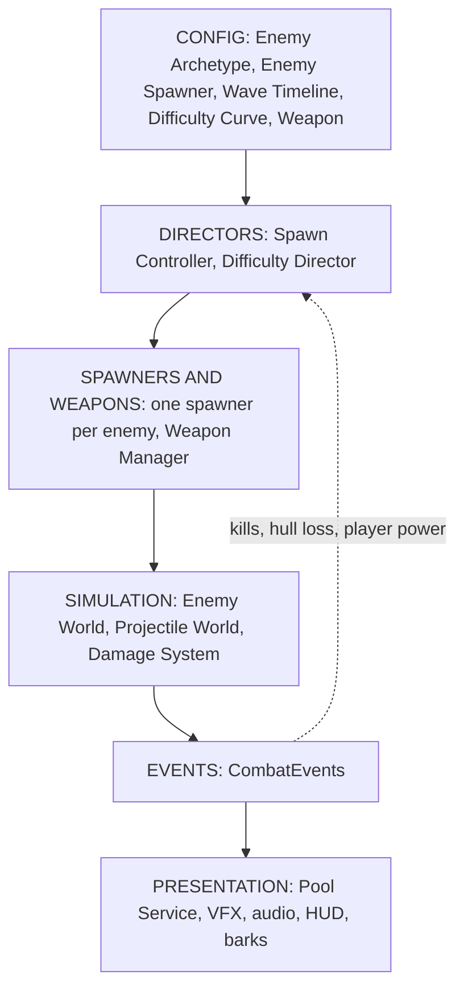
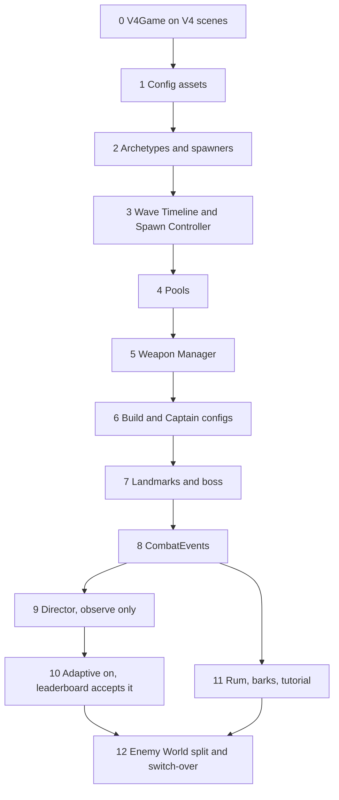

# Rogue Pirates — V4 Implementation Plan

This plan implements the architecture in [GAMEPLAY_FLOW_AND_MODULES.md](GAMEPLAY_FLOW_AND_MODULES.md) section 5. That document is the source of truth, including the decisions already recorded there:

- Adaptive difficulty runs in every mode, and the weekly leaderboard accepts adaptive pressure (section 5.3).
- The Saltwind schedule is a Wave Timeline: data, dynamic, and editable during play (section 5.2).
- Captain active skills are on by default (decision 21).
- The other adopted decisions in section 21 (Rum only, Swivel Guns for Rook, each other Captain keeps their own starting weapon, no barrels, six weapon slots).

V4 is a new scene set and a new assembly. It is **not** a renamed copy of V3. V3 stays playable and is not edited. Reusable V3 and shared code is **moved into** the modules below. Anything that is the old structure (one giant spawner, one giant weapon class, enemy behavior chosen by name) is not carried forward as the V4 design.

---

## 1. The architecture being built

This is section 5.1. Implementation does not replace it with the current V3 object graph.



| Module | Responsibility | What moves in from the current project | What is not kept |
|---|---|---|---|
| **Enemy Archetype** | One asset per enemy: stats, tier, threat, rewards, movement, attack, specials, pool size. Elites and specialists are override assets. | `EnemyDefinition` (34 lines), `SpawnProfileModules` behavior data (167 lines), generated from `EnemyCombatProfileRegistry` (191) and `CombatSpecialistEnemyCatalog` (73) | The C# profile registry and the boot-time specialist clones |
| **Enemy Spawner** | One asset per enemy for how it enters: group, placement, cooldown, cap, weight against pressure. No stats. | `SpawnProfile` placement and timing (34 lines), `SpawnPlacementService` (283 lines, used as-is) | Per-enemy `if (id == …)` caps |
| **Wave Timeline** | One asset per stage. Ordered phases with triggers, threat per second, weighted spawners, bursts, caps. The Saltwind table in section 5.2 is the default preset only. | Numbers from `StageBalanceProfile` spawn and timing fields, and the band tables in `SaltwindAmbientCompositionLogic` (lines 16–34) | `EncounterSpawnSchedule` named slots, and the hardcoded beat names in `V3PressureBeatDirector` |
| **Difficulty Curve** | Designed health, damage and expected-power curves, plus clamp and smoothing rules. | The formulas in `GameConstants.EnemyHP` and `EnemyDamage` (lines 137–149) become keyframes | Those formulas as code |
| **Difficulty Director** | Once per second, builds Pressure from player power and performance. Bends threat rate, elite chance, tier timing and composition. Never bends boss health, scripted beat times, or rewards. Adaptive mode is the shipping mode, including ranked runs. | `RunRng` director stream (73 lines), `EnemyTierLogic` gates (lines 43–59) become one input | A separate ranked curve |
| **Spawn Controller** | One per run. Advances the phase, spends the threat budget, runs scripted bursts and triggered encounters. | Budget and retry behavior from `EncounterSpawner` (842 lines), `SpawnModifierStack` (69), `AmbientSpawnBudget` (27), `RunRng` | `EncounterSpawner` as the V4 API |
| **Weapon** | One asset per weapon, including Swivel Guns, Long Nine, Harpoon and Mortar. | `WeaponDefinition` (116 lines). The four weapons that `CombatWeaponCatalog` creates in code become real assets | Runtime-only weapon definitions |
| **Weapon Manager** | Six slots. One behavior per firing pattern. One stat resolver: config × upgrades × player stats × Items. | Targeting from `WeaponTargeting` (435 lines) and the stat math inside `WeaponController` (1,568 lines) | The  weapon-name branches |
| **Player Power Index** | Offense and defense versus the expected value for that minute, plus kill rate and hull-loss rate. | Combat telemetry already recorded by `RunCombatSignals` (113 lines) | A hand-tuned power number per build |
| **Enemy World** | Agents, movement, attacks. Split into registry, movement, attack and behavior modules. | `EnemyWorld` (1,401 lines) and `SaltwindCombatBehaviorSystem` (895 lines), moved behind archetype modules | Enemy-name branches |
| **Damage System** | Hits, crits, status, kills. Difficulty multipliers are already baked in at spawn. | `DamageSystem` (77 lines), `StatusController`, `DamageReceiver` | None; this stays |
| **Projectile World** | Fixed slot pools for player shots, enemy shots, kegs, strikes and hazards. | `ProjectileWorld` (278), `HostileProjectileWorld` (145) | Growing lists inside the weapon class |
| **CombatEvents** | Per-tick events. HUD, audio, VFX, barks, telemetry and the Difficulty Director only read this. | `RunCombatSignals` becomes the first consumer list | Animation callbacks that cause damage |
| **Pool Service and Pool Catalog** | One view pool and one prewarm catalog. Prewarm comes from the timeline plus the weapon offer pool. | `ProjectileViewPool` (155), `VfxPool` (59), `EnemyViewPool` (143), `PickupViewPool` (238) | Four separate pool implementations |
| **Ship** | Existing ship movement, hull and stats. Read-only snapshot each tick for the Weapon Manager and the power index. | `PlayerShipController` (597), `PlayerStats` (68), `FollowCamera` | No sailing physics, no manual aim |

**Also moved, as config on the same layers (gameplay doc sections 6–16):**

| Gameplay data | Lands on |
|---|---|
| Captains, passives, actives (on by default) | Captain config read by Ship and Weapon Manager |
| Level-up weights, Logbooks, Items, Evolutions, powerups | Config consumed by Weapon Manager and the stat resolver |
| Chests, landmarks, Beacon, Barnacle King | Stage content config; boss attacks are data, not a hardcoded phase |
| Overtime and storm | The last phases of the Wave Timeline, not a separate director |
| Rum sources and results | Reward config listening to CombatEvents. The saved field stays `marks` |
| Barks and the nine tutorial steps | Data listening to CombatEvents |

**Left where it is, because nothing in the game uses it yet:** `TerritoryService` (44 lines), `RaidSettlementService` (40 lines), `BiomeCatalog` and the three mastery preset names. They are not V4's architecture. Home, raids and extra biomes come after the combat architecture is in and verified.

---

## 2. Where V4 lives

| Path | Role |
|---|---|
| `Assets/_Game/Scenes/V4/` | `V4Boot`, `V4MainMenu`, `V4SaltwindRun`, `V4ModuleLab` |
| `Assets/_Game/V4/Runtime/` | New assembly `RoguePirates.V4`, namespace `RoguePirates.V4`. References `HighSeas.Runtime` and `RoguePirates.Simulation`. Nothing in `HighSeas.Runtime` references V4. |
| `Assets/_Game/V4/Data/` | The config assets in section 1 |
| `Assets/_Game/V4/Editor/` | Generators and validators |
| `Assets/_Game/Tests/V4/` | Edit Mode and Play Mode tests |
| `plan/v4-verification/phase-NN/` | Evidence |

### Scenes, taken from the V3 scenes

Verified: `V3Boot` contains only `V3BootLoader`. `V3MainMenu` contains only `V3MainMenuController`. `V3SaltwindRun` places `V3RunBootstrap`, `V3AuthoredGameplayHud`, `V3RunResultsScreen` and `StageBalanceProfileHost`, plus the shared ship, camera, `EnemyWorld`, `WeaponController`, `EncounterSpawner` and HUD. Those shared objects stay in the duplicated scene. The V3-specific components are removed and replaced by **one** `V4Game` component.

`V4Game` is the composition root. On play it creates the modules in section 1 and connects them. It does not grow into a second `V3RunBootstrap`.

| Source scene | V4 scene |
|---|---|
| `Scenes/v3/V3Boot.unity` | `V4Boot` loads `V4MainMenu` |
| `Scenes/v3/V3MainMenu.unity` | `V4MainMenu` loads `V4SaltwindRun` |
| `Scenes/v3/V3SaltwindRun.unity` | `V4SaltwindRun`, with `V4Game` instead of the V3 bootstrap |
| `Scenes/Tests/Test_WeaponEnemy.unity` | `V4ModuleLab`, which runs any one module on its own |

Duplicate the scenes in the Unity Editor so the copies get new identifiers. Do not copy `.meta` files. Co-op, PvP and the map-generator scenes are not part of this plan.

### The one temporary bridge

Until the Spawn Controller and Weapon Manager exist, `V4Game` may call the current spawner and weapon class through a single class, `V4LegacyBridge`. That class is not a module and not an API. Phase 4 deletes its spawn path. Phase 5 deletes the class. No new behavior is added to V3 files to support it.

---

## 3. Tuning Console

One in-game panel, bound to the **config assets in section 1**, not to `StageBalanceProfile`.

- Open with F1, the gamepad Select button, or an on-screen gear. The game keeps running unless "Pause while open" is on.
- Each architecture module is a collapsible section. Search covers every section.
- A field edit changes the run's copy of that config. It does not write the asset unless the Editor-only "Write back" button is used.
- Every edit is logged with the run time, the old value and the new value. Telemetry stores that log and the config hash.
- Presets save and load as JSON. Reloading a preset and replaying the seed must reproduce the telemetry.
- Top of the panel, always visible: run time, current timeline phase, Pressure (once the director exists), enemies alive, pool use, FPS. Actions: jump to time, trigger a phase, spawn an archetype, grant a weapon or Item, force the boss, force death.
- The console is compiled only into development builds. Phase 12 proves a release build does not contain it.

| Console section | Appears when this module lands |
|---|---|
| Run | Phase 0 |
| Enemy Archetypes, Enemy Spawners | Phase 2 |
| Wave Timeline | Phase 3 |
| Pools | Phase 4 |
| Weapons, Evolutions | Phase 5 |
| Level-ups, Logbooks, Items, Powerups, Captains | Phase 6 |
| Landmarks, Beacon, Boss | Phase 7 |
| Events | Phase 8 |
| Difficulty Curve, Difficulty Director | Phases 9 and 10 |
| Rum and Results | Phase 11 |
| Barks and Tutorial | Phase 11 |

---

## 4. How a phase is proved

A phase is **Passed** only when `plan/v4-verification/phase-NN/` contains all of the following.

| Evidence | What it proves |
|---|---|
| `CHECKLIST.md` | Every exit item, with a status |
| `editmode-results.xml` and `playmode-results.xml` | Tests ran. Check the timestamp, the test count and the failures |
| `v3-regression-results.xml` | V3 tests are still green, because V3 was not edited |
| `unity-console.log` | No errors during the playable check |
| `telemetry-seed-101.jsonl`, plus 202 and 303 | Seeded traces, including the config hash and the tuning change log |
| `config-hash.txt` | The hash of every config the phase loaded |
| `playable-check.md` | What was played, which console values were changed, and what happened |
| `diff-summary.md` | `git diff --stat` showing no V3 file changes |

Status words: **Not started**, **Implemented, unverified**, **Failed**, **Passed**, **Pending playtest**. Feel and fun stay Pending playtest until a person says so. A passing test is not that.

Phase 0 records the V3 traces for seeds 101, 202 and 303 using the Module Lab input recorder: spawns per minute, level times, chests, boss time, death time, Rum. Later phases must match those traces unless the checklist explains the intended difference.

From the repo root, with the Editor connected:

```powershell
$env:UNITY_PROJECT_PATH = Join-Path (Get-Location) 'Pirate Game Unity'
unity status --json
unity pipeline list
unity test "Pirate Game Unity" --mode EditMode --output "plan/v4-verification/phase-NN/editmode-results.xml"
unity test "Pirate Game Unity" --mode PlayMode --output "plan/v4-verification/phase-NN/playmode-results.xml"
```

If `unity` is not on the path, use `C:/Program Files/Unity/Hub/Editor/6000.3.11f1/Editor/Unity.exe`. Do not run batch mode while the Editor has the project open. An exit code alone is not proof; the XML must exist and list the tests.

---

## 5. Phases

Each phase adds one architecture module, moves the listed code into it, exposes that module in the Tuning Console, and leaves `V4SaltwindRun` playable. Open a phase for the work, the play test and the proof.

<details>
<summary><strong>Phase 0 — Composition root on the V4 scenes</strong></summary>

**Builds:** `V4Game`, the module slots from section 1, an empty `CombatEvents` buffer, and the console shell. No gameplay rules yet.

**Moves in:** scene objects already in `V3SaltwindRun` (ship, camera, water, HUD views). They are referenced, not copied into new scripts.

**Work**
1. Create the V4 assembly, folders and the four scenes in section 2.
2. `V4Game` constructs the module list. Unbuilt modules are the single `V4LegacyBridge`, marked with the phase that deletes it.
3. Console section **Run**: seed, restart, time scale, pause-while-open, god mode, jump to time, force death.
4. Add the V4 scenes to build settings after the V3 scenes.
5. Record the three V3 seed traces.

**Playable check:** Boot `V4Boot` → menu → `V4SaltwindRun`. Play to the boss and die. Open the console and restart on seed 101.

**Proof:** V4 plays a full run. Seed 101 matches the V3 trace. `V4LegacyBridge` is the only class that calls `EncounterSpawner` or `WeaponController`. V3 tests are green.

</details>

<details>
<summary><strong>Phase 1 — Config assets, and the Saltwind data moved into them</strong></summary>

**Builds:** the five config types: Enemy Archetype, Enemy Spawner, Wave Timeline, Difficulty Curve, Weapon. Empty of behavior. Filled with today's numbers.

**Moves in:** field values from `SaltwindSoloStageBalanceProfile.asset`, `StageBalanceProfile.cs` lines 24–141, and the content lists named in section 5.7. The asset types stay in V3. V4 does not grow a second `StageBalanceProfile`.

**Work**
1. Author the schemas from section 5.1 and 5.6, including schema version, balance version and the content hash.
2. An editor tool copies current values into `Assets/_Game/V4/Data/`. The default Wave Timeline is the section 5.2 table, including band 0 at **0.5** enemies per second (the live asset, not the 0.6 code default).
3. `V4Game` loads this set. The bridge reads it, so a console edit already changes the run.
4. Validator: missing ids, zero weights, caps below a burst, stats outside the `StatId` range (`GameEnums.cs` lines 170–193).

**Console:** every field of the five configs, grouped by asset, collapsible per enemy, phase and weapon. Reset, preset save and load, live hash.

**Playable check:** During a run, set Band 2 threat from 1.8 to 4 and watch density change. Save the preset, restart, and confirm it applies from the start.

**Proof:** A reflection test fails if any config field has no console row. Preset replay of seed 101 matches. The hash changes when a value changes.

</details>

<details>
<summary><strong>Phase 2 — Enemy Archetypes and Enemy Spawners</strong></summary>

**Builds:** real archetype and spawner assets for all 24 ids (14 authored, 8 specialists, 2 overtime). Variants point at a base. Tier lives on the archetype. Concurrency limits are tags, checked the same way for every enemy.

**Moves in:** `EnemyDefinition`, `SpawnProfileModules`, `SpawnPlacementService`. The generator reads `EnemyCombatProfileRegistry` and `CombatSpecialistEnemyCatalog` once, then those classes are not used by V4.

**Playable check:** In `V4ModuleLab`, spawn each archetype alone. Change a telegraph time in the console and see the next attack use it. In `V4SaltwindRun`, set the ranged-gunner tag cap to 1 and confirm a second Cannonboat does not spawn.

**Proof:** For all 24 ids, values resolved through the six layers in section 5.6 equal today's resolved values. A search test fails if V4 spawn code compares an enemy name.

</details>

<details>
<summary><strong>Phase 3 — Wave Timeline and Spawn Controller</strong></summary>

**Builds:** `SpawnController` and one `IEnemySpawner` per spawner asset. This is the V4 spawn path.

**Moves in:** budget, retry, reserved slots and pause behavior from `EncounterSpawner`; `SpawnModifierStack`; `AmbientSpawnBudget`; `RunRng`.

**Timeline rules, from section 5.2:**
- Triggers: time, event, previous phase cleared, or a condition (level, kills, Pressure).
- Threat per second is data. Later, the Difficulty Director multiplies it.
- Warnings are generated from the trigger. No fixed "at 4:00" strings.
- Scripted beats keep their authored time. Condition-triggered phases may move earlier once the director is on.
- Overtime and the storm are phases of this same asset, not another director.

**Deletes:** the spawn half of `V4LegacyBridge`. `V3PressureBeatDirector` is not forked.

**Console section — Wave Timeline:** add, duplicate, delete and reorder phases; edit trigger, duration, threat, spawner weights, caps and warning; buttons for Trigger now and Skip.

**Playable check:** Add a phase at 2:30 that spawns only Bomb Boats, and watch it. Change the elite Hammerhead trigger to "level at least 8" and confirm it waits. Save the preset and replay it.

**Proof:** The default preset matches the V3 spawn traces for seeds 101, 202 and 303. A capped run does not store a spawn debt. Burst slots are reserved. `EncounterSpawner` has no caller under `Assets/_Game/V4/`.

</details>

<details>
<summary><strong>Phase 4 — Pool Service, Pool Catalog, slot pools</strong></summary>

**Builds:** `PoolService`, `PoolCatalog`, `SlotPool`. Prewarm list comes from the Wave Timeline plus the weapon offer pool.

**Moves in:** the four view pools. `WeaponJuiceController`'s direct object creation (686 lines) goes through `PoolService` on the V4 path.

**Console section — Pools:** per-pool prewarm, cap, overflow policy, in-use and peak counts, and a counter of objects created after prewarm. It must stay at 0.

**Playable check:** Play ten minutes with six weapons. The counter stays at 0. Lower a cap during play and see the overflow policy.

**Proof:** A Play Mode test counts `Instantiate` during combat after prewarm and requires 0. Spawn traces are unchanged.

</details>

<details>
<summary><strong>Phase 5 — Weapon configs and Weapon Manager</strong></summary>

**Builds:** one `WeaponConfig` per weapon and `WeaponManager` with one behavior per pattern: projectile, fan, mine, orbit, trail, chain, pulse, predicted area, summon. Powder Kegs stay trailing. Every other weapon aims itself. Stat resolver: config × rank × player stats × Items.

**Moves in:** `WeaponDefinition`, `WeaponTargeting`, and the firing math from `WeaponController`. Evolutions move from `WeaponEvolutionCatalog` (lines 35–49) into assets: base weapon, required Item, behavior change.

**Deletes:** `V4LegacyBridge` entirely.

**Design rules applied here:** six slots; starter pool is Swivel Guns, Deck Cannons, Broadside, Powder Kegs, Flying Cutlasses, Long Nine; Lightning Mast, Flamethrower, Mortar and Harpoon are unlocks.

**Console section — Weapons:** per weapon, the combat numbers, targeting, upgrade steps and pool keys; grant, remove and set rank; force an evolution.

**Playable check:** In `V4ModuleLab`, fire each weapon alone and change its cooldown live. Force Deck Cannons into Stormshot Cannon.

**Proof:** Ranks 1, 4, 8 and 12 match today's exported weapon stats. A weapon with no target does not spend its cooldown. A search test finds no weapon-name comparison under `Assets/_Game/V4/`. `WeaponController` has no caller there.

</details>

<details>
<summary><strong>Phase 6 — Build configs: level-ups, Logbooks, Items, powerups, Captains</strong></summary>

**Builds:** config for offer weights, Logbooks, Items, chest pools, powerups and Captains. Items are modifiers and triggered effects on the stat resolver. They are not `HasItem("…")` checks.

**Moves in:** the offer-weight table (`LevelOfferGenerator.cs` lines 464–476), `V3ItemCatalog` (lines 48–117), `WeaponEvolution` requirements, `V3PowerupCatalog` (lines 9–34), and the Captain numbers in `V3CaptainProfile.cs` (lines 28–47) and `V3CaptainCatalog.cs`.

**Decisions applied in this phase**
- Rook starts with Swivel Guns. Hank starts with Deck Cannons, Richie with Broadside, Sparky with Powder Kegs, Ember with Flamethrower, Roxie with Lightning Mast. First Conquest still forces Swivel Guns.
- Active skills default **on**. The current code defaults them off (`CombatExperimentProfile.cs` lines 59–63); V4 does not copy that default.
- Richie, Ember and Roxie require their weapon unlock. Hank and Sparky keep their Rum costs from the profile asset (100 and 140).
- Logbook assets with a wrong or invalid stat are corrected: Scavenger's Net, Cartographer's Folio, Quartermaster's Ledger, Navigator's Charts (section 11 of the gameplay doc).
- Saltwind powerups are Repair Supplies, Powder Rush, Magnetic Tide and Dead Calm.

**Console:** weights by weapon count, per-Logbook step, per-Item effect, chest membership, powerup magnitude and weight, per-Captain hull, speed, passive, active cooldown and unlock cost. Buttons to grant a level, an Item, or switch Captain and restart.

**Playable check:** Play Rook and Hank and confirm the starting guns. Press Space and see the active skill. Set the new-weapon offer weight to 100 and see only new-weapon cards.

**Proof:** Default weights and chest rolls match today's tests. Each Item has one effect test. No Item-name or Captain-name comparison remains under `Assets/_Game/V4/`.

</details>

<details>
<summary><strong>Phase 7 — Landmarks, Beacon and Barnacle King as config</strong></summary>

**Builds:** stage content config for the four landmarks, the Beacon, and the boss attack list. Explosive barrels are not in the config, so they do not spawn.

**Moves in:** placement and interaction from `V3StagePoiPlacer`, `V3DiscoverySystem` and `POIManager`, and the attack timings from `BarnacleKingBossAttackDirector`. The 30% threshold on line 87 becomes a field. Rewards and hint times come from the config that was filled in Phase 1 (Beacon hints 5:00 and 7:00).

**Console:** landmark rewards, Beacon radius and hint times, boss phase thresholds and the attack list. Buttons: reveal Beacon, summon boss, set boss health percent.

**Playable check:** Reorder phase 1 to Charge, Charge, Volley and fight it. Set the boss to 31% health and confirm the phase change waits until the current attack finishes.

**Proof:** 100 seeds have the right landmark counts and a reachable Beacon. Used landmarks do not return. Boss victory is saved once. Boss and player dying on the same tick still counts as a win. No barrel objects exist after `V4Game` starts.

</details>

<details>
<summary><strong>Phase 8 — CombatEvents, then presentation only listens</strong></summary>

**Builds:** the per-tick event buffer from section 5.4: spawned, killed, fired, hit, damaged, power changed, wave changed, config changed.

**Moves in:** `RunCombatSignals` and the combat telemetry writer, as readers. HUD, damage numbers and weapon VFX in the V4 scene subscribe. They do not call simulation methods.

**Console section — Events:** counts per event type, a filterable log, export of the session (telemetry, change log, preset, hash).

**Playable check:** Play with the log open. Kills, shots and phase changes appear. Export the session and confirm the hash matches the console.

**Proof:** A test records event order inside one tick. The V4 presentation assembly is not referenced by simulation types. Seed traces stay the same as Phase 7.

</details>

<details>
<summary><strong>Phase 9 — Difficulty Curve, Player Power Index, director in observe mode</strong></summary>

**Builds:** `DifficultyCurveConfig`, `PlayerPowerIndex`, `DifficultyDirector`. The director samples every second, logs Pressure, and changes nothing.

**Moves in:** `GameConstants.EnemyHP` and `EnemyDamage` become the default keyframes. Expected offense and defense curves start from the Phase 0 seed traces. `RunRng` is already inside the Spawn Controller.

**Console section — Difficulty:** live Pressure, offense, defense and performance; editable curves, gains, clamps (0.85–1.35), smoothing (20 seconds) and maximum change per second (0.02). Mode switch: Off, Observe, Adaptive. This phase stays on Observe.

**Playable check:** Play a one-weapon run and a six-weapon run. Pressure differs on the graph. Spawns match a run with the director off.

**Proof:** Default keyframes equal the old formulas at each minute. Observe-mode traces equal Phase 8 traces for the same seed. The director output is identical when the same inputs are replayed.

</details>

<details>
<summary><strong>Phase 10 — Adaptive difficulty on, including the leaderboard</strong></summary>

**Builds:** the shipping difficulty mode from section 5.3. One lever at a time, each with its own evidence folder: threat rate, elite chance, tier timing, composition bias, then enemy health only while the cap is full.

**Rules that are not optional**
- Adaptive mode is the default for every run, including ranked runs.
- The weekly board accepts the resulting kill counts. Each entry stores average Pressure, peak Pressure, director version and config hash.
- Replay of the same inputs reproduces the same Pressure and the same kills.
- Boss health, scripted beat times and per-kill rewards do not adapt.
- Clamps are the same for every player.

Condition-triggered timeline phases may fire up to about a minute early for a strong build. Time-triggered beats do not move.

**Console:** a toggle and a range per lever, and a test-only "force Pressure" slider.

**Playable check:** For each lever, play a strong and a weak build and confirm the lever stays inside its clamp. Force Pressure to 1.35 and see the timeline rate rise.

**Proof:** Clamp, smoothing and the never-adapt list have tests. A ranked-run fixture stores Pressure beside the kill count. Strong and weak runs both finish inside the time-to-death band recorded in the checklist, or the miss is written down instead of tuned away in secret.

</details>

<details>
<summary><strong>Phase 11 — Rum, results, barks, tutorial</strong></summary>

**Builds:** reward config and narrative config, both as CombatEvents readers.

**Rum.** Sources are data rows: event, amount, condition, cap. Defaults are the current Marks table (2 per qualifying minute, 3 per landmark, 5 per elite, 25 for the boss, 3 per overtime minute up to 15). Settlement stays once per run id, using `SaveService.TrySettleRun` (lines 189–200). The save field stays `marks`. The results screen says **Rum**. Gold is spent on chests and expires. The doubloon bank is not on the V4 path.

**Barks and tutorial.** About 30 barks and the nine First Conquest steps from section 6. Each is an event, a speaker, text, a cooldown and a priority. They never pause the run after the boss.

**Console:** per Rum source, per bark, per tutorial step, with "pay this source" and "play this bark" buttons.

**Playable check:** Add a source of 1 Rum per chest, see it on the results screen, and confirm a second death callback does not pay again. Play a fresh First Conquest and see the steps in order.

**Proof:** The 52-Rum fixture from the current settlement tests passes on the default rows. A failed run still pays what it earned. Tutorial steps cannot complete out of order.

</details>

<details>
<summary><strong>Phase 12 — Split Enemy World, then make V4 the boot scene</strong></summary>

**Builds:** the Enemy World split from section 5.7: registry, movement, attack, archetype behavior modules, view sync. This is last because it changes no rules.

**Moves in:** the rest of `EnemyWorld` and `SaltwindCombatBehaviorSystem`.

**Then**
- Profile a ten-minute six-weapon run. Record the machine, the build and the frame time.
- Build a release player with the console compiled out, and confirm the console types are absent.
- Put `V4Boot` first in the build list. Leave the V3 scenes in the project, unlisted, until V4 has a Passed playtest.

**Proof:** No enemy-name comparison remains under `Assets/_Game/V4/`. All V4 and V3 test files are green. Seed 101 still matches the Phase 10 trace, plus the explained adaptive difference. `playable-check.md` either has notes from a person or is marked Pending playtest.

</details>

---

## 6. Order



Phase 11 can proceed beside Phases 9 and 10. It must not turn adaptive mode off.

---

## 7. Status

| Phase | Module | Status | Evidence |
|---|---|---|---|
| 0 | Composition root | Not started | `plan/v4-verification/phase-00-composition/` |
| 1 | Config assets | Not started | `plan/v4-verification/phase-01-config/` |
| 2 | Archetypes and spawners | Not started | `plan/v4-verification/phase-02-archetypes/` |
| 3 | Wave Timeline and Spawn Controller | Not started | `plan/v4-verification/phase-03-timeline/` |
| 4 | Pools | Not started | `plan/v4-verification/phase-04-pools/` |
| 5 | Weapon Manager | Not started | `plan/v4-verification/phase-05-weapons/` |
| 6 | Build and Captains | Not started | `plan/v4-verification/phase-06-build/` |
| 7 | Landmarks and boss | Not started | `plan/v4-verification/phase-07-boss/` |
| 8 | CombatEvents | Not started | `plan/v4-verification/phase-08-events/` |
| 9 | Difficulty Director, observe | Not started | `plan/v4-verification/phase-09-director/` |
| 10 | Adaptive difficulty | Not started | `plan/v4-verification/phase-10-adaptive/` |
| 11 | Rum, barks, tutorial | Not started | `plan/v4-verification/phase-11-rum-barks/` |
| 12 | Enemy World split and switch-over | Not started | `plan/v4-verification/phase-12-switch/` |
