# Rogue Pirates: Art Guide

Oct 7, 2026 · @Kshitij

## How to read this guide

Hand-off for the art and VFX team: the style rules, the mobile-web budgets, and for every piece of content what it does in play, how it should read, what exists today and what is missing (V5 M6). The markdown source is `plan/v5/phase-06-art/ART_GUIDE.md`.

- **Paths** are under `Pirate Game Unity/` unless they start with `plan/`. "Data" means `Assets/_Game/V4/Data/`.
- **Status**: **exists** (production-style art in the game, maybe over budget), **placeholder** (a primitive, a borrowed model, a tint of another model or a reused effect), **needed** (nothing in the project), **deferred** (content not built yet, D33).
- **Priority**: **P0** hurts readability or the phone budget today; **P1** needed for the content built in M4-M5 and for M7; **P2** later phases (M14 island, M25 sails, M27 brands); **P3** later biomes and polish.
- **Triangles** were counted from the model files in this repo (FBX polygon indices or Unity mesh assets), the whole model at LOD0; a prefab may draw less. **Particles** are the sum of the effect's authored `maxParticles` caps (an upper bound) and the number of particle systems ("PS").
- Gameplay ships on placeholders tagged `PLACEHOLDER_v5_*` (plan D13); this guide is what replaces them.

## 0. What changed since 1 Oct

Since 1 Oct, playtest rounds 1-10 and M8z changed what art is most urgent. Missing icons now keep content out of the game: 28 items stay out of chests and 9 weapons show their name instead of an icon. PvP, the menus and the off-screen arrows also need art this guide did not list (section 17). No new art files were added to the project in this period; every change below is code or config.

| Date | Change in the game | What it means for art | Section |
| --- | --- | --- | --- |
| 7 Oct | Logbooks are offered more often (also with six weapons); their cards say LOGBOOK | Logbook icons show on more cards; all 15 catalogue slots are still empty | 6, 14 |
| 6-7 Oct | Off-screen arrows point to the boss, minibosses and scheduled elites, with name and distance (red-orange for boss and minibosses, gold for elites) | Arrow sprites and a small label plate are needed; today the arrows are drawn in code (`ThreatArrowPresenter.cs`) | 17 |
| 6 Oct | Timed heals drop in view ahead of the ship, twice as often under 35% hull; everything is unlocked for the playtest | The Health barrel is on screen far more often: its 1,752-triangle model moves up to P0 | 7 |
| 6 Oct | Every point of interest is back, and the boss is summoned at the Treasury Beacon again | The Beacon marker is now the Shuriken water whirlpool (`Assets/Prefabs/VFX/whirlpool.prefab`, 322 triangles, 2 PS), which works on WebGL | 8 |
| 5 Oct | Salvage chests are back, drawn at 0.75 scale | Still the 77,650-triangle model: still priority 1 | 8, 16 |
| 4 Oct | Health bars only on elites, minibosses and the boss (and the PvP opponent) | One bar style for those four uses; ordinary enemies have no bar | 7, 17 |
| 3 Oct | Borrowed icons removed: cards without art show the weapon or item name | 9 weapons and 28 items have no icon; the 28 items are kept out of the chest pool until they get one | 3.2, 5.2, 14 |
| 3 Oct | Weapons that are not cannons no longer borrow the cannonball: coloured-primitive stand-ins are built in code for the parrots, the monkey turret and its shots, the anchors, the lanterns and the coins (`WeaponPlaceholderModels.cs`) | These five still need real models; the stand-ins show the intended size and colour | 3.2 |
| 3 Oct | No masthead pennant on enemies; each ship type has its own sail and flag colour, and its hull leans towards it | The colour codes in section 9.3 are now the enemy colour language; new models must keep sail and flag areas for them | 9.3 |
| 3 Oct | Aura weapons draw a ring; non-projectile enemy attacks get a warning; cannonballs are dark with a trail | The telegraph kit (1.3) and the aura rings should share one material | 1.3, 3 |
| 3 Oct | Every hit shows a damage number and a flash; every kill explodes | The hit kit and kill burst play far more often: their budget matters more | 3.1 |
| 3 Oct | The Flamethrower is switched off (cards, chests, draft, shop) until its redo; Ember starts with another weapon | The flamethrower redo is what brings the weapon back | 3.1 |
| 3 Oct | The Reef Crab keeps 10-14 m away and lobs one big, slow cannonball every 2.5 s after a 0.6 s aim; the Kraken elite is drawn 1.5× | A large, readable boss-style shot and an aim warning are needed for the crab | 9, 10 |
| 3 Oct | 1v1 PvP (lobby, invite links, draft, match, end screen), guest profiles, weekly leaderboard, item popup | New UI and in-world art | 17 |
| 2 Oct | 15-minute Survivor.io-style voyage with rings and hordes of 12-26 ordinary enemies | Many cheap enemies on screen at once: the 300-800 triangle budget for ordinary enemies matters more | 2, 9 |
| 1 Oct | Mobile UI and touch input (M7), menu hub, shop and inventory (M8) | Touch controls and menu art | 17 |

## 1. Style rules

Stylized low-poly on one colour atlas, readable from above at phone size, with one model per behaviour and Shuriken-only effects.

### 1.1 Look

| Rule | Detail |
| --- | --- |
| Stylized low-poly | Flat or gently graded colour, chunky shapes, bevels only where they catch light. Islands use a 128×128 colour atlas (`Assets/Texture2D/ColorAtlas.png`, `Assets/Material/Coloratlas.mat`, 23 prefabs): new props sample the same atlas. |
| Saturated, warm sea | Turquoise shallows, deep teal water, sand, green palms; the player and rewards warm (gold, cream, red sails), enemies cooler or dirtier, hazards hot (orange, red). |
| Readable at the game camera | Top-down follow camera, offset (0, 25, -20), pitch about 51-56°; the view spans about 32 m around the ship, up to \~55-60 m at boost zoom. The top silhouette carries the identity. Check every asset at gameplay scale on a 6 inch phone, portrait and landscape. |
| One silhouette per role | Each enemy that attacks differently gets its own model (M3d rule: an enemy that looks the same always behaves the same). Tint and size alone are a stopgap. |
| Size tells threat | Fodder small, specialists medium, elites large with a crown or trim, bosses fill a sixth of the screen. Elites are drawn 2.15× today. |
| No UI text in world art | Names and numbers live in UI. UI text has no em dashes (owner rule). |
| Accessible | Never rely on red vs green alone: hazards add shape (rings, stripes, spikes); rewards add sparkle and bob. |

### 1.2 Colour language

| Meaning | Colour | Used by |
| --- | --- | --- |
| Player weapons | Each weapon family its own hue (section 3); five weapons share the default cyan (0.65, 1, 1) today | Projectiles, aim overlay |
| Enemy attack warning | Orange-red (1, 0.35, 0.1, alpha 0.55) | All enemy telegraphs |
| Danger zone active | Bright red-orange, opaque edge | Strike moment, burning patches |
| Gold | (1, 0.85, 0.15) | Coins, gold barrels, Rich elites |
| XP | Cyan (0.2, 0.95, 1) | XP gems |
| Heal | Green (0.18, 1, 0.42) | Health barrels, Repair Supplies, repair tender |
| Rarity 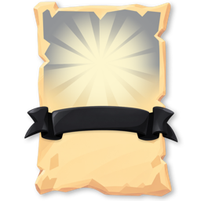 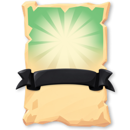  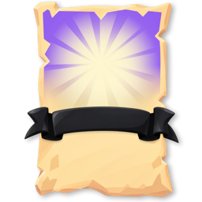 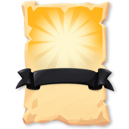 | Common grey, Uncommon green, Rare blue, Epic purple, Legendary gold | Card frames `Assets/UI/New_items/Upgrade Cards/*.png` |
| Player damage flash | (1, 0.25, 0.2), 0.12 s | `DemoJuiceSettings.asset` |

### 1.3 Telegraph language

Every enemy attack shows its shape on the water, in the warning colour, before it lands.

| Attack shape | Telegraph | Duration today |
| --- | --- | --- |
| Circle strike (kraken, boss slam) | Flat ring filling from the centre; edge solid, inside 20-30% alpha | 1.0-1.5 s |
| Line charge (swordfish, rammer, boss charge) | Arrow or lane rectangle along the dash | 0.6-1.5 s |
| Fan volley (manta, boss spread) | Wedge with the shot lanes as gaps | 0.9-1.2 s |
| Projectile | The shot itself: bright core, dark outline, 0.13-0.45 m | - |
| Self-explosion (bomb boat) | Flashing fuse plus a ring at the blast radius | contact |

Rings are drawn by code today; the mortar telegraph is the Lightning Mast effect tinted red and the boss ring is the Fire Barrel prefab, both placeholders. **Needed (P1):** one telegraph kit (ring, filled disc, lane, wedge, a fill-over-time parameter, a strike flash, one material).

### 1.4 Technical rules for WebGL mobile

| Rule | Why |
| --- | --- |
| **No VFX Graph**, Shuriken only | WebGL has no compute shaders: `PF_Whirlpool.prefab` (VFX Graph) draws nothing on phones |
| No lights inside effects; no realtime point lights | Explosion prefabs carry lights today |
| Unlit or SimpleLit URP, SRP-Batcher compatible; one material per model where possible | 450-980 batches in the Editor; target 100-150 draw calls |
| No per-instance material copies for tints | Shared tinted materials keep batching |
| Effects and pickups cast no shadows | Done for pickups in M3e |
| Textures ≤1024 (hero), 512 (enemies, POIs), 256 (props, VFX sheets), power of two, ASTC/ETC2 overrides | 1145 of 1171 textures are 2048 with no mobile override today |
| VFX sheets share one or two atlases; soft particles off | Fill rate on Mali-G57 |
| Pivot at the waterline centre, +Z forward, 1 unit = 1 m | Pools and the simulation place by pivot |
| LOD0 plus a 50% LOD1 for anything over 2,000 triangles | Generated LODs cover only the 14 heaviest FBX today |
| Effects reset cleanly when pooled; one-shots loop off, hit lifetime ≤ 2 s | Everything is pooled |
| Deliver editable source, export and a gameplay-scale screenshot | Acceptance in `Rogue_Pirates_Asset_Checklist.md` |

## 2. Budgets (reference phone: Galaxy A15/A16 4G, Helio G99, Mali-G57 MC2, 30 fps)

The scene budget is 100-150k visible triangles, 100-150 draw calls and at most 1,000-1,500 live particles; today's art measures 1.45M triangles and 784 batches at 9:00 in the Editor (M3e), about 10× over. Other targets: 60-80 active enemies, compressed textures under \~100 MB, Unity heap \~256 MB (`plan/v5/research/DEVICE_TARGETS.md`).

| Asset class | Triangles LOD0 | Materials | Texture | Live particles | Today (worst) |
| --- | --- | --- | --- | --- | --- |
| Player ship (hull, sails, flag) | 3,000-5,000 | 2-3 | 1024 hull, 512 sail | wake ≤ 40 | Brig 20,008 tris, 48 PS (cap 1,536) |
| Ordinary enemy | 300-800 | 1 | 256-512 | 0 idle | RamShip 11,462 |
| Specialist enemy | 600-1,200 | 1 | 512 | ≤ 10 idle | Ghostboat 5,258 |
| Elite / miniboss | 1,500-2,500 | 1-2 | 512 | ≤ 20 aura | Crab 3,386 |
| Boss | 4,000-6,000 | 2 | 1024 | ≤ 150 in an attack | Crab 3,386 (shared with the miniboss) |
| Projectile | ≤ 100 or a billboard | shared | atlas | trail ≤ 8 | Cannonball cube 192 |
| Weapon mount on the ship | ≤ 500 | shared | atlas | muzzle ≤ 20 | Deck Cannons muzzle 11,992, Long Nine muzzle 18,266 |
| Orbit or summon model (cutlass, anchor, parrot) | ≤ 300 (turret ≤ 600) | shared | atlas | trail ≤ 10 | Cutlass 1,812 |
| Weapon hit / explosion | - | 1 sheet | atlas | ≤ 30 per hit, ≤ 3 PS | Explosion\_Large 17 PS |
| Persistent weapon effect (stream, aura, beam) | ≤ 200 | 1 | atlas | ≤ 80 | Lightning Mast 15 PS, cap 7,120 |
| Pickup (barrel, coin, gem) | ≤ 150 | shared | atlas | ≤ 3 sparkle | Barrels 1,752, 3-6 PS each |
| POI | 1,000-2,500 | 1-2 | 512 | idle ≤ 30 | Salvage Chest 77,650, 12 per stage |
| Island section | 3,000-6,000 | atlas | 128 atlas | 0 | Island\_Tropical\_7 20,718 (45-50 per stage) |
| Home-island decoration | 200-1,500 | atlas | atlas | ≤ 20 | - |
| Defense (M14) | 800-1,500 | 1-2 | 512 | muzzle ≤ 20 | - |
| Water | ≤ 8,000 visible | 1 | 512 | - | OceanGrid\_LOD0 131,072 (to check in M7) |

Heaviest models in use (1 Oct 2026):

| Model | Triangles | Used by | Note |
| --- | --- | --- | --- |
| `Assets/Mesh/Cursed/Treasure_chest/Treasure_chest.fbx` | 77,650 | Salvage Chest (12 per stage) | A 2,354-triangle chest exists: `Assets/Prefabs/VFX/SalvageChest.prefab` |
| `Assets/Mesh/Cursed/stone-arch/storn_arch.fbx` | 68,393 | `BossBeacon.prefab` (not the live beacon) 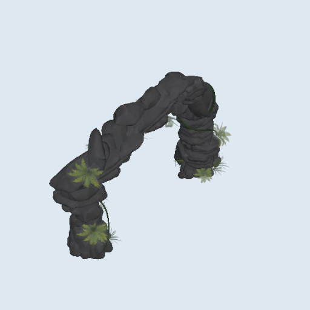 | Do not use as is |
| `Assets/Mesh/Brig.asset` (+ Sail.001, Flag) | 20,008 | Player ship `CutlassSloop.prefab` 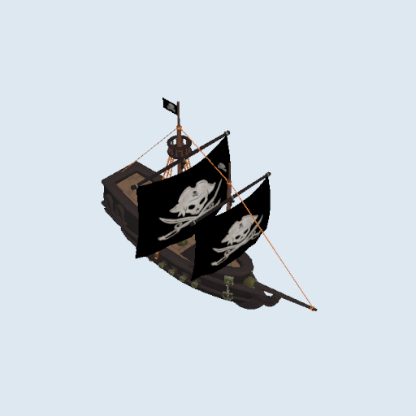 | Mesh asset: no generated LOD |
| `Assets/Stylish Cannon Pack/Cannon Pack/3.FBX`, `16.FBX` | 11,448 / 6,274 | Deck Cannons and Long Nine muzzle effects | Replace with mounts |
| `Assets/3D Models/ocean_buoy/ocean_buoy.fbx` | 12,240 | Signal Buoy |  |
| `Assets/3D Models/light_house/light_house.fbx` | 11,597 | Lighthouse of Fortune |  |
| `Assets/Mesh/RamShip.asset` | 11,198 | 5 enemy ids | No generated LOD |
| `Assets/Mesh/Cursed/repair wreck/repair_wreck.fbx` | 10,484 | Repair Wreck |  |
| `Assets/Mesh/Island_Mesh_1..10.asset` | 8,121-20,510 each | Every stage, 45-50 islands | Not LOD'd, not batched (D25) |

## 3. Weapons and their effects

Every weapon needs a mount on the ship, a muzzle, a projectile or body, a hit and, where listed, a persistent effect; the nine new weapons run on borrowed placeholders. Effects are bound in `Assets/_Game/Resources/DemoJuiceSettings.asset` and can be overridden per weapon in `Assets/_Game/V4/Resources/V4VfxProfiles.asset` (all empty today). Configs: `Data/Weapons/<id>.asset`.

### 3.1 Built weapons

| id | Name | In play | Art brief | GPT prompt | Colour (today → proposed) | Size | What exists | Status | Pri |
| --- | --- | --- | --- | --- | --- | --- | --- | --- | --- |
| deck\_cannons | 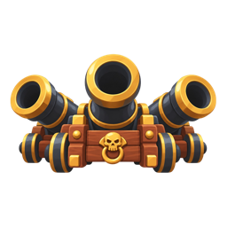 Deck Cannons | Forward shot, steer to aim, 16 m | **What it is:** the starter gun, twin bow cannons firing round shot straight ahead. **In play:** a shot every 0.7 s along the bow out to 16 m; the player aims by steering, so the shot extends the bow line. **Read from the camera:** two short barrels either side of the bowsprit, a dark ball with a short gold-tinted smoke tail. **States/parts:** mount (needed), muzzle puff, shot, small hit from the shared hit kit. **Colour and style:** dark iron barrels on warm wood, gold trail. **Focus:** a mount under 500 triangles replacing the 11,992-triangle muzzle model; muzzle at most 20 particles; shot readable at 0.3 m. **Avoid:** whole cannon models as muzzles, lights, long smoke. | Single image of a low-poly 3D game model for a top-down cartoon pirate game, flat colours, chunky stylised shapes, very few faces, plain light grey background, no text: a weapon mount for the bow of a small wooden sailing ship, two short stubby black-iron cannons side by side on one low wooden carriage, barrels pointing forward, brass bands around the barrels, one round dark cannonball resting beside it for scale. Shown alone in a three-quarter view from above. 1024x1024. | gold → keep | shot 0.3 m | shot `Cannonball.prefab` (192); muzzle `DeckCannons_Muzzle_VFX.prefab` (11,992: a whole cannon, 4 PS) 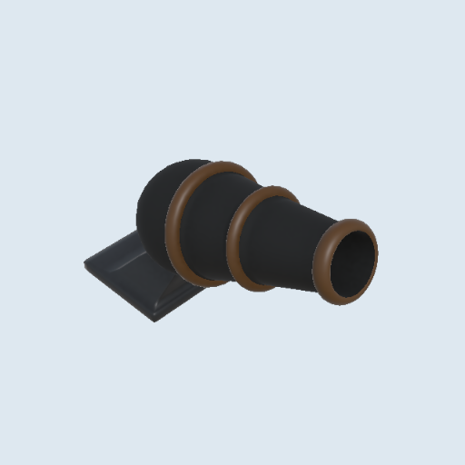 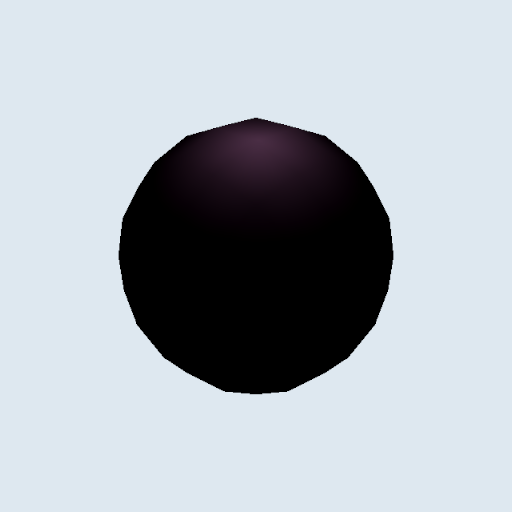 | exists, muzzle over budget | P0 |
| broadside\_battery | 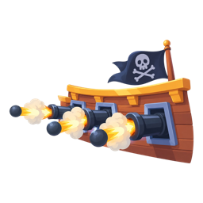 Broadside Battery | Fan volleys both sides, 12 m | **What it is:** side guns that fire small fans of shot to port and starboard. **In play:** every 1.5 s a narrow fan leaves each side into nearby clusters within 12 m, so the player sails past crowds. **Read from the camera:** a row of gun ports along each side of the hull; the two fans must read as leaving the sides, not the bow. **States/parts:** side mount strips (needed), wide side smoke puffs, shot, hit. **Colour and style:** steel-white shot (from grey-blue), dark ports on warm wood. **Focus:** port strips on the shared atlas; short puffs; muzzle at most 20 particles per side. **Avoid:** full cannon models, smoke clouds that cover the sides of the ship. | Single image of a low-poly 3D game model for a top-down cartoon pirate game, flat colours, chunky stylised shapes, very few faces, plain light grey background, no text: a weapon mount strip for the side of a small wooden sailing ship, a short curved plank section with three square gun ports, hinged red lids open, three short black-iron cannon muzzles poking out sideways. Shown alone in a three-quarter view from above. 1024x1024. | grey-blue → steel white | 12 m | `Broadside_Cannonball_VFX.prefab`, `Broadside_Muzzle_VFX.prefab` (544, 4 PS) | exists | P1 |
| powder\_kegs | 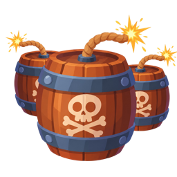 Powder Kegs | Mines astern; 3 m trigger, 3.2 m blast | **What it is:** explosive kegs dropped behind the ship as mines. **In play:** a keg falls into the wake about every 1.1 s and blows when an enemy comes within 3 m, hitting everything in 3.2 m; the player drags chasers over them. **Read from the camera:** a round keg top, a sparking fuse, a thin red blast ring. **States/parts:** keg body, fuse spark, ring, blast. **Colour and style:** dark wood, red bands, red ring with stripes or dashes so it never reads as an enemy warning. **Focus:** a keg near the projectile and pickup budgets (100-150 triangles) replacing the 1,445-triangle Fire Barrel; blast within 30 particles. **Avoid:** lights, a solid orange-red ring (the enemy warning colour). | Single image of a low-poly 3D game model for a top-down cartoon pirate game, flat colours, chunky stylised shapes, very few faces, plain light grey background, no text: a small round black-powder keg floating upright in the water, dark wood staves, two red iron bands, a short lit fuse sparking on top, a skull painted on the lid. Shown alone in a three-quarter view from above. 1024x1024. | red → keep | keg 0.8 m | keg `FireBarrel.prefab` (1,445); blast `PowderKeg_Explosion_VFX.prefab` 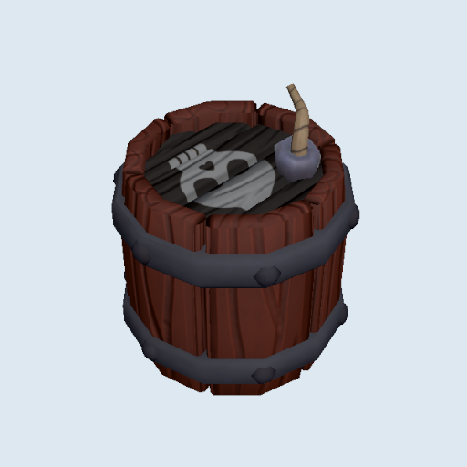 | exists, keg over budget | P1 |
| flying\_cutlasses | 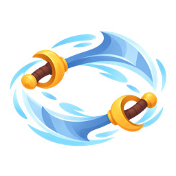 Flying Cutlasses | Two blades orbit at 5 m | **What it is:** two magic cutlasses that circle the ship. **In play:** the blades sweep a 5 m ring at a steady spin and cut anything they pass, so close enemies melt without aiming. **Read from the camera:** a flat curved blade seen from above with a white arc trail that shows the ring. **States/parts:** blade model, arc trail, hit spark. **Colour and style:** bright steel blade, brass hilt, white trail. **Focus:** a blade under 300 triangles replacing the 1,620-triangle model plus cube; trail at most 10 particles or one ribbon showing the radius. **Avoid:** thin blades that vanish at phone size, a trail so long it reads as a solid ring. | Single image of a low-poly 3D game model for a top-down cartoon pirate game, flat colours, chunky stylised shapes, very few faces, plain light grey background, no text: one chunky pirate cutlass lying flat as if flying, a wide curved bright steel blade, a brass basket hilt and a short red grip, slightly oversized so it reads from far above. Shown alone in a three-quarter view from above. 1024x1024. | white → keep | orbit r 5 m | `Flying Cutlasses.prefab` (1,620 + cube) 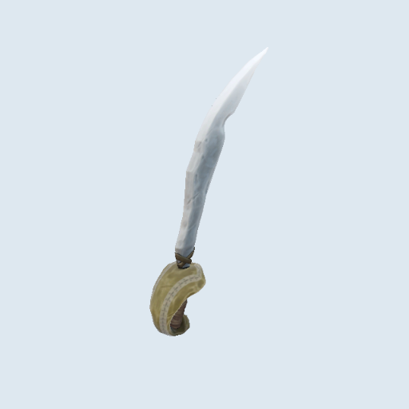 | exists, over budget | P1 |
| flamethrower | 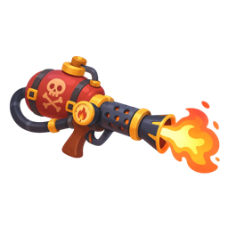 Flamethrower | Cone 9.5 m, 52°, 2.75 s on | **What it is:** a bow nozzle that pours a cone of fire; switched off in the game since 3 Oct until this redo lands. **In play:** a 52° cone 9.5 m long burns everything inside while it is on, and burning enemies keep ticking; the player sweeps the cone by steering. **Read from the camera:** the flame must fill exactly the damage cone, edge to edge. **States/parts:** nozzle mount (needed), stream, burn flicker on enemies, burning patch (P1, today a broken pink material). **Colour and style:** orange flame, yellow core, brass nozzle. **Focus:** cone shape matches the hitbox; stream at most 80 particles on one material; a matching patch effect. **Avoid:** turbulence that spills past the cone, lights, VFX Graph. | Single image of a low-poly 3D game model for a top-down cartoon pirate game, flat colours, chunky stylised shapes, very few faces, plain light grey background, no text: a weapon mount for the bow of a small wooden sailing ship, a squat brass fuel tank with an iron band, feeding a short flared brass nozzle pointing forward, a small pilot flame at its tip. Shown alone in a three-quarter view from above. 1024x1024. | orange → keep | 9.5 m × 52° | `Flamethrower_Stream_VFX.prefab`, scaled to the cone (M4a) | **being redone by the owner's VFX artist** (R-89) | P0 |
| lightning\_mast | 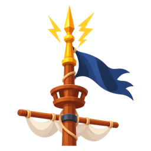 Lightning Mast | Chains 4 targets, 13 m | **What it is:** a lightning rod on the mast that calls a bolt down on an enemy and arcs it on. **In play:** every 1.8 s a bolt strikes an enemy within 13 m and jumps between up to 4 targets, lighting up a crowd. **Read from the camera:** a bright vertical flash at each strike and thin arcs linking the victims. **States/parts:** mast-top coil mount (needed), bolt, arcs, strike flash. **Colour and style:** blue-white (from cyan), copper coil. **Focus:** cut the effect from 15 systems and a 7,120 cap to at most 80 particles and one sheet; bolts as stretched sprites; arcs thick enough for a phone. **Avoid:** lights, sub-emitters, red tints. | Single image of a low-poly 3D game model for a top-down cartoon pirate game, flat colours, chunky stylised shapes, very few faces, plain light grey background, no text: a mast-top weapon mount for a small sailing ship, a short wooden mast tip crowned with a coil of bright copper wire around an iron spike, a small glass ball at the top glowing pale blue-white. Shown alone in a three-quarter view from above. 1024x1024. | cyan → blue-white | strike r 3.5 m | `Lightning Mast.prefab` (15 PS, cap 7,120) | exists, far over budget | P0 |
| long\_nine | 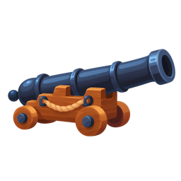 Long Nine | Long forward lane, prefers elites, 18 m | **What it is:** one long naval gun that fires a fast tracer down a narrow lane ahead. **In play:** a heavy, slower shot (about every 1.6 s) in a narrow forward arc out to 18 m, the gun for picking off big targets; the player lines it up by steering. **Read from the camera:** a single long barrel on the centre line; a tight bright tracer that shows the lane. **States/parts:** mount (needed), muzzle flash, tracer, hit. **Colour and style:** amber tracer (from cyan), dark iron gun. **Focus:** a mount under 500 triangles replacing the 18,266-triangle muzzle model; a crisp tracer with a short life; muzzle at most 20 particles. **Avoid:** wide glows that blur the lane, lights. | Single image of a low-poly 3D game model for a top-down cartoon pirate game, flat colours, chunky stylised shapes, very few faces, plain light grey background, no text: a weapon mount for the bow of a small wooden sailing ship, one very long slim black-iron naval gun on a low wooden slide carriage, barrel pointing forward, brass ring at the muzzle. Shown alone in a three-quarter view from above. 1024x1024. | cyan → amber | 18 m | `LaserBeam.prefab`; muzzle `Long Nine.prefab` (18,266) 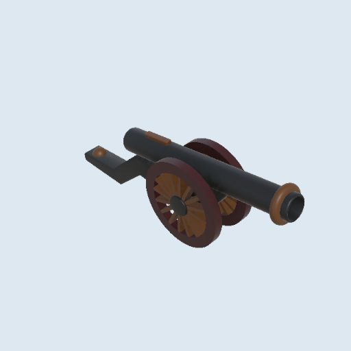 | exists, muzzle far over budget | P0 |
| mortar | 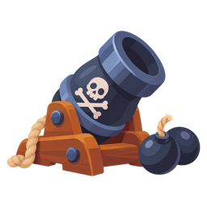 Mortar | Shell on the densest cluster after 0.6 s | **What it is:** a deck mortar that lobs shells onto the thickest crowd. **In play:** about every 1.2 s it picks the densest cluster within 15 m, shows a landing marker, and the shell lands 0.6 s later in a 4.25 m blast. **Read from the camera:** a squat round barrel pointing up; the marker on the water is the main read. **States/parts:** mount, arcing shell, landing marker (from the P1 telegraph kit), blast. **Colour and style:** friendly yellow marker; dark iron mortar. **Focus:** replace the marker, today the Lightning Mast tinted red, which reads as an enemy attack; a mount under 500 triangles (1,462 today). **Avoid:** red or orange markers, lights. | Single image of a low-poly 3D game model for a top-down cartoon pirate game, flat colours, chunky stylised shapes, very few faces, plain light grey background, no text: a weapon mount for the deck of a small wooden sailing ship, a squat fat black-iron mortar with a wide round mouth tilted up, sitting on a thick square wooden block with iron corner plates. Shown alone in a three-quarter view from above. 1024x1024. | cyan → friendly yellow marker | r 4.25 m | `Mortar.prefab` (1,462, 4 PS); marker = Lightning Mast tinted red 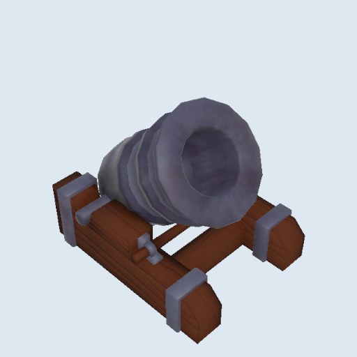 | marker placeholder | P1 |
| swivel\_guns | 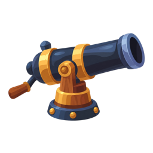 Swivel Guns | Rapid small shots all around, 12 m | **What it is:** small rail guns that fire quick pellets in every direction. **In play:** a shot about every 0.6 s at nearby enemies all around within 12 m; the cleanup gun that chips weak fodder off the ship. **Read from the camera:** two small swivels on the rails, pellets smaller than cannonballs. **States/parts:** rail mounts (needed), tiny muzzle pop, pellet, hit. **Colour and style:** pale gold pellets (from cyan), dark iron on wood. **Focus:** a mount pair under 500 triangles (1,228 today); pellets clearly smaller than the 0.3 m cannonball (0.55×); tiny hits from the smallest hit kit size (at most 8 particles). **Avoid:** muzzle smoke on every shot, pellets the same colour as XP gems (cyan). | Single image of a low-poly 3D game model for a top-down cartoon pirate game, flat colours, chunky stylised shapes, very few faces, plain light grey background, no text: two small iron swivel guns, each on a forked Y-shaped iron yoke fixed to a short wooden ship's rail post, short barrels with a wooden tiller handle at the back. Shown alone in a three-quarter view from above. 1024x1024. | cyan → pale gold | 0.55× shot | `Cannonball small.prefab`; `Swivel Guns.prefab` (1,228) 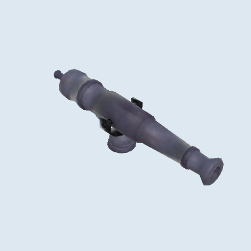 | exists | P2 |
| harpoon\_gun | 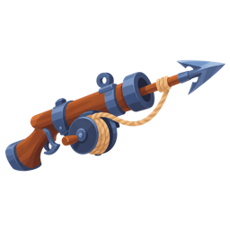 Harpoon Gun | Forward tether that slows, 13 m | **What it is:** a bow launcher that fires a harpoon on a rope. **In play:** about every 0.8 s a harpoon flies forward within a 75° arc out to 13 m, strikes and tethers the target, slowing it; the player uses it to hold dangerous chasers back. **Read from the camera:** the rope line from ship to target is the read; a pale tip on the harpoon. **States/parts:** launcher mount (needed, none today), harpoon (exists, 266), rope line, hit. **Colour and style:** tan rope, cyan tip, iron and wood launcher. **Focus:** the mount (under 500 triangles); a rope that stays readable while stretched; a small hit. **Avoid:** a rope too thin for a phone, warning-coloured rope. | Single image of a low-poly 3D game model for a top-down cartoon pirate game, flat colours, chunky stylised shapes, very few faces, plain light grey background, no text: a weapon mount for the bow of a small wooden sailing ship, a heavy wooden crossbow-style harpoon launcher on an iron swivel base, a barbed iron harpoon loaded with a coil of tan rope beside it. Shown alone in a three-quarter view from above. 1024x1024. | cyan → tan rope, cyan tip | 13 m | `Harpoon.prefab` (266); no mount 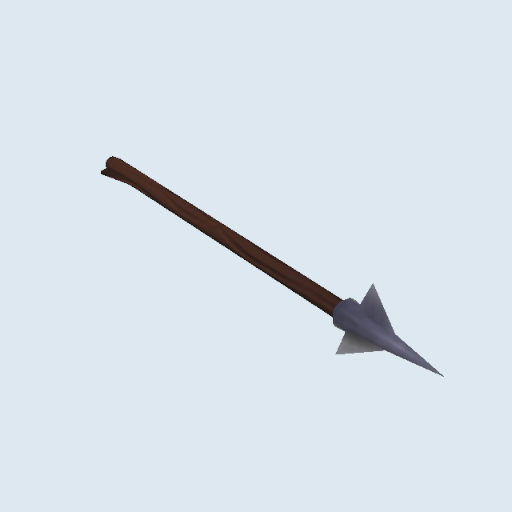 | exists, mount needed | P2 |

Shared effects: enemy hit, kill, crit and level-up all use `02_FishEnemy_DamageVFX.prefab` (5 PS on every hit and burn tick); elite and boss kills `Explosion_Large.prefab` (17 PS); splash `19_WaterImpactSplash.prefab` (cap 1,050). **Needed (P0):** a hit kit in 3 sizes (≤ 8, ≤ 20, ≤ 30 particles), a crit variant, a burn flicker (shader), a level-up burst, one atlas. Burning patches use `14_BurningTrail_VFX.prefab`, which renders a broken pink material (R-104); **needed (P1):** a patch effect matched to the flamethrower redo.

### 3.2 New weapons (M4 and M4b, built on placeholders)

All nine are built (M4 `eaf71a9d`, M4b `3e633720`); numbers in `plan/v5/phase-04-weapons/PLAN.md` and `phase-04b-weapons/PLAN.md`.

| id | Name | In play | Art brief | GPT prompt | Colour | Size | Budget | Placeholder today | Pri |
| --- | --- | --- | --- | --- | --- | --- | --- | --- | --- |
| anchor\_flail | Anchor Flail | An anchor circles the ship, hits and knocks back 2 m | **What it is:** a heavy anchor on a chain swinging around the ship. **In play:** it sweeps a 3.5 m ring; each enemy it passes is hit at most once per 0.75 s and shoved 2 m, so the player bullies crowds off the hull. Rank milestones (Q20, 7 Oct): rank 4 swings 0.5 m wider, rank 8 adds another anchor (three on the chain ring, evenly spaced; the Kraken Chain evolution adds a fourth), rank 12 swings 25°/s faster, so the anchor model and chain must read when three or four circle at once. **Read from the camera:** the anchor's crossbar and curved flukes from above, a chain strip back to the hull, spray where it skims. **States/parts:** anchor model, chain strip, skim spray, hit. **Colour and style:** iron grey with rust. **Focus:** the icon first (cards show the name today); then an anchor under 300 triangles to replace the code-built stand-in; spray at most 10 particles. **Avoid:** a chain too thin to see, a blade-like anchor. | Hand-painted cartoon mobile game weapon icon for a pirate roguelite, soft cel shading, glossy highlights, chunky readable shapes, warm saturated colours, no outline, one centred subject in three-quarter view filling about 80% of a square, bold silhouette that still reads at 64 px, transparent background, no text, no frame, 1024x1024. Subject: a heavy black-iron ship's anchor with rust-orange patches, swinging on a thick chain that curls around it in a circle, a white splash of sea spray where it skims. | iron grey, rust | orbit r 3.5 m | 300 + spray 10 p | `Cannonball.prefab`; Flying Cutlasses icon | P1 |
| chainshot | Chainshot | Wide shot, 2 pierces, 25% slow, 16 m | **What it is:** two cannonballs joined by a chain, spinning flat as they fly. **In play:** about once a second a 0.75 m wide shot leaves the bow, passes through two more enemies and slows each by 25% for 2 s; good against lines of chasers. Rank milestones (Q20): rank 4 one more pierce, rank 8 a 0.5 m wider shot (the projectile and blur scale up by a third: author it to scale cleanly), rank 12 the slow lasts 1 s longer. **Read from the camera:** a wide spinning bar, clearly wider than a plain cannonball, with a white blur disc. **States/parts:** cannon muzzle (shared), projectile, blur sprite, hit and slow cue. **Colour and style:** dark iron, white blur. **Focus:** the icon first; a projectile under 150 triangles plus one blur sprite; the width must show at once. **Avoid:** a model that reads as one ball, a blinding blur. | Hand-painted cartoon mobile game weapon icon for a pirate roguelite, soft cel shading, glossy highlights, chunky readable shapes, warm saturated colours, no outline, one centred subject in three-quarter view filling about 80% of a square, bold silhouette that still reads at 64 px, transparent background, no text, no frame, 1024x1024. Subject: two dark iron cannonballs joined by a short heavy chain, spinning flat through the air, with white curved motion streaks around them showing the spin. | dark iron, white blur | 0.75 m | 150, blur sprite | cannonball; Deck Cannons icon | P1 |
| siren\_bell | Siren Bell | Pulse around the ship every 3 s, 20% slow | **What it is:** a cursed brass bell at the stern that tolls a damaging wave. **In play:** every few seconds, with or without a target, a ring spreads 5 m around the ship, hurting and slowing everything by 20% for 1.5 s; a steady heartbeat the player plans around. Rank milestones (Q20): rank 4 the slow lasts 0.5 s longer, rank 8 the ring reaches 1 m further, rank 12 a second ring follows 0.35 s after each toll (two rings in flight at once: the ring material must stay readable when two overlap). **Read from the camera:** a teal ring expanding from the ship; the bell itself is a small stern detail. **States/parts:** stern bell mount, pulse ring, slow cue on enemies. **Colour and style:** brass bell, sea-teal ring. **Focus:** the icon first; then a bell under 400 triangles; the ring sharing the aura and telegraph material (one mesh, no particles needed). **Avoid:** orange or red rings, filled discs. | Hand-painted cartoon mobile game weapon icon for a pirate roguelite, soft cel shading, glossy highlights, chunky readable shapes, warm saturated colours, no outline, one centred subject in three-quarter view filling about 80% of a square, bold silhouette that still reads at 64 px, transparent background, no text, no frame, 1024x1024. Subject: a polished brass ship's bell hanging from a small dark wooden post, swinging as it rings, two glowing sea-teal sound rings rippling outward from it. | brass, sea-teal | r 5 m | 400 + ring | area-impact ring; Lightning Mast icon | P1 |
| squid\_ink\_pots | Squid Ink Pots | Lobs ink onto the back of the pack: a 3 s slick slows 35% | **What it is:** clay pots of squid ink lobbed from the deck (D21, 7 Oct: replaced the Ramming Prow). **In play:** every 2.5 s, with no input, a pot arcs up to 22 m onto the back of the enemy pack (where the rear enemy will be when it lands, 0.9 s later) and bursts into a 3.5 m black-violet slick that lasts 3 s; everything sailing through it is slowed 35% (bosses and the Reef Crab half) and takes light damage, so the rear of a crowd straggles while the front still comes to the guns. Rank 4 adds a second pot on the next pack back, rank 8 makes slicks 25% wider, rank 12 slows 10% more. **Read from the camera:** a small round pot arcing in, then a flat dark ink pool on the water with a violet rim that ripples every half second; slowed ships trail ink. **States/parts:** pot projectile (lob arc), landing splash, ink slick decal with a pulsing rim (3 s, fades out), slowed-enemy ink drip cue. **Colour and style:** squid-ink black with a violet sheen (0.55, 0.25, 0.9), cream clay pot. **Focus:** the icon first (cards show the name today); the slick as one decal plus the shared ring material, no more than 2 live slicks per pot cap; a pot under 150 triangles; splash at most 12 particles. **Avoid:** a slick that reads as a hazard the player must dodge (no red or orange, no spikes), a pool so dark it vanishes on deep water (keep the violet rim), confusion with the Maelstrom's blue whirlpool (no swirl). | Hand-painted cartoon mobile game weapon icon for a pirate roguelite, soft cel shading, glossy highlights, chunky readable shapes, warm saturated colours, no outline, one centred subject in three-quarter view filling about 80% of a square, bold silhouette that still reads at 64 px, transparent background, no text, no frame, 1024x1024. Subject: a round cream clay pot with a cork stopper bursting open in mid-air, spilling glossy black squid ink with a violet sheen, a small cartoon squid tentacle curling out of the pot, a few ink droplets flying. | ink black, violet rim | r 3.5 m slick, 22 m range | pot 150, splash 12 p, slick decal | violet pulse rings on the water (code-built); no icon (name on the card) | P1 |
| parrot\_squadron | Parrot Squadron | Parrots dive at nearby enemies (at most 12) | **What it is:** trained parrots that fly out and bomb enemies. **In play:** two parrots (more with Quantity cards) launch from the ship, fly above the water to the nearest enemies, strike and pick a new target when one sinks, then leave after 6 s; at most 12 at once. Rank milestones (Q20): rank 4 and rank 12 each add a parrot to every launch, rank 8 keeps them out 25% longer (up to 7 parrots per launch with cards and the Armada, still at most 12 at once). **Read from the camera:** spread wings and a bright body, flying above the ships. **States/parts:** parrot body, small bomb or shot, hit. **Colour and style:** tropical red, green, blue, yellow. **Focus:** the icon first; parrots under 200 triangles each with wing shapes that read from above (the stand-in had to be scaled up to be seen); colour variants by material. **Avoid:** thin wings, birds lost against green palms. | Hand-painted cartoon mobile game weapon icon for a pirate roguelite, soft cel shading, glossy highlights, chunky readable shapes, warm saturated colours, no outline, one centred subject in three-quarter view filling about 80% of a square, bold silhouette that still reads at 64 px, transparent background, no text, no frame, 1024x1024. Subject: a bright red cartoon parrot with green and blue wings diving forward, wings swept back, carrying a small black round bomb with a lit fuse in its claws, two smaller parrots following behind. | tropical | 0.6 m | 200 each | cannonball at 0.6; Swivel icon | P1 |
| monkey\_gunners | Monkey Gunners | A floating turret astern fires within 10 m for 8 s (at most 4) | **What it is:** a barrel raft dropped astern with a monkey gunner on it. **In play:** the raft surfaces behind the ship, floats for 8 s and fires a shot about every 0.6 s at anything within 10 m; at most 4 at once, so the player leaves a trail of little forts. Rank milestones (Q20): rank 4 rafts float 25% longer (10 s), rank 8 drops a second raft and rank 12 a third (the cap is now 4 at once, with the Monkey Battery), so two to four rafts sit side by side astern. **Read from the camera:** a round raft top with a cannon barrel and the monkey's head and bandana. **States/parts:** raft and monkey, tiny cannon, muzzle puff, shot, sink. **Colour and style:** brown wood, red bandana, orange shot. **Focus:** the icon first; a turret under 600 triangles to replace the code-built stand-in; muzzle at most 10 particles. **Avoid:** a raft that reads as a pickup barrel. | Hand-painted cartoon mobile game weapon icon for a pirate roguelite, soft cel shading, glossy highlights, chunky readable shapes, warm saturated colours, no outline, one centred subject in three-quarter view filling about 80% of a square, bold silhouette that still reads at 64 px, transparent background, no text, no frame, 1024x1024. Subject: a cheeky brown monkey in a red bandana sitting on a small raft of lashed wooden barrels, firing a tiny brass cannon with a round puff of white smoke. | brown, red | 1.2 m | 600, muzzle 10 p | `CannonBarrel.prefab`; Deck Cannons icon | P1 |
| maelstrom\_charge | Maelstrom Charge | A charge opens a 3 s whirlpool that drags, then implodes | **What it is:** a lobbed charge that opens a small whirlpool. **In play:** about every 5 s a charge lands on the densest crowd within 15 m; a whirlpool opens for 3 s, drags enemies inward and hurts them every 0.5 s, then implodes. Rank milestones (Q20): rank 4 whirlpools 20% wider, rank 8 they last 1 s longer (4 s), rank 12 a second charge lands on the next pack, so two whirlpools can spin at once (the decal and particles budget is per whirlpool). **Read from the camera:** a spinning spiral decal on the water, inward foam arms, a spout at the end. **States/parts:** charge shell, landing splash, whirlpool decal, implode spout. **Colour and style:** deep blue and foam, clearly a player effect. **Focus:** the icon first; a rotating decal plus at most 60 Shuriken particles; it must look different from the Treasury Beacon and boss-arrival whirlpools. **Avoid:** VFX Graph (draws nothing on phones), purple or teal portal looks, lights. | Hand-painted cartoon mobile game weapon icon for a pirate roguelite, soft cel shading, glossy highlights, chunky readable shapes, warm saturated colours, no outline, one centred subject in three-quarter view filling about 80% of a square, bold silhouette that still reads at 64 px, transparent background, no text, no frame, 1024x1024. Subject: a glowing deep-blue round charge in a brass casing, hovering above a small swirling whirlpool of deep blue water with white foam spiralling inward. | deep blue, foam | r 4 m | decal + ≤ 60 p, **Shuriken only** | timed ring; `Assets/Prefabs/VFX/whirlpool.prefab` (322, 2 PS) is a candidate | P1 |
| lighthouse\_lantern | Lighthouse Lantern | A 9 m beam sweeps around the ship at 60°/s | **What it is:** a lantern whose beam sweeps around the ship like a lighthouse. **In play:** a 9 m beam turns steadily around the ship and burns every enemy it crosses, each at most once per 0.5 s; the player reads the sweep and lets enemies walk into it. Rank milestones (Q20): rank 4 beams 15% longer, rank 8 a 25% faster sweep, rank 12 one more beam (the Beacon of the Deep adds another): the beam mesh is drawn once per beam, so keep it cheap. **Read from the camera:** a warm wedge or strip of light lying on the water, rooted at a small lantern on the ship. **States/parts:** lantern model, beam mesh, small glints. **Colour and style:** warm white and soft yellow. **Focus:** the icon first; the beam as one unlit additive mesh, at most 20 particles; a lantern to replace the code-built stand-in. **Avoid:** realtime lights, orange that reads as a warning lane. | Hand-painted cartoon mobile game weapon icon for a pirate roguelite, soft cel shading, glossy highlights, chunky readable shapes, warm saturated colours, no outline, one centred subject in three-quarter view filling about 80% of a square, bold silhouette that still reads at 64 px, transparent background, no text, no frame, 1024x1024. Subject: a brass ship's lantern with glass panes and a bright warm yellow-white flame, throwing a long wide cone of warm light to one side like a lighthouse beam. | warm white | 9 m | 1 mesh, ≤ 20 p | a line of cannonballs | P1 |
| cursed\_doubloons | Cursed Doubloons | Coins jump between enemies; kills drop +1 gold (40 a run) | **What it is:** cursed coins that ricochet from enemy to enemy. **In play:** about once a second a coin strikes an enemy within 12 m and jumps on through several more; each kill pays one extra gold, up to 40 a run. Rank milestones (Q20): ranks 4 and 8 each add one more jump, rank 12 throws a second coin 0.35 s after each one (two zigzag trails at once). **Read from the camera:** a spinning coin and a ghostly green zigzag trail between victims. **States/parts:** coin (sprite or tinted model), ghost trail, hit, small gold pop on a kill. **Colour and style:** gold with a cursed green rim and trail. **Focus:** the icon first; a billboard with at most 8 particles; the coin must not be mistaken for a gold pickup. **Avoid:** plain gold coins (pickup colour), a lightning-style bolt (that is the Lightning Mast). | Hand-painted cartoon mobile game weapon icon for a pirate roguelite, soft cel shading, glossy highlights, chunky readable shapes, warm saturated colours, no outline, one centred subject in three-quarter view filling about 80% of a square, bold silhouette that still reads at 64 px, transparent background, no text, no frame, 1024x1024. Subject: three gold coins stamped with a skull, glowing with a ghostly green aura, bouncing in a zigzag with green wispy trails; the gold stays warm but clearly cursed green, not plain treasure. | cursed green on gold | 0.3 m | billboard, 8 p | lightning strike; `03_GoldCoin.prefab` (128) can be tinted 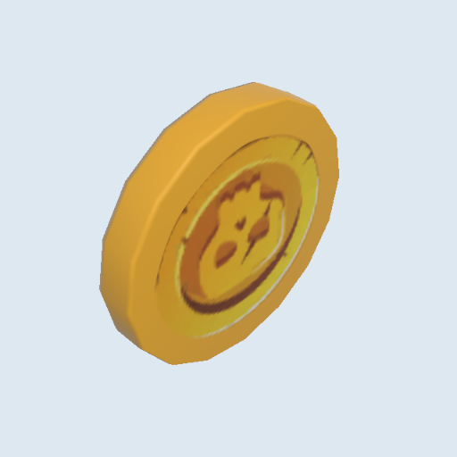 | P1 |

**Update 7 Oct.** The borrowed icons in this table were removed on 3 Oct: the nine new weapons have no icon, and their cards show the name. Five of them no longer borrow the cannonball either: coloured-primitive stand-ins are built in code for the parrots, the monkey turret and its shots, the anchors, the lanterns and the coins (`Assets/_Game/V4/Presentation/Weapons/WeaponPlaceholderModels.cs`). A real model set in the weapon's data replaces the stand-in automatically, as long as its name does not contain "Cannon".

**In-game today** (playtest round 7 screenshots, 3 Oct): the new weapons on their placeholder art.

| Screenshot | What it shows |
| --- | --- |
| 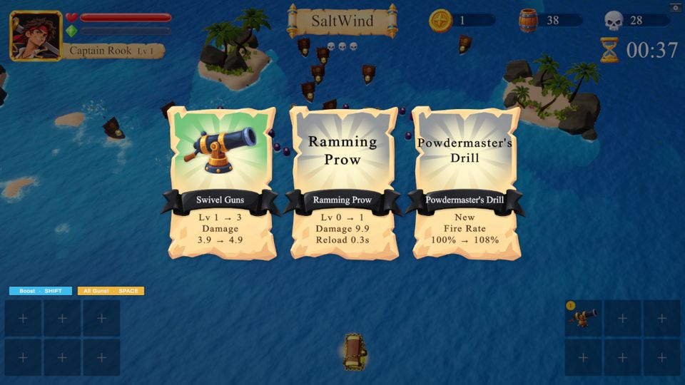 | Voyage start: the player ship, enemies and HUD at the game camera |
| 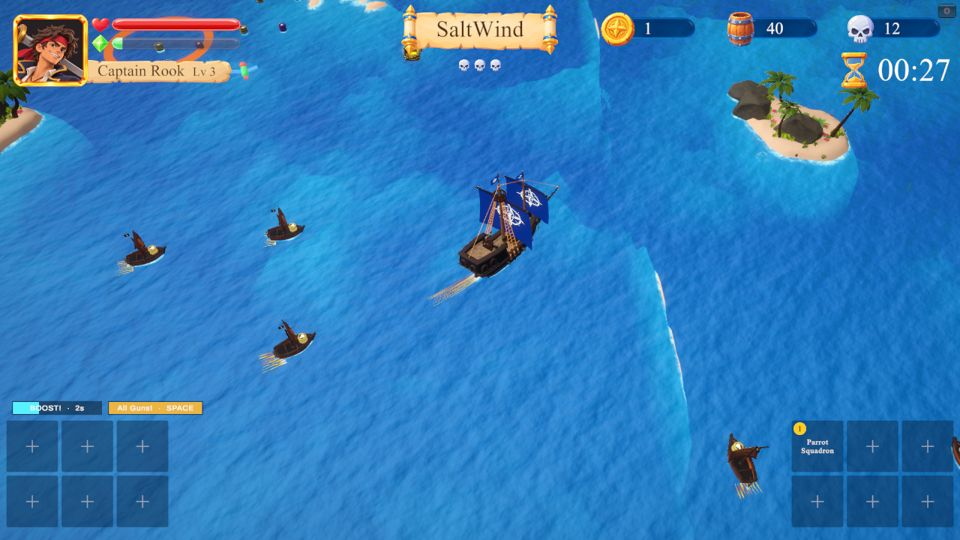 | Parrot Squadron on code-built stand-in birds |
| 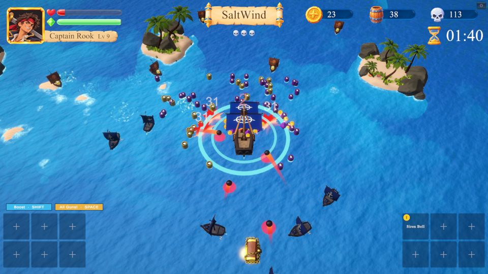 | Siren Bell pulse ring |
| 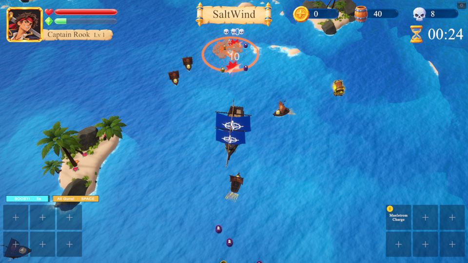 | Maelstrom Charge (the round 7 Monkey Gunners capture is the same image) |
| 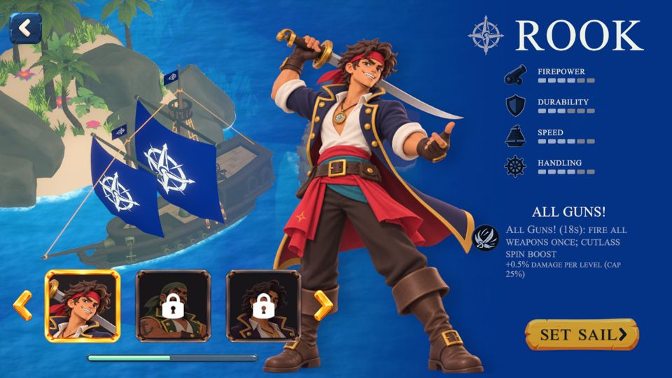 | Mortar shell and landing marker |

Weapon mounts (P1): each weapon needs a small mount at a socket (bow, sides, stern, mast); today the muzzle effects are whole cannon models (`Deck Cannons.prefab` has 14 renderers and 14 colliders).

## 4. Evolutions

All 19 evolutions reuse their base weapon's effects and icon today; each needs an evolved icon (the base icon with an evolved frame and a new motif), a stronger variant of the base body and one signature effect, within the base weapon's budget plus ≤ 20 particles. An evolution unlocks when its weapon reaches the evolution level (5 today, owner to confirm) with its item.

| id | Name | Base + item | In play | Art brief | GPT prompt | Colour | Pri |
| --- | --- | --- | --- | --- | --- | --- | --- |
| stormshot\_cannon | Stormshot Cannon | deck\_cannons + grapeshot\_pouch | Forward arc pierce; first hit bursts grapeshot | **What it is:** evolved Deck Cannons. **In play:** the forward shot now pierces through a forward arc, and its first hit bursts into a small fan of grapeshot pellets, so one well-steered shot clears a lane. **Read from the camera:** a brighter, crackling shot and a visible fan of pellets at the first hit. **States/parts:** evolved icon (needed), shot core, pellet fan on first hit. **Colour and style:** gold with electric blue. **Focus:** the icon (base icon, evolved frame, storm motif); the pellet fan from the smallest hit kit; within the base budget plus 20 particles. **Avoid:** blue that reads as XP cyan, lights in the crackle. | Hand-painted cartoon mobile game weapon icon for a pirate roguelite, evolved version of a twin bow cannon weapon, soft cel shading, glossy highlights, chunky readable shapes, no outline, centred, transparent background, no text, no frame, 1024x1024. Subject: two gilded bow cannons firing a cannonball with a crackling electric-blue core that bursts into a fan of small grapeshot pellets, behind it a soft radiant burst of gold and electric blue to show it is evolved. If a base icon is attached, keep its subject and style. | gold + electric blue | P1 |
| kings\_broadside | King's Broadside | broadside\_battery + broadside\_drum | Volley plus an opposite-side follow-up | **What it is:** evolved Broadside Battery. **In play:** each side volley is followed a moment later by a volley from the opposite side, so both flanks are covered. **Read from the camera:** gilded gun ports and a second, crown-gold muzzle flash on the follow-up side. **States/parts:** evolved icon (needed), gilded port strips, follow-up muzzle. **Colour and style:** gold and royal red. **Focus:** the icon; a follow-up muzzle that reads as different from the first volley; within the base budget plus 20 particles. **Avoid:** big smoke on both sides at once, new materials for the gilding (use the atlas). | Hand-painted cartoon mobile game weapon icon for a pirate roguelite, evolved version of a broadside cannon weapon, soft cel shading, glossy highlights, chunky readable shapes, no outline, centred, transparent background, no text, no frame, 1024x1024. Subject: a row of gilded gun ports on a royal red hull firing both ways at once, each muzzle flash shaped like a small golden crown, behind it a soft radiant burst of gold and royal red to show it is evolved. If a base icon is attached, keep its subject and style. | gold, royal red | P1 |
| devils\_wake | Devil's Wake | powder\_kegs + double\_fuse\_cord | Wider keg pattern, chained blasts | **What it is:** evolved Powder Kegs. **In play:** kegs drop in a wider pattern astern and a blast sets off nearby kegs in a chain, so a pursuing crowd is caught in a rolling explosion. **Read from the camera:** horned kegs and a burning fuse line linking kegs that are about to chain. **States/parts:** evolved icon (needed), horned keg variant, fuse line, chained blast. **Colour and style:** hellfire red, dark wood. **Focus:** the icon; the fuse link as one cheap line or ribbon; chained blasts sharing one pooled effect. **Avoid:** many full explosions at once (budget), solid orange-red rings that read as enemy warnings. | Hand-painted cartoon mobile game weapon icon for a pirate roguelite, evolved version of a powder keg mine weapon, soft cel shading, glossy highlights, chunky readable shapes, no outline, centred, transparent background, no text, no frame, 1024x1024. Subject: three black powder kegs with little red devil horns linked by one burning fuse line, the first one exploding in hellfire red, behind it a soft radiant burst of red and orange to show it is evolved. If a base icon is attached, keep its subject and style. | hellfire red | P1 |
| bladed\_tide | Bladed Tide | flying\_cutlasses + serrated\_scabbard | Blade orbit pulses in and out | **What it is:** evolved Flying Cutlasses. **In play:** the blade ring breathes in and out between close and medium radius, catching enemies that hover at the edge. **Read from the camera:** serrated blades and a water ribbon trail that shows the ring growing and shrinking. **States/parts:** evolved icon (needed), serrated blade variant, water ribbon. **Colour and style:** steel and sea foam. **Focus:** the icon; the ribbon as one trail per blade within 10 particles; the pulse must be easy to see. **Avoid:** a solid ring that hides the water, blades thinner than the base ones. | Hand-painted cartoon mobile game weapon icon for a pirate roguelite, evolved version of a flying cutlass weapon, soft cel shading, glossy highlights, chunky readable shapes, no outline, centred, transparent background, no text, no frame, 1024x1024. Subject: two serrated bright steel cutlasses circling each other, trailing curling ribbons of sea-foam water, behind them a soft radiant burst of steel white and sea green to show it is evolved. If a base icon is attached, keep its subject and style. | steel, foam | P1 |
| hellfire\_nozzle | Hellfire Nozzle | flamethrower + dragons\_breath\_nozzle | Wider cone; kills leave flame patches | **What it is:** evolved Flamethrower; off in the game until the flamethrower redo returns. **In play:** a wider fire cone, and kills (and the stream) leave short burning patches on the water. **Read from the camera:** a dragon-head nozzle and a blue-cored flame that still fills exactly the damage cone. **States/parts:** evolved icon (needed), nozzle variant, blue-core stream, burning patch. **Colour and style:** orange with a blue core. **Focus:** match the VFX artist's redo; the patch effect (today a broken pink material) shared with the base. **Avoid:** many overlapping patches, lights, VFX Graph. | Hand-painted cartoon mobile game weapon icon for a pirate roguelite, evolved version of a flamethrower weapon, soft cel shading, glossy highlights, chunky readable shapes, no outline, centred, transparent background, no text, no frame, 1024x1024. Subject: a brass nozzle shaped like a dragon's head breathing a wide blast of orange fire with a hot blue core, small flames burning on the water below, behind it a soft radiant burst of orange and blue to show it is evolved. If a base icon is attached, keep its subject and style. | orange, blue core | P1 |
| tempest\_mast | Tempest Mast | lightning\_mast + copper\_conductor | Extra jump and a delayed cluster strike | **What it is:** evolved Lightning Mast. **In play:** the chain jumps once more, and a delayed strike falls on a cluster after a short marker. **Read from the camera:** a small storm cloud over the mast; a friendly marker on the water before the delayed strike. **States/parts:** evolved icon (needed), cloud, violet-white bolts, delayed marker from the telegraph kit. **Colour and style:** violet-white. **Focus:** the icon; the marker in a friendly colour so it never reads as an enemy attack; within the base budget plus 20 particles. **Avoid:** red or orange markers, a cloud that hides the ship. | Hand-painted cartoon mobile game weapon icon for a pirate roguelite, evolved version of a lightning mast weapon, soft cel shading, glossy highlights, chunky readable shapes, no outline, centred, transparent background, no text, no frame, 1024x1024. Subject: a ship's mast topped with a copper coil under a small dark storm cloud, violet-white lightning bolts forking down in several directions, behind it a soft radiant burst of violet and white to show it is evolved. If a base icon is attached, keep its subject and style. | violet-white | P1 |
| kraken\_chain | Kraken Chain | anchor\_flail + rusted\_shackle | A second anchor; wider, harder | **What it is:** evolved Anchor Flail. **In play:** a second anchor joins the swing, both swing wider, hit harder and shove further. **Read from the camera:** two anchors opposite each other, purple tentacles wrapped round the chains. **States/parts:** evolved icon (needed), tentacle-wrapped anchor variant, spray. **Colour and style:** iron and kraken purple. **Focus:** the icon; the anchor variant within the 300-triangle orbit budget; its item has no icon yet, so this evolution cannot drop until the item gets art or is swapped. **Avoid:** tentacles that read as an enemy kraken, purple close to the enemy affix rings. | Hand-painted cartoon mobile game weapon icon for a pirate roguelite, evolved version of an anchor flail weapon, soft cel shading, glossy highlights, chunky readable shapes, no outline, centred, transparent background, no text, no frame, 1024x1024. Subject: two heavy black-iron anchors swinging in a circle on thick chains, purple kraken tentacles wrapped around the chains, behind them a soft radiant burst of purple and iron grey to show it is evolved. If a base icon is attached, keep its subject and style. | iron, kraken purple | P1 |
| bar\_shot\_barrage | Bar Shot Barrage | chainshot + chain\_locker | Three chained shots, two more pierces | **What it is:** evolved Chainshot. **In play:** each firing sends three chained shots in a fan, each passing through more enemies, so whole lines are cut and slowed. **Read from the camera:** three spinning bars fanned side by side ahead of the bow. **States/parts:** evolved icon (needed), the same projectile three times, blur sprites. **Colour and style:** dark iron with white blur. **Focus:** the icon; reuse the base projectile so three shots cost no new art; blur sprites that do not merge into one blob. **Avoid:** a new trail per shot. Its item has no icon yet, so it cannot drop until the item gets art or is swapped. | Hand-painted cartoon mobile game weapon icon for a pirate roguelite, evolved version of a chainshot weapon, soft cel shading, glossy highlights, chunky readable shapes, no outline, centred, transparent background, no text, no frame, 1024x1024. Subject: three chained bar shots, each two dark iron balls on a short chain, fanned out side by side and spinning flat with white motion arcs, behind them a soft radiant burst of gold and iron grey to show it is evolved. If a base icon is attached, keep its subject and style. | iron, white blur | P1 |
| drowned\_choir | Drowned Choir | siren\_bell + siren\_scale | Faster, wider, harder slow | **What it is:** evolved Siren Bell. **In play:** the bell tolls faster, the pulse reaches further and slows harder, a wider safety bubble. **Read from the camera:** ghostly double rings, a drowned barnacled bell at the stern. **States/parts:** evolved icon (needed), bell variant, ghost ring. **Colour and style:** ghost teal. **Focus:** the icon; the ring on the shared aura material with a ghostly second edge; no particles needed. Its item has no icon yet, so it cannot drop until the item gets art or is swapped. **Avoid:** rings so frequent they flicker, orange or red edges, filled discs. | Hand-painted cartoon mobile game weapon icon for a pirate roguelite, evolved version of a siren bell weapon, soft cel shading, glossy highlights, chunky readable shapes, no outline, centred, transparent background, no text, no frame, 1024x1024. Subject: a barnacle-covered drowned bronze bell tolling, several ghostly teal sound rings spreading out with faint singing siren silhouettes in them, behind it a soft radiant burst of ghost teal to show it is evolved. If a base icon is attached, keep its subject and style. | ghost teal | P1 |
| black\_tide | Black Tide | squid\_ink\_pots + iron\_figurehead | One more pot, wider and stronger ink | **What it is:** evolved Squid Ink Pots. **In play:** each volley lobs one more pot, the slicks are 30% wider and slow 10% harder, and the pots come faster; the back of the pack crawls. **Read from the camera:** several darker pools joining into a black tide with a bright violet rim. **States/parts:** evolved icon (needed), the same slick decal tinted darker, larger splash. **Colour and style:** deep ink black, bright violet. **Focus:** the icon; reuse the base slick with a tint and scale, no new systems. **Avoid:** pools merging into one unreadable blot, any red or orange. | Hand-painted cartoon mobile game weapon icon for a pirate roguelite, evolved version of a squid ink pot weapon, soft cel shading, glossy highlights, chunky readable shapes, no outline, centred, transparent background, no text, no frame, 1024x1024. Subject: three cracked clay pots spilling a rising wave of glossy black ink with violet highlights, a giant squid's tentacles curling out of the wave, behind it a soft radiant burst of violet to show it is evolved. If a base icon is attached, keep its subject and style. | ink black, violet | P1 |
| whalers\_volley | Whaler's Volley | harpoon\_gun + whale\_oil\_barrel | Two harpoons that pass through a foe | **What it is:** evolved Harpoon Gun. **In play:** two harpoons fly at once and each passes through a foe, tethering and slowing more targets. **Read from the camera:** two barbed harpoons with dark oily ropes. **States/parts:** evolved icon (needed), barbed harpoon variant, oily rope. **Colour and style:** tan and oil black. **Focus:** the icon; reuse the base harpoon with a barb change; ropes readable side by side. Its item has no icon yet, so it cannot drop until the item gets art or is swapped. **Avoid:** ropes so dark they vanish on deep water, new trail systems. | Hand-painted cartoon mobile game weapon icon for a pirate roguelite, evolved version of a harpoon gun weapon, soft cel shading, glossy highlights, chunky readable shapes, no outline, centred, transparent background, no text, no frame, 1024x1024. Subject: two barbed iron harpoons flying side by side, their tan ropes glistening with black whale oil, behind them a soft radiant burst of tan and gold to show it is evolved. If a base icon is attached, keep its subject and style. | tan, oil black | P1 |
| ship\_of\_the\_line | Ship of the Line | long\_nine + powder\_horn\_of\_the\_line | Wider, heavier, more often | **What it is:** evolved Long Nine. **In play:** a wider, heavier lane shot that fires more often, punching through the toughest targets ahead. **Read from the camera:** a thicker amber tracer and a heavy muzzle ring. **States/parts:** evolved icon (needed), tracer variant, muzzle ring. **Colour and style:** amber. **Focus:** the icon; a tracer width that matches the wider hit lane; the ring within 20 extra particles. Its item has no icon yet, so it cannot drop until the item gets art or is swapped. **Avoid:** glow that blurs the lane edge, lights. | Hand-painted cartoon mobile game weapon icon for a pirate roguelite, evolved version of a long naval gun weapon, soft cel shading, glossy highlights, chunky readable shapes, no outline, centred, transparent background, no text, no frame, 1024x1024. Subject: a long black-iron naval gun firing a thick bright amber tracer, a heavy smoke ring at the muzzle, behind it a soft radiant burst of amber to show it is evolved. If a base icon is attached, keep its subject and style. | amber | P1 |
| siege\_bombard | Siege Bombard | mortar + siege\_quadrant | Bigger, harder shells, more often | **What it is:** evolved Mortar. **In play:** bigger, harder shells land more often on the densest crowd. **Read from the camera:** a spiked shell and a bigger friendly landing marker. **States/parts:** evolved icon (needed), spiked shell variant, larger marker. **Colour and style:** friendly yellow marker, iron shell. **Focus:** the icon; the marker from the telegraph kit scaled to the larger blast; the blast within the hit kit. Its item has no icon yet, so it cannot drop until the item gets art or is swapped. **Avoid:** red or orange markers, a blast bigger than its hit area. | Hand-painted cartoon mobile game weapon icon for a pirate roguelite, evolved version of a mortar weapon, soft cel shading, glossy highlights, chunky readable shapes, no outline, centred, transparent background, no text, no frame, 1024x1024. Subject: a squat heavy iron mortar launching a large spiked shell high in an arc, a bright yellow landing ring below, behind it a soft radiant burst of yellow and iron grey to show it is evolved. If a base icon is attached, keep its subject and style. | yellow, iron | P1 |
| swivel\_battery | Swivel Battery | swivel\_guns + swivel\_mount | Two more shots a burst, faster | **What it is:** evolved Swivel Guns. **In play:** each burst fires two more pellets and the bursts come faster, a spray that keeps fodder off the ship. **Read from the camera:** twin-barrel swivels on the rails; a denser stream of small pellets. **States/parts:** evolved icon (needed), twin-barrel mount variant, pellets. **Colour and style:** pale gold. **Focus:** the icon; reuse the base pellet; the mount within 500 triangles. Its item has no icon yet, so it cannot drop until the item gets art or is swapped. **Avoid:** a muzzle effect per pellet, cyan pellets that read as XP. | Hand-painted cartoon mobile game weapon icon for a pirate roguelite, evolved version of a swivel gun weapon, soft cel shading, glossy highlights, chunky readable shapes, no outline, centred, transparent background, no text, no frame, 1024x1024. Subject: a twin-barrel iron swivel gun on a forked yoke spraying a dense stream of small pale-gold pellets, behind it a soft radiant burst of pale gold to show it is evolved. If a base icon is attached, keep its subject and style. | pale gold | P1 |
| parrot\_armada | Parrot Armada | parrot\_squadron + captains\_perch | Two more parrots, harder | **What it is:** evolved Parrot Squadron. **In play:** two more parrots join each launch and they hit harder, a flock that hunts the whole screen. **Read from the camera:** a larger flock led by a captain parrot in a hat. **States/parts:** evolved icon (needed), captain parrot variant (hat on the base model), shot. **Colour and style:** green and red, tropical. **Focus:** the icon; the captain as a small add-on within the 200-triangle parrot budget. Its item has no icon yet, so it cannot drop until the item gets art or is swapped. **Avoid:** separate models per colour, a flock that hides enemies under it. | Hand-painted cartoon mobile game weapon icon for a pirate roguelite, evolved version of a parrot squadron weapon, soft cel shading, glossy highlights, chunky readable shapes, no outline, centred, transparent background, no text, no frame, 1024x1024. Subject: a big captain parrot in a tiny black tricorne hat leading a flock of red, green and blue parrots, each carrying a small lit bomb, behind them a soft radiant burst of green and red to show it is evolved. If a base icon is attached, keep its subject and style. | green, red | P1 |
| monkey\_battery | Monkey Battery | monkey\_gunners + banana\_crate | A second turret, called down more often | **What it is:** evolved Monkey Gunners. **In play:** a second turret drops alongside, and both are called down more often, a small floating battery astern. **Read from the camera:** two barrel rafts side by side, banana details. **States/parts:** evolved icon (needed), raft variant with a banana crate, shots. **Colour and style:** brown and banana yellow. **Focus:** the icon; the variant as a small add-on within 600 triangles. Its item has no icon yet, so it cannot drop until the item gets art or is swapped. **Avoid:** yellow close to gold pickups on the raft, extra muzzle smoke. | Hand-painted cartoon mobile game weapon icon for a pirate roguelite, evolved version of a monkey gunner weapon, soft cel shading, glossy highlights, chunky readable shapes, no outline, centred, transparent background, no text, no frame, 1024x1024. Subject: two small barrel rafts side by side, each with a monkey in a red bandana firing a tiny brass cannon, a crate of bright yellow bananas between them, white muzzle puffs, behind them a soft radiant burst of banana yellow to show it is evolved. If a base icon is attached, keep its subject and style. | brown, banana yellow | P1 |
| abyssal\_vortex | Abyssal Vortex | maelstrom\_charge + storm\_conch | A wider whirlpool that hits harder | **What it is:** evolved Maelstrom Charge. **In play:** a wider whirlpool that hits and implodes harder. **Read from the camera:** a darker spiral with white lightning flecks. **States/parts:** evolved icon (needed), darker decal variant, flecks, implode. **Colour and style:** deep navy and white. **Focus:** the icon; the same decal recoloured and scaled, flecks within 20 extra particles, Shuriken only; still distinct from the Beacon and boss whirlpools. Its item has no icon yet, so it cannot drop until the item gets art or is swapped. **Avoid:** VFX Graph, purple or teal portal colours. | Hand-painted cartoon mobile game weapon icon for a pirate roguelite, evolved version of a whirlpool charge weapon, soft cel shading, glossy highlights, chunky readable shapes, no outline, centred, transparent background, no text, no frame, 1024x1024. Subject: a large dark-navy whirlpool seen from above at an angle, white foam spiralling inward, small white lightning flecks crackling in it, behind it a soft radiant burst of navy and white to show it is evolved. If a base icon is attached, keep its subject and style. | deep navy, white | P1 |
| beacon\_of\_the\_deep | Beacon of the Deep | lighthouse\_lantern + fresnel\_lens | A second, longer beam | **What it is:** evolved Lighthouse Lantern. **In play:** a second, longer beam joins the sweep, so the area around the ship is crossed twice as often. **Read from the camera:** two opposite beams with a cyan rim and prism glints. **States/parts:** evolved icon (needed), lens lantern variant, longer beam mesh. **Colour and style:** warm white with a cyan rim. **Focus:** the icon; reuse the beam mesh at a longer length; glints within 20 extra particles. Its item has no icon yet, so it cannot drop until the item gets art or is swapped. **Avoid:** realtime lights, a cyan that reads as XP. | Hand-painted cartoon mobile game weapon icon for a pirate roguelite, evolved version of a lighthouse lantern weapon, soft cel shading, glossy highlights, chunky readable shapes, no outline, centred, transparent background, no text, no frame, 1024x1024. Subject: a brass lantern with a ribbed glass lens throwing two long opposite beams of warm white light with cyan rims and small prism glints, behind it a soft radiant burst of warm white and cyan to show it is evolved. If a base icon is attached, keep its subject and style. | warm white, cyan rim | P1 |
| pirate\_kings\_hoard | Pirate King's Hoard | cursed\_doubloons + cursed\_chest\_key | Two more coin jumps, harder | **What it is:** evolved Cursed Doubloons. **In play:** the coins bounce two more times and hit harder, threading through a crowd. **Read from the camera:** bigger cursed coins and a stronger green trail. **States/parts:** evolved icon (needed), larger coin billboard, trail. **Colour and style:** green-gold. **Focus:** the icon; the same billboard scaled up; still clearly cursed, not a pickup. Its item has no icon yet, so it cannot drop until the item gets art or is swapped. **Avoid:** plain gold, a chest model on the water (the hoard is in the icon only). | Hand-painted cartoon mobile game weapon icon for a pirate roguelite, evolved version of a cursed coin weapon, soft cel shading, glossy highlights, chunky readable shapes, no outline, centred, transparent background, no text, no frame, 1024x1024. Subject: five large cursed gold coins stamped with skulls ricocheting in a zigzag with glowing green trails, a small open chest of green-gold treasure below, behind them a soft radiant burst of green and gold to show it is evolved. If a base icon is attached, keep its subject and style. | green-gold | P1 |

## 5. Items

Items are icon-first: 19 have icons (shown in the table below), the 28 new ones have none (placeholders removed 3 Oct). Each needs a 1024 master icon (imported at 256) on the rarity frame, readable at 64 px; items with a visible proc need a small shared effect. Configs `Data/Build/Items/<id>.asset`; icons `Assets/UI/New_items/Items/*.png`, listed in `V4IconCatalog.asset`.

### 5.1 Built items with icons (19)

| id | Name | Rarity | In play | Art brief | GPT prompt | Proc effect | Pri |
| --- | --- | --- | --- | --- | --- | --- | --- |
| lucky\_doubloon | 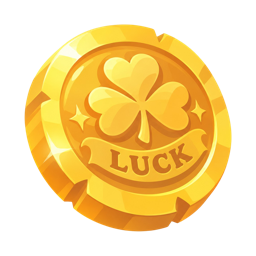 Lucky Doubloon | Common | +Luck | **What it is:** a lucky gold coin. **In play:** +3% Luck (better level-up card rarity); won from Salvage Chests and the Powder Cache, shown in the item popup for about 3 s and in the HUD item row (4 slots, bottom-right, about 64 px). No proc. **Read at 64 px:** one round gold coin with a clover; the existing icon reads well. **Colour and style:** grey Common frame (added by the UI); warm gold. **Focus:** keep the coin. **Avoid:** the word LUCK stamped on it today breaks the no-text rule: refresh to remove it. | Icon refresh (removes the stamped text): Mobile game item icon for a cartoon pirate roguelite, hand-painted style with soft cel shading, glossy highlights, chunky readable shapes and warm saturated colours, no outline, one centred object in three-quarter view filling 80% of a square, transparent background, no text, no frame, 1024x1024. Subject: one thick shiny gold doubloon tilted towards the viewer, a raised four-leaf clover in the centre and a ring of small stars round the rim instead of any lettering, a bright glint on the edge. | - | - |
| gunners\_gloves | 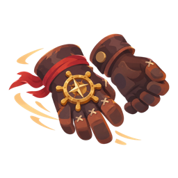 Gunner's Gloves | Common | Turning gives an attack-speed surge | **What it is:** a pair of gunner's leather gloves. **In play:** +3% Luck; turning 28° or more gives +12% fire rate for 2.5 s. Chest and Powder Cache reward, item popup, HUD item row at about 64 px. **Read at 64 px:** two brown gloves with a brass wheel badge; reads well, slightly busy. **Colour and style:** grey Common frame; brown leather, brass. **Focus:** the proc needs speed lines on the ship for the 2.5 s surge, small and short. **Avoid:** lines that look like the boost wake or a hit. | Proc effect texture (speed lines, not an icon): Particle texture for a cartoon pirate roguelite, hand-painted style with soft cel shading and a soft glow, no outline, centred shape filling about 80% of a square, pure white and pale gold shapes on a pure black background for additive particles, no text, 1024x1024 (imported at 256). Subject: three short curved speed streaks fanning out in a quarter circle, thick at the head and tapering to a point, like the swoosh of a fast turn. | speed lines on the ship | P3 |
| captains\_bell | 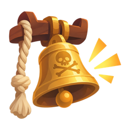 Captain's Bell | Uncommon | Every 12 kills a free weapon burst | **What it is:** a brass ship's bell with a skull, hung from a beam. **In play:** +3% Luck; every 12 kills every weapon fires once for free. Chest and Powder Cache reward, item popup, HUD item row at about 64 px. **Read at 64 px:** bell shape with ring marks; reads very well. **Colour and style:** green Uncommon frame; gold brass. **Focus:** the proc is one gold ring pulse from the ship as the free volley fires, so the player links it to the bell. **Avoid:** orange-red, the enemy warning colour. | Proc effect texture (bell ring pulse, not an icon): Particle texture for a cartoon pirate roguelite, hand-painted style with soft cel shading and a soft glow, no outline, centred shape filling about 80% of a square, pure white and warm gold shapes on a pure black background for additive particles, no text, 1024x1024 (imported at 256). Subject: one thin bright ring wave seen from above, slightly thicker on one side like a sound wave, with three small short chime marks around its outer edge. | bell ring pulse | P3 |
| double\_fuse\_cord | 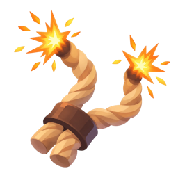 Double-Fuse Cord | Uncommon | Evolves Powder Kegs | **What it is:** two lit fuse cords bound together. **In play:** +8% fire rate; evolves Powder Kegs into Devil's Wake at weapon level 5. Chest and Powder Cache reward, item popup, HUD item row at about 64 px. **Read at 64 px:** today two tan ropes with sparks: close to Powder Fuse (a tan coiled rope with a spark), so the two blur in the item row. **Colour and style:** green Uncommon frame. **Focus:** make it clearly two cords that twist into one, both ends lit. **Avoid:** tan rope coils. | Icon refresh (to separate it from Powder Fuse): Mobile game item icon for a cartoon pirate roguelite, hand-painted style with soft cel shading, glossy highlights, chunky readable shapes and warm saturated colours, no outline, one centred object in three-quarter view filling 80% of a square, transparent background, no text, no frame, 1024x1024. Subject: two thick red-and-black striped fuse cords twisted together into one Y shape, joined by a brass clamp, both upper ends burning with bright orange sparks. | - | - |
| ghost\_lantern | 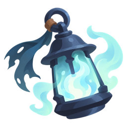 Ghost Lantern | Uncommon | A near miss raises crit briefly | **What it is:** an iron lantern holding a pale blue ghost flame. **In play:** +3% Luck; dodging an enemy shot by a near miss gives +8% crit chance for 2 s. Chest and Powder Cache reward, item popup, HUD item row at about 64 px. **Read at 64 px:** lantern with wisps; reads well. **Colour and style:** green Uncommon frame; ghost cyan. **Focus:** the proc is a quick ghostly glint on the ship when the near miss counts. **Avoid:** XP cyan sparkle; keep it paler and wispy. | Proc effect texture (ghost glint, not an icon): Particle texture for a cartoon pirate roguelite, hand-painted style with soft cel shading and a soft glow, no outline, centred shape filling about 80% of a square, pure white and pale ghost-blue shapes on a pure black background for additive particles, no text, 1024x1024 (imported at 256). Subject: a four-point star glint with two curling ghostly wisps trailing from it, soft and misty at the ends. | ghost glint | P3 |
| grapeshot\_pouch | 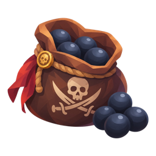 Grapeshot Pouch | Uncommon | +Deck Cannons damage; evolves it | **What it is:** a leather pouch of grapeshot. **In play:** +10% damage; evolves Deck Cannons into Stormshot Cannon at weapon level 5. Chest and Powder Cache reward, item popup, HUD item row at about 64 px. No proc. **Read at 64 px:** brown sack with dark balls spilling out; reads well. **Colour and style:** green Uncommon frame; brown leather, dark iron. **Focus:** keep the existing icon. **Avoid:** nothing to change. | Not needed: the existing icon reads well. | - | - |
| reinforced\_keel | 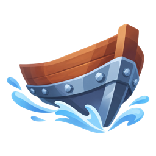 Reinforced Keel | Uncommon | Less damage at speed | **What it is:** an iron-banded keel cutting through water. **In play:** +3% Luck; take 12% less damage while sailing at 4.2 m/s or faster. Chest and Powder Cache reward, item popup, HUD item row at about 64 px. **Read at 64 px:** hull bow with a splash; reads, though it could pass for a boat. **Colour and style:** green Uncommon frame; wood, steel blue. **Focus:** the proc is a steel-blue armour shimmer along the hull while fast. **Avoid:** heal green; a full shield bubble. | Proc effect texture (armour shimmer, not an icon): Particle texture for a cartoon pirate roguelite, hand-painted style with soft cel shading and a soft glow, no outline, centred shape filling about 80% of a square, pure white and steel-blue shapes on a pure black background for additive particles, no text, 1024x1024 (imported at 256). Subject: a horizontal band of overlapping hexagonal plate glints, bright in the middle and fading out at both ends, like a sheen sweeping along metal. | armour shimmer | P3 |
| serrated\_scabbard | 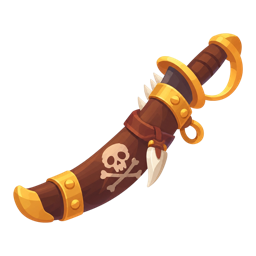 Serrated Scabbard | Uncommon | Evolves Flying Cutlasses | **What it is:** a cutlass scabbard with a saw-toothed edge. **In play:** +4% crit chance; evolves Flying Cutlasses into Bladed Tide at weapon level 5. Chest and Powder Cache reward, item popup, HUD item row at about 64 px. **Read at 64 px:** today a thin diagonal shape that fills under half the slot. **Colour and style:** green Uncommon frame; brown leather, steel. **Focus:** a fuller, chunkier scabbard with big teeth. **Avoid:** a thin diagonal line. | Icon refresh (chunkier silhouette): Mobile game item icon for a cartoon pirate roguelite, hand-painted style with soft cel shading, glossy highlights, chunky readable shapes and warm saturated colours, no outline, one centred object in three-quarter view filling 80% of a square, transparent background, no text, no frame, 1024x1024. Subject: a short wide curved leather cutlass scabbard with big steel saw teeth along its outer edge, a brass skull fitting and the gold hilt of the cutlass sticking out, shown at a gentle angle. | - | - |
| admirals\_ledger | 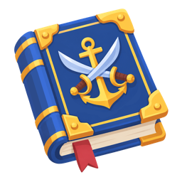 Admiral's Ledger | Rare | Damage per weapon family | **What it is:** an admiral's ledger. **In play:** +4% damage, plus 3% for each different weapon family carried, up to +18%. Chest and Powder Cache reward, item popup, HUD item row at about 64 px. No proc. **Read at 64 px:** a closed blue book with gold corners; reads well alone. **Colour and style:** blue Rare frame. **Focus:** it sits under the Logbook row, and Logbooks are closed leather books (defence ones blue), so refresh it as an open ledger. **Avoid:** a closed book. | Icon refresh (so it never reads as a Logbook): Mobile game item icon for a cartoon pirate roguelite, hand-painted style with soft cel shading, glossy highlights, chunky readable shapes and warm saturated colours, no outline, one centred object in three-quarter view filling 80% of a square, transparent background, no text, no frame, 1024x1024. Subject: an open navy ledger lying flat with cream pages ruled in columns of small weapon pictograms, a gold anchor clasp hanging open and a white quill pen resting across it. | - | - |
| black\_powder\_keg | 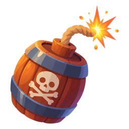 Black Powder Keg | Rare | Stronger explosions | **What it is:** a keg of black powder. **In play:** +10% crit damage; Powder Kegs explosions deal 12% more damage. Chest and Powder Cache reward, item popup, HUD item row at about 64 px. No proc. **Read at 64 px:** reads as a keg, but it is almost the same as the Powder Kegs weapon icon. **Colour and style:** blue Rare frame. **Focus:** a refresh that shows the powder, not the mine. **Avoid:** the lit fuse and skull keg of the weapon icon. | Icon refresh (to separate it from the Powder Kegs weapon icon): Mobile game item icon for a cartoon pirate roguelite, hand-painted style with soft cel shading, glossy highlights, chunky readable shapes and warm saturated colours, no outline, one centred object in three-quarter view filling 80% of a square, transparent background, no text, no frame, 1024x1024. Subject: a small open-topped keg heaped with glittering black powder, a brass scoop stuck in it, a little powder spilling down the side, no fuse. | - | - |
| golden\_figurehead | 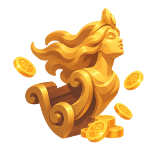 Golden Figurehead | Rare | Damage from unspent gold | **What it is:** a gilded mermaid figurehead. **In play:** +5% gold gain; +1% damage for every 20 gold held, up to +15% at 300 gold. Chest and Powder Cache reward, item popup, HUD item row at about 64 px. No proc. **Read at 64 px:** gold mermaid bust with coins; reads well. **Colour and style:** blue Rare frame; gold. **Focus:** keep the existing icon. **Avoid:** nothing to change. | Not needed: the existing icon reads well. | - | - |
| leviathan\_tooth | 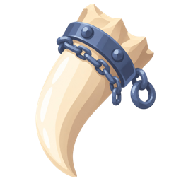 Leviathan Tooth | Rare | +20% damage to targets hit by Harpoon Gun tar in the last 1.2 s | **What it is:** a huge sea-monster tooth with an iron band. **In play:** the config gives +3% Luck and 20% more damage to enemies hit by Harpoon Gun tar in the last 1.2 s (narrower than slowed enemies). Chest and Powder Cache reward, item popup, HUD item row at about 64 px. No proc. **Read at 64 px:** one curved ivory fang; reads very well. **Colour and style:** blue Rare frame; ivory, iron. **Focus:** keep the existing icon. **Avoid:** nothing to change. | Not needed: the existing icon reads well. | - | - |
| powder\_fuse | 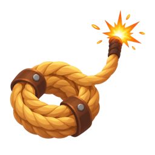 Powder Fuse | Rare | Distance without hits charges an explosion | **What it is:** a coiled fuse rope with a lit end. **In play:** +3% Luck; sailing 18 m without being hit charges the next Powder Kegs explosion for 35% more damage. Chest and Powder Cache reward, item popup, HUD item row at about 64 px. **Read at 64 px:** tan coil with a spark; reads, but see Double-Fuse Cord. **Colour and style:** blue Rare frame; tan rope. **Focus:** the proc is a warm glow at the stern that builds over the 18 m and holds once charged. **Avoid:** fire on the hull. | Proc effect texture (charge glow, not an icon): Particle texture for a cartoon pirate roguelite, hand-painted style with soft cel shading and a soft glow, no outline, centred shape filling about 80% of a square, pure white and warm orange shapes on a pure black background for additive particles, no text, 1024x1024 (imported at 256). Subject: a soft round ember glow with a bright core and a few small sparks drifting upward around it, calm rather than explosive. | charge glow | P3 |
| sea\_witchs\_eye | 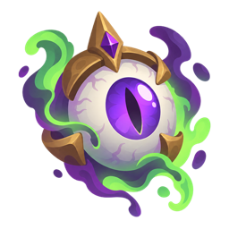 Sea Witch's Eye | Rare | Stronger status damage | **What it is:** a witch's purple eye in a gold setting with green wisps. **In play:** +4% Luck; burn damage +15%. Chest and Powder Cache reward, item popup, HUD item row at about 64 px. No proc. **Read at 64 px:** round eye with a slit pupil; reads very well. **Colour and style:** blue Rare frame; purple, cursed green. **Focus:** keep the existing icon. **Avoid:** nothing to change. | Not needed: the existing icon reads well. | - | - |
| stormglass | 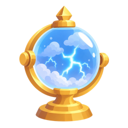 Stormglass | Rare | +1 chain jump | **What it is:** a glass storm orb on a gold stand. **In play:** Lightning Mast chains to 1 more enemy; +1 projectile for every weapon per 2 copies. Chest and Powder Cache reward, item popup, HUD item row at about 64 px. No proc. **Read at 64 px:** blue orb with lightning on a stand; reads very well and is the style reference for new item icons. **Colour and style:** blue Rare frame; gold, sky blue. **Focus:** keep the existing icon. **Avoid:** nothing to change. | Not needed: the existing icon reads well. | - | - |
| broadside\_drum | 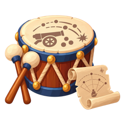 Broadside Drum | Epic | Evolves Broadside Battery | **What it is:** a ship's war drum. **In play:** +1 projectile for every weapon; evolves Broadside Battery into King's Broadside at weapon level 5. Chest and Powder Cache reward, item popup, HUD item row at about 64 px. No proc. **Read at 64 px:** drum reads, but the sticks and scroll around it add noise. **Colour and style:** purple Epic frame; red and cream drum. **Focus:** optional refresh: drum and two crossed sticks only. **Avoid:** the scroll. | Icon refresh (optional, less clutter): Mobile game item icon for a cartoon pirate roguelite, hand-painted style with soft cel shading, glossy highlights, chunky readable shapes and warm saturated colours, no outline, one centred object in three-quarter view filling 80% of a square, transparent background, no text, no frame, 1024x1024. Subject: a squat naval war drum with a deep red body, gold rope lacing and a cream skin, two wooden drumsticks crossed on top. | - | - |
| copper\_conductor | 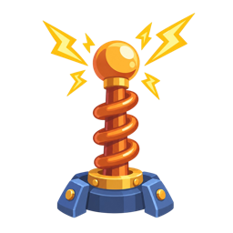 Copper Conductor | Epic | Evolves Lightning Mast | **What it is:** a copper coil lightning rod. **In play:** +10% projectile speed; evolves Lightning Mast into Tempest Mast at weapon level 5. Chest and Powder Cache reward, item popup, HUD item row at about 64 px. No proc. **Read at 64 px:** a thin vertical rod that fills about half the slot width. **Colour and style:** purple Epic frame; copper, electric yellow. **Focus:** refresh with a chunkier coil and a wide base. **Avoid:** a thin pole. | Icon refresh (chunkier silhouette): Mobile game item icon for a cartoon pirate roguelite, hand-painted style with soft cel shading, glossy highlights, chunky readable shapes and warm saturated colours, no outline, one centred object in three-quarter view filling 80% of a square, transparent background, no text, no frame, 1024x1024. Subject: a short fat copper coil wound round a brass rod with a glowing ball on top, set on a wide round blue-iron base, two bright yellow sparks jumping off the ball. | - | - |
| cursed\_compass | 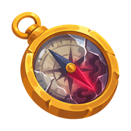 Cursed Compass | Epic | Luck, denser fights | **What it is:** a gold compass with a red cursed needle. **In play:** +8% Luck; 18% more enemies spawn. Chest and Powder Cache reward, item popup, HUD item row at about 64 px. No proc. **Read at 64 px:** round gold compass; reads well. **Colour and style:** purple Epic frame; gold, dark red. **Focus:** keep the existing icon. **Avoid:** nothing to change; note the Navigator's Charts Logbook uses a compass rose, kept on a teal book so the two stay apart. | Not needed: the existing icon reads well. | - | - |
| dragons\_breath\_nozzle | 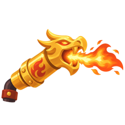 Dragon's Breath Nozzle | Epic | Evolves Flamethrower | **What it is:** a gold dragon-head flame nozzle. **In play:** +32% shot size; evolves Flamethrower into Hellfire Nozzle at weapon level 5 (the Flamethrower is off until its redo). Chest and Powder Cache reward, item popup, HUD item row at about 64 px. No proc. **Read at 64 px:** dragon head breathing fire; reads well. **Colour and style:** purple Epic frame; gold, orange flame. **Focus:** keep the existing icon. **Avoid:** nothing to change. | Not needed: the existing icon reads well. | - | - |

### 5.2 Items built on placeholder icons (28), and deferred ones

| id | Name | Rarity | In play | Art brief | GPT prompt | Proc effect | Status | Pri |
| --- | --- | --- | --- | --- | --- | --- | --- | --- |
| rusted\_shackle | Rusted Shackle | Uncommon | +12% shot size; evolves Anchor Flail | **What it is:** a broken, rusty iron shackle off an anchor chain. **In play:** +12% shot size; evolves Anchor Flail into Kraken Chain at weapon level 5. Icon on chest cards, the item popup and the HUD row; no proc art. **Read at 64 px:** a fat U-shaped shackle with its pin and one snapped link. **Colour and style:** Uncommon green card frame; orange rust on dark iron, a few barnacles, matching the hand-painted item set. **Focus / Avoid:** one heavy shape; avoid the Leviathan Tooth icon's iron band and chain; no anchor (the weapon). | Hand-painted cartoon mobile game item icon for a pirate roguelite, soft cel shading, glossy highlights, chunky readable shapes and warm saturated colours, no outline, one centred object in three-quarter view filling about 80% of a square, transparent background, no text, no frame, 1024x1024. Subject: a heavy iron shackle, a fat U-shaped bow closed by a thick screw pin, one snapped chain link hanging from it with a jagged break, crusted with bright orange rust patches and two small white barnacles, glossy highlights on the dark iron. No anchor, no tooth. | - | placeholder | P1 |
| chain\_locker | Chain Locker | Uncommon | Evolves Chainshot | **What it is:** a ship's chain locker, a small iron-strapped sea box full of heavy chain. **In play:** +10% projectile speed; evolves Chainshot into Bar Shot Barrage at weapon level 5. Icon on chest cards, the item popup and the HUD row; no proc art. **Read at 64 px:** a square box with a fat loop of dark chain spilling over its edge. **Colour and style:** Uncommon green card frame; weathered brown wood, dark iron, white glints on the links. **Focus / Avoid:** big chunky links; not a treasure chest (no gold, coins or domed lid). | Hand-painted cartoon mobile game item icon for a pirate roguelite, soft cel shading, glossy highlights, chunky readable shapes and warm saturated colours, no outline, one centred object in three-quarter view filling about 80% of a square, transparent background, no text, no frame, 1024x1024. Subject: a square weathered wooden sea locker bound with dark iron straps and rivets, its flat lid thrown open, a thick loop of oversized dark iron chain with chunky links spilling over the front edge and hanging down the side. Not a treasure chest: no gold, no coins, no rounded lid. | - | placeholder | P1 |
| siren\_scale | Siren Scale | Uncommon | Evolves Siren Bell | **What it is:** one large shimmering scale shed by a siren. **In play:** +9% fire rate; evolves Siren Bell into Drowned Choir at weapon level 5. Icon on chest cards, the item popup and the HUD row; no proc art. **Read at 64 px:** a single rounded fan-shaped scale with a bright pearly rim. **Colour and style:** Uncommon green card frame; teal, violet and pearl pink, a soft glow that hints at Drowned Choir's ghost teal. **Focus / Avoid:** one bold glossy shape; not a seashell, gem or bell. | Hand-painted cartoon mobile game item icon for a pirate roguelite, soft cel shading, glossy highlights, chunky readable shapes and warm saturated colours, no outline, one centred object in three-quarter view filling about 80% of a square, transparent background, no text, no frame, 1024x1024. Subject: one large rounded fan-shaped mermaid scale, thick and slightly curved, iridescent teal shading to violet with a pearl pink rim, a broad glossy highlight across it and a soft magical sea-teal glow, two tiny bubbles beside it. Not a seashell, not a gem. | - | placeholder | P1 |
| iron\_figurehead | Iron Figurehead | Uncommon | Evolves Squid Ink Pots | **What it is:** a ship's figurehead bust cast in dark riveted iron. **In play:** +9% damage; evolves Squid Ink Pots into Black Tide at weapon level 5 (D21: the Ramming Prow's item, reused). Icon on chest cards, the item popup and the HUD row; no proc art. **Read at 64 px:** a bearded head and chest jutting forward in profile, heavy jaw. **Colour and style:** Uncommon green card frame; gunmetal iron, bright steel edges. **Focus / Avoid:** must not look like the Golden Figurehead icon (gold, flowing-haired woman, coins): no gold, no coins, no hair flowing back. | Hand-painted cartoon mobile game item icon for a pirate roguelite, soft cel shading, glossy highlights, chunky readable shapes and warm saturated colours, no outline, one centred object in three-quarter view filling about 80% of a square, transparent background, no text, no frame, 1024x1024. Subject: a ship's figurehead bust of a stern bearded sea captain cast in dark gunmetal iron, square jaw thrust forward, iron plates and big round rivets across the chest, bright steel highlights on the edges and a faint orange glow at the rivets. No gold, no coins, no woman. | - | placeholder | P1 |
| whale\_oil\_barrel | Whale Oil Barrel | Uncommon | Evolves Harpoon Gun | **What it is:** a small cask of whale oil with a whaler's brand. **In play:** +9% damage; evolves Harpoon Gun into Whaler's Volley at weapon level 5. Icon on chest cards, the item popup and the HUD row; no proc art. **Read at 64 px:** a squat cask with a big glossy amber-black drip down its side. **Colour and style:** Uncommon green card frame; pale tan wood, tan rope, glossy amber-black oil. **Focus / Avoid:** not the Black Powder Keg icon or Powder Kegs weapon (no fuse, flame or red). | Hand-painted cartoon mobile game item icon for a pirate roguelite, soft cel shading, glossy highlights, chunky readable shapes and warm saturated colours, no outline, one centred object in three-quarter view filling about 80% of a square, transparent background, no text, no frame, 1024x1024. Subject: a squat pale-tan wooden cask lying on its side with tan rope hoops, a whale tail branded on its front, a wooden spout leaking a thick glossy amber-black oil drip that runs down the side and pools under it. No fuse, no fire, no gunpowder. | - | placeholder | P1 |
| powder\_horn\_of\_the\_line | Powder Horn of the Line | Uncommon | Evolves Long Nine | **What it is:** a navy gunner's powder horn, polished and banded in brass. **In play:** +9% damage; evolves Long Nine into Ship of the Line at weapon level 5. Icon on chest cards, the item popup and the HUD row; no proc art. **Read at 64 px:** a fat curved crescent horn with a brass cap at each end. **Colour and style:** Uncommon green card frame; cream horn, brass bands, navy-blue strap. **Focus / Avoid:** the strap and brass ends must stop it reading as a tooth (Leviathan Tooth, Shark Tooth Necklace). | Hand-painted cartoon mobile game item icon for a pirate roguelite, soft cel shading, glossy highlights, chunky readable shapes and warm saturated colours, no outline, one centred object in three-quarter view filling about 80% of a square, transparent background, no text, no frame, 1024x1024. Subject: a fat curved powder horn of polished cream horn with two wide brass bands, a brass spout cap at the narrow end and a brass plug at the wide end, a navy-blue carrying strap looping over it, a small anchor crest engraved in the middle, warm amber glints. Clearly a horn, not a tooth. | - | placeholder | P1 |
| siege\_quadrant | Siege Quadrant | Uncommon | Evolves Mortar | **What it is:** a gunner's brass quadrant for setting a mortar's angle. **In play:** +12% shot size; evolves Mortar into Siege Bombard at weapon level 5. Icon on chest cards, the item popup and the HUD row; no proc art. **Read at 64 px:** a solid quarter-circle wedge with a plumb weight hanging below. **Colour and style:** Uncommon green card frame; bright brass, dark iron weight, a little Siege Bombard yellow. **Focus / Avoid:** few, bold tick marks; avoid a compass or clock face (Cursed Compass, Dead Man's Compass) and hair-thin scale lines. | Hand-painted cartoon mobile game item icon for a pirate roguelite, soft cel shading, glossy highlights, chunky readable shapes and warm saturated colours, no outline, one centred object in three-quarter view filling about 80% of a square, transparent background, no text, no frame, 1024x1024. Subject: a chunky brass gunner's quadrant, a thick quarter-circle plate with a long straight arm along one edge, five bold notches on the curved scale, a heavy dark iron plumb weight hanging on a short cord, bright brass highlights. Not a compass, not a clock. | - | placeholder | P1 |
| swivel\_mount | Swivel Mount | Uncommon | Evolves Swivel Guns | **What it is:** the forged iron yoke a swivel gun sits on. **In play:** +9% fire rate; evolves Swivel Guns into Swivel Battery at weapon level 5. Icon on chest cards, the item popup and the HUD row; no proc art. **Read at 64 px:** a bold Y shape on a short post with one big pivot bolt. **Colour and style:** Uncommon green card frame; dark iron, oak post, pale gold trim echoing Swivel Battery. **Focus / Avoid:** show the empty mount, not the gun (that is the Swivel Guns weapon icon); avoid thin arms. | Hand-painted cartoon mobile game item icon for a pirate roguelite, soft cel shading, glossy highlights, chunky readable shapes and warm saturated colours, no outline, one centred object in three-quarter view filling about 80% of a square, transparent background, no text, no frame, 1024x1024. Subject: a thick forged dark-iron Y-shaped swivel yoke with two broad curved arms, empty, turning on one big round pivot bolt set into a short stout oak rail post, pale gold trim rings on the post, small curved motion marks showing it can swing. No gun barrel. | - | placeholder | P1 |
| captains\_perch | Captain's Perch | Uncommon | Evolves Parrot Squadron | **What it is:** the captain's parrot perch, missing its bird. **In play:** +9% damage; evolves Parrot Squadron into Parrot Armada at weapon level 5. Icon on chest cards, the item popup and the HUD row; no proc art. **Read at 64 px:** a T-shaped perch with a tiny tricorne and one bright feather. **Colour and style:** Uncommon green card frame; warm wood, brass ring, parrot red and green. **Focus / Avoid:** no whole parrot (the Parrot Squadron weapon icon); avoid thin legs on the stand. | Hand-painted cartoon mobile game item icon for a pirate roguelite, soft cel shading, glossy highlights, chunky readable shapes and warm saturated colours, no outline, one centred object in three-quarter view filling about 80% of a square, transparent background, no text, no frame, 1024x1024. Subject: a sturdy wooden T-shaped parrot perch on a round base, a brass ring at the top, a tiny black tricorne captain's hat hanging from one end of the bar, one long bright red and green parrot feather resting across it. No parrot. | - | placeholder | P1 |
| banana\_crate | Banana Crate | Uncommon | Evolves Monkey Gunners | **What it is:** a ship's crate of bananas, the monkey crew's pay. **In play:** +9% fire rate; evolves Monkey Gunners into Monkey Battery at weapon level 5. Icon on chest cards, the item popup and the HUD row; no proc art. **Read at 64 px:** a big bright yellow banana bunch on a brown crate. **Colour and style:** Uncommon green card frame; banana yellow on warm brown wood. **Focus / Avoid:** no monkey (Powder Monkey item and the Monkey Gunners weapon); avoid a barrel shape (Whale Oil Barrel, Black Powder Keg). | Hand-painted cartoon mobile game item icon for a pirate roguelite, soft cel shading, glossy highlights, chunky readable shapes and warm saturated colours, no outline, one centred object in three-quarter view filling about 80% of a square, transparent background, no text, no frame, 1024x1024. Subject: a small slatted wooden crate overflowing with two big bunches of glossy bright yellow bananas, one banana peeled and hanging over the edge, a monkey paw print stamped on the crate side. No monkey, no barrel. | - | placeholder | P1 |
| storm\_conch | Storm Conch | Uncommon | Evolves Maelstrom Charge | **What it is:** a spiral conch that holds a sea storm. **In play:** +12% shot size; evolves Maelstrom Charge into Abyssal Vortex at weapon level 5. Icon on chest cards, the item popup and the HUD row; no proc art. **Read at 64 px:** a big spiral conch with a swirl and sparks leaving its mouth. **Colour and style:** Uncommon green card frame; cream shell, deep navy inside, electric-blue sparks like Abyssal Vortex. **Focus / Avoid:** no glass or gold stand (the Stormglass icon); avoid tiny sparks that vanish at 64 px. | Hand-painted cartoon mobile game item icon for a pirate roguelite, soft cel shading, glossy highlights, chunky readable shapes and warm saturated colours, no outline, one centred object in three-quarter view filling about 80% of a square, transparent background, no text, no frame, 1024x1024. Subject: a large spiral conch shell, cream with deep navy-blue stripes and a glossy pink-white lip, a swirl of dark blue water and wind spiralling out of its opening with three bold electric-blue spark bolts. No glass, no stand. | - | placeholder | P1 |
| fresnel\_lens | Fresnel Lens | Uncommon | Evolves Lighthouse Lantern | **What it is:** a lighthouse's ribbed glass lens in a brass ring. **In play:** +12% shot size; evolves Lighthouse Lantern into Beacon of the Deep at weapon level 5. Icon on chest cards, the item popup and the HUD row; no proc art. **Read at 64 px:** a round disc of bold concentric glass rings. **Colour and style:** Uncommon green card frame; warm white glass, brass rim, cyan rim light and small prism rainbows. **Focus / Avoid:** no lantern body or flame (Ghost Lantern icon, Lighthouse Lantern weapon), no glass sphere (Stormglass); 3 or 4 thick rings. | Hand-painted cartoon mobile game item icon for a pirate roguelite, soft cel shading, glossy highlights, chunky readable shapes and warm saturated colours, no outline, one centred object in three-quarter view filling about 80% of a square, transparent background, no text, no frame, 1024x1024. Subject: a round flat lighthouse fresnel lens held in a thick brass ring, four bold concentric ridges of warm white glass, a bright warm glint shining through the centre, a cyan rim light and two small prism rainbows. No lantern, no flame, not a sphere. | - | placeholder | P1 |
| cursed\_chest\_key | Cursed Chest Key | Uncommon | Evolves Cursed Doubloons | **What it is:** the iron key to a cursed treasure chest. **In play:** +9% damage; evolves Cursed Doubloons into Pirate King's Hoard at weapon level 5. Icon on chest cards, the item popup and the HUD row; no proc art. **Read at 64 px:** a long key with a big skull bow, wrapped in green glow. **Colour and style:** Uncommon green card frame; dark iron with tarnished gold teeth, cursed green glow matching Pirate King's Hoard. **Focus / Avoid:** must not look like the Skeleton Key (pale bone, red ribbon); no coins. | Hand-painted cartoon mobile game item icon for a pirate roguelite, soft cel shading, glossy highlights, chunky readable shapes and warm saturated colours, no outline, one centred object in three-quarter view filling about 80% of a square, transparent background, no text, no frame, 1024x1024. Subject: a long ornate dark-iron key held diagonally, its bow shaped like a grinning skull with glowing green eyes, tarnished gold teeth on the bit, wrapped in a ghostly green glow with three thick green wisps curling off it. Not bone, no ribbon. | - | placeholder | P1 |

**Other new items, and the deferred ones**

| id | Name | Rarity | In play | Art brief | GPT prompt | Proc effect | Status | Pri |
| --- | --- | --- | --- | --- | --- | --- | --- | --- |
| spare\_planks | Spare Planks | Common | +Hull | **What it is:** a bundle of spare planks for patching the hull. **In play:** +7 max hull (the built item has no heal). Icon on chest cards, the item popup and the HUD row; a small heal-green sparkle when taken is enough proc art. **Read at 64 px:** three thick planks crossed by a rope, a hammer on top. **Colour and style:** Common grey card frame; warm brown wood, iron nails, heal green (0.18, 1, 0.42) sparkle. **Focus / Avoid:** avoid a ship hull or keel shape (Reinforced Keel icon) and a loose pile of thin sticks. | Hand-painted cartoon mobile game item icon for a pirate roguelite, soft cel shading, glossy highlights, chunky readable shapes and warm saturated colours, no outline, one centred object in three-quarter view filling about 80% of a square, transparent background, no text, no frame, 1024x1024. Subject: a neat stack of three thick warm-brown wooden planks tied with a rope cross, a small claw hammer and three iron nails resting on top, one bright green four-point sparkle at a corner. Not a ship hull. | heal sparkle | placeholder | P1 |
| powder\_monkey | Powder Monkey | Common | +attack speed | **What it is:** a powder monkey, the deck boy who runs gunpowder to the guns, drawn as a real monkey. **In play:** +6.5% fire rate. Icon on chest cards, the item popup and the HUD row; no proc art. **Read at 64 px:** a round monkey face hugging a fat black powder bag, speed lines behind. **Colour and style:** Common grey card frame; brown monkey, red and white striped shirt, black bag. **Focus / Avoid:** no cannon, raft or bandana (the Monkey Gunners weapon icon); no keg (Black Powder Keg). | Hand-painted cartoon mobile game item icon for a pirate roguelite, soft cel shading, glossy highlights, chunky readable shapes and warm saturated colours, no outline, one centred object in three-quarter view filling about 80% of a square, transparent background, no text, no frame, 1024x1024. Subject: a small eager brown cartoon monkey in a red and white striped sailor shirt, running and hugging a fat black cloth gunpowder bag tied with string, big grin, three bold white speed lines behind it. No cannon, no raft, no bandana, no barrel. | - | placeholder | P1 |
| shark\_tooth\_necklace | Shark Tooth Necklace | Common | +damage to healthy targets | **What it is:** a sailor's necklace with one big shark tooth. **In play:** +12% damage per copy to enemies above 90% hull, up to +80%. Icon on chest cards, the item popup and the HUD row; no proc art. **Read at 64 px:** a triangular white serrated tooth hanging from a loop of cord. **Colour and style:** Common grey card frame; white tooth, brown leather cord, teal and wooden beads. **Focus / Avoid:** must not look like the Leviathan Tooth icon (one huge curved cream fang with an iron band and chain): small flat triangle, cord loop, no iron. | Hand-painted cartoon mobile game item icon for a pirate roguelite, soft cel shading, glossy highlights, chunky readable shapes and warm saturated colours, no outline, one centred object in three-quarter view filling about 80% of a square, transparent background, no text, no frame, 1024x1024. Subject: a round loop of brown leather cord necklace with one large flat triangular white shark tooth with bold serrated edges hanging at the bottom, flanked by chunky teal and wooden beads. No iron band, no chain, not a curved fang. | - | placeholder | P1 |
| manta\_sail | Manta Sail | Common | +speed | **What it is:** a small sail cut in the shape of a manta ray. **In play:** +3% sail speed. Icon on chest cards, the item popup and the HUD row; no proc art. **Read at 64 px:** a wide diamond of wing-shaped canvas on a short mast. **Colour and style:** Common grey card frame; deep blue top, cream belly, white wind lines. **Focus / Avoid:** it must read as a sail, not as the Manta Ray enemy: show the mast and rope; avoid a sea creature face. | Hand-painted cartoon mobile game item icon for a pirate roguelite, soft cel shading, glossy highlights, chunky readable shapes and warm saturated colours, no outline, one centred object in three-quarter view filling about 80% of a square, transparent background, no text, no frame, 1024x1024. Subject: a small billowing sail cut in the wide diamond shape of manta ray wings, deep blue on top with a cream underside, a thin tail-like pennant trailing behind, fixed to a short wooden mast with rope, three bold white wind lines sweeping past. A sail, not an animal, no face. | - | placeholder | P1 |
| reef\_carapace | Reef Carapace | Common | +armour | **What it is:** a round shield made from a coral-grown turtle shell. **In play:** +4 armour; kept out of the pools since M5 because armour is not applied yet (D34, question 30). Icon on chest cards, the item popup and the HUD row; no proc art. **Read at 64 px:** a round domed shell with big plates. **Colour and style:** Common grey card frame; olive-green shell, pink and orange coral. **Focus / Avoid:** keep barnacles off (Barnacle Crown) and avoid looking like a ship's hull (Reinforced Keel). | Hand-painted cartoon mobile game item icon for a pirate roguelite, soft cel shading, glossy highlights, chunky readable shapes and warm saturated colours, no outline, one centred object in three-quarter view filling about 80% of a square, transparent background, no text, no frame, 1024x1024. Subject: a round domed shield made from a sea-turtle shell with big hexagonal olive-green plates, branches of bright pink and orange coral growing from its rim, a rope hand strap on the side, a glossy highlight on the dome. No barnacles, no crown. | - | placeholder | P1 |
| crows\_nest | Crow's Nest | Common | +pickup radius | **What it is:** the lookout basket at the top of the mast. **In play:** +10% pickup range. Icon on chest cards, the item popup and the HUD row; no proc art. **Read at 64 px:** a round basket on a mast top, spyglass poking out, small flag above. **Colour and style:** Common grey card frame; warm wood, brass spyglass, red pennant. **Focus / Avoid:** show the mast and flag so it does not read as a barrel (Whale Oil Barrel, Black Powder Keg); avoid thin rigging lines. | Hand-painted cartoon mobile game item icon for a pirate roguelite, soft cel shading, glossy highlights, chunky readable shapes and warm saturated colours, no outline, one centred object in three-quarter view filling about 80% of a square, transparent background, no text, no frame, 1024x1024. Subject: a round woven wooden lookout basket at the top of a short thick mast, a brass spyglass poking out over the rim, a small red pennant flying from the mast tip, the basket seen slightly from above. Not a barrel. | - | placeholder | P1 |
| skeleton\_key | Skeleton Key | Uncommon | Chance of a free chest | **What it is:** a key carved from bone that opens any lock. **In play:** 6% chance a chest is free per copy, up to 35%; a free chest does not raise the next price, and a "Free chest" toast shows. Icon on chest cards, the item popup and the HUD row; the guide lists a small "free" stamp on the chest. **Read at 64 px:** a pale bone key with a skull bow and red ribbon. **Colour and style:** Uncommon green card frame; bone white, red ribbon. **Focus / Avoid:** no green glow and no iron (Cursed Chest Key). | Hand-painted cartoon mobile game item icon for a pirate roguelite, soft cel shading, glossy highlights, chunky readable shapes and warm saturated colours, no outline, one centred object in three-quarter view filling about 80% of a square, transparent background, no text, no frame, 1024x1024. Subject: a chunky key carved from pale cream bone held diagonally, a small rounded skull as its bow, simple blocky teeth, a bright red ribbon tied through the skull's eye in a bow, a soft warm highlight. No green glow, no iron. | "free" stamp on the chest | placeholder | P1 |
| smugglers\_ledger | Smuggler's Ledger | Rare | Dearer chests, better rarity | **What it is:** a smuggler's secret account book. **In play:** chests cost 20% more; Uncommon and better items are 10% likelier per copy, up to 50%. Icon on chest cards, the item popup and the HUD row; no proc art. **Read at 64 px:** a thick dark book with a dagger through it. **Colour and style:** Rare blue card frame; dark brown leather, iron buckle, steel dagger, gold coins. **Focus / Avoid:** must not look like the Admiral's Ledger icon (blue book, gold corners, anchor and cutlasses, red bookmark): no blue cover, no anchor. | Hand-painted cartoon mobile game item icon for a pirate roguelite, soft cel shading, glossy highlights, chunky readable shapes and warm saturated colours, no outline, one centred object in three-quarter view filling about 80% of a square, transparent background, no text, no frame, 1024x1024. Subject: a thick battered dark-brown leather ledger book closed with an iron buckle strap, a steel dagger stabbed down through its cover, a few gold coins spilling from between its pages. No blue cover, no anchor, no bookmark. | - | placeholder | P1 |
| black\_spot | Black Spot | Rare | Elite rewards | **What it is:** the pirate's black spot, a death mark on a scrap of paper. **In play:** elite kills drop 10% more gold and XP per copy, up to 50%. Icon on chest cards, the item popup and the HUD row; the guide lists an elite marker as proc art. **Read at 64 px:** a pale torn scrap with one huge black dot. **Colour and style:** Rare blue card frame; yellowed parchment, inky black spot, faint red glow. **Focus / Avoid:** the spot must read as ink, not a hole; avoid writing or small marks on the paper. | Hand-painted cartoon mobile game item icon for a pirate roguelite, soft cel shading, glossy highlights, chunky readable shapes and warm saturated colours, no outline, one centred object in three-quarter view filling about 80% of a square, transparent background, no text, no frame, 1024x1024. Subject: a torn, curling scrap of yellowed parchment with one large round glossy black ink spot in the middle, a few small ink splatters at its edge, a faint ominous red glow around the paper. No writing. | elite marker | placeholder | P1 |
| dead\_mans\_compass | Dead Man's Compass | Rare | More enemies, more XP | **What it is:** a compass with a carved bone case taken from a dead navigator. **In play:** +5% XP gain; 10% more enemies spawn. Icon on chest cards, the item popup and the HUD row; no proc art. **Read at 64 px:** a round bone case with a skull lid and a glowing needle. **Colour and style:** Rare blue card frame; bone white case, ghostly cyan needle (XP cyan). **Focus / Avoid:** must not look like the Cursed Compass icon (gold case, cracked glass, red needle, purple smoke): no gold, no red, no cracks. | Hand-painted cartoon mobile game item icon for a pirate roguelite, soft cel shading, glossy highlights, chunky readable shapes and warm saturated colours, no outline, one centred object in three-quarter view filling about 80% of a square, transparent background, no text, no frame, 1024x1024. Subject: an open round compass with a case carved from pale bone, the lid shaped like a skull and tipped back, a bold glowing ghostly cyan needle over a dark face, a soft cyan glow spilling out. No gold, no red, no cracked glass. | - | placeholder | P1 |
| cursed\_coin | Cursed Coin | Rare | More gold, less hull | **What it is:** a cracked doubloon that pays well and drains the ship. **In play:** +10% gold gain, -10% max hull; kept out of the pools since M5 because gold gain is not applied in stage runs (D34, question 31). Icon on chest cards, the item popup and the HUD row; no proc art. **Read at 64 px:** one coin split by a glowing green crack. **Colour and style:** Rare blue card frame; tarnished gold, cursed green light. **Focus / Avoid:** not the Lucky Doubloon icon (clover, LUCK) or the Cursed Doubloons weapon (three bouncing coins): one coin, no text. | Hand-painted cartoon mobile game item icon for a pirate roguelite, soft cel shading, glossy highlights, chunky readable shapes and warm saturated colours, no outline, one centred object in three-quarter view filling about 80% of a square, transparent background, no text, no frame, 1024x1024. Subject: one large thick tarnished gold coin stamped with a skull, split by a jagged crack with bright cursed green light leaking out of it and a small green wisp rising. One coin only, no clover, no lettering. | - | placeholder | P1 |
| barnacle\_crown | Barnacle Crown | Epic | Damage stacks while surrounded | **What it is:** a drowned king's barnacled crown. **In play:** while 4 or more enemies are within 5 m, +2% damage a second up to +20%; each extra copy raises the cap by 4%, up to +40%; drains 4% a second once free. Icon on chest cards, the item popup and the HUD row; proc art is a stack ring on the ship. **Read at 64 px:** a crown with clear points and white barnacle lumps. **Colour and style:** Epic purple card frame; old gold, white barnacles, green seaweed, one pearl. **Focus / Avoid:** bold points; not Golden Figurehead gold. | Hand-painted cartoon mobile game item icon for a pirate roguelite, soft cel shading, glossy highlights, chunky readable shapes and warm saturated colours, no outline, one centred object in three-quarter view filling about 80% of a square, transparent background, no text, no frame, 1024x1024. Subject: a king's old gold crown with five bold points, crusted with big white barnacle clusters and small shells, strands of green seaweed hanging from it, one large glossy pearl set in the front. | stack ring on the ship | placeholder | P1 |
| jolly\_roger | Jolly Roger | Epic | Kill-streak damage | **What it is:** the pirate flag, raised for a killing spree. **In play:** every 10 kills, +1% damage up to +20%; each extra copy raises the cap by 5%, up to +40%; a hit removes half the bonus. Icon on chest cards, the item popup and the HUD row; proc art is a streak counter in the UI. **Read at 64 px:** a black flag with a big white skull and crossbones. **Colour and style:** Epic purple card frame; black cloth, bone white. **Focus / Avoid:** a big skull filling the flag; no thin bones or ragged edges. | Hand-painted cartoon mobile game item icon for a pirate roguelite, soft cel shading, glossy highlights, chunky readable shapes and warm saturated colours, no outline, one centred object in three-quarter view filling about 80% of a square, transparent background, no text, no frame, 1024x1024. Subject: a black pirate flag waving on a short wooden pole with a brass tip, a large grinning white skull with thick crossed bones filling most of the cloth, a subtle purple sheen on the folds, one small torn notch at the fly end. | streak counter (UI) | placeholder | P1 |
| leviathan\_heart | Leviathan Heart | Legendary | Periodic crowd blast | **What it is:** the still-beating heart of a sea monster. **In play:** every 12 s a blast hits the densest group for 45 damage in a 5 m radius after a 0.6 s warning; each copy adds 20% up to double. Icon on chest cards, the item popup and the HUD row; proc art is a friendly 5 m pulse with its warning. **Read at 64 px:** a glowing heart shape with a light ring. **Colour and style:** Legendary gold frame; deep teal, cyan veins. **Focus / Avoid:** the pulse must not use the enemy warning orange-red; avoid gore. | Hand-painted cartoon mobile game item icon for a pirate roguelite, soft cel shading, glossy highlights, chunky readable shapes and warm saturated colours, no outline, one centred object in three-quarter view filling about 80% of a square, transparent background, no text, no frame, 1024x1024. Subject: a stylised sea-monster heart, deep teal with bright glowing cyan veins and small fin-like ridges, a ring of cyan light pulsing outward from it, a few bubbles around it, magical rather than gory. | friendly 5 m pulse with a warning | placeholder | P1 |
| captains\_last\_rum | Captain's Last Rum | Legendary | Cheats death once | **What it is:** the captain's last bottle of rum, kept for the worst moment. **In play:** once a run, a fatal hit leaves the ship at 25% hull with 2 s of immunity and +30% damage for 8 s. Icon on chest cards, the item popup and the HUD row; proc art is a revive flash and a 2 s shield. **Read at 64 px:** a squat bottle with a golden glow inside. **Colour and style:** Legendary gold frame; dark green glass, red wax, golden halo. **Focus / Avoid:** differ from Storm in a Bottle (tall clear flask). | Hand-painted cartoon mobile game item icon for a pirate roguelite, soft cel shading, glossy highlights, chunky readable shapes and warm saturated colours, no outline, one centred object in three-quarter view filling about 80% of a square, transparent background, no text, no frame, 1024x1024. Subject: a squat round old dark-green glass rum bottle with a red wax seal over the cork and a faded blank parchment label, only a last swig of glowing golden rum left inside, a soft golden halo around it. | revive flash, 2 s shield | placeholder | P1 |
| hammerhead\_helm | Hammerhead Helm | Uncommon | Less knockback, ram damage | **What it is:** a helm shaped like a hammerhead shark's head. **In play (deferred, D33, designed):** received knockback 20% lower per copy, up to 80%; moving above 5 m/s into an enemy below full hull deals ram damage, once a second per target. Icon on chest cards, the item popup and the HUD row; proc art is a bow spark. **Read at 64 px:** the wide T-shaped hammer head. **Colour and style:** Uncommon green frame; grey-blue shark, iron trim. **Focus / Avoid:** not Iron Figurehead or the Ramming Prow beak. | Hand-painted cartoon mobile game item icon for a pirate roguelite, soft cel shading, glossy highlights, chunky readable shapes and warm saturated colours, no outline, one centred object in three-quarter view filling about 80% of a square, transparent background, no text, no frame, 1024x1024. Subject: a sturdy pirate helmet shaped like a hammerhead shark's head, the wide flat T-shaped hammer forming the brow with small eyes at each tip, grey-blue shark skin with a white underside, riveted iron trim and a leather chin strap, a few white sparks at the front edge. | bow spark | deferred (D33) | P2 |
| kraken\_ink\_sac | Kraken Ink Sac | Rare | Elite deaths leave slowing ink | **What it is:** a kraken's ink sac, swollen and dripping. **In play (deferred, D33, designed):** elite deaths leave a 3 m ink pool for 3 s that slows enemies 20% and damages them; at most 4 pools live. Icon on chest cards, the item popup and the HUD row; proc art is an ink decal (at most 4 live). **Read at 64 px:** a round purple sac with a big black drip. **Colour and style:** Rare blue frame; kraken purple, glossy black ink. **Focus / Avoid:** avoid gore; must not read as Black Spot's ink dot. | Hand-painted cartoon mobile game item icon for a pirate roguelite, soft cel shading, glossy highlights, chunky readable shapes and warm saturated colours, no outline, one centred object in three-quarter view filling about 80% of a square, transparent background, no text, no frame, 1024x1024. Subject: a plump rounded kraken ink sac, glossy deep purple with small suction-cup spots, tied at the neck with a short tentacle curling around it, a thick glossy black ink drip running from the bottom into a small splash. Cute, not gory. | ink decal (≤ 4 live) | deferred (D33) | P2 |
| storm\_in\_a\_bottle | Storm in a Bottle | Epic | Burst of 5 strikes | **What it is:** a corked flask holding a live thunderstorm. **In play (deferred, D33, designed):** every 20 Lightning Mast or Copper Conductor chain events, 5 lightning strikes over 1 s at enemies within 18 m; 10 s cooldown. Icon on chest cards, the item popup and the HUD row; proc art reuses lightning. **Read at 64 px:** a tall flask with a dark cloud and a bolt. **Colour and style:** Epic purple frame; clear glass, grey cloud, violet-white bolts. **Focus / Avoid:** no glass orb or gold stand (Stormglass); not Captain's Last Rum. | Hand-painted cartoon mobile game item icon for a pirate roguelite, soft cel shading, glossy highlights, chunky readable shapes and warm saturated colours, no outline, one centred object in three-quarter view filling about 80% of a square, transparent background, no text, no frame, 1024x1024. Subject: a tall clear glass flask with a long neck, a cork and twine, holding a dark grey storm cloud with two bold violet-white lightning bolts crackling inside and a little rain, a violet glow on the glass. Not a round orb, no stand, not a rum bottle. | reuse lightning | deferred (D33) | P2 |
| devils\_match | Devil's Match | Epic | Ignites; burning deaths explode | **What it is:** a match with a devil-shaped head. **In play (deferred, D33, designed):** hits have a 20% chance to set enemies burning; burning enemies that die explode in a 2.5 m blast. Icon on chest cards, the item popup and the HUD row; proc art is a small blast. **Read at 64 px:** one thick match with a horned red head and a big flame. **Colour and style:** Epic purple frame; red head, orange flame with a purple edge. **Focus / Avoid:** not a fuse or cord (Powder Fuse, Double-Fuse Cord); keep the stick thick. | Hand-painted cartoon mobile game item icon for a pirate roguelite, soft cel shading, glossy highlights, chunky readable shapes and warm saturated colours, no outline, one centred object in three-quarter view filling about 80% of a square, transparent background, no text, no frame, 1024x1024. Subject: one oversized thick wooden match held diagonally, its bright red head shaped with two little devil horns and a mischievous face, burning with a big orange flame edged in purple, a few embers. Not a fuse, not a rope. | small blast | deferred (D33) | P2 |
| queen\_annes\_fuse | Queen Anne's Fuse | Epic | Keg blasts spawn secondary blasts | **What it is:** a royal fuse from the queen's own powder store. **In play (deferred, D33, designed):** keg explosions set off a secondary blast at the nearest other enemy within 4 m after 0.2 s, at 25% of the damage; copies add generations, up to 3. Icon on chest cards, the item popup and the HUD row; proc art reuses the keg blast. **Read at 64 px:** a coiled fuse under a small crown, lit spark. **Colour and style:** Epic purple frame; gold, royal purple ribbon. **Focus / Avoid:** not Powder Fuse or Double-Fuse Cord; no keg. | Hand-painted cartoon mobile game item icon for a pirate roguelite, soft cel shading, glossy highlights, chunky readable shapes and warm saturated colours, no outline, one centred object in three-quarter view filling about 80% of a square, transparent background, no text, no frame, 1024x1024. Subject: a thick ornate fuse cord coiled in a neat spiral and wrapped in royal purple ribbon, a small gold crown cap on one end, the other end lit with a bright yellow spark that splits into three smaller sparks. No keg, no barrel. | reuse keg blast | deferred (D33) | P2 |

**Update 7 Oct.** All 28 items above are built (47 item configs in total), but none has an icon: the placeholder icons were removed on 3 Oct. Only the 19 items with art-team icons drop from chests; the 28 stay out of the chest pool until their icon exists. Thirteen evolutions need one of these items, so those evolutions cannot happen in a voyage today. That makes these icons **P0**.

## 6. Logbooks

No Logbook has an icon yet: each needs a book icon in one family style (a leather book with a stat emblem; cover colour by group: offence red, defence blue, movement teal, economy gold). The code side is done (3 Oct): the icon catalogue has a `logbooks` list with 15 empty slots. Drop the PNGs, named after the Logbook, into `Assets/UI/New_items/Logbooks/` and run Tools > Rogue Pirates > Demo > Wire Art Team Assets. Until then the cards show the name. Configs `Data/Build/Logbooks/<id>.asset`.

| id | Name | Stat | Art brief | GPT prompt | Status | Pri |
| --- | --- | --- | --- | --- | --- | --- |
| gunnery\_manual | Gunner's Manual | Damage | **What it is:** a gunnery logbook; emblem two crossed cannons. **In play:** +10% damage a rank at Common, times the card's rarity (up to 2.5× at Legendary), 5 ranks; offered on level-up cards marked LOGBOOK and shown in the HUD Logbook row (4 slots above the items, about 64 px) with its rank. **Read at 64 px:** a red book with an X of two barrels. **Colour and style:** offence red cover; the frame follows the card's rarity; same book for all 15, only the emblem changes. **Focus:** big emblem. **Avoid:** thin barrels. | Mobile game icon for a cartoon pirate roguelite, hand-painted style with soft cel shading and glossy highlights, no outline: one thick closed leather logbook standing at a slight three-quarter angle, stitched spine with two raised bands, a brass clasp strap across the page edge, cream page edges, a cream ribbon bookmark, no metal corner caps, cover in deep red leather. On the cover a large raised gold emblem of two short fat cannons crossed in an X, filling half the cover. Centred, filling 80% of a square, transparent background, no text, no frame, 1024x1024. | needed | P1 |
| powder\_drill | Powdermaster's Drill | Attack speed | **What it is:** a powder drill logbook; emblem a powder horn with motion lines. **In play:** +8% attack speed a rank at Common, times the card's rarity, 5 ranks; level-up cards marked LOGBOOK, HUD Logbook row at about 64 px with its rank. **Read at 64 px:** a red book with a curved horn and three speed lines. **Colour and style:** offence red cover; frame by card rarity; same book as the family. **Focus:** the horn's curve and bold lines. **Avoid:** fine engraving; looking like Damage (Gunner's Manual). | Mobile game icon for a cartoon pirate roguelite, hand-painted style with soft cel shading and glossy highlights, no outline: one thick closed leather logbook standing at a slight three-quarter angle, stitched spine with two raised bands, a brass clasp strap across the page edge, cream page edges, a cream ribbon bookmark, no metal corner caps, cover in deep red leather. On the cover a large raised gold emblem of a curved powder horn with three bold speed lines behind it, filling half the cover. Centred, filling 80% of a square, transparent background, no text, no frame, 1024x1024. | needed | P1 |
| navigators\_charts | Navigator's Charts | Move speed | **What it is:** a navigator's logbook; emblem a compass rose. **In play:** +0.62 move speed a rank at Common, times the card's rarity, 5 ranks; level-up cards marked LOGBOOK, HUD Logbook row at about 64 px with its rank. **Read at 64 px:** a teal book with a four-point star. **Colour and style:** movement and utility teal cover; frame by card rarity; same book as the family. **Focus:** a bold four-point rose. **Avoid:** a round compass case, which is the Cursed Compass item. | Mobile game icon for a cartoon pirate roguelite, hand-painted style with soft cel shading and glossy highlights, no outline: one thick closed leather logbook standing at a slight three-quarter angle, stitched spine with two raised bands, a brass clasp strap across the page edge, cream page edges, a cream ribbon bookmark, no metal corner caps, cover in sea-teal leather. On the cover a large raised brass emblem of a bold four-point compass rose star, no compass case, filling half the cover. Centred, filling 80% of a square, transparent background, no text, no frame, 1024x1024. | needed | P1 |
| carpenters\_notes | Carpenter's Notes | Hull | **What it is:** a ship's carpenter's logbook; emblem a hammer and plank. **In play:** +20 max hull a rank at Common (and heals), times the card's rarity, 5 ranks; level-up cards marked LOGBOOK, HUD Logbook row at about 64 px with its rank. **Read at 64 px:** a blue book with a hammer over a plank. **Colour and style:** defence blue cover; frame by card rarity; same book as the family. **Focus:** chunky hammer head. **Avoid:** heal green crosses; gold corner caps like the Admiral's Ledger item. | Mobile game icon for a cartoon pirate roguelite, hand-painted style with soft cel shading and glossy highlights, no outline: one thick closed leather logbook standing at a slight three-quarter angle, stitched spine with two raised bands, a brass clasp strap across the page edge, cream page edges, a cream ribbon bookmark, no metal corner caps, cover in deep navy-blue leather. On the cover a large raised silver emblem of a chunky carpenter's hammer crossed over a short wooden plank, filling half the cover. Centred, filling 80% of a square, transparent background, no text, no frame, 1024x1024. | needed | P1 |
| lookouts\_glass | Lookout's Glass | Crit chance | **What it is:** a lookout's logbook; emblem a spyglass with a target. **In play:** +5% crit chance a rank at Common, times the card's rarity, 5 ranks; level-up cards marked LOGBOOK, HUD Logbook row at about 64 px with its rank. **Read at 64 px:** a red book with a spyglass across a ring. **Colour and style:** offence red cover; frame by card rarity; same book as the family. **Focus:** a short thick spyglass and a simple two-ring target. **Avoid:** a thin telescope line. | Mobile game icon for a cartoon pirate roguelite, hand-painted style with soft cel shading and glossy highlights, no outline: one thick closed leather logbook standing at a slight three-quarter angle, stitched spine with two raised bands, a brass clasp strap across the page edge, cream page edges, a cream ribbon bookmark, no metal corner caps, cover in deep red leather. On the cover a large raised gold emblem of a short thick spyglass laid across a simple two-ring target, filling half the cover. Centred, filling 80% of a square, transparent background, no text, no frame, 1024x1024. | needed | P1 |
| quartermasters\_ledger | Quartermaster's Ledger | Gold gain | **What it is:** a quartermaster's logbook; emblem a coin stack. **In play:** +10% gold gain a rank at Common, times the card's rarity, 5 ranks; level-up cards marked LOGBOOK, HUD Logbook row at about 64 px with its rank. **Read at 64 px:** a gold book with a short stack of coins. **Colour and style:** economy gold cover; frame by card rarity; same book as the family. **Focus:** three or four fat coins, darker bronze emblem so it stands out on gold. **Avoid:** gold-on-gold with no contrast. | Mobile game icon for a cartoon pirate roguelite, hand-painted style with soft cel shading and glossy highlights, no outline: one thick closed leather logbook standing at a slight three-quarter angle, stitched spine with two raised bands, a brass clasp strap across the page edge, cream page edges, a cream ribbon bookmark, no metal corner caps, cover in warm mustard-gold leather. On the cover a large raised deep-bronze emblem of a stack of four fat coins with bright gold edges, filling half the cover. Centred, filling 80% of a square, transparent background, no text, no frame, 1024x1024. | needed | P1 |
| scavengers\_net | Scavenger's Net | Pickup radius | **What it is:** a scavenger's logbook; emblem a net holding a barrel. **In play:** +1.2 pickup radius a rank at Common, times the card's rarity, 5 ranks; level-up cards marked LOGBOOK, HUD Logbook row at about 64 px with its rank. **Read at 64 px:** a teal book with a round barrel in a net. **Colour and style:** movement and utility teal cover; frame by card rarity; same book as the family. **Focus:** the barrel; the net as three or four thick cords. **Avoid:** a fine mesh that turns to grey noise. | Mobile game icon for a cartoon pirate roguelite, hand-painted style with soft cel shading and glossy highlights, no outline: one thick closed leather logbook standing at a slight three-quarter angle, stitched spine with two raised bands, a brass clasp strap across the page edge, cream page edges, a cream ribbon bookmark, no metal corner caps, cover in sea-teal leather. On the cover a large raised brass emblem of a small round barrel held in a net of a few thick cords, filling half the cover. Centred, filling 80% of a square, transparent background, no text, no frame, 1024x1024. | needed | P1 |
| cartographers\_folio | Cartographer's Folio | XP gain | **What it is:** a cartographer's logbook; emblem a map with a gem. **In play:** +10% XP gain a rank at Common, times the card's rarity, 5 ranks; level-up cards marked LOGBOOK, HUD Logbook row at about 64 px with its rank. **Read at 64 px:** a gold book with a folded map and one cyan gem. **Colour and style:** economy gold cover; frame by card rarity; same book as the family; the gem in XP cyan. **Focus:** the cyan gem as the brightest spot. **Avoid:** map lines and lettering. | Mobile game icon for a cartoon pirate roguelite, hand-painted style with soft cel shading and glossy highlights, no outline: one thick closed leather logbook standing at a slight three-quarter angle, stitched spine with two raised bands, a brass clasp strap across the page edge, cream page edges, a cream ribbon bookmark, no metal corner caps, cover in warm mustard-gold leather. On the cover a large raised emblem of a folded parchment map with one glowing cyan crystal gem on it, filling half the cover. Centred, filling 80% of a square, transparent background, no text, no frame, 1024x1024. | needed | P1 |
| extra\_hands | Extra Hands | Quantity | **What it is:** a crew logbook; emblem three hands on a rope. **In play:** +1 projectile for every weapon a rank (times the card's rarity), only 3 ranks; level-up cards marked LOGBOOK, HUD Logbook row at about 64 px with its rank. **Read at 64 px:** a red book with three fists on one rope. **Colour and style:** offence red cover; frame by card rarity; same book as the family. **Focus:** three simple mitten-shaped fists in a row. **Avoid:** detailed fingers that blur; skin tones close to the red cover. | Mobile game icon for a cartoon pirate roguelite, hand-painted style with soft cel shading and glossy highlights, no outline: one thick closed leather logbook standing at a slight three-quarter angle, stitched spine with two raised bands, a brass clasp strap across the page edge, cream page edges, a cream ribbon bookmark, no metal corner caps, cover in deep red leather. On the cover a large raised gold emblem of three simple fists in a row gripping one thick horizontal rope, filling half the cover. Centred, filling 80% of a square, transparent background, no text, no frame, 1024x1024. | needed | P1 |
| oversized\_shot | Oversized Shot | Size | **What it is:** a logbook for bigger shot; emblem a huge cannonball. **In play:** +10% size a rank at Common, times the card's rarity, 5 ranks; level-up cards marked LOGBOOK, HUD Logbook row at about 64 px with its rank. **Read at 64 px:** a red book with one big ball next to a tiny one. **Colour and style:** offence red cover; frame by card rarity; same book as the family. **Focus:** the size contrast. **Avoid:** a dark ball on dark red: give it a gold rim. | Mobile game icon for a cartoon pirate roguelite, hand-painted style with soft cel shading and glossy highlights, no outline: one thick closed leather logbook standing at a slight three-quarter angle, stitched spine with two raised bands, a brass clasp strap across the page edge, cream page edges, a cream ribbon bookmark, no metal corner caps, cover in deep red leather. On the cover a large raised gold-rimmed emblem of one huge iron cannonball beside a tiny one, filling half the cover. Centred, filling 80% of a square, transparent background, no text, no frame, 1024x1024. | needed | P1 |
| ironclad | Ironclad | Armour | **What it is:** an armour logbook; emblem a riveted shield. **In play:** +3 armour a rank at Common, times the card's rarity, 5 ranks; out of the Saltwind pool today because armour is not applied yet, so lower priority within P1. Level-up cards marked LOGBOOK, HUD Logbook row at about 64 px. **Read at 64 px:** a blue book with a shield. **Colour and style:** defence blue cover; frame by card rarity; same book. **Focus:** a heater shield with big rivets. **Avoid:** a round shield like the Reef Carapace item. | Mobile game icon for a cartoon pirate roguelite, hand-painted style with soft cel shading and glossy highlights, no outline: one thick closed leather logbook standing at a slight three-quarter angle, stitched spine with two raised bands, a brass clasp strap across the page edge, cream page edges, a cream ribbon bookmark, no metal corner caps, cover in deep navy-blue leather. On the cover a large raised silver emblem of a pointed heater shield with a ring of big rivets, filling half the cover. Centred, filling 80% of a square, transparent background, no text, no frame, 1024x1024. | needed | P1 |
| fortune | Fortune | Luck | **What it is:** a luck logbook; emblem a four-leaf doubloon. **In play:** +0.05 Luck a rank at Common, times the card's rarity, 5 ranks; level-up cards marked LOGBOOK, HUD Logbook row at about 64 px with its rank. **Read at 64 px:** a gold book with a coin bearing a clover. **Colour and style:** economy gold cover; frame by card rarity; same book; bronze emblem with a green clover for contrast. **Focus:** the green clover. **Avoid:** copying the Lucky Doubloon item icon; any lettering on the coin. | Mobile game icon for a cartoon pirate roguelite, hand-painted style with soft cel shading and glossy highlights, no outline: one thick closed leather logbook standing at a slight three-quarter angle, stitched spine with two raised bands, a brass clasp strap across the page edge, cream page edges, a cream ribbon bookmark, no metal corner caps, cover in warm mustard-gold leather. On the cover a large raised deep-bronze coin emblem with a bright green four-leaf clover in its centre, filling half the cover. Centred, filling 80% of a square, transparent background, no text, no frame, 1024x1024. | needed | P1 |
| tidecaller | Tidecaller | Duration | **What it is:** a tide logbook; emblem an hourglass in a wave. **In play:** +10% effect duration a rank at Common, times the card's rarity, 5 ranks; level-up cards marked LOGBOOK, HUD Logbook row at about 64 px with its rank. **Read at 64 px:** a teal book with an hourglass framed by one curling wave. **Colour and style:** movement and utility teal cover; frame by card rarity; same book as the family. **Focus:** the hourglass's two bulbs. **Avoid:** small foam detail; too many wave curls. | Mobile game icon for a cartoon pirate roguelite, hand-painted style with soft cel shading and glossy highlights, no outline: one thick closed leather logbook standing at a slight three-quarter angle, stitched spine with two raised bands, a brass clasp strap across the page edge, cream page edges, a cream ribbon bookmark, no metal corner caps, cover in sea-teal leather. On the cover a large raised brass emblem of an hourglass wrapped by one curling wave, filling half the cover. Centred, filling 80% of a square, transparent background, no text, no frame, 1024x1024. | needed | P1 |
| admiral | Admiral | Damage to elites and bosses | **What it is:** an admiral's logbook; emblem a bicorne hat. **In play:** +10% damage to elites a rank at Common (bosses not yet counted), times the card's rarity, 5 ranks; level-up cards marked LOGBOOK, HUD Logbook row at about 64 px with its rank. **Read at 64 px:** a red book with a wide two-pointed hat. **Colour and style:** offence red cover; frame by card rarity; same book as the family. **Focus:** the bicorne's wide crescent shape and cockade. **Avoid:** a pirate tricorne or skull. | Mobile game icon for a cartoon pirate roguelite, hand-painted style with soft cel shading and glossy highlights, no outline: one thick closed leather logbook standing at a slight three-quarter angle, stitched spine with two raised bands, a brass clasp strap across the page edge, cream page edges, a cream ribbon bookmark, no metal corner caps, cover in deep red leather. On the cover a large raised gold emblem of an admiral's wide bicorne hat seen from the front with a round cockade, filling half the cover. Centred, filling 80% of a square, transparent background, no text, no frame, 1024x1024. | needed | P1 |
| plunderer | Plunderer | Boss gold | **What it is:** a plunder logbook; emblem a treasure sack. **In play:** +10% boss gold (doubloon gain) a rank at Common, times the card's rarity, 5 ranks; level-up cards marked LOGBOOK, HUD Logbook row at about 64 px with its rank. **Read at 64 px:** a gold book with a bulging tied sack. **Colour and style:** economy gold cover; frame by card rarity; same book; bronze emblem for contrast. **Focus:** the sack's round body and tied neck. **Avoid:** the skull sack of the Grapeshot Pouch item. | Mobile game icon for a cartoon pirate roguelite, hand-painted style with soft cel shading and glossy highlights, no outline: one thick closed leather logbook standing at a slight three-quarter angle, stitched spine with two raised bands, a brass clasp strap across the page edge, cream page edges, a cream ribbon bookmark, no metal corner caps, cover in warm mustard-gold leather. On the cover a large raised deep-bronze emblem of a bulging tied treasure sack with a few bright gold coins spilling out, filling half the cover. Centred, filling 80% of a square, transparent background, no text, no frame, 1024x1024. | needed | P1 |
| chaos | Chaos | Random stat | **What it is:** a chaos logbook; emblem a die with a skull. **In play:** a random stat; deferred (D33), as its card must show the rolled stat before it is taken; no config yet. Level-up cards and HUD Logbook row at about 64 px once built. **Read at 64 px:** a book with one large die. **Colour and style:** fits no stat group: owner to choose; suggested charcoal-black cover; frame by card rarity; same book. **Focus:** the die's cube silhouette, skull on its top face. **Avoid:** several dice. Make it last. | Mobile game icon for a cartoon pirate roguelite, hand-painted style with soft cel shading and glossy highlights, no outline: one thick closed leather logbook standing at a slight three-quarter angle, stitched spine with two raised bands, a brass clasp strap across the page edge, cream page edges, a cream ribbon bookmark, no metal corner caps, cover in charcoal-black leather. On the cover a large raised bone-white emblem of one die tilted on its corner, a small skull on its top face and pips on the sides, filling half the cover. Centred, filling 80% of a square, transparent background, no text, no frame, 1024x1024. | deferred (D33) | P2 |

## 7. Powerups and run pickups

All eight floor powerups are code-built primitives (four fall to a grey "unknown" sphere); each needs a floating model (≤ 300 triangles, bob and spin, a coloured ring on the water so it reads from above), a pickup burst (≤ 20 particles), a buff indicator on the ship and a HUD buff icon. Pool since M5: Repair Supplies 25, Battle Signal 25, Tailwind 13, Powder Rush 10, Magnetic Tide 8, Dead Calm 7, Salvage Chime 7, Full Sail 5; collected within 1.5 m, at most 6 per stage, 30 s life (`PlaceholderFactory.CreateFloorPowerup`).

| Kind | Effect | Art brief | GPT prompt | Colour | Placeholder today | Pri |
| --- | --- | --- | --- | --- | --- | --- |
| Repair Supplies | Heal | **What it is:** a floating supply crate that restores 20% of maximum hull when touched. **In play:** a kill drop (1% a kill, at least 20 s apart, elites always drop), 30 s life, 1.5 m pickup; out of the Saltwind drop pool since the 2 Oct playtest (weight 0) but kept for later stages. **Read from the camera:** a square crate top with a big green cross on the lid, a solid green ring on the water, bob and slow spin. **States:** idle, about to expire (blink), collected (green burst), HUD buff icon. **Colour and style:** heal green on warm wood. **Focus:** the cross seen from above. **Avoid:** looking like the Health barrel (keep it square, not round); over 300 triangles; lights, shadows, more than 20 burst particles. | **Model:** Single image of a low-poly 3D game pickup for a top-down cartoon pirate game, flat colours, chunky simple shapes, very few polygons, plain light grey background, no text: a small square wooden supply crate with a big bright green cross painted across its lid and two short planks tied to one side, floating on calm water inside a thin glowing green ring. The cross must read clearly from above. Shown alone in a three-quarter view from above. 1024x1024. **HUD icon:** Small round mobile game buff icon, hand-painted cartoon style, soft cel shading, glossy highlights, no outline, transparent background, no text, 1024x1024: a wooden crate with a bright green cross on its lid and two planks leaning against it, inside a soft green circular glow. | green | green cube | P1 |
| Powder Rush | +attack speed 8 s | **What it is:** a small powder keg that gives +30% attack speed for 8 s. **In play:** one of the three powerups Saltwind drops today (equal odds with Magnetic Tide and Dead Calm), from kills and elites, 30 s on the water, collected within 1.5 m. **Read from the camera:** a round keg top with orange bands and a zigzag lightning-bolt fuse standing up as the vertical element, a solid orange ring on the water, bob and spin. **States:** idle with a few fuse sparks, about to expire, collected (orange spark burst), buff glint on the ship's guns, HUD buff icon. **Colour and style:** orange and dark wood. **Focus:** the lightning fuse. **Avoid:** reading as the Bomb Boat's keg or an enemy warning: no red-orange filling disc, no smoke; at most 3 idle sparks. | **Model:** Single image of a low-poly 3D game pickup for a top-down cartoon pirate game, flat colours, chunky simple shapes, very few polygons, plain light grey background, no text: a small round powder keg with two bright orange bands and a fuse bent into a zigzag lightning bolt standing straight up from the lid, a few chunky yellow sparks at its tip, floating inside a thin glowing orange ring on the water. Shown alone in a three-quarter view from above. 1024x1024. **HUD icon:** Small round mobile game buff icon, hand-painted cartoon style, soft cel shading, glossy highlights, no outline, transparent background, no text, 1024x1024: a black-powder keg with a fuse shaped like an orange lightning bolt, sparks flying, inside a soft orange circular glow. | orange | grey sphere | P1 |
| Magnetic Tide | Pulls pickups | **What it is:** a buoy topped with a horseshoe magnet that pulls the stage's pickups to the ship and also opens barrels. **In play:** one of the three Saltwind drops today (equal odds), 30 s life, collected within 1.5 m; best when the sea is full of gems, coins and barrels. **Read from the camera:** a red and silver U magnet pointing up from a small buoy, a solid cyan ring on the water, bob and spin. **States:** idle (inward pulse), about to expire, collected (cyan ripple pulling in), a faint ring round the ship while active, HUD buff icon. **Colour and style:** red and silver magnet, cyan ring. **Focus:** the U shape from above. **Avoid:** crystal shapes that copy the XP gem; outward-filling rings that look like an enemy telegraph; over 300 triangles. | **Model:** Single image of a low-poly 3D game pickup for a top-down cartoon pirate game, flat colours, chunky simple shapes, very few polygons, plain light grey background, no text: a small round red-and-white buoy with a big red horseshoe magnet with silver tips standing upright on top, floating inside a thin glowing cyan ring on the water. The U shape must read from above. Shown alone in a three-quarter view from above. 1024x1024. **HUD icon:** Small round mobile game buff icon, hand-painted cartoon style, soft cel shading, glossy highlights, no outline, transparent background, no text, 1024x1024: a red and silver horseshoe magnet pulling gold coins and cyan gems toward it, inside a soft cyan circular glow. | cyan | grey sphere | P1 |
| Dead Calm | Slows enemies 5 s | **What it is:** a corked bottle of still water that slows every enemy by 30% for 5 s. **In play:** one of the three Saltwind drops today (equal odds), 30 s life, collected within 1.5 m; a breather when a horde closes in. **Read from the camera:** an upright bottle as the vertical element, a flat frost-white ripple disc and a pale blue ring on the water, slow bob, no spin blur. **States:** idle, about to expire, collected (a flat pale blue ripple spreading out), suggested pale tint on slowed enemies, HUD buff icon. **Colour and style:** pale ice blue and frost white, glass with one highlight. **Focus:** stillness: a calm, flat look against the moving sea. **Avoid:** Tailwind's sky-blue swirl; a spreading ring that reads as an orange-red danger ring; snow particles over 20. | **Model:** Single image of a low-poly 3D game pickup for a top-down cartoon pirate game, flat colours, chunky simple shapes, very few polygons, plain light grey background, no text: a corked glass bottle of perfectly still pale-blue water standing upright on a flat frosted white ripple, floating inside a thin glowing pale-blue ring on the water. Calm and frosty, no motion lines. Shown alone in a three-quarter view from above. 1024x1024. **HUD icon:** Small round mobile game buff icon, hand-painted cartoon style, soft cel shading, glossy highlights, no outline, transparent background, no text, 1024x1024: a corked glass bottle holding perfectly still pale-blue water with a frosty ripple ring around it, inside a soft pale-blue circular glow. | pale blue | grey sphere | P1 |
| Battle Signal | +25% damage 8 s | **What it is:** a lit signal flare on a cork float that gives +25% damage for 8 s. **In play:** built in code with the same drop rules (kill drop, 30 s life, 1.5 m pickup) but not in the Saltwind drop pool today; ready for later stages. **Read from the camera:** a short red smoke plume rising as the vertical element, a bright flare head, a solid red ring with a gold rim on the water, bob and spin. **States:** idle with a little smoke, about to expire, collected (red and gold burst), buff glow on the ship, HUD buff icon. **Colour and style:** signal red with gold. **Focus:** the plume seen from above. **Avoid:** the enemy warning red-orange and any filling disc; more than 20 smoke particles; lights. | **Model:** Single image of a low-poly 3D game pickup for a top-down cartoon pirate game, flat colours, chunky simple shapes, very few polygons, plain light grey background, no text: a small round cork float carrying a lit red signal flare with a bright white-hot tip and a short chunky red smoke plume rising from it, floating inside a thin glowing red ring with a gold rim on the water. Shown alone in a three-quarter view from above. 1024x1024. **HUD icon:** Small round mobile game buff icon, hand-painted cartoon style, soft cel shading, glossy highlights, no outline, transparent background, no text, 1024x1024: a red signal flare burning bright with red smoke rising and gold sparks, inside a soft red circular glow. | red | red cylinder | P1 |
| Tailwind | +20% speed 6 s | **What it is:** a tiny mast with a puffed sail wrapped in a wind ribbon; +20% speed for 6 s. **In play:** built in code but not in the Saltwind drop pool today; when it returns it drops from kills, lasts 30 s and is collected within 1.5 m, used to escape a ring of enemies or reach a chest. **Read from the camera:** a white sail as the vertical element, a sky-blue swirl ribbon round it, a solid sky-blue ring, bob and spin. **States:** idle, about to expire, collected (wind streak burst), short speed lines on the ship's wake, HUD buff icon. **Colour and style:** white and sky blue. **Focus:** the swirl's motion. **Avoid:** looking like Full Sail (smaller sail, no gold); Dead Calm's pale blue; over 300 triangles. | **Model:** Single image of a low-poly 3D game pickup for a top-down cartoon pirate game, flat colours, chunky simple shapes, very few polygons, plain light grey background, no text: a tiny wooden mast on a small float with one puffed-out white sail, a thick sky-blue ribbon of wind spiralling round it, floating inside a thin glowing sky-blue ring on the water. Shown alone in a three-quarter view from above. 1024x1024. **HUD icon:** Small round mobile game buff icon, hand-painted cartoon style, soft cel shading, glossy highlights, no outline, transparent background, no text, 1024x1024: a small white sail puffed out by a sky-blue swirl of wind, inside a soft sky-blue circular glow. | sky blue | blue sphere | P1 |
| Salvage Chime | Pulls XP | **What it is:** a small brass chime on a float that pulls all the XP on the stage to the ship. **In play:** built in code but not in the Saltwind drop pool today; a kill drop with 30 s life and 1.5 m pickup; worth it after a big fight leaves gems behind. **Read from the camera:** a bell with three short chime tubes as the vertical element, a solid yellow ring, bob and a gentle swing. **States:** idle with a soft ring pulse, about to expire, collected (yellow pulse and cyan gems streaming in), HUD buff icon. **Colour and style:** brass and yellow, warm highlight. **Focus:** the bell shape. **Avoid:** looking like a gold coin or the Salvage Bell landmark (smaller, no wreck); cyan that copies the XP gems; over 300 triangles. | **Model:** Single image of a low-poly 3D game pickup for a top-down cartoon pirate game, flat colours, chunky simple shapes, very few polygons, plain light grey background, no text: a small brass bell hanging from a short wooden crossbar on a cork float, three short brass chime tubes beside it, floating inside a thin glowing yellow ring on the water. Shown alone in a three-quarter view from above. 1024x1024. **HUD icon:** Small round mobile game buff icon, hand-painted cartoon style, soft cel shading, glossy highlights, no outline, transparent background, no text, 1024x1024: a small golden wind chime ringing, with cyan gems drawn toward it, inside a soft yellow circular glow. | yellow | yellow capsule | P1 |
| Full Sail | +45% speed 8 s | **What it is:** a spinning gold token with a raised full sail; +45% speed for 8 s in its own buff slot. **In play:** built in code but not in the Saltwind drop pool today; a kill drop (30 s life, 1.5 m pickup) that turns the ship into a sprinter. **Read from the camera:** the token standing on edge and spinning so it flashes gold, a white and gold ring, bob. **States:** idle, about to expire, collected (gold sparkle burst), white streaks on the ship's sails while active, HUD buff icon. **Colour and style:** white sail, gold token, the most precious-looking powerup. **Focus:** the gold flash while spinning. **Avoid:** Tailwind's look (no blue); reading as a gold coin (bigger, sail shape raised); more than 20 particles. | **Model:** Single image of a low-poly 3D game pickup for a top-down cartoon pirate game, flat colours, chunky simple shapes, very few polygons, plain light grey background, no text: a thick round gold token standing on its edge with a raised white full sail shape on its face, floating above a thin glowing white and gold ring on the water. Bigger and bolder than a coin. Shown alone in a three-quarter view from above. 1024x1024. **HUD icon:** Small round mobile game buff icon, hand-painted cartoon style, soft cel shading, glossy highlights, no outline, transparent background, no text, 1024x1024: a big billowing white sail with gold trim and speed lines, inside a soft gold circular glow. | white, gold | grey sphere | P1 |

Run pickups:

| Pickup | Art brief | GPT prompt | What exists | Triangles | Status | Pri |
| --- | --- | --- | --- | --- | --- | --- |
| XP gem | **What it is:** the XP drop from kills. **In play:** up to 200 on the water at once; the ship collects it automatically within 4.25 m and it homes in at 10-28 m/s; the player steers through clusters to level up. **Read from the camera:** a small faceted cyan crystal whose top facets catch the light, bobbing 0.12 m. **States:** idle bob, homing (short cyan streak), collected (tiny flash). **Colour and style:** XP cyan (0.2, 0.95, 1), one shared material. **Focus:** cheapness: 150 triangles at most, ideally far fewer, or a billboard. **Avoid:** today's 624 triangles; a particle system per gem (use a shader glint); a look that matches cyan weapon shots or the Magnetic Tide ring. | Single image of a low-poly 3D game pickup for a top-down cartoon pirate game, flat colours, very few polygons, plain light grey background, no text: a small cyan crystal gem with six to eight large facets, a bright pale top facet and a slightly darker underside, simple enough to show 200 at once. Shown alone in a three-quarter view from above. 1024x1024. | `04_XPCrystal.prefab` 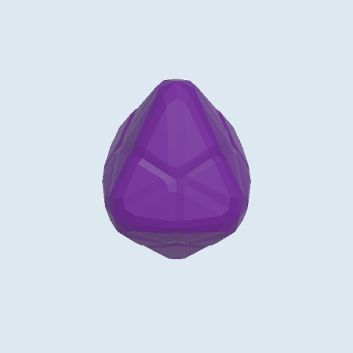 | 624 | over budget (up to 200 live) | P1 |
| Gold coin | **What it is:** run gold, spent on Salvage Chests. **In play:** half of ordinary kills drop a coin and gold barrels burst into them; coins fly to the ship from as far as 26 m at 10-28 m/s, so many are in the air at once. **Read from the camera:** a thick gold coin spinning on edge so it flashes from above. **States:** idle spin, homing, collected (gold flash). **Colour and style:** gold (1, 0.85, 0.15) with a skull stamp. **Focus:** keep the 128-triangle model; replace its 3 particle systems with a shader glint since hordes drop many coins. **Avoid:** looking like the Full Sail token or the Cursed Doubloons weapon (no green glow). | Single image of a low-poly 3D game pickup for a top-down cartoon pirate game, flat colours, very few polygons, plain light grey background, no text: one thick gold coin with a simple raised skull stamp and a bevelled rim, tilted on its edge as if spinning. Shown alone in a three-quarter view from above. 1024x1024. | `03_GoldCoin.prefab` (3 PS)  | 128 | exists | P2 |
| Gold barrel | **What it is:** a floating barrel stuffed with gold. **In play:** opens when the ship comes within 5 m and bursts into 6-10 flying coins that home to the ship; Magnetic Tide opens it too. A small reason to steer off line. **Read from the camera:** a round barrel top with coins heaped above the rim, a gold glint, bobbing 0.12 m. **States:** idle bob, opened (staves split, coins fly), gone. **Colour and style:** warm wood, gold. **Focus:** one barrel mesh of 150 triangles shared with the XP and Health barrels; only the contents on top change. **Avoid:** today's 1,752 triangles and 3 particle systems; looking like enemy Bomb Boat or Powder Barge kegs (no fuse, no black bands). | Single image of a low-poly 3D game pickup for a top-down cartoon pirate game, flat colours, chunky simple shapes, very few polygons, plain light grey background, no text: one simple floating wooden barrel with two brass bands, its open top heaped with shiny gold coins spilling over the rim. The coins must read from above. Shown alone in a three-quarter view from above. 1024x1024. | `LootBarrel.prefab` (3 PS)  | 1,752 | over budget | P1 |
| XP barrel | **What it is:** a floating barrel full of XP gems. **In play:** opens when the ship comes within 5 m and bursts into 6-10 flying gems; Magnetic Tide opens it too; in PvP gold arrows point to XP barrels. **Read from the camera:** the shared barrel shape with cyan crystals poking out of the top, a cyan glint, bobbing 0.12 m. **States:** idle bob, opened (staves split, gems fly), gone. **Colour and style:** warm wood, XP cyan crystals. **Focus:** the same 150-triangle barrel as the gold and health barrels with a different top. **Avoid:** today's 1,752 triangles; particle systems on the barrel; gems so small they read as a plain barrel. | Single image of a low-poly 3D game pickup for a top-down cartoon pirate game, flat colours, chunky simple shapes, very few polygons, plain light grey background, no text: one simple floating wooden barrel with two brass bands, its open top packed with large faceted cyan crystal gems poking up out of it. The cyan must read from above. Shown alone in a three-quarter view from above. 1024x1024. | `GemBarrel.prefab`  | 1,752 | over budget | P1 |
| Health barrel | **What it is:** the run's main heal: a barrel with a cross that restores 20% of maximum hull. **In play:** a timed drop every 90-150 s, placed in view ahead of the ship, twice as often below 35% hull; opens within 5 m and sends healing pieces to the ship. On screen often, so P0 in practice (6 Oct). **Read from the camera:** a white barrel top with a big green cross, a green glint. **States:** idle bob, opened (green burst), gone. **Colour and style:** heal green on white paint and wood. **Focus:** the shared 150-triangle barrel and the cross on the lid. **Avoid:** today's 1,752 triangles and 6 particle systems; confusion with Repair Supplies (that is a square crate). | Single image of a low-poly 3D game pickup for a top-down cartoon pirate game, flat colours, chunky simple shapes, very few polygons, plain light grey background, no text: one simple floating barrel painted white with two brass bands and a big bright green cross painted on its closed lid. The cross must read clearly from above. Shown alone in a three-quarter view from above. 1024x1024. | `HealthBarrel.prefab` (6 PS)  | 1,752 | over budget | P1 |
| Enemy health bar | **What it is:** the bar over elites, minibosses, the boss and the PvP opponent (since 4 Oct, none on ordinary enemies). **In play:** floats 2.2 m above the unit and shows how close a long fight is to ending. **Read from the camera:** a short, thick bar that faces the camera and reads at phone size. **States:** full, damage taken (a pale trail behind the fill), low (pulse), removed on death. **Colour and style:** dark wood and brass frame, red fill; skull end-cap for the boss, crown for elites (section 17). **Focus:** one quad with a fill shader instead of a world canvas per enemy. **Avoid:** a world canvas each (today's cost); a green fill, which means heal. | Game UI health bar for a cartoon pirate game, hand-painted cartoon style, transparent background, no text, 1536x1024: an empty short thick horizontal bar frame of dark wood with brass rivets, a separate flat red fill strip, a small skull end-cap and a small gold crown end-cap, all laid out separately with space between them, drawn flat for 9-slice scaling. | `05_EnemyHealthIndicator.prefab` (a world canvas each) | - | costly (questions 15-16) | P1 |

## 8. Points of interest

The Salvage Chest (77,650 triangles, 12 per stage) is the single worst asset; most POIs are over budget and need five states: unseen (minimap only), idle, in range (prompt), active or charging, used (visibly spent), plus a minimap glyph and a vertical element so they read as interactable from 30 m. Prefabs `Assets/_Game/V4/Demo/POI/POI_*.prefab`.

| POI (code) | Name | In play | Art brief | GPT prompt | What exists | Tris / PS | Status | Pri |
| --- | --- | --- | --- | --- | --- | --- | --- | --- |
| SalvageChest | Salvage Chest | Paid run chest, 12 per stage | **What it is:** a chest on a sandbar bought with run gold; it gives an item, shown in the item popup. **In play:** 12 a stage, opened within 6 m; the price starts at 20 gold and rises with each chest bought, so the player chooses when to spend; the Treasure Chart reveals the nearest. **Read from the camera:** a chunky lid with iron bands, a gold glow from the lock, a ring of pale sand, readable once discovered (24 m). **States:** unseen (minimap), idle, in range (prompt, lid rattles), opening, used (lid up, empty, glow off). **Colour and style:** brown wood, dark iron, gold glow. **Focus:** about 1,500 triangles, one material, a clear opened state. **Avoid:** today's 77,650 triangles; a glow effect over 30 particles. | Single image of a low-poly 3D treasure chest for a top-down cartoon pirate game, flat colours, chunky stylised shapes, very few polygons, plain light grey background, no text: an iron-banded wooden chest half-buried on a small round sandbar, a warm gold glow from its lock. Shown twice side by side: closed and glowing, and opened with the lid up, empty and dull. Each in a three-quarter view from above. 1536x1024. | `Treasure_chest.prefab`  | 77,650 / 3 | far over budget: swap to `Assets/Prefabs/VFX/SalvageChest.prefab` (2,354) or a new 1,500 chest; add an opened state  | P0 |
| BossBeacon | Treasury Beacon | Summons the boss | **What it is:** the stone beacon where the player calls the Barnacle King. **In play:** found by sailing near (24 m) or by the hints: its direction shows from 12:00 and an exact marker from 13:00; hold 0.7 s within 6 m to call the boss, which rises from a whirlpool beside it. **Read from the camera:** a stone tower with a purple beam as the vertical element, seen from across the screen; a purple ring at 6 m. **States:** sealed, discovered, activating (vault door glows over the 0.7 s hold), active (beam on, today's Shuriken whirlpool), defeated (beam off, cracked). **Colour and style:** grey stone, purple light. **Focus:** the beam. **Avoid:** the 68,393-triangle stone arch; red-orange, which reads as an attack. | Single image of a low-poly 3D landmark for a top-down cartoon pirate game, flat colours, chunky stylised shapes, very few polygons, plain light grey background, no text: a squat grey stone beacon tower on a small rock with a round vault door in its base and a purple beam of light rising from its top. Show four states side by side: sealed (door shut, no light), discovered (faint purple runes), activating (door glowing) and active (beam on). Each in a three-quarter view from above. 1536x1024. | `18_BossBeacon.prefab` (3 primitives) | - | placeholder | P1 |
| TrialBuoy | Signal Buoy | Stay 4 m for 8 s, pick a buff | **What it is:** a charge shrine: stay within 4 m for 8 s while enemies attack, then pick one run buff (+10% damage, +0.5 move speed or +0.8 pickup radius). **In play:** a risk choice in the middle of a horde; progress shows as a ring on the water. **Read from the camera:** a tall red and white striped buoy with a bell as the vertical element; the 4 m charge ring is the key read. **States:** unseen, idle (bell sways), in range (ring appears), charging (ring fills round, bell rings), used (ring gone, buoy tilted, light off). **Colour and style:** red and white stripes, gold charge ring. **Focus:** the ring filling. **Avoid:** an orange-red filling disc (that is an enemy telegraph); today's 12,240 triangles. | Single image of a low-poly 3D landmark for a top-down cartoon pirate game, flat colours, chunky stylised shapes, very few polygons, plain light grey background, no text: a tall red and white striped sea buoy with a brass bell in a small cage on top, and around it on the water a flat gold charge ring shown three times side by side: empty, half full and full. Each in a three-quarter view from above. 1536x1024. | `TrialBuoy.prefab`  | 12,240 / 0 | over budget; charge ring needed | P1 |
| GildedWreck | Repair Wreck | One-use heal 25% | **What it is:** a half-sunk wreck that heals 25% of maximum hull once. **In play:** one use at landmark range (4 m); the player saves it for when the hull is low, so it must stay recognisable as a heal from across the screen. **Read from the camera:** a broken hull outline with a mast stump and a green lantern as the vertical element, loose planks round it, a green ring. **States:** unseen, idle (lantern glows), in range (prompt, lantern brighter), used (lantern out, hull lower in the water). **Colour and style:** dark wet wood, heal green light. **Focus:** the lantern and the sunk outline. **Avoid:** today's 10,484 triangles; looking like a sinking enemy ship (no sails, no enemy colours); a real light. | Single image of a low-poly 3D landmark for a top-down cartoon pirate game, flat colours, chunky stylised shapes, very few polygons, plain light grey background, no text: a half-sunk broken wooden ship hull with loose planks floating around it and a bright green lantern hanging on its mast stump. Shown twice side by side: usable (lantern glowing green) and spent (lantern dark, hull lower). Each in a three-quarter view from above. 1536x1024. | `repair_wreck.prefab`  | 10,484 / 0 | over budget | P1 |
| MerchantSkiff | Powder Cache | Elite ambush, reward on clear | **What it is:** a cache of powder kegs that springs an elite ambush. **In play:** in range at 8 m; hold 0.7 s to spring it; 4 elites arrive, and clearing them pays a chest of Rare or better and 20 gold. A clear risk and reward choice. **Read from the camera:** a heap of kegs under a torn tarp, a black skull flag on a pole as the vertical element, a ring at 8 m. **States:** unseen, idle, in range (flag flaps, fuse sparks), active (ambush, kegs glow), cleared (tarp off, chest open, flag down). **Colour and style:** dark wood, canvas, black flag. **Focus:** the flag. **Avoid:** today's tombstone and its 10 fire systems (cap 6,325); orange fire that reads as a hazard. | Single image of a low-poly 3D landmark for a top-down cartoon pirate game, flat colours, chunky stylised shapes, very few polygons, plain light grey background, no text: a stack of dark wooden powder kegs under a torn canvas tarp on a small rock, a tall pole beside it flying a black flag with a white skull. Shown alone in a three-quarter view from above. 1024x1024. | `pirate_tombstone.prefab` + fire  | 7,285 / 10 PS (cap 6,325) | placeholder, over budget | P1 |
| CursedIdol | Treasure Chart | Reveals the 3 nearest chests | **What it is:** a rolled map on a post that reveals the 3 nearest unopened chests. **In play:** one use at landmark range; the chests appear on the minimap and steer the player's route. **Read from the camera:** a wooden post as the vertical element with a cream scroll and red ribbon on top, a gold sparkle, a ring of sand. **States:** unseen, idle (scroll flutters), in range (prompt), used (scroll gone, post bare, sparkle off), plus a suggested short gold ping toward each revealed chest. **Colour and style:** cream parchment, red ribbon, gold. **Focus:** the scroll seen from above. **Avoid:** today's 8,110 triangles; sparkle over 30 particles; reading as a pickup (keep it planted). | Single image of a low-poly 3D landmark for a top-down cartoon pirate game, flat colours, chunky stylised shapes, very few polygons, plain light grey background, no text: a rolled cream treasure map tied with a red ribbon, resting on top of a short wooden post stuck in a small round sandbar, a few chunky gold sparkles around it. Shown alone in a three-quarter view from above. 1024x1024. | `Treasure map.prefab`  | 8,110 / 2 | over budget | P1 |
| LighthouseOfFortune | Lighthouse of Fortune | +8% damage for the run; not placed in Saltwind | **What it is:** a small lighthouse on a rock that gives +8% damage for the run. **In play:** one use; not placed in Saltwind today, planned for later stages. **Read from the camera:** a short, stubby tower with a gold lamp as the vertical element, tall enough to spot from 30 m, a gold ring on the water. **States:** unseen, idle (lamp turning), in range (prompt), used (lamp steady and dim). **Colour and style:** red and white bands, gold light, grey rock. **Focus:** a toy-like stubby shape so it does not block the view. **Avoid:** today's 11,597 triangles; a real light or a long beam that hides enemies; height that hides the ship. | Single image of a low-poly 3D landmark for a top-down cartoon pirate game, flat colours, chunky stylised shapes, very few polygons, plain light grey background, no text: a short, stubby red-and-white banded lighthouse on a small grey rock with a glowing golden lamp at the top, toy-like proportions. Shown alone in a three-quarter view from above. 1024x1024. | `light_house.fbx`  | 11,597 / 0 | unused | P3 |
| ExitMaelstrom | Exit portal | Stage exit (not built) | **What it is:** the portal that ends a stage. **In play:** not built yet; locked until the stage goal is met, then the player sails in to leave. **Read from the camera:** a large flat whirlpool decal with foam arms and a bright centre, ringed by a few rocks or posts as the vertical element. **States:** locked (dark, still), unlocking, open (spinning, glowing), entering (ship pulled in). **Colour and style:** teal and white foam, bright centre. **Focus:** one rotating Shuriken decal shared with the boss arrival whirlpool. **Avoid:** VFX Graph (draws nothing on WebGL); the Beacon's purple; red-orange. | Top-down game texture, pure black background, soft edges, no text, 1536x1024: two versions side by side of a large swirling sea portal seen straight from above: open (glowing teal water spiralling into a bright white centre with white foam arms) and locked (darker, still, faint arms), for a rotating water decal. | none | - | needed | P3 |
| (design) | Davy Jones' Contract | Boss-risk shrine | **What it is:** a boss-risk shrine: a sea chest with a glowing contract. **In play:** design only: before the boss, one use adds +35% boss hull and +15% boss damage, and the boss pays one extra item chest if killed. **Read from the camera:** an open chest with a floating green scroll as the vertical element, a sickly green ring. **States:** unseen, idle (scroll floats), in range (scroll unrolls), signed (scroll burns away, chest locks), spent after the boss (dark, unavailable). **Colour and style:** barnacled wood, ghost green. **Focus:** the floating contract. **Avoid:** the Beacon's purple; red-orange; over 2,500 triangles. | Single image of a low-poly 3D landmark for a top-down cartoon pirate game, flat colours, chunky stylised shapes, very few polygons, plain light grey background, no text: a barnacle-crusted sea chest on a small rock with its lid open and a glowing green contract scroll floating upright above it. Shown alone in a three-quarter view from above. 1024x1024. | none | - | needed | P3 |
| (design) | Salvage Bell | Pulls XP | **What it is:** a bell on a wreck post that pulls all uncollected XP to the ship. **In play:** design only: one use; if there is no XP it says so and is not spent. Best after a big fight. **Read from the camera:** a broken mast sticking out of the water with a brass bell as the vertical element, a yellow ring. **States:** unseen, idle (bell sways), in range (prompt), ringing (yellow pulse, gems stream in), used (bell still and dull). **Colour and style:** dark wreck wood, brass, yellow pulse. **Focus:** the bell. **Avoid:** today's borrowed `fish_bell` (8,650 triangles); looking like the Salvage Chime powerup (bigger, planted) or the Repair Wreck (no hull, no lantern). | Single image of a low-poly 3D landmark for a top-down cartoon pirate game, flat colours, chunky stylised shapes, very few polygons, plain light grey background, no text: a large brass ship's bell hanging from the broken mast of a small wreck sticking out of the water, a few planks around it. Shown alone in a three-quarter view from above. 1024x1024. | `fish_bell.prefab` (8,650)  | - | needed | P3 |
| (design) | Castaway Idol | Random blessing | **What it is:** a carved tiki idol that grants one random blessing. **In play:** design only: one use gives one of: heal 25% hull, or for 60 s +20 Luck, +15% damage or +15% speed; the four are previewed, not the result. **Read from the camera:** a tall tiki on a tiny sand island as the vertical element, palm leaves, a flower garland, a warm ring. **States:** unseen, idle (eyes glow softly), in range (prompt), rolling (eyes flicker through four colours), used (eyes dark). **Colour and style:** carved brown wood, island greens, flower pinks. **Focus:** the face from above (big brow and mouth). **Avoid:** looking like a home-island decoration; over 2,500 triangles. | Single image of a low-poly 3D landmark for a top-down cartoon pirate game, flat colours, chunky stylised shapes, very few polygons, plain light grey background, no text: a tall carved wooden tiki idol with a big brow, glowing eyes and a wide mouth, standing on a tiny sand island with two palm leaves and a pink flower garland round its neck. Shown alone in a three-quarter view from above. 1024x1024. | none | - | needed | P3 |
| (boss arrival) | Arrival whirlpool | 2.5 s entrance | **What it is:** the whirlpool the Barnacle King rises from. **In play:** a 2.5 s entrance at 1.6 scale beside the Beacon when the boss is called; the player should back off and get ready. **Read from the camera:** a large spiralling decal with foam arms, a dark centre and a burst of spray as the boss breaks the surface. **States:** opening, spinning, boss rising (splash), closing. **Colour and style:** teal, white foam, dark centre. **Focus:** a Shuriken version (a decal plus 2-3 systems) that works on phones, like `whirlpool.prefab`. **Avoid:** VFX Graph (`PF_Whirlpool.prefab` shows only a splash on WebGL); red-orange (it is not an attack); over 150 particles. | Top-down game texture, pure black background, soft edges, no text, 1024x1024: a large spiral whirlpool seen straight from above, thick white foam arms curling into a dark deep centre, teal water between the arms, soft outer edge, for a rotating water decal. | `PF_Whirlpool.prefab` (VFX Graph: a splash on WebGL) | - | placeholder on phones | P1 |

**Update 7 Oct.** Every point of interest is back in voyages (6 Oct), and the boss is summoned at the Treasury Beacon again. The Beacon marker is now the Shuriken water whirlpool `Assets/Prefabs/VFX/whirlpool.prefab` (322 triangles, 2 PS, works on WebGL) instead of the three primitives. The Salvage Chest is drawn at 0.75 scale but is still the 77,650-triangle model.

## 9. Enemies

Eleven enemy ids that attack differently share three hulls of 5,000-11,000 triangles and pass today only by tint and size; under the owner's rule each needs its own 300-1,200-triangle model. Every enemy needs a top-readable silhouette, an idle, an attack wind-up (telegraph, section 1.3), a hit flash (shader) and a death (sink or a burst ≤ 30 particles). Configs `Data/Enemies/<id>.asset`, `Data/Variants/<id>.asset`.

Shared models today:

| Model | Triangles | Ids drawn with it |
| --- | --- | --- |
| `Cannonboat.asset` (`SmuggleBoat.prefab`, `FireBoat.prefab`) | 5,399 | cutthroat\_skiff, deckhand\_dinghy, drowned\_pursuer, needle\_sloop, treasure\_raider, bomb\_boat, bomb\_ketch |
| `Ghostboat.asset` (`Cannonboat.prefab`, `CannonboatNavy.prefab`) | 5,258 | cannonboat, gunner\_cog, drowned\_harrier, net\_cutter, shield\_frigate |
| `RamShip.asset` | 11,462 | boarding\_barge, rammer\_raft, ram\_raider, powder\_barge, repair\_tender |
| `Crab.asset` | 3,386 | reef\_crab\_miniboss, barnacle\_king (×2.4) |
| `Shark.002.asset` (`HammerHead.prefab`) | 2,458 | hammerhead, elite\_hammerhead |
| `Kraken.asset` | 6,724 | kraken\_spawn, elite\_kraken\_spawn |

Unused candidates (check rights and budget): `pirateship.fbx` (1,287), `Wooden Boat.fbx` (2,572), `Octopus.fbx` (2,752), `Eel.prefab` (3,646), `FireSwordFish.prefab`; the `cursed/*` hulls (\~21k) are too heavy.

    

| id | Name | In play | Art brief | GPT prompt | Tint today | Size | Status | Pri |
| --- | --- | --- | --- | --- | --- | --- | --- | --- |
| shark |  Shark | Chase, contact; the main enemy from 11:00 | **What it is:** late-voyage fodder (7 HP). **In play:** main enemy from 11:00 to the end, plus swarm pulses of 8 at 6:30 and 11:40 and a ring of 11 at 11:05. It cuts the ship off and speeds up when close, so packs surround it; contact only. Keep moving. **Read from the camera:** tall dorsal fin and broad grey back; a creature, so no sail, it keeps its own colour. **Animation/states:** idle tail sway, swim, no wind-up (contact only), bite lunge, hit flash, death roll and sink. **Budget:** ordinary, 300-800 triangles (1,896 today), one material, no idle particles beyond the shared wake. **Focus:** the fin. **Avoid:** a T-head or a bill, which belong to the hammerhead and swordfish. | Single image of a low-poly stylised 3D game model for a top-down cartoon pirate game, flat colours, chunky shapes, plain light grey background, no text, 1024x1024. The enemy alone, in a three-quarter view from above. Subject: a chunky cartoon shark swimming at the surface, slate-grey back with one tall triangular dorsal fin, white belly, a toothy grin, tail curved mid-stroke, a little white foam at the waterline. | - | 1 | exists (1,896) | P2 |
| swordfish |  Swordfish | Dive-lunge dash | **What it is:** a fast, fragile lunger (2.3 HP). **In play:** from 1:50 in the main mix; rings of 8 at 1:50, 20 at 4:00, 16 at 8:00. It hovers about 10 m off, aims for 0.85 s, then dashes at 12 m/s for 0.65 s; inside about 5.5 m it lunges at once. Turn off its line. **Read from the camera:** a long straight bill well past the head, slim blue body, tall sail fin; the bill points along the dash. **Animation/states:** idle, swim, aim crouch with the bill locked on (its telegraph), dash, hit flash, death flip. **Budget:** ordinary, 300-800 triangles (2,580 today), one material, no idle particles beyond the shared wake. **Focus:** the bill. **Avoid:** a shark's fin profile; a bill too thin for a phone. | Single image of a low-poly stylised 3D game model for a top-down cartoon pirate game, flat colours, chunky shapes, plain light grey background, no text, 1024x1024. The enemy alone, in a three-quarter view from above. Subject: a cartoon swordfish leaping forward low over the water, a very long thick straight bill pointing ahead, slim cobalt-blue body with a silver belly, a tall dark-blue sail fin on its back, body tensed for a dash. | - | 1 | exists (2,580) | P2 |
| hammerhead |  Hammerhead | Telegraphed charge | **What it is:** a small, fragile charger (1.75 HP). **In play:** lines of 11 sweep across the screen at 6:30, 11:40 and 13:10. Each closes in, shows an orange-red lane on the water for about 1 s (the aim locks for the last 0.35 s), then charges along it at 11 m/s or more for 1 s. Step out of the lane. **Read from the camera:** the wide T-shaped head is its whole identity from above; grey-brown back, small fin. **Animation/states:** idle, swim, wind-up (head dips, tail coils) with the lane, charge, hit flash, death. **Budget:** ordinary, 300-800 triangles (the shared 2,458 model today), one material, no idle particles beyond the shared wake. **Focus:** the head's width. **Avoid:** reading as the plain shark; armour or gold, which mark the elite. | Single image of a low-poly stylised 3D game model for a top-down cartoon pirate game, flat colours, chunky shapes, plain light grey background, no text, 1024x1024. The enemy alone, in a three-quarter view from above. Subject: a cartoon hammerhead shark at the surface with a very wide flat T-shaped head and an eye at each tip, grey-brown back, pale belly, a short dorsal fin, head lowered as if about to charge. | - | 1 | exists | P2 |
| manta\_ray |  Manta Ray | Strafes, 3-shot spread | **What it is:** a ranged sea creature (8.75 HP). **In play:** main enemy from 13:00, with a ring of 12 at 13:00. It circles the ship about 10 m off, changing direction after each volley; after a 0.9 s wind-up it fires three shots in an 18° fan, every 2.2 s. Slip between the lanes or close in. **Read from the camera:** flat diamond wings, wide and low, short tail; deep blue top, pale belly that flashes at the wind-up. **Animation/states:** idle wing ripple, glide, wind-up (wing tips lift, belly glows) with the wedge telegraph, fire, hit flash, death. **Budget:** ordinary, 300-800 triangles, one material, no idle particles beyond the shared wake. **Focus:** the diamond outline. **Avoid:** a boat-like outline; anything kraken-like. | Single image of a low-poly stylised 3D game model for a top-down cartoon pirate game, flat colours, chunky shapes, plain light grey background, no text, 1024x1024. The enemy alone, in a three-quarter view from above. Subject: a cartoon manta ray gliding at the surface, broad flat diamond wings with tips curled up, deep navy-blue back, a glowing pale cyan belly showing at the wing edges, two short head fins and a thin tail. | - | 1.05 | exists | P2 |
| kraken\_spawn |  Kraken Spawn | Slow tank, tentacle circles | **What it is:** a young kraken, a slow area-denial specialist (17.5 HP). **In play:** in the special mix from 11:00 and again at 13:00, a few at a time. It drifts in slowly, anchors within about 9 m; every 6 s it marks two 1.5 m circles on and beside the ship that strike 1.2 s later. Sail out of the circles. **Read from the camera:** a domed head with a ring of tentacle tips at the surface; tentacles burst up inside the circles. **Animation/states:** idle tentacle curl, drift, wind-up (tentacles sink as the circles fill), strike, hit flash, death sink. **Budget:** specialist, 600-1,200 triangles (6,724 today), one material, no idle particles beyond the shared wake. **Focus:** head plus a separate strike tentacle. **Avoid:** the elite's runes and size. | Single image of a low-poly stylised 3D game model for a top-down cartoon pirate game, flat colours, chunky shapes, plain light grey background, no text, 1024x1024. The enemy alone, in a three-quarter view from above. Subject: a small cartoon kraken with a round purple-maroon domed head and big yellow eyes, sitting in the water with six thick curled tentacle tips around it, plus one separate tentacle rising straight up out of a splash. | - | 0.65 | over budget (6,724) | P1 |
| cannonboat |  Cannonboat | Keeps range, single shot | **What it is:** the first ranged ship (2.8 HP). **In play:** ranged mix from 1:00 to 5:40, a pack of 4 at 3:20, and 2 elite cannonboats in the Powder Cache ambush. It holds about 14 m off and fires one led cannonball (9 m/s) every 2 s after a 0.8 s wind-up. Dodge sideways or close in. **Read from the camera:** a small gunboat with one bow cannon on a turntable, barrel clearly forward; navy-blue sail and flag kept as a separate tintable area. **Animation/states:** idle bob, sail, wind-up (barrel swings to aim, muzzle glows), recoil, hit flash, sink. **Budget:** ordinary, 300-800 triangles, one material, no idle particles beyond the shared wake. **Focus:** the single gun. **Avoid:** three guns or a long barrel. | Single image of a low-poly stylised 3D game model for a top-down cartoon pirate game, flat colours, chunky shapes, plain light grey background, no text, 1024x1024. The enemy alone, in a three-quarter view from above. Subject: a small wooden enemy gunboat with one chunky black cannon on a round turntable at the bow pointing forward, one mast with a navy-blue sail and a navy-blue flag. | - | 1 | over budget | P1 |
| gunner\_cog |  Gunner Cog | Formation, 3-shot burst | **What it is:** the heavy ranged ship of the second half (4.2 HP). **In play:** ranged mix from 5:40 to the end, 30-35% of spawns at 9:00. It holds about 12 m off and fires between 5 and 22 m: a 0.6 s wind-up, then three shots fanned at -6°, 0° and +6°, every 3 s. **Read from the camera:** round-bellied cog with high castles and three gun ports on the side; square crimson sail and flag kept tintable. Drawn 1.15. **Animation/states:** idle, sail, wind-up (three ports open and glow), volley recoil, hit flash, sink. **Budget:** ordinary, 300-800 triangles, one material, no idle particles beyond the shared wake. **Focus:** three guns in a row. **Avoid:** the cannonboat's single gun; a slim hull like the needle sloop. | Single image of a low-poly stylised 3D game model for a top-down cartoon pirate game, flat colours, chunky shapes, plain light grey background, no text, 1024x1024. The enemy alone, in a three-quarter view from above. Subject: a round-bellied wooden cog with raised castles at bow and stern, three black cannons poking from ports along one side, one mast with a square crimson sail and a crimson flag. | crimson | 1.15 | own model needed | P0 |
| cutthroat\_skiff |  Cutthroat Skiff | Flanks, contact | **What it is:** the armoured melee boat (12.25 HP, 3.5 times a dinghy). **In play:** main enemy from 5:40 to the end, a pack of 12 at 12:30, and 3 (or 2 elites) in the Powder Cache ambush. It circles to a flank about 7 m behind the ship, then inside 13 m winds up 0.8 s and dashes 0.55 s side-on across the ship's path, backs off and comes again. Watch the flanks. **Read from the camera:** narrow pointed skiff with raised cutlasses; small red sail and flag kept tintable. **Animation/states:** idle, row, wind-up (crew raise blades, hull turns side-on), dash, hit flash, sink. **Budget:** ordinary, 300-800 triangles, one material, no idle particles beyond the shared wake. **Focus:** blades held high. **Avoid:** a ram prow (chargers) or any gun. | Single image of a low-poly stylised 3D game model for a top-down cartoon pirate game, flat colours, chunky shapes, plain light grey background, no text, 1024x1024. The enemy alone, in a three-quarter view from above. Subject: a narrow pointed wooden rowing skiff with two pirates holding big cutlasses up high, a short mast with a small bright red sail and a red flag. | red | 0.92 | own model needed | P0 |
| deckhand\_dinghy |  Deckhand Dinghy | Fast swarm | **What it is:** the basic fodder of the opening (3.5 HP, one starting hit). **In play:** the only enemy from 0:00 and the main enemy until 5:40, many on screen at once. Fast (5.5 m/s), it cuts the ship off from all sides with a slight wobble, rams, peels away for 0.6 s and comes round again. Mow them down while moving. **Read from the camera:** tiny round dinghy, one rower, stubby mast; small sand-coloured sail and flag kept tintable. The smallest ship on screen. **Animation/states:** idle bob, row, no wind-up (contact only), ram bump, hit flash, capsize. **Budget:** ordinary, 300-800 triangles (aim low), one material, no idle particles beyond the shared wake. **Focus:** small and round. **Avoid:** anything that looks armed. | Single image of a low-poly stylised 3D game model for a top-down cartoon pirate game, flat colours, chunky shapes, plain light grey background, no text, 1024x1024. The enemy alone, in a three-quarter view from above. Subject: a tiny round wooden dinghy with one scruffy pirate rowing, a stubby mast with a small sand-yellow sail and a sand-yellow flag. It must read as weak fodder. | - | 0.82 | own model needed | P0 |
| bomb\_boat |  Bomb Boat | Runs in and explodes | **What it is:** a suicide bomber (2.8 HP). **In play:** special mix from 1:50 to 5:40. It chases at 1.5 times its speed; within 5 m it stops for 0.35 s, then runs at 14 m/s for up to 2.5 s with a 3 m blast circle riding on it, exploding on the ship or when time runs out. Shoot it early. **Read from the camera:** a small boat with one oversized black keg and lit fuse; fire-orange sail and flag kept tintable. **Animation/states:** idle bob, sail, wind-up (fuse flares, hull shakes) with the riding circle, sprint, hit flash, explosion (kill burst). **Budget:** ordinary, 300-800 triangles, one material with the fuse glow in it, no idle particles beyond the shared wake. **Focus:** the keg. **Avoid:** the powder barge's stacked kegs. | Single image of a low-poly stylised 3D game model for a top-down cartoon pirate game, flat colours, chunky shapes, plain light grey background, no text, 1024x1024. The enemy alone, in a three-quarter view from above. Subject: a small wooden boat carrying one oversized black powder keg with a lit, glowing fuse, a short mast with a fire-orange sail and a fire-orange flag. It must read as about to explode. | - | 1 | own model needed | P1 |
| rammer\_raft |  Rammer Raft | Telegraphed ram | **What it is:** a heavy charger (9.8 HP). **In play:** special mix from 5:40. It approaches slowly, shows an orange-red lane for about 1 s, then rams along it at about 14 m/s for 1.1 s (18 m at most) and curves back. Step out of the lane. **Read from the camera:** lashed log raft with one huge sharpened log ram pointing forward; bone-coloured square sail and flag kept tintable. **Animation/states:** idle, drift, wind-up (raft rears, ram lowers) with the lane, ram, hit flash, break apart. **Budget:** specialist, 600-1,200 triangles, one material, no idle particles beyond the shared wake. **Focus:** the ram, longer than the raft is wide. **Avoid:** an iron cap on the ram (ram raider) unless the two share one model with the cap as an add-on. | Single image of a low-poly stylised 3D game model for a top-down cartoon pirate game, flat colours, chunky shapes, plain light grey background, no text, 1024x1024. The enemy alone, in a three-quarter view from above. Subject: a raft of logs lashed with rope, a huge sharpened log ram jutting far forward, one mast with a bone-white square sail and a bone-white flag. | - | 1 | own model needed | P0 |
| boarding\_barge |  Boarding Barge | Grapples: a 10 m ring for 1 s, then a hit that slows the ship 25% for 2 s | **What it is:** a grappling barge (14 HP). **In play:** special mix at 8:00 and 12:00. It holds about 7.5 m off; within 14 m it winds up 1 s while a 10 m grapple ring shows round it, then, if the ship is inside, hits it and slows it by 25% for 2 s; every 3 s. Stay outside the ring. **Read from the camera:** wide flat barge with grapple hooks and a raised boarding plank, crew waiting; sky-blue sail and flag kept tintable. Drawn 1.15. **Animation/states:** idle, sail, wind-up (hooks swing, plank lifts) with the ring, throw, hit flash, sink. **Budget:** specialist, 600-1,200 triangles, one material, no idle particles beyond the shared wake. **Focus:** hooks and plank. **Avoid:** a prominent cannon; it grapples, it does not shoot. | Single image of a low-poly stylised 3D game model for a top-down cartoon pirate game, flat colours, chunky shapes, plain light grey background, no text, 1024x1024. The enemy alone, in a three-quarter view from above. Subject: a wide flat wooden barge with a boarding plank raised at the front, three pirates swinging grappling hooks on ropes, one mast with a sky-blue sail and a sky-blue flag. | blue | 1.15 | own model needed | P0 |
| drowned\_harrier |  Drowned Harrier | Keeps range, burst | **What it is:** the ghost gunboat of overtime (5.25 HP). **In play:** after 15:00 in the Drowned Pursuit, 20% of spawns for two minutes, then 40%. It holds about 16 m off and, after a 1 s wind-up, fires two shots along one led line every 2.5 s. Dodge across the line. **Read from the camera:** waterlogged gunboat with torn teal sails and flag (kept tintable), a green glow at the gun; clearly spectral, unlike any daytime ship. **Animation/states:** idle sway, ghostly glide, wind-up (gun glows brighter), fire, hit flash, dissolve. **Budget:** ordinary, 300-800 triangles, one material, glow in the material, no idle particles beyond the shared wake. **Focus:** torn sails and glow. **Avoid:** looking like the cannonboat with a tint. | Single image of a low-poly stylised 3D game model for a top-down cartoon pirate game, flat colours, chunky shapes, plain light grey background, no text, 1024x1024. The enemy alone, in a three-quarter view from above. Subject: a waterlogged ghost gunboat with rotten planks and seaweed, one cannon at the bow glowing green, a broken mast with torn teal sails and a ragged teal flag. | teal | 1 | placeholder | P1 |
| drowned\_pursuer |  Drowned Pursuer | Chase, contact | **What it is:** the ghost fodder of overtime (7 HP). **In play:** after 15:00 in the Drowned Pursuit, 80% of spawns for two minutes, then 60%, coming faster as overtime goes on. It chases straight at 5 m/s and hits on contact. Keep moving and cut through. **Read from the camera:** barnacled sunken rowboat with two glowing lantern eyes on the bow; sea-green rags as sail and flag kept tintable. **Animation/states:** idle sway, ghostly glide, no wind-up (contact only), lunge, hit flash, dissolve. **Budget:** ordinary, 300-800 triangles, one material, eye glow in the material, no idle particles beyond the shared wake. **Focus:** the lantern eyes. **Avoid:** looking like the deckhand dinghy. | Single image of a low-poly stylised 3D game model for a top-down cartoon pirate game, flat colours, chunky shapes, plain light grey background, no text, 1024x1024. The enemy alone, in a three-quarter view from above. Subject: a barnacled sunken rowboat with two glowing lantern eyes on its bow, a stump of mast with sea-green rags as its sail and a ragged sea-green flag. | sea green | 1 | placeholder | P1 |
| reef\_crab\_miniboss |  Reef Crab | Miniboss charge | **What it is:** the miniboss, with a health bar. **In play:** at 2:30 (the sea clears for it), 5:00 (with boss-slot health), 11:00 and 13:00. It keeps 3-5.5 m off and sidesteps; every 2.5 s it aims for 0.6 s and lobs one big, slow cannonball (8 m/s, up to 20 m). If the ship comes within 4.5 m it slams a 4 m ring after 1.2 s, then rests 2 s. Dodge the ball; hit it while it rests. **Read from the camera:** armoured coral-red crab, two big claws, a back cannon; plates open in the rest. **Animation/states:** idle, sidestep, aim, fire, slam wind-up, rest, hit flash, death. **Budget:** elite, 1,500-2,500 triangles (3,386 shared with the boss), one material. **Focus:** cannon. **Avoid:** the Barnacle King's shell. | Single image of a low-poly stylised 3D game model for a top-down cartoon pirate game, flat colours, chunky shapes, plain light grey background, no text, 1024x1024. The enemy alone, in a three-quarter view from above. Subject: a big armoured coral-red crab with two equal heavy claws, a stubby barnacled stone cannon on its back, and back plates that lift open to show a soft pale weak spot; a big barnacled stone cannonball beside it. | - | 1 | shares the boss mesh | P1 |
| needle\_sloop |  needle sloop | Keeps range, single shot | **What it is:** the sniper (4.2 HP). **In play:** ranged mix from 4:00, then at 9:00, 11:00 and 13:00. It holds about 18 m off and fires between 12 and 24 m: a 1 s aim, then one fast shot (16 m/s) every 2.5 s; if the ship comes within 8 m it flees. Chase it down or keep weaving. **Read from the camera:** slim sloop with one very long needle gun along its centre line; lime sail and flag kept tintable. Drawn 0.9. **Animation/states:** idle, sail, aim (gun steadies, muzzle glints) for the full second, fire recoil, hit flash, sink. **Budget:** specialist, 600-1,200 triangles, one material, no idle particles beyond the shared wake. **Focus:** the long gun. **Avoid:** a barrel so thin it vanishes on a phone; side guns. | Single image of a low-poly stylised 3D game model for a top-down cartoon pirate game, flat colours, chunky shapes, plain light grey background, no text, 1024x1024. The enemy alone, in a three-quarter view from above. Subject: a slim fast sloop with one very long, thick-walled needle gun mounted along its centre line and reaching past the bow, one mast with a lime-green sail and a lime-green flag. | lime | 0.9 | own model needed | P0 |
| net\_cutter |  net cutter | Flanks, nets | **What it is:** a net layer (5.25 HP). **In play:** ranged mix at 8:00, 9:00 and 12:00. It sails ahead of the ship, to one side; every 4 s it marks a 3 m circle 4-10 m ahead of the ship for 0.85 s, then lays a 6 m slowing net there for 3 s. Turn away from the mark. **Read from the camera:** working boat with a long boom swung out to the side and a net bundle on it; orange sail and flag kept tintable. **Animation/states:** idle, sail, wind-up (boom swings out) with the circle, cast, hit flash, sink. **Budget:** specialist, 600-1,200 triangles, one material, no idle particles beyond the shared wake. **Focus:** the boom and net. **Avoid:** a boom that reads as a gun or vanishes. | Single image of a low-poly stylised 3D game model for a top-down cartoon pirate game, flat colours, chunky shapes, plain light grey background, no text, 1024x1024. The enemy alone, in a three-quarter view from above. Subject: a small wooden working boat with a thick boom swung out to one side carrying a bundled fishing net with cork floats, one mast with an orange sail and an orange flag. | orange | 1 | own model needed | P0 |
| shield\_frigate |  shield frigate | One heavy shot every 5 s; the shield wall does not block damage yet | **What it is:** the slow tank (14 HP). **In play:** special mix at 9:00, 12:00 and 13:00. It moves at 3 m/s, holds about 10 m off and fires between 8 and 16 m: one heavy shot every 5 s after a 0.8 s wind-up. Focus it down. **Read from the camera:** broad frigate with a curved wall of planks and iron across the bow; steel-white sails and flag kept tintable. Drawn 1.15. The wall shows toughness only; it takes no less damage from the front. **Animation/states:** idle, sail, wind-up (gun slot opens), heavy recoil, hit flash, sink. **Budget:** specialist, 600-1,200 triangles, one material, no idle particles beyond the shared wake. **Focus:** the wall. **Avoid:** several guns (gunner cog); spikes that read as a ram. | Single image of a low-poly stylised 3D game model for a top-down cartoon pirate game, flat colours, chunky shapes, plain light grey background, no text, 1024x1024. The enemy alone, in a three-quarter view from above. Subject: a sturdy wide frigate with a curved wall of planks and riveted iron plates across its bow like a shield, one heavy cannon in a slot in the wall, steel-white sails and a steel-white flag. It must look armoured and slow. | steel white | 1.15 | own model needed | P0 |
| powder\_barge |  powder barge | Chases, powder area | **What it is:** a mine layer (14 HP). **In play:** special mix at 9:00 and 12:00. It crawls straight at the ship (about 1.2 m/s) and every 3 s drops a powder keg mine where it is, three at most; each arms in 1.2 s and lasts 6 s. Do not sail through its trail. **Read from the camera:** wide barge stacked high with kegs and a chute at the stern; powder-orange sail and flag kept tintable. Drawn 1.25. **Animation/states:** idle, crawl, wind-up (a keg slides down the chute), drop, hit flash, sink. Smoke on the kegs comes from the material, not particles. **Budget:** specialist, 600-1,200 triangles, one material, no idle particles beyond the shared wake. **Focus:** the keg stack. **Avoid:** the bomb boat's single giant keg. | Single image of a low-poly stylised 3D game model for a top-down cartoon pirate game, flat colours, chunky shapes, plain light grey background, no text, 1024x1024. The enemy alone, in a three-quarter view from above. Subject: a wide flat wooden barge stacked high with black powder kegs tied down with rope, a wooden chute at the stern with a keg sliding into the water, one mast with a powder-orange sail and a powder-orange flag. | orange | 1.25 | own model needed | P0 |
| ram\_raider |  ram raider | Telegraphed charge | **What it is:** a fast double charger (7 HP). **In play:** special mix from 4:00, then at 8:00 and 11:00. It shows an orange-red lane for about 1 s, charges at about 21 m/s for 0.75 s, aiming further ahead of the ship than other chargers, then backs off 1.1 s and charges a second time. Turn hard after the first pass. **Read from the camera:** sleek raider with an iron-capped ram; rose-red sail and flag kept tintable. Drawn 1.05. **Animation/states:** idle, sail, wind-up (ram lowers) with the lane, charge, back-off, second wind-up, hit flash, sink. **Budget:** specialist, 600-1,200 triangles, one material, no idle particles beyond the shared wake. **Focus:** the iron ram. **Avoid:** the rammer raft's log silhouette, unless sharing that model with the cap. | Single image of a low-poly stylised 3D game model for a top-down cartoon pirate game, flat colours, chunky shapes, plain light grey background, no text, 1024x1024. The enemy alone, in a three-quarter view from above. Subject: a sleek narrow raider boat with a big pointed iron-capped ram on its bow, one mast with a rose-red sail and a rose-red flag, the hull leaning forward as if charging. | red | 1.05 | may share the rammer's new model | P1 |
| repair\_tender |  repair tender | Heals allies | **What it is:** the healer (8.75 HP, no attack). **In play:** special mix at 8:00 and 13:00. It keeps away from the ship and goes to the most damaged ally within 20 m; every 4 s, after a 1 s wind-up, it heals that ally within 8 m by 3% of its health. Kill it first. **Read from the camera:** tender with a small crane, planks and tools on deck; green sail and a green flag with a white cross, kept tintable. **Animation/states:** idle, sail, wind-up (crane swings over), heal beam in the shared heal green, hit flash, sink. **Budget:** specialist, 600-1,200 triangles, one material, no idle particles beyond the shared wake. **Focus:** crane and cross. **Avoid:** any gun; a cross that looks like a pickup. | Single image of a low-poly stylised 3D game model for a top-down cartoon pirate game, flat colours, chunky shapes, plain light grey background, no text, 1024x1024. The enemy alone, in a three-quarter view from above. Subject: a small tender boat with a wooden crane on deck, stacked planks, a toolbox and a hammer, one mast with a green sail and a green flag with a white cross. It must look like a healer, not a fighter. | green | 1 | own model needed | P0 |
| bomb\_ketch |  bomb ketch | Lobbed bombs | **What it is:** a mortar ship (7 HP). **In play:** special mix from 5:40, then at 11:00 and 13:00. It holds about 16 m off and fires from 11 to 22 m: a 0.5 s aim, then a mortar bomb that lands 1.2 s later in a 3 m orange-red circle where the ship is heading; every 4 s. Leave the circle. **Read from the camera:** two-masted ketch with a squat mortar pointing up on deck and stacked shells; purple sails and flag kept tintable. Drawn 1.2. **Animation/states:** idle, sail, wind-up (mortar tilts, crew loads) with the circle, launch puff, hit flash, sink. **Budget:** specialist, 600-1,200 triangles, one material, no idle particles beyond the shared wake. **Focus:** the upward mortar. **Avoid:** horizontal guns; the bomb boat's keg. | Single image of a low-poly stylised 3D game model for a top-down cartoon pirate game, flat colours, chunky shapes, plain light grey background, no text, 1024x1024. The enemy alone, in a three-quarter view from above. Subject: a two-masted wooden ketch with a squat black iron mortar on its deck pointing straight up and a small pile of round shells beside it, purple sails and a purple flag. | violet | 1.2 | own model needed | P0 |
| elite\_hammerhead |  Elite Hammerhead | Double charge | **What it is:** a scheduled elite (42 HP) with a health bar. **In play:** at 3:00 (the sea clears for it), then at 8:00 and 12:00 alongside the waves. Same lane as the hammerhead but a 1.2 s wind-up, and it charges twice in a row before a 3 s rest. Dodge both passes. **Read from the camera:** the hammerhead's T-head plus scars, armour plates and gold trim or a crown from the shared elite kit; drawn 2.15 times. **Animation/states:** idle, swim, wind-up (head dips, plates flare) with the lane, two charges, rest, hit flash, death. **Budget:** elite, 1,500-2,500 triangles, one or two materials, aura ring at most 20 particles, no other idle particles. **Focus:** the same animal, bigger. **Avoid:** a new silhouette that hides the T-head. | Single image of a low-poly stylised 3D game model for a top-down cartoon pirate game, flat colours, chunky shapes, plain light grey background, no text, 1024x1024. The enemy alone, in a three-quarter view from above. Subject: a big battle-scarred hammerhead shark with a very wide T-shaped head, riveted iron armour plates on its head and back edged in gold trim, a small gold crown on its head, grey-brown skin. | elite scale | 2.15× | elite treatment | P1 |
| elite\_kraken\_spawn |  Elite Kraken Spawn | Sequential traps | **What it is:** the big Kraken in the 10:00 boss slot, with a health bar. **In play:** at 10:00 the sea clears for it; boss-slot health, drawn 1.5 times larger than other elites. Every 6 s it marks three 1.5 m circles, on the ship and 2.5 m either side, which strike in turn at 1.2, 1.55 and 1.9 s. Keep moving. **Read from the camera:** a large kraken head with glowing runes and a crown from the elite kit; tentacles rise in each circle. **Animation/states:** idle tentacle sway, anchor, wind-up (runes pulse with each circle), three strikes, hit flash, death sink. **Budget:** elite, 1,500-2,500 triangles, one or two materials, aura ring at most 20 particles. **Focus:** the runes. **Avoid:** reading as the small Kraken Spawn with a tint. | Single image of a low-poly stylised 3D game model for a top-down cartoon pirate game, flat colours, chunky shapes, plain light grey background, no text, 1024x1024. The enemy alone, in a three-quarter view from above. Subject: a large cartoon kraken with a deep purple domed head covered in glowing cyan runes, a gold crown, big yellow eyes and eight thick tentacles spread on the water, three tentacle tips rising out of splashes in a row. | elite scale | 1.5× | elite treatment | P1 |

Elite treatment (P1): one shared kit on the base model (gold trim or crown, a ground aura ring in the affix colour, a health bar always shown) with colours for Armored, Swift, Volatile, Rich, Cursed and Captain. Later biomes (P3): Gravewater and Devil's Maw variants on shared geometry, plus new Siren and Fire Eel models.

### 9.3 Ship colour codes (since 3 Oct)

Each enemy ship type has its own colour on its sails and flags, and its hull leans towards it (`EnemyViewTint.cs`). The masthead pennant was removed on the owner's request. New models must keep the sail and flag as separate tintable areas so these colours carry over. Creatures (sharks, swordfish, manta, kraken, crab) keep their own data tint.

| Ship type | Colour | RGB (0-1) |
| --- | --- | --- |
| deckhand\_dinghy | sand | 0.95, 0.85, 0.55 |
| treasure\_raider | gold | 1, 0.78, 0.1 |
| cutthroat\_skiff | red | 1, 0.28, 0.22 |
| needle\_sloop | lime | 0.8, 1, 0.2 |
| drowned\_pursuer | sea green | 0.35, 1, 0.55 |
| cannonboat | navy blue | 0.3, 0.5, 1 |
| gunner\_cog | crimson | 0.9, 0.15, 0.3 |
| net\_cutter | orange | 1, 0.6, 0.15 |
| shield\_frigate | steel white | 0.75, 0.85, 1 |
| drowned\_harrier | teal | 0.2, 1, 0.85 |
| bomb\_boat | fire orange | 1, 0.42, 0.05 |
| bomb\_ketch | purple | 0.7, 0.3, 1 |
| rammer\_raft | bone | 0.92, 0.88, 0.78 |
| ram\_raider | rose red | 1, 0.3, 0.35 |
| boarding\_barge | sky blue | 0.4, 0.72, 1 |
| powder\_barge | powder orange | 1, 0.55, 0.1 |
| repair\_tender | green | 0.35, 1, 0.35 |

Health bars (since 4 Oct) show only on elites, minibosses, the boss and the PvP opponent.

**Enemies in game today** (playtest screenshots, 2-3 Oct):

| Screenshot | What it shows |
| --- | --- |
|  | Early voyage: ordinary ships on shared hulls, told apart by sail colour only |
|  | The Kraken elite (drawn 1.5×) and its tentacle circles |

## 10. Bosses

The Barnacle King has no model of its own (the Reef Crab mesh scaled 2.4×) and needs one with its four attack wind-ups (P0).

| id | Name | In play | Art brief | GPT prompt | States | Colours | Size | Budget | What exists | Pri |
| --- | --- | --- | --- | --- | --- | --- | --- | --- | --- | --- |
| barnacle\_king | Barnacle King | Saltwind boss, 2,800 HP; spread (5 shots, 1.2 s), charge (1.5 s, a second in phase 3), bombard (r 5.5 m, 1.5 s), shell slam (r 5 m, 1.2 s); phases at 65% and 30% | **What it is:** Saltwind's boss, a giant hermit crab in a barnacle shell, about 6 m. **In play:** rises from the whirlpool at the Beacon; cycles spread, charge, bombard and shell slam, each followed by a 2-2.5 s recovery; phases at 65% and 30%, enraged below 30% with shorter recoveries. **Read from the camera:** the shell top carries the identity: barnacle crown, one huge claw, about a sixth of the screen. **States:** entrance, idle, slam (claw raised), charge (body low), spread (claw open), bombard (shell tilted back), recovery (shell opens: weak window), phase change (sheds barnacles), death (3 bursts). **Colour and style:** sand, coral red, barnacle white. **Avoid:** the Reef Crab look; over 150 particles in an attack. | Single image of a low-poly 3D boss for a top-down cartoon pirate game, flat colours, chunky stylised shapes, plain light grey background, no text: a giant hermit crab living in a huge barnacle-crusted spiral shell with a crown of white barnacles on top, one enormous coral-red claw and one small claw, sandy legs. Show it twice side by side: shell closed and guarded, and shell cracked open showing a soft glowing weak spot. The shell top must carry the identity from above. Each in a three-quarter view from above. 1536x1024. | entrance (whirlpool), idle, 4 wind-ups, recover, phase change, enrage, death | sand, coral red, barnacle white | \~6 m | 4,000-6,000, ≤ 150 p | `CrabElite.prefab` (the Reef Crab mesh ×2.4); death `FX_Fire_05` (cap 4,000); spawn `Tornado_VFX.prefab` (7 PS)  | P0 |
| reef\_crab\_miniboss | Reef Crab | Miniboss | **What it is:** the Saltwind miniboss: a coral-red armoured crab with two equal claws and no shell. **In play:** arrives at 2:30, 5:00 and about 11:30 with more hull each time; keeps 10-14 m away and lobs one big, slow (8 m/s) cannonball every 2.5 s after a 0.6 s aim; slams if the player sails into it. Has a health bar and an off-screen arrow. **Read from the camera:** a wide flat carapace and two raised claws, clearly smaller than the King. **States:** idle, aim (claws brace for 0.6 s), lob, slam, armour-down window (back plates lift), death. **Colour and style:** coral red, cream belly. **Avoid:** the King's shell and crown; a shot that looks like the player's cannonballs. | Single image of a low-poly 3D miniboss for a top-down cartoon pirate game, flat colours, chunky stylised shapes, plain light grey background, no text: a wide, flat, armoured coral-red crab with two equal big claws raised, a cream underside and back plates that can lift to show a soft weak spot, no shell. Shown alone in a three-quarter view from above. 1024x1024. | as enemy plus armour-down window | coral red | 1 | 1,500-2,500 | `Crab.prefab`  | P1 |
| (later) | Drowned Admiral | Gravewater boss | **What it is:** the Gravewater boss, a ghost galleon. **In play:** design only: about 3.5 m radius, turns slowly to present a broadside; Ghost Broadside (side markers, six shells each side, fore and aft lanes open), Cursed Wake (slowing patches), Fog Order (dims the far sea, summons ghost cannonboats), Crossfire in phase 3; armour drops after the wake. **Read from the camera:** a long hull with rows of gun ports down both sides and torn glowing sails. **States:** entrance, idle, 4 wind-ups (glowing gun ports, wake trail, fog horn, twin fans), weak window, phase change, death (sinks into green mist). **Colour and style:** ghost green, black wood. **Avoid:** fog that hides telegraphs; VFX Graph. | Single image of a low-poly 3D boss for a top-down cartoon pirate game, flat colours, chunky stylised shapes, plain light grey background, no text: a ghostly galleon with black rotten wood, long rows of glowing green gun ports down both sides, torn sea-green sails and a faint green glow. The broadside rows must read from above. Shown alone in a three-quarter view from above. 1024x1024. |  | ghost green |  |  | none | P3 |
| (later) | Infernal Kraken | Devil's Maw boss | **What it is:** the Devil's Maw boss, a stationary kraken with burning tentacles. **In play:** design only: a 4 m body in the middle of the arena; Tentacle Slam (three 2 m circles), Burning Rings with a gap to slip through, Drag Current pulling toward the body, an Infernal Sweep beam in phase 3; each sequence ends with a 2 s armour-down opening. **Read from the camera:** a round head mass with tentacles spread like a star around it and glowing cracks. **States:** entrance, idle, 4 wind-ups (tentacles raised, rings charging, current swirl, sweep tentacle lit), weak window, phase change, death. **Colour and style:** magma orange and black rock. **Avoid:** fire that drowns the orange-red telegraphs (keep the magma darker); looking like the Kraken elite. | Single image of a low-poly 3D boss for a top-down cartoon pirate game, flat colours, chunky stylised shapes, plain light grey background, no text: a huge stationary kraken head rising from the sea, black volcanic skin with glowing magma cracks, eight thick tentacles spread like a star around it with burning tips. Shown alone in a three-quarter view from above. 1024x1024. |  | magma |  |  | none | P3 |

**Boss and miniboss in game today:**

| Screenshot | What it shows |
| --- | --- |
|  | Reef Crab miniboss |
|  | Barnacle King fight: today the Reef Crab mesh at 2.4× |

## 11. Island decorations (request 22) and the stage

The voyage stage builds 45-50 islands from `Island_Tropical_1..10.prefab` (8,289-20,718 triangles each) and needs sections at 3,000-6,000 with an LOD1 (P2); the home island (M14) needs the 38 cosmetic decorations below, all needed, P2.

   

Props today come from `IslandVisualLibrary.asset`: `Tree_01/02.prefab` (1,232), `Rock_*.prefab` (Rock\_Large 400), `Ground_Sand_Small` (285). Unused and heavy: `CoralReef_1-4` (17,560), `MermaidStatue` (34,502), `Shipwreck` (42,388), `Tower_Windward` (25,046), `Island_Vulcano` (38,990).

      

Each decoration: ≤ 1,500 triangles (small ≤ 500), colour atlas, pivot at the ground centre, a socket footprint (S 2×2 m, M 4×4 m, L 6×6 m; proposed), optional idle animation and ≤ 20 particles, a 512×512 store thumbnail, placed and ghost-preview states. Cosmetic only (D14), sold for RUM; web3 copies marked by origin.

| id | Family | Name | Art brief | GPT prompt | Size | Candidate |
| --- | --- | --- | --- | --- | --- | --- |
| deco\_jetty | Dock and harbour | Jetty | **What it is:** a wooden pier of three plank segments on posts. **In play:** cosmetic (D14), bought with RUM, on a home-island L socket; raiders and visitors see it; says a working harbour. **Read from the camera:** a long plank strip with dark gaps; fits 6×6 m at the 55° view. **States:** placed, ghost preview, no idle animation. **Colour and style:** shared colour atlas, warm tropical palette. **Focus / Avoid:** ≤ 1,500 triangles; model fresh, `wooden_bridge.fbx` is 45,468; keep sightlines clear. | Single image of one low-poly stylised 3D game asset for a top-down cartoon pirate island game: a short wooden pier of three plank segments on thick posts, rope railings and a small lantern at the far end, the planks clearly separated when seen from above. The object alone, compact enough to sit on a square 6×6 m footprint, three-quarter view from above, plain light grey background, chunky simple shapes, flat colours from a warm tropical palette, soft simple shading, no text, no logos, no other objects. 1024x1024. | L | `wooden_bridge.fbx` (45,468: too heavy)  |
| deco\_post\_lantern | Dock and harbour | Lantern on a post | **What it is:** a wooden post with a hanging iron lantern. **In play:** cosmetic (D14), bought with RUM, on a home-island S socket; raiders and visitors see it; says a lit, kept harbour. **Read from the camera:** a post topped by a warm dot of light; fits 2×2 m at the 55° view. **States:** placed, ghost preview, idle a lamp flicker. **Colour and style:** shared colour atlas, warm tropical palette. **Focus / Avoid:** ≤ 500 triangles; no real light; flicker by emissive or 1-3 particles; keep sightlines clear. | Single image of one low-poly stylised 3D game asset for a top-down cartoon pirate island game: a tall wooden post with an arm holding an iron hanging lantern that glows warm yellow. The object alone, compact enough to sit on a square 2×2 m footprint, three-quarter view from above, plain light grey background, chunky simple shapes, flat colours from a warm tropical palette, soft simple shading, no text, no logos, no other objects. 1024x1024. | S | - |
| deco\_rope\_coil | Dock and harbour | Rope coils | **What it is:** two coiled ship's ropes and a loose tangle. **In play:** cosmetic (D14), bought with RUM, on a home-island S socket; raiders and visitors see it; says a tidy crew. **Read from the camera:** round spirals that read as rope; fits 2×2 m at the 55° view. **States:** placed, ghost preview, no idle animation. **Colour and style:** shared colour atlas, warm tropical palette. **Focus / Avoid:** ≤ 500 triangles; cheap, low filler; keep sightlines clear. | Single image of one low-poly stylised 3D game asset for a top-down cartoon pirate island game: two neatly coiled thick ship's ropes and a small loose tangle of rope beside them, the spirals clear when seen from above. The object alone, compact enough to sit on a square 2×2 m footprint, three-quarter view from above, plain light grey background, chunky simple shapes, flat colours from a warm tropical palette, soft simple shading, no text, no logos, no other objects. 1024x1024. | S | - |
| deco\_crates\_barrels | Dock and harbour | Crates and barrels | **What it is:** stacked cargo crates and two barrels. **In play:** cosmetic (D14), bought with RUM, on a home-island S socket; raiders and visitors see it; says plunder brought home. **Read from the camera:** square lids beside round barrel tops; fits 2×2 m at the 55° view. **States:** placed, ghost preview, no idle animation. **Colour and style:** shared colour atlas, warm tropical palette. **Focus / Avoid:** ≤ 500 triangles; reuse `Baral.fbx` (488) proportions; keep sightlines clear. | Single image of one low-poly stylised 3D game asset for a top-down cartoon pirate island game: a small stack of wooden cargo crates and two barrels, one barrel with a red band, crate lids and barrel tops clearly visible from above. The object alone, compact enough to sit on a square 2×2 m footprint, three-quarter view from above, plain light grey background, chunky simple shapes, flat colours from a warm tropical palette, soft simple shading, no text, no logos, no other objects. 1024x1024. | S | `Baral.fbx` (488)  |
| deco\_crane | Dock and harbour | Small crane | **What it is:** a wooden cargo crane with a pulley and hanging cargo net. **In play:** cosmetic (D14), bought with RUM, on a home-island M socket; raiders and visitors see it; says a growing port. **Read from the camera:** a thin arm with the net as a dot; fits 4×4 m at the 55° view. **States:** placed, ghost preview, idle a slow net sway. **Colour and style:** shared colour atlas, warm tropical palette. **Focus / Avoid:** ≤ 1,500 triangles; thin arm, never over a defense; keep sightlines clear. | Single image of one low-poly stylised 3D game asset for a top-down cartoon pirate island game: a small wooden dockside cargo crane on a square base, a long arm with a rope pulley and a net of cargo hanging from it. The object alone, compact enough to sit on a square 4×4 m footprint, three-quarter view from above, plain light grey background, chunky simple shapes, flat colours from a warm tropical palette, soft simple shading, no text, no logos, no other objects. 1024x1024. | M | - |
| deco\_bollards | Dock and harbour | Mooring bollards | **What it is:** three iron mooring posts looped with rope. **In play:** cosmetic (D14), bought with RUM, on a home-island S socket; raiders and visitors see it; says a harbour where ships tie up. **Read from the camera:** three dark round tops joined by rope; fits 2×2 m at the 55° view. **States:** placed, ghost preview, no idle animation. **Colour and style:** shared colour atlas, warm tropical palette. **Focus / Avoid:** ≤ 500 triangles; simple cylinders; keep sightlines clear. | Single image of one low-poly stylised 3D game asset for a top-down cartoon pirate island game: three short black iron mooring bollards in a row with a thick rope looped around them. The object alone, compact enough to sit on a square 2×2 m footprint, three-quarter view from above, plain light grey background, chunky simple shapes, flat colours from a warm tropical palette, soft simple shading, no text, no logos, no other objects. 1024x1024. | S | - |
| deco\_tavern | Pirate life | Tavern hut | **What it is:** a thatched beach tavern with a picture sign and barrel tables. **In play:** cosmetic (D14), bought with RUM, on a home-island L socket; raiders and visitors see it; says a crew that comes home. **Read from the camera:** a big round thatched roof; fits 6×6 m at the 55° view. **States:** placed, ghost preview, idle a swinging sign. **Colour and style:** shared colour atlas, warm tropical palette. **Focus / Avoid:** ≤ 1,500 triangles; picture sign, no words; roof clear of sockets; keep sightlines clear. | Single image of one low-poly stylised 3D game asset for a top-down cartoon pirate island game: a beach tavern hut with a round thatched roof on wooden posts, a hanging sign showing a picture of a mug, and barrels used as tables in front. The object alone, compact enough to sit on a square 6×6 m footprint, three-quarter view from above, plain light grey background, chunky simple shapes, flat colours from a warm tropical palette, soft simple shading, no text, no logos, no other objects. 1024x1024. | L | - |
| deco\_rum\_still | Pirate life | Rum still | **What it is:** a copper rum still with a coiled pipe over a small fire. **In play:** cosmetic (D14), bought with RUM, on a home-island M socket; raiders and visitors see it; says a captain rich in RUM. **Read from the camera:** a copper dome and coiled pipe; fits 4×4 m at the 55° view. **States:** placed, ghost preview, idle steam and fire flicker. **Colour and style:** shared colour atlas, warm tropical palette. **Focus / Avoid:** ≤ 1,500 triangles; ≤ 20 particles in total, no light; keep sightlines clear. | Single image of one low-poly stylised 3D game asset for a top-down cartoon pirate island game: a copper rum still with a round pot, a coiled copper pipe running to a barrel, a small fire under it and a thin wisp of steam. The object alone, compact enough to sit on a square 4×4 m footprint, three-quarter view from above, plain light grey background, chunky simple shapes, flat colours from a warm tropical palette, soft simple shading, no text, no logos, no other objects. 1024x1024. | M | - |
| deco\_hammocks | Pirate life | Hammocks | **What it is:** two leaning palms with a striped hammock between them. **In play:** cosmetic (D14), bought with RUM, on a home-island M socket; raiders and visitors see it; says a relaxed, lived-in island. **Read from the camera:** two palm crowns joined by a bright band; fits 4×4 m at the 55° view. **States:** placed, ghost preview, idle a gentle sway. **Colour and style:** shared colour atlas, warm tropical palette. **Focus / Avoid:** ≤ 1,500 triangles; small crowns over lanes; keep sightlines clear. | Single image of one low-poly stylised 3D game asset for a top-down cartoon pirate island game: two leaning palm trees with a red and cream striped hammock slung between them. The object alone, compact enough to sit on a square 4×4 m footprint, three-quarter view from above, plain light grey background, chunky simple shapes, flat colours from a warm tropical palette, soft simple shading, no text, no logos, no other objects. 1024x1024. | M | - |
| deco\_campfire | Pirate life | Campfire with a spit | **What it is:** a stone ring, a campfire and a fish on a spit. **In play:** cosmetic (D14), bought with RUM, on a home-island S socket; raiders and visitors see it; says a crew living here. **Read from the camera:** a grey ring around an orange centre; fits 2×2 m at the 55° view. **States:** placed, ghost preview, idle a looping flame. **Colour and style:** shared colour atlas, warm tropical palette. **Focus / Avoid:** ≤ 500 triangles; small and centred, never like a warning ring; keep sightlines clear. | Single image of one low-poly stylised 3D game asset for a top-down cartoon pirate island game: a ring of grey stones around a small campfire with a fish roasting on a wooden spit over the flames. The object alone, compact enough to sit on a square 2×2 m footprint, three-quarter view from above, plain light grey background, chunky simple shapes, flat colours from a warm tropical palette, soft simple shading, no text, no logos, no other objects. 1024x1024. | S | - |
| deco\_lookout | Pirate life | Lookout tower | **What it is:** a tall crow's-nest tower on four legs with a flag. **In play:** cosmetic (D14), bought with RUM, on a home-island M socket; raiders and visitors see it; says a captain on watch. **Read from the camera:** a square platform on four legs; fits 4×4 m at the 55° view. **States:** placed, ghost preview, idle a fluttering flag. **Colour and style:** shared colour atlas, warm tropical palette. **Focus / Avoid:** ≤ 1,500 triangles; slim, so it never hides the raider; keep sightlines clear. | Single image of one low-poly stylised 3D game asset for a top-down cartoon pirate island game: a tall wooden lookout tower on four legs with a ladder and a round crow's-nest platform at the top flying a small red flag. The object alone, compact enough to sit on a square 4×4 m footprint, three-quarter view from above, plain light grey background, chunky simple shapes, flat colours from a warm tropical palette, soft simple shading, no text, no logos, no other objects. 1024x1024. | M | - |
| deco\_flagpole | Pirate life | Flag pole | **What it is:** a tall pole flying the player's flag (section 12). **In play:** cosmetic (D14), bought with RUM, on a home-island S socket; raiders and visitors see it; says who owns this island. **Read from the camera:** a pole and a readable flag; fits 2×2 m at the 55° view. **States:** placed, ghost preview, idle the flag waves. **Colour and style:** shared colour atlas, warm tropical palette. **Focus / Avoid:** ≤ 500 triangles; reuse `Flag.asset` (64) and the section 12 spec; keep sightlines clear. | Single image of one low-poly stylised 3D game asset for a top-down cartoon pirate island game: a tall wooden flag pole on a small stone base with a plain blank cream cloth flag waving, ready for the player's own design. The object alone, compact enough to sit on a square 2×2 m footprint, three-quarter view from above, plain light grey background, chunky simple shapes, flat colours from a warm tropical palette, soft simple shading, no text, no logos, no other objects. 1024x1024. | S | `Flag.asset` |
| deco\_trophy\_pedestal | Treasure | Trophy pedestals | **What it is:** a stone pedestal with a gold trophy for raid wins and titles. **In play:** cosmetic (D14), bought with RUM, on a home-island S socket; raiders and visitors see it; says the captain's victories. **Read from the camera:** a gold shape on a pale square; fits 2×2 m at the 55° view. **States:** placed, ghost preview, idle a soft glint. **Colour and style:** shared colour atlas, warm tropical palette. **Focus / Avoid:** ≤ 500 triangles; blank plaque; names come from UI; keep sightlines clear. | Single image of one low-poly stylised 3D game asset for a top-down cartoon pirate island game: a stone pedestal with a shiny gold trophy cup on top and a blank plaque on the front. The object alone, compact enough to sit on a square 2×2 m footprint, three-quarter view from above, plain light grey background, chunky simple shapes, flat colours from a warm tropical palette, soft simple shading, no text, no logos, no other objects. 1024x1024. | S | - |
| deco\_treasure\_pile | Treasure | Treasure pile | **What it is:** a heap of coins, goblets and pearls around an open chest. **In play:** cosmetic (D14), bought with RUM, on a home-island M socket; raiders and visitors see it; says a wealthy raider. **Read from the camera:** a warm gold mound; fits 4×4 m at the 55° view. **States:** placed, ghost preview, idle a soft sparkle. **Colour and style:** shared colour atlas, warm tropical palette. **Focus / Avoid:** ≤ 1,500 triangles; never like run gold or a Salvage Chest; keep sightlines clear. | Single image of one low-poly stylised 3D game asset for a top-down cartoon pirate island game: a heap of gold coins, goblets and pearls spilling from an open wooden treasure chest. The object alone, compact enough to sit on a square 4×4 m footprint, three-quarter view from above, plain light grey background, chunky simple shapes, flat colours from a warm tropical palette, soft simple shading, no text, no logos, no other objects. 1024x1024. | M | - |
| deco\_captain\_statue | Treasure | Golden Captain statue | **What it is:** a golden statue of one Captain on a plinth, one per Captain. **In play:** cosmetic (D14), bought with RUM, on a home-island M socket; raiders and visitors see it; says the player's Captain. **Read from the camera:** the head and hat shape; fits 4×4 m at the 55° view. **States:** placed, ghost preview, no idle animation. **Colour and style:** shared colour atlas, warm tropical palette. **Focus / Avoid:** ≤ 1,500 triangles; six variants on one plinth, matching the character art; keep sightlines clear. | Single image of one low-poly stylised 3D game asset for a top-down cartoon pirate island game: a golden statue of a heroic cartoon pirate captain in a tricorne hat on a square stone plinth, one hand raising a cutlass. The object alone, compact enough to sit on a square 4×4 m footprint, three-quarter view from above, plain light grey background, chunky simple shapes, flat colours from a warm tropical palette, soft simple shading, no text, no logos, no other objects. 1024x1024. | M | - |
| deco\_bounty\_board | Treasure | Bounty board | **What it is:** a notice board on two posts showing wins on a UI texture slot. **In play:** cosmetic (D14), bought with RUM, on a home-island S socket; raiders and visitors see it; says the captain's record. **Read from the camera:** a flat panel tilted to the camera; fits 2×2 m at the 55° view. **States:** placed, ghost preview, no idle animation. **Colour and style:** shared colour atlas, warm tropical palette. **Focus / Avoid:** ≤ 500 triangles; flat panel for the texture, no painted text; keep sightlines clear. | Single image of one low-poly stylised 3D game asset for a top-down cartoon pirate island game: a wooden notice board on two posts with a small roof, its panel holding blank parchment posters, the board tilted back slightly. The object alone, compact enough to sit on a square 2×2 m footprint, three-quarter view from above, plain light grey background, chunky simple shapes, flat colours from a warm tropical palette, soft simple shading, no text, no logos, no other objects. 1024x1024. | S | - |

**Nature, spooky, seasonal, skins and Chippy's corner**

| id | Family | Name | Art brief | GPT prompt | Size | Candidate |
| --- | --- | --- | --- | --- | --- | --- |
| deco\_palms | Nature | Palm variants | **What it is:** three palm shapes: tall, curved and a short double. **In play:** cosmetic (D14), bought with RUM, on a home-island S socket; raiders and visitors see it; says a lush island. **Read from the camera:** star-shaped crowns of three sizes; fits 2×2 m at the 55° view. **States:** placed, ghost preview, idle a leaf sway. **Colour and style:** shared colour atlas, warm tropical palette. **Focus / Avoid:** ≤ 500 triangles; `Tree_01/02` are 1,232, over budget; keep sightlines clear. | Single image of one low-poly stylised 3D game asset for a top-down cartoon pirate island game: three different low-poly palm trees side by side: tall and straight, curved, and a short double palm, star-shaped leaf crowns seen clearly from above. The object alone, compact enough to sit on a square 2×2 m footprint, three-quarter view from above, plain light grey background, chunky simple shapes, flat colours from a warm tropical palette, soft simple shading, no text, no logos, no other objects. 1024x1024. | S | `Tree_01/02.prefab`  |
| deco\_flower\_bush | Nature | Flowering bushes | **What it is:** two round bushes with red and pink hibiscus. **In play:** cosmetic (D14), bought with RUM, on a home-island S socket; raiders and visitors see it; says a cared-for island. **Read from the camera:** green domes dotted with flowers; fits 2×2 m at the 55° view. **States:** placed, ghost preview, no idle animation. **Colour and style:** shared colour atlas, warm tropical palette. **Focus / Avoid:** ≤ 500 triangles; flowers as atlas colour, not meshes; keep sightlines clear. | Single image of one low-poly stylised 3D game asset for a top-down cartoon pirate island game: two round tropical bushes covered in large red and pink hibiscus flowers. The object alone, compact enough to sit on a square 2×2 m footprint, three-quarter view from above, plain light grey background, chunky simple shapes, flat colours from a warm tropical palette, soft simple shading, no text, no logos, no other objects. 1024x1024. | S | - |
| deco\_tide\_pool | Nature | Tide pools | **What it is:** a rock ring around a shallow pool with a starfish. **In play:** cosmetic (D14), bought with RUM, on a home-island M socket; raiders and visitors see it; says a calm shore. **Read from the camera:** a grey ring with a turquoise centre; fits 4×4 m at the 55° view. **States:** placed, ghost preview, idle a water shimmer. **Colour and style:** shared colour atlas, warm tropical palette. **Focus / Avoid:** ≤ 1,500 triangles; pool lighter than the sea; keep sightlines clear. | Single image of one low-poly stylised 3D game asset for a top-down cartoon pirate island game: a ring of rounded rocks around a shallow turquoise tide pool with an orange starfish and a few shells inside. The object alone, compact enough to sit on a square 4×4 m footprint, three-quarter view from above, plain light grey background, chunky simple shapes, flat colours from a warm tropical palette, soft simple shading, no text, no logos, no other objects. 1024x1024. | M | - |
| deco\_coral\_arch | Nature | Coral arch | **What it is:** an arch of pink and orange coral rising from the water. **In play:** cosmetic (D14), bought with RUM, on a home-island M socket; raiders and visitors see it; says an exotic island. **Read from the camera:** an open curve with water through it; fits 4×4 m at the 55° view. **States:** placed, ghost preview, no idle animation. **Colour and style:** shared colour atlas, warm tropical palette. **Focus / Avoid:** ≤ 1,500 triangles; model fresh, `CoralReef_*` are 17,560; keep sightlines clear. | Single image of one low-poly stylised 3D game asset for a top-down cartoon pirate island game: a natural arch of pink and orange coral rising out of shallow turquoise water. The object alone, compact enough to sit on a square 4×4 m footprint, three-quarter view from above, plain light grey background, chunky simple shapes, flat colours from a warm tropical palette, soft simple shading, no text, no logos, no other objects. 1024x1024. | M | `CoralReef_*` (too heavy) |
| deco\_waterfall\_rock | Nature | Waterfall rock | **What it is:** a tall mossy rock with a thin waterfall into a pool. **In play:** cosmetic (D14), bought with RUM, on a home-island L socket; raiders and visitors see it; says a grand, scenic island. **Read from the camera:** a dark rock with a bright strip; fits 6×6 m at the 55° view. **States:** placed, ghost preview, idle a scrolling water sheet and spray. **Colour and style:** shared colour atlas, warm tropical palette. **Focus / Avoid:** ≤ 1,500 triangles; narrow, so it hides nothing behind; keep sightlines clear. | Single image of one low-poly stylised 3D game asset for a top-down cartoon pirate island game: a tall mossy rock with a thin white-blue waterfall falling into a small round pool at its foot. The object alone, compact enough to sit on a square 6×6 m footprint, three-quarter view from above, plain light grey background, chunky simple shapes, flat colours from a warm tropical palette, soft simple shading, no text, no logos, no other objects. 1024x1024. | L | - |
| deco\_bird\_nest | Nature | Sea-bird nests | **What it is:** a rock with two straw nests and white gulls. **In play:** cosmetic (D14), bought with RUM, on a home-island S socket; raiders and visitors see it; says a wild island. **Read from the camera:** white gulls on grey rock; fits 2×2 m at the 55° view. **States:** placed, ghost preview, idle gulls bob. **Colour and style:** shared colour atlas, warm tropical palette. **Focus / Avoid:** ≤ 500 triangles; simple gull shapes; keep sightlines clear. | Single image of one low-poly stylised 3D game asset for a top-down cartoon pirate island game: a small grey rock with two straw nests on top and white gulls sitting in them. The object alone, compact enough to sit on a square 2×2 m footprint, three-quarter view from above, plain light grey background, chunky simple shapes, flat colours from a warm tropical palette, soft simple shading, no text, no logos, no other objects. 1024x1024. | S | - |
| deco\_glow\_shells | Nature | Glowing shells | **What it is:** a cluster of large softly glowing spiral shells. **In play:** cosmetic (D14), bought with RUM, on a home-island S socket; raiders and visitors see it; says a magical shore. **Read from the camera:** pale glowing spirals; fits 2×2 m at the 55° view. **States:** placed, ghost preview, idle a slow emissive pulse. **Colour and style:** shared colour atlas, warm tropical palette. **Focus / Avoid:** ≤ 500 triangles; pearl and pink, never XP cyan; keep sightlines clear. | Single image of one low-poly stylised 3D game asset for a top-down cartoon pirate island game: a cluster of large spiral seashells glowing softly in pearl and pink tones. The object alone, compact enough to sit on a square 2×2 m footprint, three-quarter view from above, plain light grey background, chunky simple shapes, flat colours from a warm tropical palette, soft simple shading, no text, no logos, no other objects. 1024x1024. | S | - |
| deco\_ghost\_lantern | Spooky | Ghost lanterns | **What it is:** a crooked lantern post with a green ghostly flame. **In play:** cosmetic (D14), bought with RUM, on a home-island S socket; raiders and visitors see it; says a Gravewater captain. **Read from the camera:** a crooked post with a green dot; fits 2×2 m at the 55° view. **States:** placed, ghost preview, idle a flame flicker. **Colour and style:** shared colour atlas, warm tropical palette. **Focus / Avoid:** ≤ 500 triangles; pale green, never heal green; keep sightlines clear. | Single image of one low-poly stylised 3D game asset for a top-down cartoon pirate island game: an old crooked wooden lantern post with a cracked lantern holding a pale green ghostly flame. The object alone, compact enough to sit on a square 2×2 m footprint, three-quarter view from above, plain light grey background, chunky simple shapes, flat colours from a warm tropical palette, soft simple shading, no text, no logos, no other objects. 1024x1024. | S | - |
| deco\_skeleton\_bench | Spooky | Skeleton crew bench | **What it is:** a bench with two cartoon skeletons in pirate hats. **In play:** cosmetic (D14), bought with RUM, on a home-island M socket; raiders and visitors see it; says a spooky sense of humour. **Read from the camera:** two hats and skulls on a plank; fits 4×4 m at the 55° view. **States:** placed, ghost preview, idle a slow head nod. **Colour and style:** shared colour atlas, warm tropical palette. **Focus / Avoid:** ≤ 1,500 triangles; friendly cartoon, not horror; keep sightlines clear. | Single image of one low-poly stylised 3D game asset for a top-down cartoon pirate island game: a wooden bench with two friendly cartoon skeletons in pirate hats sitting on it. The object alone, compact enough to sit on a square 4×4 m footprint, three-quarter view from above, plain light grey background, chunky simple shapes, flat colours from a warm tropical palette, soft simple shading, no text, no logos, no other objects. 1024x1024. | M | - |
| deco\_wrecked\_hull | Spooky | Wrecked hull | **What it is:** a broken hull on its side in the sand. **In play:** cosmetic (D14), bought with RUM, on a home-island L socket; raiders and visitors see it; says a captain who has seen battle. **Read from the camera:** a curved hull with ribs; fits 6×6 m at the 55° view. **States:** placed, ghost preview, no idle animation. **Colour and style:** shared colour atlas, warm tropical palette. **Focus / Avoid:** ≤ 1,500 triangles; not like the Repair Wreck (10,484) or a live ship; keep sightlines clear. | Single image of one low-poly stylised 3D game asset for a top-down cartoon pirate island game: a broken wooden ship hull lying on its side in the sand, ribs showing through the planks. The object alone, compact enough to sit on a square 6×6 m footprint, three-quarter view from above, plain light grey background, chunky simple shapes, flat colours from a warm tropical palette, soft simple shading, no text, no logos, no other objects. 1024x1024. | L | `repair_wreck.prefab` (10,484)  |
| deco\_wisps | Spooky | Will-o'-wisps | **What it is:** three floating pale-green lights over a mossy stone. **In play:** cosmetic (D14), bought with RUM, on a home-island S socket; raiders and visitors see it; says a haunted island. **Read from the camera:** soft dots above a dark stone; fits 2×2 m at the 55° view. **States:** placed, ghost preview, idle drifting lights. **Colour and style:** shared colour atlas, warm tropical palette. **Focus / Avoid:** ≤ 500 triangles; ≤ 10 particles; never like XP gems; keep sightlines clear. | Single image of one low-poly stylised 3D game asset for a top-down cartoon pirate island game: three small floating glowing pale-green orbs hovering over a mossy stone. The object alone, compact enough to sit on a square 2×2 m footprint, three-quarter view from above, plain light grey background, chunky simple shapes, flat colours from a warm tropical palette, soft simple shading, no text, no logos, no other objects. 1024x1024. | S | - |
| deco\_bunting | Seasonal | Festival bunting | **What it is:** two poles with strings of triangular flags. **In play:** cosmetic (D14), bought with RUM, on a home-island M socket; raiders and visitors see it; says a celebration. **Read from the camera:** coloured lines between two posts; fits 4×4 m at the 55° view. **States:** placed, ghost preview, idle a flag sway. **Colour and style:** shared colour atlas, warm tropical palette. **Focus / Avoid:** ≤ 1,500 triangles; flags as flat cards, one material; keep sightlines clear. | Single image of one low-poly stylised 3D game asset for a top-down cartoon pirate island game: two wooden poles with strings of colourful triangular pennant flags hung between them. The object alone, compact enough to sit on a square 4×4 m footprint, three-quarter view from above, plain light grey background, chunky simple shapes, flat colours from a warm tropical palette, soft simple shading, no text, no logos, no other objects. 1024x1024. | M | - |
| deco\_lantern\_festival | Seasonal | Lantern festival | **What it is:** a wooden frame hung with round paper lanterns. **In play:** cosmetic (D14), bought with RUM, on a home-island M socket; raiders and visitors see it; says a festival. **Read from the camera:** a grid of warm round lights; fits 4×4 m at the 55° view. **States:** placed, ghost preview, idle a gentle sway. **Colour and style:** shared colour atlas, warm tropical palette. **Focus / Avoid:** ≤ 1,500 triangles; emissive glow, no lights; keep sightlines clear. | Single image of one low-poly stylised 3D game asset for a top-down cartoon pirate island game: a wooden frame hung with round red and gold paper lanterns glowing warmly. The object alone, compact enough to sit on a square 4×4 m footprint, three-quarter view from above, plain light grey background, chunky simple shapes, flat colours from a warm tropical palette, soft simple shading, no text, no logos, no other objects. 1024x1024. | M | - |
| deco\_frosted\_palms | Seasonal | Frosted palms | **What it is:** a snowy palm hung with gold ornaments. **In play:** cosmetic (D14), bought with RUM, on a home-island S socket; raiders and visitors see it; says a winter festival. **Read from the camera:** a white-topped crown with gold dots; fits 2×2 m at the 55° view. **States:** placed, ghost preview, idle a leaf sway. **Colour and style:** shared colour atlas, warm tropical palette. **Focus / Avoid:** ≤ 500 triangles; reuse the palm; snow as atlas colour; keep sightlines clear. | Single image of one low-poly stylised 3D game asset for a top-down cartoon pirate island game: a palm tree with snow dusting the tops of its leaves and small gold ornaments hanging from it. The object alone, compact enough to sit on a square 2×2 m footprint, three-quarter view from above, plain light grey background, chunky simple shapes, flat colours from a warm tropical palette, soft simple shading, no text, no logos, no other objects. 1024x1024. | S | - |
| deco\_fireworks | Seasonal | Fireworks platform | **What it is:** a wooden platform with rockets in barrels and a fuse. **In play:** cosmetic (D14), bought with RUM, on a home-island M socket; raiders and visitors see it; says an anniversary. **Read from the camera:** a square deck with rocket tips; fits 4×4 m at the 55° view. **States:** placed, ghost preview, idle fireworks on tap. **Colour and style:** shared colour atlas, warm tropical palette. **Focus / Avoid:** ≤ 1,500 triangles; ≤ 40 particles; never like weapon hits; keep sightlines clear. | Single image of one low-poly stylised 3D game asset for a top-down cartoon pirate island game: a small wooden platform with rockets standing in barrels and a lit fuse sparking. The object alone, compact enough to sit on a square 4×4 m footprint, three-quarter view from above, plain light grey background, chunky simple shapes, flat colours from a warm tropical palette, soft simple shading, no text, no logos, no other objects. 1024x1024. | M | - |
| skin\_lighthouse | Skins | Lighthouse skin | **What it is:** a cosmetic skin for the defense lighthouse. **In play:** cosmetic (D14), bought with RUM, on a home-island M socket; raiders and visitors see it; says the captain's style. **Read from the camera:** the defense's own silhouette; fits 4×4 m at the 55° view. **States:** placed, ghost preview, idle the defense's beam sweep. **Colour and style:** shared colour atlas, warm tropical palette. **Focus / Avoid:** ≤ 1,500 triangles; look only; beam size and colour unchanged; keep sightlines clear. | Single image of one low-poly stylised 3D game asset for a top-down cartoon pirate island game: a small stone lighthouse with a red and white striped top and a gold lamp room. The object alone, compact enough to sit on a square 4×4 m footprint, three-quarter view from above, plain light grey background, chunky simple shapes, flat colours from a warm tropical palette, soft simple shading, no text, no logos, no other objects. 1024x1024. | M | `light_house.fbx` (11,597)  |
| skin\_beacon | Skins | Beacon skin | **What it is:** a cosmetic skin for the home Treasury Beacon. **In play:** cosmetic (D14), bought with RUM, on a home-island M socket; raiders and visitors see it; says pride in the treasury. **Read from the camera:** still clearly the raid target; fits 4×4 m at the 55° view. **States:** placed, ghost preview, idle a crystal glow. **Colour and style:** shared colour atlas, warm tropical palette. **Focus / Avoid:** ≤ 1,500 triangles; same size and silhouette, never a disguise; keep sightlines clear. | Single image of one low-poly stylised 3D game asset for a top-down cartoon pirate island game: a carved stone beacon tower with gold trim and a purple crystal on top. The object alone, compact enough to sit on a square 4×4 m footprint, three-quarter view from above, plain light grey background, chunky simple shapes, flat colours from a warm tropical palette, soft simple shading, no text, no logos, no other objects. 1024x1024. | M | - |
| skin\_dock | Skins | Dock skin | **What it is:** a cosmetic skin for the home dock. **In play:** cosmetic (D14), bought with RUM, on a home-island L socket; raiders and visitors see it; says a wealthy harbour. **Read from the camera:** the dock's shape, richer trim; fits 6×6 m at the 55° view. **States:** placed, ghost preview, no idle animation. **Colour and style:** shared colour atlas, warm tropical palette. **Focus / Avoid:** ≤ 1,500 triangles; texture and trim swap only; keep sightlines clear. | Single image of one low-poly stylised 3D game asset for a top-down cartoon pirate island game: a polished dock with dark wood planks, brass fittings and blue rope railings. The object alone, compact enough to sit on a square 6×6 m footprint, three-quarter view from above, plain light grey background, chunky simple shapes, flat colours from a warm tropical palette, soft simple shading, no text, no logos, no other objects. 1024x1024. | L | - |
| skin\_path\_tiles | Skins | Path tiles | **What it is:** path tiles in stone, plank or sand. **In play:** cosmetic (D14), bought with RUM, on a home-island S socket; raiders and visitors see it; says the captain's layout. **Read from the camera:** flat tiles that join; fits 2×2 m at the 55° view. **States:** placed, ghost preview, no idle animation. **Colour and style:** shared colour atlas, warm tropical palette. **Focus / Avoid:** ≤ 500 triangles; flat, cheap, tiling edges; keep sightlines clear. | Single image of one low-poly stylised 3D game asset for a top-down cartoon pirate island game: three square path tiles side by side: grey stone, wooden planks, and sand with small shells. The object alone, compact enough to sit on a square 2×2 m footprint, three-quarter view from above, plain light grey background, chunky simple shapes, flat colours from a warm tropical palette, soft simple shading, no text, no logos, no other objects. 1024x1024. | S | - |
| skin\_fences\_walls | Skins | Fences and walls | **What it is:** fence and wall sections in picket, stone or bone. **In play:** cosmetic (D14), bought with RUM, on a home-island S socket; raiders and visitors see it; says the captain's taste. **Read from the camera:** low framing lines; fits 2×2 m at the 55° view. **States:** placed, ghost preview, no idle animation. **Colour and style:** shared colour atlas, warm tropical palette. **Focus / Avoid:** ≤ 500 triangles; low, joining sections; keep sightlines clear. | Single image of one low-poly stylised 3D game asset for a top-down cartoon pirate island game: three short wall sections side by side: white wooden picket fence, stacked stone wall, and a wall of bones. The object alone, compact enough to sit on a square 2×2 m footprint, three-quarter view from above, plain light grey background, chunky simple shapes, flat colours from a warm tropical palette, soft simple shading, no text, no logos, no other objects. 1024x1024. | S | - |
| deco\_chippy\_stash | Chippy's corner | Stash of shiny things | **What it is:** a pile of shiny things gathered by Chippy, the mascot. **In play:** cosmetic (D14), bought with RUM, on a home-island S socket; raiders and visitors see it; says a Chippy fan. **Read from the camera:** a tiny bright heap; fits 2×2 m at the 55° view. **States:** placed, ghost preview, idle a soft glint. **Colour and style:** shared colour atlas, warm tropical palette. **Focus / Avoid:** ≤ 500 triangles; never like a gold pickup; keep sightlines clear. | Single image of one low-poly stylised 3D game asset for a top-down cartoon pirate island game: a small pile of shiny things a chipmunk collected: buttons, coins, a key and a bottle cap. The object alone, compact enough to sit on a square 2×2 m footprint, three-quarter view from above, plain light grey background, chunky simple shapes, flat colours from a warm tropical palette, soft simple shading, no text, no logos, no other objects. 1024x1024. | S | - |
| deco\_chippy\_house | Chippy's corner | Chipmunk house | **What it is:** a tiny hut sized for Chippy, the chipmunk mascot. **In play:** cosmetic (D14), bought with RUM, on a home-island S socket; raiders and visitors see it; says a Chippy fan. **Read from the camera:** a little roof and round door; fits 2×2 m at the 55° view. **States:** placed, ghost preview, idle a flag flutter. **Colour and style:** shared colour atlas, warm tropical palette. **Focus / Avoid:** ≤ 500 triangles; cute and simple; keep sightlines clear. | Single image of one low-poly stylised 3D game asset for a top-down cartoon pirate island game: a tiny wooden hut with a round door, a little flag on the roof, sized for a chipmunk. The object alone, compact enough to sit on a square 2×2 m footprint, three-quarter view from above, plain light grey background, chunky simple shapes, flat colours from a warm tropical palette, soft simple shading, no text, no logos, no other objects. 1024x1024. | S | - |

## 12. Sails and flags (canvas spec for M25)

One 512×512 texture prints on both sail panels, stretched to about 1.5:1 and mirrored left to right as seen from the camera; and today's shader replaces a painted sail with the damage textures, so M25 needs damage as an alpha overlay.

| Part | Mesh | Material / shader | Texture today |
| --- | --- | --- | --- |
| Player sails | `Sail.001.asset` (221 vertices, 362 triangles) | `EnemySail.mat`, `EnemySailShader` (`_BaseTexture`, `Cull Off`, wind sway) | `PlayerSail (1).png` 512×512  |
| Captain sails | same | `<Captain>/_Sail_Mat.mat` | `<Captain> sail colour.png` 1080×1080 (not a power of two)       |
| Player flag | `Flag.asset` (45 vertices, 64 triangles) | `SkullBandanaFlag.mat` | `PlayerSail.png` 512×512  |
| Enemy sails and flags | `Sail.asset`, `Flag.asset` | `SmugglerFlag.mat` etc. | `SmugglerFlag.png` 120×80  |
| Sail damage | same shader, `_DamageTexture_1..3` |  | `sail damage1..3.png` 1024  |

`Sail.001` UV layout (read from the mesh): two panels (10×10 and 11×11 grids) each map the whole 0-1 square, so one texture shows on both; panels about 4.96 × 3.31 m and 6.12 × 4.19 m. V = 1 is the top edge (the yard; the shader's wind fade pins the top). U is mirrored against mesh +X, so a texture reads mirrored from the game camera and correctly from the bow; confirm with a test texture before sticker work.

| Item | Spec (proposed) |
| --- | --- |
| Canvas | 512 × 512 RGBA, sRGB; re-export the Captain sails at 1024 or 512 |
| Aspect | The square stretches to about 1.5:1: preview on the 3D sail, or paint on a 768 × 512 view squeezed into 512 × 512 |
| Mirroring | Export mirrored on U (or flip in the shader) |
| Safe area | U 0.10-0.90, V 0.12-0.85 (about 51-461 px wide, 77-450 px from the bottom); hero emblem centred at about (0.5, 0.45) |
| Both sails | One texture on both panels; a design per panel needs a UV change |
| Damage | Today a painted sail disappears when damaged; M25 needs three tear masks with alpha (code and art) |
| Flag | Visible band about 506 × 332 px (rows 90-422 from the top), about 1.5:1; mirrored on U; emblem in the centre 70% |
| Stickers and emblems | 256 × 256 RGBA, transparent, 4 px margin, readable at 64 px on the sail; skulls, animals, crests, letters, borders, patterns; white tint-able and full-colour variants |
| Sizes | Painted sail PNG ≤ 200 KB, plus the layer JSON (M25) |

## 13. Defenses (M14 home island)

Six defenses reuse weapon behaviours and are all needed (P2): each ≤ 1,500 triangles, three upgrade looks, states idle, aiming, firing, destroyed, a socket footprint, a muzzle ≤ 20 particles and a store icon.

| id | Name | Behaviour (weapon reused) | Art brief | GPT prompt | Candidate |
| --- | --- | --- | --- | --- | --- |
| def\_cannon\_tower | Cannon tower | Projectile (Deck Cannons) | **What it is:** a round stone tower with a turning cannon on top. **In play:** reuses the Deck Cannons shot (16 m in the voyage; defense numbers come from M14 config): heavy round shots the raider must steer out of. Range telegraph: a warning-colour ring on the water. **Read from the camera:** round tower top, barrel as a clear pointer; fits its socket. **States:** 3 upgrade looks (wood and stone, iron bands, gold trim and flag); idle slow scan, aiming barrel tracks the raider, firing recoil and smoke, destroyed rubble. **Colour and style:** shared colour atlas, warm tropical palette; telegraph in the enemy warning orange-red. **Focus / Avoid:** ≤ 1,500 triangles, muzzle ≤ 20 particles; `cannon.fbx` is 2,736. | Single image of one low-poly stylised 3D game asset for a top-down cartoon pirate island game: a round stone defense tower with a cannon on a turning mount on top. Show the same tower at three upgrade levels side by side, left to right: wood and stone, stone with iron bands, stone with gold trim and a small flag. Each tower alone, three-quarter view from above, plain light grey background, chunky simple shapes, flat colours from a warm tropical palette, soft simple shading, no text, no logos, no smoke or effects. 1536x1024. | `cannon.fbx` (2,736); the Stylish Cannon Pack is too heavy  |
| def\_mortar\_nest | Mortar nest | Predicted area (Mortar) | **What it is:** a sandbag ring around a squat iron mortar. **In play:** reuses the Mortar: a shell on a predicted spot after a 0.6 s aim, 4.25 m radius in the voyage (defense numbers from M14 config). The raider sees the landing marker fill and must leave it. **Read from the camera:** pale ring, dark round muzzle at the centre; fits its socket. **States:** 3 upgrade looks (sandbags, sandbags and planks, stone and iron); idle, aiming (barrel tilts, marker shows), firing (puff, arcing shell), destroyed (burst bags). **Colour and style:** shared colour atlas, warm tropical palette; marker in the enemy warning orange-red. **Focus / Avoid:** ≤ 1,500 triangles, muzzle ≤ 20 particles; `Mortar.prefab` is 1,462. | Single image of one low-poly stylised 3D game asset for a top-down cartoon pirate island game: a mortar nest, a ring of sandbags around a squat black iron mortar pointing up. Show the same defense at three upgrade levels side by side, left to right: plain sandbags, sandbags reinforced with planks, a stone ring with iron trim. Each one alone, three-quarter view from above, plain light grey background, chunky simple shapes, flat colours from a warm tropical palette, soft simple shading, no text, no logos, no smoke or effects. 1536x1024. | `Mortar.prefab` (1,462)  |
| def\_net\_launcher | Net launcher | Slow projectile | **What it is:** a wooden ballista that fires a weighted net. **In play:** a slow projectile that slows the raider (no voyage weapon fires a net; numbers come from M14 config); the raider sees the net fly and must dodge or lose speed. Range telegraph: a warning-colour ring on the water. **Read from the camera:** a cross-shaped bow, the net a pale bundle; fits its socket. **States:** 3 upgrade looks (rope and wood, iron fittings, brass fittings); idle, aiming (turns to the raider), firing (arms snap, net opens), destroyed (snapped arms). **Colour and style:** shared colour atlas, warm tropical palette. **Focus / Avoid:** ≤ 1,500 triangles, muzzle ≤ 20 particles; the open net is a flat card. | Single image of one low-poly stylised 3D game asset for a top-down cartoon pirate island game: a wooden ballista on a turning base, loaded with a folded fishing net with stone weights. Show the same defense at three upgrade levels side by side, left to right: rope and plain wood, wood with iron fittings, dark wood with brass fittings. Each one alone, three-quarter view from above, plain light grey background, chunky simple shapes, flat colours from a warm tropical palette, soft simple shading, no text, no logos, no effects. 1536x1024. | - |
| def\_mine\_field | Mine field | Mine (Powder Kegs) | **What it is:** a few chained floating sea mines. **In play:** reuses the Powder Kegs mine: 3 m trigger and 3.2 m blast in the voyage (defense numbers from M14 config). The raider sees each mine's ring on the water and steers round it. **Read from the camera:** dark spiked rounds linked by chain, each ringed; fits its socket. **States:** 3 upgrade looks (lashed kegs, iron mines, iron with brass caps); idle bob, aiming (fuse flashes as the raider nears), firing (blast), destroyed (debris). **Colour and style:** shared colour atlas, warm tropical palette; rings in the enemy warning orange-red. **Focus / Avoid:** ≤ 1,500 triangles for the set, blast ≤ 20 particles; `FireBarrel.prefab` is 1,445. | Single image of one low-poly stylised 3D game asset for a top-down cartoon pirate island game: a mine field of three round floating sea mines with short spikes, linked by a chain, bobbing on turquoise water. Show the same set at three upgrade levels side by side, left to right: lashed wooden powder kegs, black iron mines, black iron mines with brass caps. Each set alone, three-quarter view from above, plain light grey background, chunky simple shapes, flat colours from a warm tropical palette, soft simple shading, no text, no logos, no explosions. 1536x1024. | `FireBarrel.prefab` (1,445)  |
| def\_harpoon\_post | Harpoon post | Tether projectile (Harpoon Gun) | **What it is:** a whaler's harpoon gun on a thick wooden post. **In play:** reuses the Harpoon Gun: a tether shot that slows, 13 m in the voyage (defense numbers from M14 config). The raider sees harpoon and rope fly and must dodge or be held. Range telegraph: a warning-colour ring on the water. **Read from the camera:** round post top, barrel as a pointer; fits its socket. **States:** 3 upgrade looks (wood, iron bands, brass and iron); idle, aiming (gun swivels), firing (harpoon flies), destroyed (split post). **Colour and style:** shared colour atlas, warm tropical palette, tan rope. **Focus / Avoid:** ≤ 1,500 triangles, muzzle ≤ 20 particles; reuse `Harpoon.prefab` (266) as the shot. | Single image of one low-poly stylised 3D game asset for a top-down cartoon pirate island game: a whaler's harpoon gun on a swivel mount atop a thick wooden post, a coil of tan rope at its base. Show the same defense at three upgrade levels side by side, left to right: plain wood, wood with iron bands, dark wood with brass and iron. Each one alone, three-quarter view from above, plain light grey background, chunky simple shapes, flat colours from a warm tropical palette, soft simple shading, no text, no logos, no effects. 1536x1024. | `HarpoonLauncher.prefab`  |
| def\_lighthouse | Lighthouse | Reveals the raider | **What it is:** a small lighthouse whose beam sweeps the water. **In play:** it reveals the raider instead of shooting; the raider sees the beam sweep and times a run past it, since being caught gives their position away. The beam is its range telegraph. **Read from the camera:** round tower top and a long soft light cone; fits its socket. **States:** 3 upgrade looks (wood and stone, striped stone, brass lamp room); idle slow sweep, aiming (beam locks on), firing (beam flashes on the reveal), destroyed (dark, cracked lamp). **Colour and style:** shared colour atlas, warm tropical palette, warm white beam. **Focus / Avoid:** ≤ 1,500 triangles; the beam is one mesh, no real light; `light_house.fbx` is 11,597. | Single image of one low-poly stylised 3D game asset for a top-down cartoon pirate island game: a small stout lighthouse with a lamp room on top, casting a soft warm-white cone of light across the ground in front of it. Show the same lighthouse at three upgrade levels side by side, left to right: wood and stone, red and white striped stone, stone with a brass lamp room. Each one alone, three-quarter view from above, plain light grey background, chunky simple shapes, flat colours from a warm tropical palette, soft simple shading, no text, no logos. 1536x1024. | `light_house.fbx` (too heavy)  |

## 14. UI icons

About 100 icons are missing: 9 weapons, 19 evolutions, 28 items, 15 Logbooks, 8 powerups, 6 elite affixes and 5 status effects. Deliver 1024×1024 masters (imported at 256); the catalogue is `V4IconCatalog.asset` (weapons, items, and since 3 Oct an empty Logbooks list); rarity frames `Assets/UI/New_items/Upgrade Cards/`.

| Group | Built / planned | Icons today | Status | Pri |
| --- | --- | --- | --- | --- |
| Weapons | 10 + 9 new | `Assets/UI/New_items/weapons/*.png` (10); the 9 new have none and show their name (borrowed icons removed 3 Oct) | 9 needed | P0 |
| Evolutions | 19 | none (cards reuse the base icon) | 19 needed | P1 |
| Items | 19 + 28 new | `Assets/UI/New_items/Items/*.png` (19); the 28 new have none and stay out of chests until they do | 28 needed | P0 |
| Logbooks | 15 (+ Chaos deferred) | none; the catalogue list exists with 15 empty slots (3 Oct) | 15 needed | P0 |
| Powerups (HUD buff) | 8 | none | 8 needed | P1 |
| Captains | 6 | `character ui/<Captain>/` (select, portrait, ability, logo, sail, flag)             | exists | - |
| HUD glyphs | - | `New_items/ui/`, `Stats and quest/`         | exists | - |
| Minimap glyphs | \~12 | `Mini Map/Map elements.png`  | partial | P2 |
| Elite affixes | 6 | none | needed | P1 |
| Status effects (burn, slow, shock, bleed, curse) | 5 | none | needed | P1 |
| Store thumbnails (decorations, defenses) | \~44 | none | needed | P2 |
| Currencies (RUM, run gold, tokens) | 3 | Rum, Gold; token none   | partial | P2 |

Captains: brine (Hank, "Brace!"), ember (Ember, "Stoke the Flames"), flint (Sparky, "Light the Fuse"), richie (Richie, "Cut and Run"), rook (Rook, "All Guns!"), roxie (Roxie, "Ride the Gale"): art exists; their 1080×1080 sails should be re-exported to the section 12 spec.

## 15. Brand asset slots (M27 bounty islands)

Brand elements are designed per brand at first; these sizes are a proposal for the M27 brand kit, all needed (P2).

| Slot | Where | Spec (proposed) | Rules |
| --- | --- | --- | --- |
| Hero landmark | The bounty island's landmark | 3D, ≤ 6,000 triangles, ≤ 2 materials, 1024 texture, footprint L | Must not block lanes or hide telegraphs; no text to read |
| Bounty elite and boss sails | Enemy sails and flags | Sail 512×512 (section 12); flag band 506×332 | Enemy colours stay distinct from the player's |
| Billboards and banners | Island edges, docks | 1024×512 and 512×1024 on a frame ≤ 200 triangles | Decoration sockets only, never over water lanes |
| Branded chest and drop skins | Salvage Chest, gold barrels | Chest ≤ 2,500 triangles; texture swap on the barrel UV | Rarity glow and the gold colour stay |
| Themed decoration set | Winnable decorations | 3-6 items to the section 11 spec | Cosmetic only (D14) |
| Loading card | Loading screen | 1920×1080 and 1080×1920, 10% safe area | Logo ≤ 25% of the area |
| Share-card frame | Run result card (M19) | 1200×630 PNG, transparent centre | Stats area clear |
| Penny line | NPC dialogue | text only | No em dashes |
| Limited sail | Bounty finishers only | 512×512 sail | Mintable only if no RUM was spent (D4) |

## 16. Top priorities

1. **Icons that keep content out of the game** (updated 7 Oct): 28 items (out of chests until they have one, which also blocks 13 evolutions), 9 weapons and 15 Logbooks, 52 icons in all. The GPT prompts tab has a prompt for each. P0.
2. **Salvage Chest** (77,650 triangles, 12 per stage): swap to `Assets/Prefabs/VFX/SalvageChest.prefab` (2,354) or a new chest of 1,500 triangles or fewer, with an opened state. P0.
3. **Own models for the 11 enemies that share a hull** (section 9), 300-1,200 triangles each (today 5-11k), with tintable sail and flag areas for the colour codes in 9.3. P0.
4. **Barnacle King** model with its four attack wind-ups (today the Reef Crab ×2.4). P0.
5. **Pickups to budget**: the Health barrel now drops on a timer in view, so the three 1,752-triangle barrels and the 624-triangle XP gem come first. P0.
6. **Flamethrower stream** redo by the owner's VFX artist (R-89), plus the burning-patch effect (R-104). The weapon stays switched off until it is done. P0/P1.
7. **Lightning Mast** effect (15 PS, cap 7,120) and the shared hit kit: every hit now flashes and every kill explodes. P0.
8. **Weapon mounts** to replace the whole-gun muzzle effects (Deck Cannons 11,992, Long Nine 18,266). P0.
9. **Models for the nine new weapons**, starting with the five code-built stand-ins (parrots, monkey turret, anchor, lantern, coins), then chainshot, bell, the ink pot and slick (D21: replaced the prow) and a Shuriken whirlpool. P1.
10. **Telegraph kit, aura rings and threat arrows** on one shared material. P1.
11. **Evolution icons** (19) and **powerup models plus HUD icons** (8 each). P1.
12. **PvP, menu and HUD art** (section 17). P1/P2.

## 17. New since 1 Oct: PvP, menus and HUD

The 1v1 mode, the menu hub and the off-screen arrows were built between 1 and 7 Oct on code-drawn placeholders: 13 asset groups below have no art. UI sprites are white on transparent where the code tints them, delivered as 1024 masters and imported at 256 (icons) or 512 (panels). Panels are 9-slice with the slice border marked.

| Asset | Where it shows | Art brief | GPT prompt | Spec | Today | Status | Pri |
| --- | --- | --- | --- | --- | --- | --- | --- |
| Threat arrow | Screen edge, pointing at an off-screen boss, miniboss or scheduled elite, with name and distance | **What it is:** the screen-edge arrow toward an off-screen boss, miniboss or scheduled elite, with the name over the distance. **In play:** shows while the threat is alive and off screen; no cap on how many; crowded arrows spread along the edge; the distance rounds to 10 m. It tells the player where the next fight is. **Read from the camera:** a bold arrowhead readable at thumb size on a phone's edge, clear of the top HUD. **States:** hidden, showing (gentle pulse), boss variant (skull), elite variant (crown). **Colour and style:** white sprite tinted in code (red-orange for boss and minibosses, gold for elites); dark wood label plate. **Focus:** silhouette at 64 px. **Avoid:** baked colour; text in the art. | Game UI sprite set for a cartoon pirate game, flat white shapes with soft grey inner shading on a transparent background, no text, 1536x1024: three bold chunky arrowheads pointing right with slightly rounded corners and a notch at the back: one plain, one with a small skull cut out of its middle, one with a small crown cut out of its middle; below them a small horizontal plate of dark weathered wood with brass corner rivets and an empty centre, drawn flat for 9-slice scaling. | Arrow sprite 256×256, white on transparent (tinted red-orange for boss and minibosses, gold for elites); a label plate 512×128, 9-slice; a boss variant with a skull and an elite variant with a crown | Minimap triangle sprite (`ThreatArrowPresenter.cs`) | placeholder | P1 |
| Health bar | Over elites, minibosses, the boss and the PvP opponent | **What it is:** the one bar style for elites, minibosses, the boss and the PvP opponent. **In play:** floats over the unit (2.2 m up) so the player sees how close a long fight is to ending; ordinary enemies have none. **Read from the camera:** a short, thick bar facing the camera; the end-cap tells the threat at a glance. **States:** full, damage taken (a pale trail behind the fill), low (pulse), removed on death; boss skull cap, elite crown cap. **Colour and style:** dark wood and brass frame, red fill. **Focus:** one 9-slice frame and a fill strip that work as a single quad with a fill shader. **Avoid:** a world canvas per unit; a green fill (the heal colour). | Game UI health bar for a cartoon pirate game, hand-painted cartoon style, transparent background, no text, 1536x1024: an empty short thick horizontal bar frame of dark wood with brass rivets and a plain centre, a separate flat red fill strip, a small white skull end-cap and a small gold crown end-cap, all laid out separately with space between them, drawn flat for 9-slice scaling. | Frame 512×96 9-slice, fill strip, a skull end-cap for the boss and a crown end-cap for elites | World-canvas bar `05_EnemyHealthIndicator.prefab` | placeholder | P1 |
| PvP opponent ship | The other player's ship in a 1v1 | **What it is:** the other player's ship in a 1v1, on the player hull with a rival look. **In play:** a 5-minute match inside a shrinking storm ring; the rival has a health bar, a nameplate, weapon chips under the HUD and coloured shots. The player must never mistake it for their own ship. **Read from the camera:** deep red sails, black trim and a black skull flag on the top silhouette. **States:** sailing, hit flash, low hull (smoke), sinking. **Colour and style:** player hull shapes in rival colours; nameplate of dark wood. **Focus:** sail and flag as separate material areas (no per-instance tint). **Avoid:** the enemy colour codes in section 9.3; today's whole-model red tint. | **Model:** Single image of a low-poly 3D player ship for a top-down cartoon pirate game, flat colours, chunky stylised shapes, plain light grey background, no text: a small pirate sloop with a dark hull and black trim, deep red sails and a black flag with a white skull, clearly a rival captain's ship. Shown alone in a three-quarter view from above. 1024x1024. **Nameplate:** Game UI panel for a cartoon pirate game, transparent background, no text, 1536x1024: a small horizontal rounded nameplate of dark weathered wood with red trim and brass corner rivets, plain centre for a name, drawn flat for 9-slice scaling. | A rival look on the player hull: red sails, dark trim, a black flag; a nameplate frame 512×128 | The player's ship tinted red (`PvpMatchPresenter.cs`) | placeholder | P1 |
| PvP storm ring | The shrinking safe zone | **What it is:** the edge of the PvP safe zone, a wall of storm. **In play:** after a countdown the ring shrinks from its start radius to its end radius; outside it the ship takes damage that grows each second; the HUD says when it closes. It forces the two ships together. **Read from the camera:** a dark band of cloud and rain standing on the water, clear inside. **States:** waiting (still), shrinking (rolling cloud, lightning flecks), player outside (stronger flashes). **Colour and style:** purple-grey cloud, white lightning. **Focus:** a tiling band on one ring mesh plus at most 80 Shuriken particles. **Avoid:** today's thin violet line; red-orange (enemy telegraph); fog over the arena. | Tileable horizontal game texture for a cartoon pirate game, transparent background, no text, 1536x1024: a wall of dark purple-grey storm cloud with slanting rain streaks and a few small white lightning flecks, soft top and bottom edges, seamless from left to right. | A ring of dark storm cloud and rain, 512×128 tiling band texture, plus Shuriken lightning flecks (80 particles at most) | A violet line renderer | placeholder | P2 |
| PvP edge arrows | Red to the opponent, gold to XP barrels, green to health barrels | **What it is:** small glyphs inside the threat arrow for PvP targets. **In play:** while off screen, a red arrow points to the opponent, gold to XP barrels and green to health barrels, so the player chooses to chase, farm or heal. **Read from the camera:** each glyph clear at small size inside the arrow. **States:** showing, hidden when the target is on screen. **Colour and style:** white glyphs tinted in code: a ship from above, a barrel with a gem, a barrel with a cross. **Focus:** reuse the threat arrow; only the glyphs are new. **Avoid:** detailed drawings that blur at small size; baked colour. | Set of three small game UI glyphs for a cartoon pirate game, bold flat white shapes on a transparent background, chunky and simple, no text, 1536x1024, in a row: a small sailing ship seen from straight above, a barrel with a gem on its lid, a barrel with a cross on its lid. | Reuse the threat arrow with three small glyphs: ship, gem barrel, cross barrel (128×128 each) | Code-drawn | placeholder | P2 |
| Draft screen | Picking weapons and Logbooks before a 1v1 | **What it is:** the screen where both players pick weapons and Logbooks before a 1v1. **In play:** cards show the icon, name and description; on phones a tap reads and picks a card (tap again to undo), then the player locks in. **Read from the camera:** UI only: the frame must make the icon the hero at phone size. **States:** card idle, selected, locked in (stamp), unavailable. **Colour and style:** parchment card with a carved dark wood border and brass corners, matching the menu's paper panels; a red wax seal for locked in, no letters. **Focus:** room for the icon, name and two lines of text. **Avoid:** baked text; clashing with the rarity frame colours. | Game UI card frame for a cartoon pirate game, hand-painted cartoon style, portrait, transparent centre and background, no text, 1024x1536: a parchment card with a carved dark-wood border, brass corners, a square window for an icon at the top and an empty name banner below it; beside it a separate round red wax-seal stamp with a skull imprint and no letters. | Reuses the weapon and Logbook icons; a draft card frame 512×768 and a "locked in" stamp | Generic UI | placeholder | P2 |
| Match end screen | Winner, reason, stats, rating change | **What it is:** the result screen after a 1v1. **In play:** shows the winner, the reason (for example sunk or forfeit), both players' stats, the rating change, Rematch and Main Menu. **Read from the camera:** UI only: the banner must say win or loss before any text is read. **States:** victory, defeat, rating up, rating down. **Colour and style:** gold ribbon and skull crest for VICTORY; torn grey-blue ribbon and broken mast for DEFEAT; a green up arrow on a gold coin and a red down arrow on an iron coin for the badges. **Focus:** chunky pirate lettering on the banners (the only art here with words). **Avoid:** extra words or punctuation; dull, low-contrast colours. | Game UI banners for a cartoon pirate game, hand-painted cartoon style, transparent background, 1536x1024: a golden ribbon banner with the word VICTORY in chunky pirate lettering and a gold skull crest above it, and below it a torn grey-blue ribbon banner with the word DEFEAT and a broken mast crest. No other text. | VICTORY and DEFEAT banners 1024×384, a rating up and down badge 256×256 | Text only | needed | P2 |
| Leaderboard | Weekly kills in a single run | **What it is:** the weekly leaderboard of kills in a single run. **In play:** players check their rank in the menu hub; the top three get medals. **Read from the camera:** UI only: the medals must read at row height. **States:** gold, silver, bronze, the player's own row highlighted, other rows. **Colour and style:** doubloon medals with a skull and crossed cutlasses on a short red ribbon; a row frame of paper or dark wood matching the menu panels, 9-slice. **Focus:** medals readable at small size. **Avoid:** text or rank numbers baked into the art; thin details. | Three game UI medals for a cartoon pirate game, hand-painted cartoon style, soft cel shading, glossy highlights, transparent background, no text, 1536x1024: gold, silver and bronze doubloon medals with a skull-and-crossed-cutlasses stamp, each hanging from a short red ribbon, side by side. | Gold, silver and bronze medals 256×256; a rank-row frame 9-slice | Text rows | needed | P2 |
| Menu hub tab icons | Play, Shop, Inventory, Leaderboard, 1v1, Settings | **What it is:** six tab icons for Play, Shop, Inventory, Leaderboard, 1v1 and Settings. **In play:** the main hub; players tap them every session, on phones in portrait and landscape. **Read from the camera:** UI only: each one bold object readable at 64 px. **States:** normal, selected (brighter, slight lift), unavailable (greyed). **Colour and style:** the item-icon style (hand-painted cartoon, soft cel shading, glossy highlights, no outline), warm golds that sit on the yellow buttons and paper panels in `Main menu ui/`. **Focus:** ship's wheel, chest of coins, sea chest of gear, trophy, crossed cutlasses, brass cog. **Avoid:** text; thin lines. | Set of six mobile game menu icons in a hand-painted cartoon style, soft cel shading, glossy highlights, no outline, transparent background, no text, 1536x1024, in a 3x2 grid with space between them: a ship's wheel, a treasure chest overflowing with gold coins, an open sea chest of pirate gear, a gold trophy cup, two crossed cutlasses, a brass cog. | Six icons in the item-icon style, 512×512 | Text buttons; `Main menu ui/` has the logo, buttons and paper panels     | partial | P2 |
| Menu background | Behind the menu hub | **What it is:** the painted scene behind the menu hub. **In play:** the first thing a player sees each session; the logo sits in the top third and the buttons over the lower part. **Read from the camera:** UI only: calm, low-contrast areas behind the buttons and the logo. **States:** one landscape and one portrait version. **Colour and style:** a warm tropical harbour at golden hour, turquoise water, a sloop with cream sails, the game's saturated warm sea. **Focus:** a clear top third for the logo. **Avoid:** characters or busy detail under the logo and buttons; text; a heavy file for the WebGL download (compress it). | Painted background for a mobile pirate game main menu, hand-painted cartoon style, warm and inviting, no text, no characters, the top third calm sky only: a tropical pirate harbour at golden hour, turquoise water, a wooden dock, a small sloop with cream sails moored, palm trees and a lighthouse in the distance, soft low-contrast areas in the lower half for buttons. 1536x1024 for landscape; make a second one at 1024x1536 for portrait. | Painted harbour scene, 1920×1080 and 1080×1920, logo-safe top third | None | needed | P2 |
| Item reward popup | "NEW ITEM" or "ITEM UPGRADED" near the top of the screen for about 3 s | **What it is:** the banner that shows a new or upgraded item near the top of the screen. **In play:** shows for about 3.2 s with 0.25 s fades after a chest or the Powder Cache reward; several in a row queue up; the panel holds the icon, name and effect. **Read from the camera:** UI only: the ribbon frames the icon so the reward registers mid-fight without covering the ship. **States:** NEW ITEM, ITEM UPGRADED, fade in, fade out. **Colour and style:** gold and red ribbon with folded ends, a soft sparkle burst behind the icon. **Focus:** a 9-slice ribbon that stretches cleanly. **Avoid:** text in the art; more than a few sparkle particles. | Game UI ribbon banner for a cartoon pirate game, hand-painted cartoon style, transparent background, no text, 1536x1024: a wide gold-and-red ribbon with folded ends and an empty flat centre for text, a soft gold sparkle burst behind its left part where an icon sits, drawn flat for 9-slice scaling. | Ribbon banner 1024×256, 9-slice, with a sparkle burst behind the icon | Generic panel | placeholder | P2 |
| Touch controls | Joystick, BOOST button, Captain ability button | **What it is:** the joystick, the BOOST button and the Captain ability ring for phones. **In play:** the stick sits under the thumb; boost sits beside the ability pad on the side away from the stick; a pause button sits at the top. Used constantly, so it must not hide the sea. **Read from the camera:** UI only: soft white shapes with alpha that stay readable over bright water. **States:** idle, pressed, ability ready and recharging. **Colour and style:** white and light grey, a compass ring base, a wheel-hub knob, a wind icon on boost. **Focus:** clean edges at large and small sizes. **Avoid:** solid fills; text (BOOST is drawn in code today). | Set of mobile game touch controls for a cartoon pirate game, white and light grey with partial transparency, flat with soft shading, transparent background, no text, 1536x1024: a round joystick base styled as a ship's compass ring, a joystick knob styled as a small ship's wheel hub, a round boost button with a gust-of-wind icon, and an empty round ability button ring, laid out separately. | Joystick base 512 and knob 256, a boost button 256 with a wind icon, an ability ring frame 256; white with alpha | Joystick sprite, the boost button reuses its base | partial | P1 |
| Raid shield (M14-M15, D19) | A home island after a raid (4-hour shield) | **What it is:** the 4-hour shield over a home island after it is raided. **In play:** M14-M15, not built: other players see the island cannot be raided; attacking someone ends your own shield. **Read from the camera:** a faint dome over the whole island, shimmering at the rim. **States:** active, ending soon (flicker), off; a shield icon with a timer in the UI. **Colour and style:** pale blue-white fresnel shimmer; the icon a round pirate shield. **Focus:** one low dome mesh with a fresnel shader, no particles. **Avoid:** hiding the island's decorations; enemy red-orange; a dome that costs fill rate on phones (thin bright edge, clear centre). | **Icon:** Mobile game UI icon, hand-painted cartoon style, soft cel shading, glossy highlights, no outline, transparent background, no text, 1024x1024: a round wooden pirate shield with an iron rim and a pale blue glowing dome shimmer over it. **Dome look:** Single image of a small low-poly tropical island for a top-down cartoon pirate game, flat colours, plain light grey background, no text: a thin pale blue-white glowing dome over the whole island, bright only at its edge and almost clear in the middle. Shown in a three-quarter view from above. 1024x1024. | A dome shimmer (one mesh, 200 triangles at most, fresnel shader) and a shield icon 256×256 | None (not built) | needed | P3 |

**These screens today** (placeholder art, playtest screenshots 3-6 Oct):

| Screenshot | What it shows |
| --- | --- |
|  | Off-screen threat arrow (code-drawn triangle) |
|  | Item reward popup |
|  | HUD with the Logbook row (names stand in for icons) |
|  | Level-up cards |
|  | 1v1 hub |
|  | 1v1 draft screen |
|  | 1v1 match: the red-tinted rival ship, hull bar and edge arrows |
|  | 1v1 storm ring |
|  | 1v1 end screen |
|  | Weekly leaderboard |
